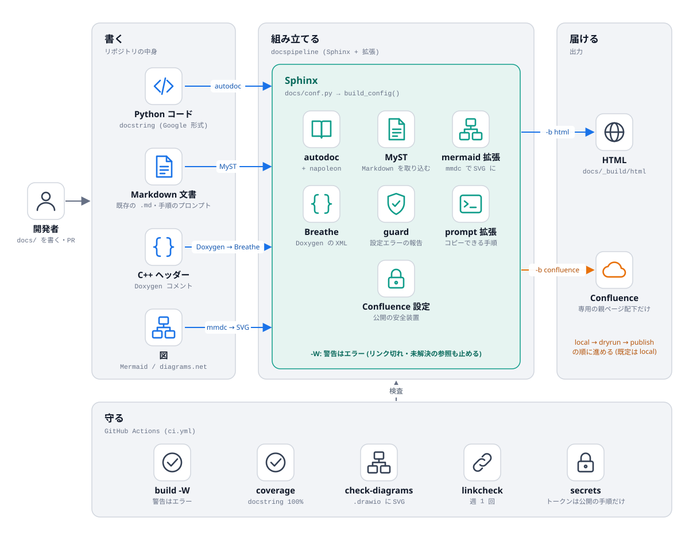

# DocsPipeline

コードの docstring から API 文書を自動生成し、構成図を加えて、Confluence に公開できるようにするための、共通設定と CLI。

- Python: Sphinx (autodoc + napoleon、Google 形式の docstring)
- 既存の Markdown 文書: MyST 経由でそのまま取り込む
- C++: Doxygen の XML を Breathe で Sphinx に取り込む
- 図: Mermaid をビルド時に SVG へ変換 / diagrams.net の `.drawio` と書き出した SVG
- 公開: Confluence (専用の親ページ配下だけ。既定は公開しない)
- Houdini の `hou` を使うコード: スタブで文書化・テスト



文書は [`docs/`](docs/) にあり、この道具自身で生成する (`docspipeline build docs`)。
保守・拡張する人は、[学習資料](docs/learn/index.md) から読む (全体像 → コードの読み方 → ビルドの内側 → 拡張のレシピ → テスト → 演習 → トラブルシュート)。

## クイックスタート

```bash
pip install "docspipeline[docs,cpp,confluence] @ git+https://github.com/manato1201/DocsPipeline"

# 対象リポジトリのルートで。docs/ の雛形と .github/workflows/docs.yml を作る (既存のファイルは上書きしない)
docspipeline init . --project "My Tool" --author "me" --package ../src
docspipeline build docs        # 警告をエラー扱いにしてビルド
```

別途必要なもの (使う機能だけ):

| 機能 | 必要なもの |
|---|---|
| Mermaid の図 | [`mmdc`](https://github.com/mermaid-js/mermaid-cli) (`npm install @mermaid-js/mermaid-cli`)。無ければ図はコードのまま表示される |
| C++ の文書 | `doxygen` |
| Confluence への公開 | `docs/` の extras `confluence` と、[環境変数](docs/confluence.rst) |

## コマンド

| コマンド | 内容 |
|---|---|
| `docspipeline init TARGET --project NAME --author A` | `docs/` の雛形と CI を作る。`--package` / `--cpp` / `--hou` |
| `docspipeline build [DOCS]` | ビルド。既定は `-W` (`--no-strict` で外す)、`-b confluence` で Confluence 形式 |
| `docspipeline coverage PATH...` | docstring が無い公開 API を一覧 (`--fail-under N`) |
| `docspipeline check-diagrams [DOCS]` | `.drawio` に書き出した SVG があるか |
| `docspipeline linkcheck [DOCS]` | 外部リンクの切れ |
| `docspipeline map PACKAGE` | ソースを構文解析して、モジュールの依存の地図 (Markdown の下書き / Mermaid / JSON) を作る。ローカルで読むだけで、外部へは送信しない。`--fail-on-cycle` |
| `docspipeline doctor` | 手元で使える機能 (`mmdc`・`doxygen`・設定の有無) を確認。トークンの値は出さない |
| `docspipeline confluence-check [DOCS]` | Confluence への接続・認証・権限の確認 (ページは変更しない) |
| `docspipeline publish [DOCS] --mode local\|dryrun\|publish` | 既定は `local` (ネットワークにつながない) |

## 公開の安全装置

- 既定は `local`。`dryrun` / `publish` は、必要な環境変数がすべて揃っていないと、ビルドを始める前に止まる
- 公開先は専用の親ページ配下だけ (`CONFLUENCE_PARENT_PAGE` が必須)。親ページの外の同名ページは上書きしない。今回の出力に無いページは消さない
- API トークンは環境変数だけ。CLI が起動した出力から、トークンの値は `***` に置き換わる
- 公開は CI の変数 `CONFLUENCE_PUBLISH=true` のときだけ、main への反映で実行する

## 構成図

図は `tools/diagrams/build_diagrams.py` の定義から、diagrams.net で開ける `.drawio` と、書き出し SVG を生成する
(`python tools/diagrams/build_diagrams.py`)。生成物が定義とずれると、`pytest` が落ちる。
図の足し方は [拡張のしかた](docs/learn/04-extend.md)。

| 図 | 内容 |
|---|---|
| [system-overview](docs/diagrams/system-overview.drawio.svg) | 書く・組み立てる・届ける・守る |
| [publish-flow](docs/diagrams/publish-flow.drawio.svg) | 公開の流れ (番号は実行順、赤は止まる条件) |
| [module-map](docs/diagrams/module-map.drawio.svg) | モジュールの依存 (読む順番の地図) |
| [build-internals](docs/diagrams/build-internals.drawio.svg) | Sphinx のビルドの内側 |

## 設計書のフェーズとの対応

| Phase | 状態 | 備考 |
|---|---|---|
| 0 雛形 | 済 | 共通の `conf.py` (`docspipeline.config`)、`init`、ページの雛形 (目的 / 見るポイント / 使うときの注意 / よくある誤り / 関連) |
| 1 Python (ProfilingTool) | **対象のリポジトリが無いため未着手**。代わりに [`examples/python_sample`](examples/python_sample) と、この文書自身で動作確認 | autodoc・日本語の docstring・Markdown の取り込み・reStructuredText の「概要」「設計」 |
| 2 横展開 + 図 | 仕組みは済。Hub / AssetDataInsightSuite は未着手 | Mermaid の画像化、diagrams.net の図 1 枚 (`docs/diagrams/`)、`check-diagrams` |
| 3 C++ (RAGReel) | 仕組みは済。RAGReel 自体は未着手 | Doxygen + Breathe を採用 (理由は [設計](docs/design.rst))。動作確認は [`examples/cpp_sample`](examples/cpp_sample) |
| 4 Confluence | 仕組みは済。**実環境では未検証** | 接続テスト → dryrun → publish。Confluence の環境が手元に無い |
| 5 CI | 済 (GitHub Actions を書いた。**まだ GitHub 上では走らせていない**) | PR ごとに `-W` ビルド、週 1 回 linkcheck、main で公開 |
| 6 ホスティング | 決めていない | まずローカルの HTML。公開先は、文書の内容 (個人・企業の情報) を確認してから |
| 7 更新の自動化 | 済 | CI・更新ルール ([運用手順](docs/runbook.md))・`hou` スタブ |
| Final | 済 | [運用手順](docs/runbook.md) |

追補の TakayuStudio 系 (T2 定型項目・T11 出力形式の表・T12 出典の注記) は反映した。
外部資料の追補のうち、Z16 (oh-my-mermaid) の「機械が読み取った事実と、人が書く理由を分けて持つ」考え方は、
**自前の** `docspipeline map` として実装した (外部ツールは導入せず、コードの情報を外部へ送らない。[学習資料](docs/learn/09-structure-map.md))。
X3 (graphify)・X7 (better-readme-skill)・Y9 (skills.sh のスキル) は、導入前に SKILL.md と監査結果を読む前提の提案で、取り込んでいない。
最新の追補の ASCII モチーフ (蚕・繭) も、実装していない。設計書が「出す場所は UI を作る段階で決める」としており、
DocsPipeline にはまだ UI が無い (理由は [設計](docs/design.rst))。
Graphify の地図との比較も、未実施。

## 未検証のこと

- Confluence の実環境への `dryrun` / `publish`、Mermaid の SVG が Confluence の画面で見えること
- 標準ライブラリの型の参照 (`pathlib.Path` など) が、intersphinx で解決されること。作業環境から `docs.python.org` に届かず、オフラインのモード (`DOCSPIPELINE_OFFLINE=1`) でしか確かめていない。CI (オンライン) で初めて確認される
- GitHub Actions の実行
- Python 3.13 以外 (CI は 3.11 と 3.13)
- 実際の ProfilingTool・ToolOrchestrationHub・AssetDataInsightSuite・RAGReel (Qt) のコード

## 開発

```bash
pip install -e ".[docs,cpp,confluence,dev]"
pytest              # 単体テスト + サンプルと自身の文書の実ビルド + 図の整合 (doxygen が無ければ C++ は飛ばす)
ruff check . && ruff format --check .
```
