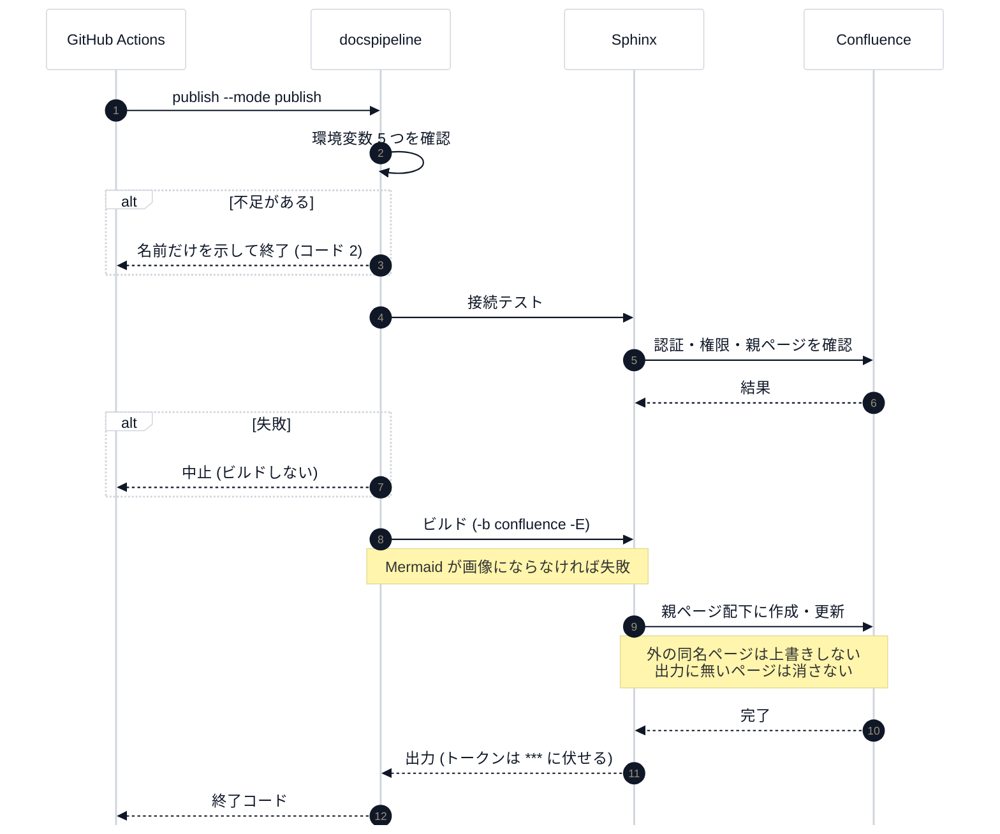

# Confluence への公開

## 目的

Sphinx の出力を、専用の親ページ配下に Confluence のページとして公開する。
公開には [sphinxcontrib-confluencebuilder](https://sphinxcontrib-confluencebuilder.readthedocs.io/) を使う。

## 公開の流れ

番号は実行順。`alt` は、**止まる条件** (不足・失敗) を表す。



手で描いた構成図 (diagrams.net):


## 見るポイント

公開は 3 つのモードで段階的に進める。モードは `--mode` (または環境変数 `DOCSPIPELINE_CONFLUENCE_MODE`) で決め、
**既定は local** (ネットワークにつながない)。

| モード | 挙動 |
|---|---|
| `local` | Confluence 形式の出力を `docs/_build/confluence` に作るだけ。公開しない |
| `dryrun` | 接続テストのあと、Confluence に接続して、何が作成・更新されるかを確認する。ページは変更しない |
| `publish` | 接続テストのあと、親ページ配下へ公開する |

```bash
$ docspipeline publish docs                    # local: 出力の確認
$ docspipeline confluence-check docs           # 認証・権限の確認
$ docspipeline publish docs --mode dryrun      # 乾燥実行
$ docspipeline publish docs --mode publish     # 公開
```

## 環境変数

`dryrun` と `publish` では、次の環境変数がすべて必要。不足していれば、ビルドを始める前に、**名前だけ** を示して止まる。

| 名前 | 内容 |
|---|---|
| `CONFLUENCE_SERVER_URL` | Confluence Cloud の URL (例: `https://example.atlassian.net/wiki/`) |
| `CONFLUENCE_SPACE_KEY` | 公開先のスペースキー |
| `CONFLUENCE_PARENT_PAGE` | 専用の親ページの題名。公開の対象は、この配下だけ |
| `CONFLUENCE_SERVER_USER` | Atlassian アカウントのメールアドレス |
| `CONFLUENCE_API_TOKEN` | API トークン。スコープ付きのトークンを使うときは `CONFLUENCE_API_TOKEN_SCOPED=true` も設定する |
| `CONFLUENCE_PAGE_PREFIX` (任意) | ページの題名の先頭に付ける文字列。既存ページとの題名の衝突を避けるのに使う |

## 手で編集したページを壊さないための設定

{py:func}`docspipeline.confluence.sphinx_settings` が、次を明示する。

| 守るもの | 設定 |
|---|---|
| 親ページ配下にだけ公開する | `CONFLUENCE_PARENT_PAGE` を必須にしている |
| 親ページ配下の外にある、同じ題名の既存ページ | 上書きせず、エラーで止まる (`confluence_publish_trample = False`) |
| 今回の出力に無いページ | 消さない・アーカイブしない (`confluence_cleanup_purge` / `confluence_cleanup_archive` を `False`) |
| 未解決のインラインコメントが付いたページ | 更新せず、警告を出す (`confluence_publish_skip_commented_pages = "ignored-resolved"`)。ページ全体へのコメントは、この対象に **入らない** |
| 更新の通知 | 抑える (`confluence_disable_notifications = True`) |

`publish` は警告をエラー扱いにしない (`--strict` で切り替える)。コメント付きのページを飛ばした警告で、
公開まで失敗させないため。文書の品質は `docspipeline build` (`-W`) が止める。

## トークンの扱い

- トークンは環境変数だけに置き、設定ファイル・文書・リポジトリに書かない。
- `docspipeline` が起動した Sphinx の出力は、トークンの値を `***` に置き換えて表示する
  ({py:func}`docspipeline.confluence.mask_secrets`)。
- CI では、トークンを GitHub の `secrets` に、それ以外を `vars` に置く。
  トークンは、**公開のステップだけ** に渡す (`pip` / `npm` のインストール scripts には見せない)。

## よくある誤り

- `publish` を指定したのに公開されない: 環境変数が不足していないか確認する。
  不足があれば、ビルドの前に止まり、終了コード 2 を返す。
- モードの綴りを間違えた: 黙って `local` に倒さず、エラーにする (公開したつもりで公開されない事故を防ぐ)。

## 検証できていないこと

実際の Confluence 環境 (アカウント・スペース) が手元に無いため、次は **未検証**。

- 実際の Confluence への `dryrun` / `publish`
- Mermaid から作った SVG が、Confluence の画面で正しく表示されること
  (Confluence 形式の出力に、画像が添付ファイルとして入るところまでは確認した)
- `confluence_publish_skip_commented_pages` などの挙動が、実際の Confluence で期待どおりか

環境を用意したら、まず専用のスペースの専用の親ページで `dryrun` を試すこと。

## 関連

- [運用手順](runbook.md)
- [出力形式ごとの取り決め](output-formats.md)
