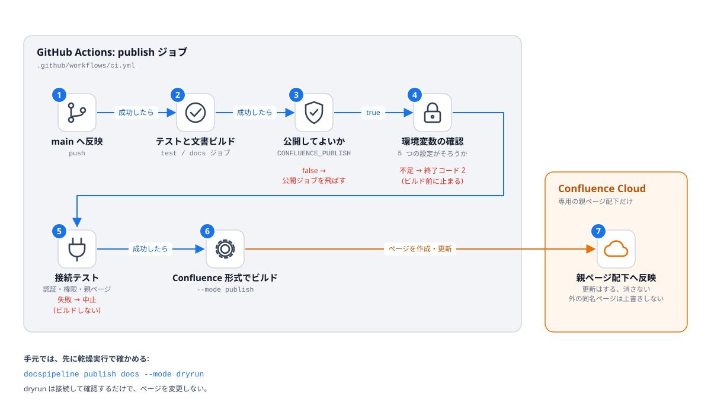

Confluence への公開
===================

目的
----

Sphinx の出力を、専用の親ページ配下に Confluence のページとして公開する。
公開には `sphinxcontrib-confluencebuilder <https://sphinxcontrib-confluencebuilder.readthedocs.io/>`_ を使う。

公開の流れ
----------

番号は実行順。赤字は、そこで止まる条件を表す。

見るポイント
------------

公開は 3 つのモードで段階的に進める。モードは ``--mode`` (または環境変数
``DOCSPIPELINE_CONFLUENCE_MODE``) で決め、**既定は local** (ネットワークにつながない)。

.. list-table::
   :header-rows: 1
   :widths: 15 85

   * - モード
     - 挙動
   * - ``local``
     - Confluence 形式の出力を ``docs/_build/confluence`` に作るだけ。公開しない。
   * - ``dryrun``
     - 接続テストのあと、Confluence に接続して、何が作成・更新されるかを確認する。ページは変更しない。
   * - ``publish``
     - 接続テストのあと、親ページ配下へ公開する。

.. code-block:: bash

   $ docspipeline publish docs                    # local: 出力の確認
   $ docspipeline confluence-check docs           # 認証・権限の確認
   $ docspipeline publish docs --mode dryrun      # 乾燥実行
   $ docspipeline publish docs --mode publish     # 公開

環境変数
--------

``dryrun`` と ``publish`` では、次の環境変数がすべて必要。不足していれば、ビルドを始める前に、
**名前だけ** を示して止まる。

.. list-table::
   :header-rows: 1
   :widths: 35 65

   * - 名前
     - 内容
   * - ``CONFLUENCE_SERVER_URL``
     - Confluence Cloud の URL (例: ``https://example.atlassian.net/wiki/``)
   * - ``CONFLUENCE_SPACE_KEY``
     - 公開先のスペースキー
   * - ``CONFLUENCE_PARENT_PAGE``
     - 専用の親ページの題名。公開の対象は、この配下だけ
   * - ``CONFLUENCE_SERVER_USER``
     - Atlassian アカウントのメールアドレス
   * - ``CONFLUENCE_API_TOKEN``
     - API トークン。スコープ付きのトークンを使うときは ``CONFLUENCE_API_TOKEN_SCOPED=true`` も設定する
   * - ``CONFLUENCE_PAGE_PREFIX`` (任意)
     - ページの題名の先頭に付ける文字列。既存ページとの題名の衝突を避けるのに使う

手で編集したページを壊さないための設定
--------------------------------------

:func:`docspipeline.confluence.sphinx_settings` が、次を明示する。

* 親ページ配下にだけ公開する (``CONFLUENCE_PARENT_PAGE`` を必須にしている)
* 親ページ配下の外にある、同じ題名の既存ページは上書きせず、エラーで止まる (``confluence_publish_trample = False``)
* 今回の出力に無いページを消さない・アーカイブしない (``confluence_cleanup_purge`` / ``confluence_cleanup_archive`` を ``False``)
* 未解決のインラインコメントが付いたページは更新せず、警告を出す (``confluence_publish_skip_commented_pages = "ignored-resolved"``)。
  ページ全体へのコメントは、この対象に **入らない**
* 更新の通知を抑える (``confluence_disable_notifications = True``)

``publish`` は警告をエラー扱いにしない (``--strict`` で切り替える)。コメント付きのページを飛ばした警告で、
公開まで失敗させないため。文書の品質は ``docspipeline build`` (``-W``) が止める。

トークンの扱い
--------------

* トークンは環境変数だけに置き、設定ファイル・文書・リポジトリに書かない。
* ``docspipeline`` が起動した Sphinx の出力は、トークンの値を ``***`` に置き換えて表示する
  (:func:`docspipeline.confluence.mask_secrets`)。
* CI では、トークンを GitHub の ``secrets`` に、それ以外を ``vars`` に置く。

よくある誤り
------------

* ``publish`` を指定したのに公開されない: 環境変数が不足していないか確認する。
  不足があれば、ビルドの前に止まり、終了コード 2 を返す。
* モードの綴りを間違えた: 黙って ``local`` に倒さず、エラーにする (公開したつもりで公開されない事故を防ぐ)。

検証できていないこと
--------------------

実際の Confluence 環境 (アカウント・スペース) が手元に無いため、次は **未検証**。

* 実際の Confluence への ``dryrun`` / ``publish``
* Mermaid から作った SVG が、Confluence の画面で正しく表示されること
  (Confluence 形式の出力に、画像が添付ファイルとして入るところまでは確認した)
* ``confluence_publish_skip_commented_pages`` などの挙動が、実際の Confluence で期待どおりか

環境を用意したら、まず専用のスペースの専用の親ページで ``dryrun`` を試すこと。

関連
----

* :doc:`runbook`
* :doc:`output-formats`
