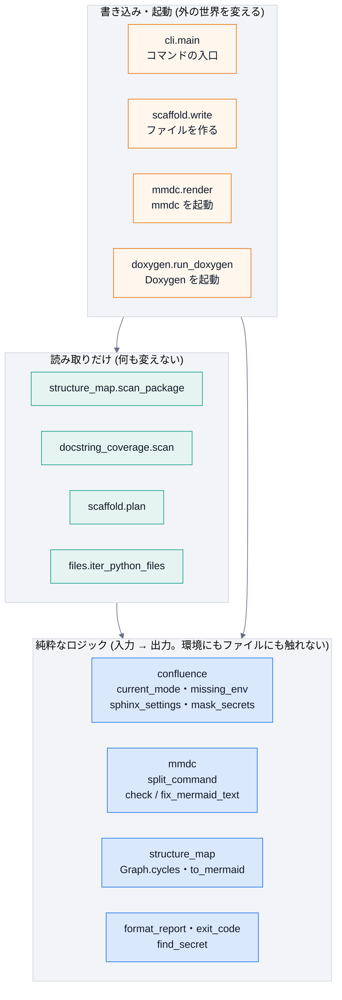

# 契約と副作用の境界

## 目的

主な関数に、**事前条件・事後条件・不変条件** (「契約」) を書き、**どの層に属するか** (純粋 / 読み取り / 書き込み・起動) を示す。
契約は、AI に実装や変更を頼むときの **指示文** になり、**そのままテストの種になる**。
読む人は、**純粋な層は仕様を読めば足り、副作用の層だけを深く読めばよい**。

## 見るポイント

### 契約の三つの言葉

| 言葉 | 意味 | docstring のどこに書くか |
|---|---|---|
| 事前条件 | 呼ぶ側が守ること。破ると、関数は **例外で止まる** (黙って続けない) | `Args:` と `Raises:` |
| 事後条件 | 関数が約束する結果 | `Returns:` |
| 不変条件 | **常に** 成り立つこと。入力や環境が変わっても崩れない | 関数・クラスの説明と、このページの表 |

### 副作用の境界

関数を、**外の世界に触れるか** で三つの層に分ける。**外側の層が、内側の層を呼ぶ**。内側は、外側を知らない。

| 層 | 触れてよいもの | 触れないもの | テストの方法 |
|---|---|---|---|
| **純粋** | 引数だけ。環境変数は **引数で受ける** (`environ`) | ファイル・環境変数 (`os.environ`)・子プロセス・ネットワーク | I/O を禁じた状態で呼び、**同じ入力なら同じ出力** を確かめる |
| **読み取り** | ファイルの読み取り・ディレクトリの列挙 | 書き込み・子プロセス・ネットワーク | 前後で **ディレクトリの中身が同じ** ことを確かめる |
| **書き込み・起動** | ファイルの書き込み・子プロセス | (制限なし。ただし、安全の約束を守る) | 偽物に差し替える (第 10 回) |

> 純粋な関数に `environ=None` (省略すると `os.environ`) を許しているのは、**呼び出しの手軽さのため** です。
> 純粋として扱うのは、**引数 `environ` を渡したとき** です。テストは、必ず渡します。

### 読む範囲の決め方

レビューの負担を減らすため、**深く読む対象を絞ります**。

| 層・性質 | 読み方 | 理由 |
|---|---|---|
| 純粋・不変の値 | **仕様 (このページの契約) を読めば足りる**。実装は、テストが通っていれば、細部まで追わなくてよい | 入力と出力だけで決まり、周りに影響しない |
| 読み取り | 契約と、**何を読むか** (どのディレクトリ・どの除外) を確かめる | 読み違えると、検査が空になる (第 9 回の事故) |
| 書き込み・起動 | **実装を深く読む**。特に、秘密・上書き・削除・外部への送信 | 取り返しのつかない変更が起きる場所 |
| 秘密を扱うもの (`mask_secrets`・トークン) | 層に関わらず、**深く読む** | 漏れると被害が大きい |

## 契約の表

「検証するテスト」は、**実在すること** を `tests/test_contracts.py` が確かめる。
「純粋」「読み取り」の層は、**その層の約束を守っていること** も、同じテストが確かめる。

| 関数 | 層 | 事前条件 | 事後条件 | 不変条件 | 検証するテスト |
|---|---|---|---|---|---|
| `confluence.current_mode` | 純粋 | `environ` が、文字列から文字列への対応 | `local`・`dryrun`・`publish` のいずれかを返す。未設定なら `local` | 大文字小文字・前後の空白を区別しない。**知らない値は、`local` に倒さず例外** | `tests/test_confluence.py::test_default_mode_is_local` `tests/test_confluence.py::test_typo_in_mode_is_an_error_not_a_silent_local` `tests/test_contracts.py::test_current_mode_contract` |
| `confluence.missing_env` | 純粋 | 同上 | 必須の環境変数のうち、未設定・空のものの **名前だけ** を、定義の順に返す | 値は、戻り値に入らない | `tests/test_confluence.py::test_publish_requires_every_setting_and_reports_names_only` `tests/test_contracts.py::test_missing_env_contract` |
| `confluence.sphinx_settings` | 純粋 | `dryrun`・`publish` では、必須の環境変数が全て揃っている (足りなければ `ConfluenceSettingsError`) | `local` では公開しない。`dryrun` は接続するが変更しない。`publish` は親ページ配下に反映する | **どのモードでも**: 上書き・削除・アーカイブをしない。未解決のコメントのあるページを更新しない。`local` には、接続先・トークンが入らない。引数を書き換えない | `tests/test_confluence.py::test_local_never_publishes_even_if_the_environment_says_so` `tests/test_confluence.py::test_local_keeps_the_safety_settings` `tests/test_contracts.py::test_sphinx_settings_contract` |
| `confluence.mask_secrets` | 純粋 | なし (任意の文字列) | トークンの値 (8 文字以上) を `***` に置き換えた文字列 | トークンの値が、結果に **残らない**。トークンを含まない文字列は、変わらない。**冪等** | `tests/test_confluence.py::test_mask_secrets` `tests/test_confluence.py::test_mask_secrets_ignores_trivially_short_values` `tests/test_contracts.py::test_mask_secrets_contract` |
| `mmdc.split_command` | 純粋 | なし | コマンドの文字列を、引数の列に分ける | `windows=True` では、`\` を消さない | `tests/test_robustness.py::test_split_command_keeps_backslashes_on_windows` |
| `mmdc.check_mermaid_text` | 純粋 | なし | 標準の `%%{init}%%` が無い Mermaid ブロックの、開きの行の一覧 | 直したあと (`fix_mermaid_text`) の結果は、必ず空 | `tests/test_mermaid_style.py::test_check_reports_blocks_without_the_init_line` `tests/test_contracts.py::test_fix_mermaid_text_contract` |
| `mmdc.fix_mermaid_text` | 純粋 | なし | 全ての Mermaid ブロックの先頭に、標準の行がある文章 | **冪等**。ブロックの外は変えない。閉じていないブロックでも止まる | `tests/test_mermaid_style.py::test_fix_inserts_the_line_and_is_idempotent` `tests/test_mermaid_style.py::test_other_code_blocks_and_text_are_untouched` `tests/test_contracts.py::test_fix_mermaid_text_contract` |
| `structure_map.Graph.cycles` | 純粋 | なし | `import` の循環を、強連結成分の一覧で返す (無ければ空) | 各成分は 2 つ以上のモジュールで、整列されている。呼ぶ順序に依存しない | `tests/test_structure_map.py::test_cycles_and_entry_points` `tests/test_contracts.py::test_graph_contract` |
| `structure_map.to_mermaid` | 純粋 | なし | 依存の地図を、Mermaid のコードにする | 同じ地図なら、同じ文字列 (決定的) | `tests/test_structure_map.py::test_renderers` `tests/test_contracts.py::test_graph_contract` |
| `structure_map.Graph.labeled_edges` | 純粋 | なし | 全ての依存を `(使う側, 使われる側, 種類, 札)` で、整列して返す。札は `EXTRACTED` (読んだ) か `INFERRED` (推測) | **`import`・`deferred` は必ず `EXTRACTED`、`reference` は必ず `INFERRED`**。推測を、読んだことにしない。同じ地図なら同じ結果で、モジュールの並びに依存しない | `tests/test_structure_map.py::test_edge_labels_follow_the_kind_of_dependency` `tests/test_contracts.py::test_labeled_edges_contract` |
| `structure_map.to_markdown` | 純粋 | なし | アーキテクチャ文書の下書きを、Markdown で返す | 全ての依存が札つきの表に **ちょうど 1 回** 出る。**推測の依存は、モジュール一覧でも `(推測)` と分かる**。冒頭の警告と札の見方が、必ず入る | `tests/test_structure_map.py::test_markdown_shows_which_facts_were_read_and_which_were_guessed` `tests/test_contracts.py::test_to_markdown_contract` |
| `docstring_coverage.format_report` | 純粋 | なし | docstring が無い項目と、割合の文字列 | 対象が無ければ 100% | `tests/test_docstring_coverage.py::test_percent_and_format` `tests/test_docstring_coverage.py::test_empty_report_is_fully_covered` |
| `doctor.exit_code` | 純粋 | なし | 必須の項目が 1 つでも失敗していれば 1、でなければ 0 | 必須でない項目の失敗は、終了コードに影響しない | `tests/test_doctor.py::test_required_failures_set_the_exit_code` |
| `messages.format_error` | 純粋 | 何が起きた・なぜ・次にどうする、の 3 つが、どれも空でない (空なら `ValueError`) | `ラベル: 何が起きた` / `  原因: …` / `  次の一手: …` の 3 行 | 改行を含まない入力なら、**常にちょうど 3 行**。同じ入力なら同じ出力 | `tests/test_usability.py::test_format_error_has_three_lines_what_why_next` `tests/test_usability.py::test_format_error_refuses_an_empty_part` `tests/test_contracts.py::test_format_error_contract` |
| `messages.format_elapsed` | 純粋 | なし | 秒数を `12.3 秒` / `1 分 5 秒` の形にする | 負の値は 0 として扱う。59.96 秒は `1 分 0 秒` (`60.0 秒` にしない) | `tests/test_usability.py::test_format_elapsed` |
| `doctor.format_checks` | 純粋 | なし | 確認の結果を、1 項目 1 行で。失敗した項目にヒントがあれば、「次の一手」の行を足す | **成功した項目には、次の一手を出さない**。値は出さない (名前だけ) | `tests/test_usability.py::test_doctor_tells_the_next_step_only_for_items_that_are_not_ok` `tests/test_usability.py::test_doctor_hints_never_contain_secret_values` |
| `prompt.find_secret` | 純粋 | なし | 秘密らしき `名前=値` があれば、**値を伏せた** 形で返す。なければ `None` | 戻り値に、値が含まれない。プレースホルダー・環境変数の名前は、秘密とみなさない | `tests/test_prompt.py::test_secret_like_values_are_found_and_not_echoed` `tests/test_prompt.py::test_names_and_placeholders_are_not_secrets` |
| `structure_map.scan_package` | 読み取り | パッケージの場所に `__init__.py` がある (無ければ例外) | モジュールごとの依存を持つ地図 | **ソースを読むだけ** (`import` も実行もしない)。何も書かない | `tests/test_structure_map.py::test_a_directory_without_init_is_rejected` `tests/test_contracts.py::test_read_only_functions_change_nothing` |
| `docstring_coverage.scan` | 読み取り | 渡した場所が、実在する (CLI が先に確かめる) | 公開 API の docstring の有無の集計 | 何も書かない。仮想環境・キャッシュを数えない | `tests/test_docstring_coverage.py::test_scan_skips_virtualenv_and_cache_dirs` `tests/test_contracts.py::test_read_only_functions_change_nothing` |
| `scaffold.plan` | 読み取り | なし | 書き出すファイルと中身の対応 | **ファイルに触れない**。同じ指定なら、同じ結果 | `tests/test_cli.py::test_init_creates_a_python_project_scaffold` `tests/test_contracts.py::test_read_only_functions_change_nothing` |
| `files.iter_python_files` | 読み取り | なし | `.py` のファイルを、整列して返す | 仮想環境・外部のコードを返さない。何も書かない | `tests/test_robustness.py::test_api_modules_skip_virtualenvs_and_vendored_code` `tests/test_contracts.py::test_read_only_functions_change_nothing` |
| `scaffold.write` | 書き込み・起動 | 既存のファイルが無い (`force` のときを除く) | 作ったファイルの一覧 | **既存のファイルがあれば、1 つも書かずに止まる** | `tests/test_cli.py::test_init_refuses_to_overwrite_without_force` |
| `mmdc.render` | 書き込み・起動 | `mmdc` が実行できる | Mermaid の画像のファイル | 同じ図は再変換しない。**半端なファイルを、他が読まない** (原子的な置き換え) | `tests/test_mermaid.py::test_render_writes_an_svg_and_reuses_it` `tests/test_mermaid.py::test_render_failure_reports_the_reason` |
| `cli.main` | 書き込み・起動 | なし | 終了コード (成功 0、失敗 1、使い方の誤り 2、Ctrl-C で中断 130) | **トークンの値を、出力に出さない**。`build` は公開しない。**エラーは、何が起きた / なぜ / 次の一手の 3 行**。長い処理は、進み具合と完了を示す | `tests/test_cli.py::test_build_never_publishes_even_if_the_environment_asks_to` `tests/test_cli.py::test_run_masks_the_token_in_child_output` `tests/test_usability.py::test_every_error_says_what_why_and_the_next_step` `tests/test_usability.py::test_ctrl_c_stops_the_child_and_says_what_to_do_next` |
| `doxygen.run_doxygen` | 書き込み・起動 | `doxygen` が実行できる (無ければ拡張のエラー) | Doxygen の XML | 警告は、Sphinx の警告として転送される | `tests/test_build.py::test_missing_doxygen_is_an_error_unless_skipped` |

(この表の関数名は、`docspipeline` パッケージの中の名前。`Graph.cycles` のように、クラスのメソッドも書く。)

## 使うときの注意

* **契約を変えるときは、表とテストを同じ変更で直す**。表だけ・テストだけを直すと、`tests/test_contracts.py` が食い違いを見つける。
* 新しい関数を足すときは、**まず層を決める**。純粋にできるものは純粋にする (引数で受け取り、結果を返す)。外の世界に触れる部分だけを、薄い外側に置く。
* 純粋な層で、`open`・`os.environ`・`subprocess` などを使う変更は、`tests/test_contracts.py` の **I/O を禁じた実行** が止める。
* 事前条件の違反は、**黙って直さず、例外で止める** (第 9 回の「早く止まる」)。

## よくある誤り

* **「純粋」と書いたのに、省略した引数で `os.environ` を読んでいる**。テストは、`environ` を渡したときだけを純粋とみなす。
  省略したときの動作は、呼ぶ側 (CLI) の責任。
* **契約を実装のコピーにする**。「`for` で回して…」ではなく、**結果の性質** (冪等・整列済み・値が残らない) を書く。性質は、実装を変えても残る。
* **不変条件を、1 つの例のテストで済ませる**。不変条件は、**いろいろな入力で** 成り立つことを確かめる (表のテストは、複数の入力を試す)。

## 関連

* [設計](design.md): 依存の向きと、判断の記録
* [テストの書き方](learn/05-testing.md)
* [講義 第 10 回 テスト](lecture/10-testing.md)
