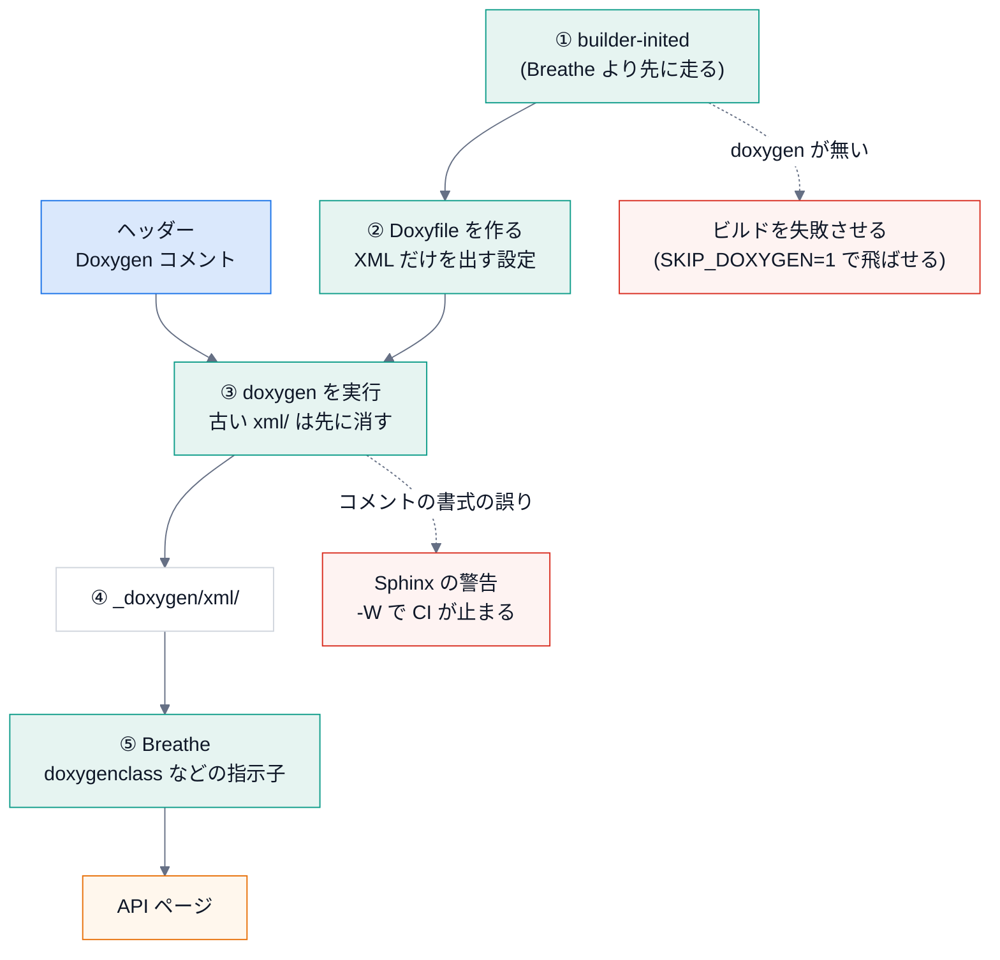

# C++ の文書 (Doxygen + Breathe)

## 目的

C++ のヘッダーのコメントから、Python と同じ Sphinx の文書に API を取り込む。

## 仕組み



1. `build_config(cpp_sources=[...])` を指定すると、Breathe と {py:mod}`docspipeline.doxygen` が有効になる。
2. Sphinx のビルドの最初に、{py:mod}`docspipeline.doxygen` が Doxyfile を作って `doxygen` を走らせ、
   XML を `docs/_doxygen/xml` に出す。古い XML は、先に消す (消した関数が文書に残り続けないように)。
3. 文書の側で `doxygenclass` などの指示子を使って、取り込む API を選ぶ。

```text
.. doxygenclass:: sample_engine::Index
   :members:
```

## 見るポイント

- 関数名・クラス名は、Doxygen がコードから読み取った名前がそのまま出る。手で書き写さない。
- Doxygen のコメントの書式の誤りは、Sphinx の警告として転送される。`-W` で CI が止まる。
- `examples/cpp_sample` が動作確認用のサンプル。

## 使うときの注意

- `doxygen` 本体は別途インストールする (`apt install doxygen` など)。
  無いとビルドは失敗する。手元で飛ばしたいときは `DOCSPIPELINE_SKIP_DOXYGEN=1` と `docspipeline build --no-strict`
  を組み合わせる (C++ の指示子が「XML が無い」という警告になる。`-W` のままでは失敗する)。
- コメントが無いこと自体は警告にならない (`WARN_IF_UNDOCUMENTED = NO`)。
  コメントの網羅は、`doxygenclass` の出力を目で確認する。`docspipeline coverage` は Python だけを対象にする。
- 実際の RAGReel (Qt / C++) のコードでは、まだ試していない。Qt のマクロ (`Q_OBJECT` など) が
  Doxygen に与える影響は、着手時に `cpp_predefined` で調整する。
