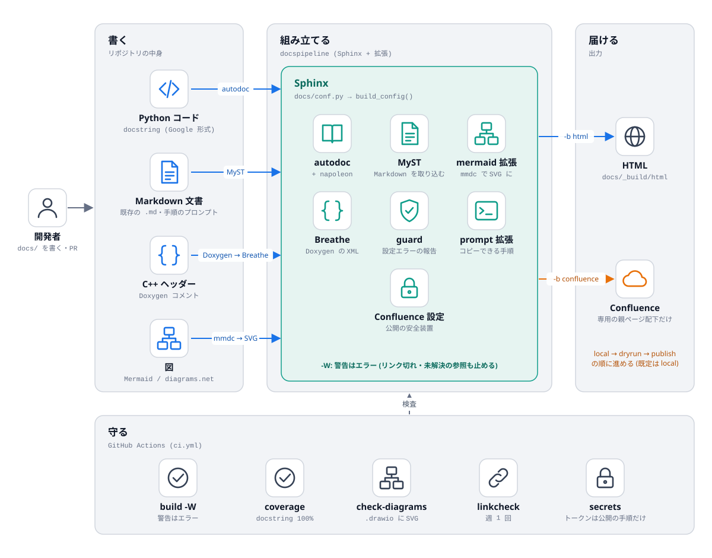
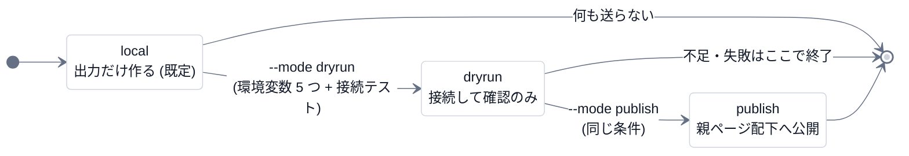
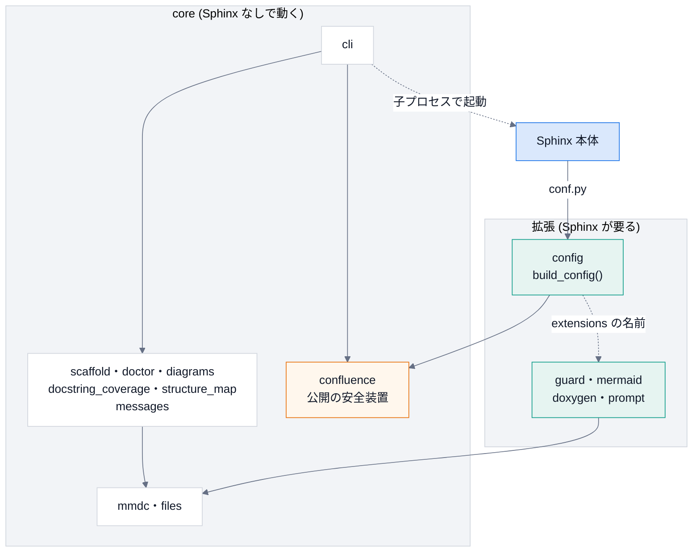
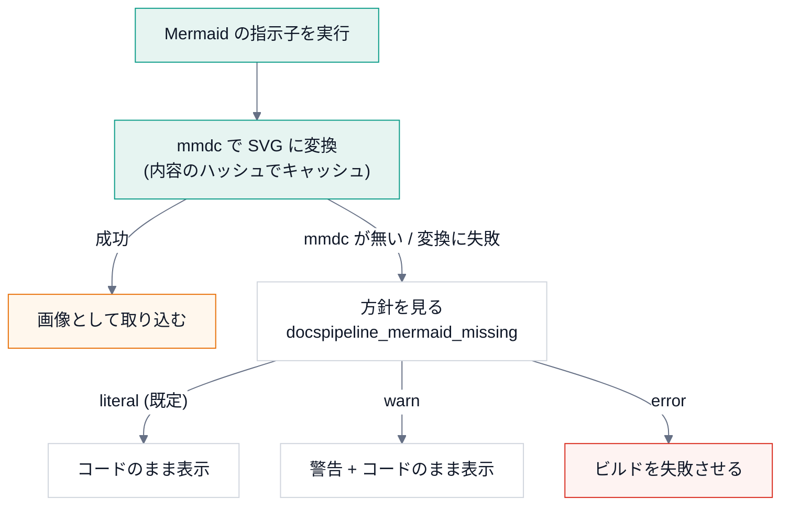

# 設計

## 全体の流れ

「書く」ものを、Sphinx と拡張が「組み立て」、HTML と Confluence に「届ける」。下の「守る」は、CI が毎回確かめる項目。
青い矢印は入力、オレンジは公開の経路を表す。

図は diagrams.net で開ける `.drawio` と、書き出した `.drawio.svg` の両方をリポジトリに置く。
生成の仕方と、図の足し方は [拡張のしかた](learn/04-extend.md) を参照。`docspipeline check-diagrams` が、書き出しの漏れを確認する。

## 設計方針

1. **既存の Markdown 文書を捨てない。** Sphinx 側で Markdown を読めるようにする (MyST)。
   読み物は Markdown (Mermaid の図つき) で書き、API リファレンスだけを reStructuredText で書く。
2. **生成物はコードの隣に置く。** 各リポジトリの `docs/` に `conf.py` を置き、共通の設定は
   {py:func}`docspipeline.config.build_config` から読み込む。
3. **公開は最後の工程。** 既定は `local` モードで、ネットワークにつながない。
4. **秘密情報は環境変数のみ。** API トークンを設定ファイルや文書に書かない。出力からも伏せる。

## 公開モード

公開は、段階を **一つずつ** 進める。既定は `local`。環境変数の不足や接続テストの失敗は、その場で止まる。

## 依存の向き

`docspipeline` のモジュールは、Sphinx に依存するかどうかで二つに分かれる。
**core は Sphinx が無い環境でも動く**。Sphinx を `import` してよいのは、拡張だけ。

実際の依存は、`docspipeline map docspipeline` で機械的に読み取れる ([機械の地図](learn/09-structure-map.md))。
`tests/test_structure_map.py` が、この向きを検査する。

## 判断の記録

### Doxygen と Sphinx の連携方式

Breathe を採用した。

- Breathe は Doxygen の XML を Sphinx の指示子 (`doxygenclass` など) で取り込む。
  取り込む対象を文書の側で選べるので、公開したい API だけを出せる。
- HTML をそのまま埋め込む方式は、Confluence に載せられないので除いた。
- ページを自動生成する方式は、生成したページの階層が Confluence の親ページ配下の階層と
  噛み合うか、確認できていないので採らなかった。
- どの方式も RAGReel の実際のコードでは試していない。ここでの比較は、サンプルのコードでの動作確認と、
  各拡張の説明に基づく。

### Mermaid の扱い

ビルド時に SVG へ変換し、HTML でも Confluence でも同じ画像を取り込む。文字は HTML ではなく SVG の
`<text>` で描かせる (`htmlLabels: false`)。画像として取り込む先で文字が消えるのを避けるため。
`mmdc` が無いときの挙動は `docspipeline_mermaid_missing` で決める。

| 値 | 挙動 |
|---|---|
| `literal` (既定) | コードをそのまま表示する |
| `warn` | 警告を出して、コードをそのまま表示する |
| `error` | ビルドを失敗させる。CI では `docspipeline build --require-mermaid` で、この値になる |

図の色とフォントは、GitHub (Markdown のまま) と HTML で揃える。各ブロックの 1 行目に、標準の `%%{init}%%` の行を置き、
`docspipeline check-mermaid` が確かめる (`--fix` で入れられる)。`docspipeline mermaid-style` が、その行と `classDef` の組を表示する。

### 外部資料 (Z16: oh-my-mermaid) の取り込み方

設計書の追補にある「コードから構造図と説明の階層を作る」という考え方を、**自前の** `docspipeline map` として実装した。
外部のツールは導入していない。

- 取り入れたもの: 「機械が読み取った事実 (依存の地図)」と「人が書く理由 (説明)」を **分けて持つ** 考え方。
  地図は事実なので毎回作り直せる。説明は人が書き、地図とのずれをテストで検出する。
- 導入しなかった理由: 外部ツールの中身 (SKILL.md・監査結果) を、この作業では確かめていない。また `omm push` のように、
  コードの情報を外部へアップロードする機能があるため、非公開のリポジトリには使えない。
  自前の `map` は、ローカルで読むだけで、何も送信しない。
- 比べていないもの: Graphify (X3) の地図との比較は、Graphify を導入していないので **未実施**。

出力は「下書き」として扱う。推定を含むので、人が確認してから使い、そのまま公開しない
(出力の冒頭に、その旨の警告が入る)。使い方と限界は [機械の地図](learn/09-structure-map.md)。

### ASCII モチーフ (提案) の扱い

設計書の最新の追補にある「ASCII モチーフ」(蚕・繭、実装系統 B) は、**実装していない**。

- 設計書の側が「出す場所は、UI を作る段階で決める」「本文・操作部品には出さない」としている。
  DocsPipeline には、いまのところ UI が無い (CLI と、Sphinx が作る静的な HTML だけ)。
  出す場所が決まっていないものを、先に作らない。
- 上流 (ascii-sharks) の動作は、設計書の側で確認済み (型検査・ビルド成功、60fps) になった。
  未確認なのは、各プロジェクトへ組み込んだときの負荷。出す場所が決まらないうちは、負荷も測れない。
- UI を作る段階で採るなら、`prefers-reduced-motion` では静止画 1 枚にし、既存の色だけを使う
  (設計書の条件)。HTML のテーマ (furo) に足す場合は、本文の可読性とページの重さを、先に測ること。

### 「Copy prompt」(Z19) の取り込み方

手順の説明に、そのまま Claude Code に渡せるプロンプトのコピーボタンを付ける、という考え方を、**自前の** Sphinx 拡張
({py:mod}`docspipeline.prompt`) として実装した。外部のコード・画像・文章は使っていない。

- 書き方は `.. prompt:: 題名` (Markdown では、コードフェンスの言語名の代わりに `{prompt}` と題名を書く)。
  使い方は [使い方](usage.md) を参照。
- 標準のノード (`container`・`paragraph`・`literal_block`) だけで組み立てる。独自のノードを作らないので、
  Confluence などのビルダーでも、**題名と普通のコードブロック** として出る (ボタンは出ない)。
- ボタンは JavaScript で足す。JavaScript が無ければ、ボタンが無いだけで、本文は読めて、選択してコピーできる。
  `https` でないページ (`file://` など) では、`navigator.clipboard` の代わりに、選択して `copy` の命令を使う。
- 新しい色は足さない。テーマ (furo) の色の変数を使うので、ライトとダークの両方に合う。動きも付けない。
- **プロンプトに秘密情報を入れない**。トークンらしき `名前=値` の形があれば、値を伏せた警告を出す (`-W` で失敗)。
  手順書は広く読まれ、コピーされて、別の場所に貼られるため。

### PDFMathTranslate (Z31) は取り込まない

英語の PDF 資料を、レイアウトを保って日本語にする候補。設計書の方針どおり、**手元の道具としてのみ** 使い、
DocsPipeline には組み込まない。

- ライセンスが AGPL-3.0 で、コピーレフトが強い。このリポジトリのコード・依存・CI に入れると、
  このリポジトリのライセンスの扱いに影響しうる (法的な判断はしていない)。依存に足さず、コードを写さず、呼び出しもしない。
- DocsPipeline の目的 (docstring から API 文書を作り、公開する) と、直接のつながりが無い。
- 動作・翻訳の質・入力した PDF の扱い (外部へ送られるか) は、確かめていない。使うなら、導入前に確認する。

### 契約と副作用の境界 (Z39) の取り込み方

設計書の第 5 弾の追補 (Z39) の考え方を、このリポジトリの **設計の約束** として取り入れた。外部のコードは使っていない。

- **契約の欄**: 主な関数に、事前条件・事後条件・不変条件を書く ([契約の表](contracts.md))。
  docstring の `Args` / `Raises` が事前条件、`Returns` が事後条件に当たる。契約は、AI に実装や変更を頼むときの指示文になる。
- **契約からテストを作る**: 表の各行に、検証するテストを対応づけた。不変条件は、1 つの例ではなく **いろいろな入力** (乱数の種を固定した
  生成・総当たりとの突き合わせを含む) で確かめる (`tests/test_contracts.py`)。表の関数とテストが実在することも、同じテストが確かめる。
- **副作用の境界**: 関数を、純粋 / 読み取り / 書き込み・起動の 3 層に分けた。外側の層が内側を呼ぶ。
  **純粋** の層は、`open`・`os.environ`・子プロセス・ネットワークを禁じた状態で呼んでも動き、同じ入力なら同じ出力になる
  (違反すると、テストが失敗する)。**読み取り** の層は、前後でディレクトリの中身が変わらない。
- **読む範囲の決め方**: 純粋な層は仕様を読めば足りる。書き込み・起動の層と、秘密を扱う部分 (`mask_secrets` など) は、深く読む。
  レビューの負担を、この線引きで減らす。

純粋な関数が、`environ=None` (省略すると `os.environ`) を許している点には、注意がいる。省略したときは純粋でなくなるので、
テストは、必ず `environ` を渡して確かめる。**この追補を取り入れる過程で、既存の関数に契約違反は見つからなかった** (3 通りの変異で、テストが失敗することは確かめた)。

### 使いやすさの提案 (UX1〜UX7) の取り込み方

設計書の側の「使いやすさの提案」(2026-11-04) は、全プロジェクト共通の 7 項目を挙げ、DocsPipeline には
「実装を始めるときに、UX1・UX2・UX4 を最初の部品として入れる」と書いている。DocsPipeline は **画面を持たない CLI** なので、
画面向けの項目は、CLI に置き換えられるものだけを取り入れた。提案の根拠は、設計書の語句の数え上げで、**アプリは操作されていない**
(この実装でも、手元の端末で動かして確かめたのは、テストが再現できる範囲まで)。

| 項目 | 取り込み | 中身 |
|---|---|---|
| **UX4 エラーの書き方の型** | 実装 | 何が起きた / なぜ / 次の一手の 3 行 (`messages.format_error`)。CLI の全てのエラーが通り、3 つのどれかが空だと例外。テストが、全てのエラーの経路で 3 行の形を確かめる |
| **UX2 進捗・取り消し・完了通知** | 実装 (CLI の範囲) | 始まり・終わり (経過時間)・`publish` の `[1/3]` の段階表示。**Ctrl-C** で子プロセスを止め、終了コード 130 (失敗とは区別)。端末の外への通知 (メール・チャット) は、CI の仕事で、実装していない |
| **UX6 空状態に「次の一手」** | 実装 (CLI の範囲) | `doctor` の使えない機能に、入れるコマンドなどを添える。成功した HTML のビルドに、開く場所を示す。`init` は、元から次の手順を示していた |
| UX1 取り消しと履歴 | 一部 | 画面の Undo は当たらない。代わりに **壊す操作を絞った**: `init` は既存を上書きしない (`--force` のときも、先にコミットして差分で戻せる、と案内する)。`check-mermaid` は `--fix` なしが確認だけ。公開は消さない。履歴の仕組みは作らない |
| UX5 続きから再開 | 未実装 | Sphinx の増分ビルドは、変わっていない文書を飛ばすが、**中断後の再実行が続きから動くかは、確かめていない** |
| UX3 状態を URL に | 対象外 | CLI に URL は無い。HTML 版は静的なので、ページごとの URL とアンカーで共有できる |
| UX7 キー操作・コマンドパレット | 未実装 | CLI のシェル補完 (`argcomplete` など) は、依存を増やすので、必要が出るまで入れない |

## 設計書の追補と、この実装での扱い

設計書の追補は、日付順に積まれている。**同じ話題が複数の追補にあるときは、新しい日付を優先する**。

| # | 追補 | 日付 | 設計書の状態 | この実装での扱い |
|---|---|---|---|---|
| 1 | 実務で運用するための拡張 | 2026-10-11 | — | Phase 5 (CI)・7 (更新の自動化)・`hou` のスタブは実装。Phase 6 は、ローカルの HTML と `site/` まで。Confluence の実環境は **未検証** |
| 2 | TakayuStudio 系 (T2・T11・T12) | 2026-10-15 | 提案 | 実装済み: 定型項目の雛形・[出力形式の表](output-formats.md)・ページ末尾の出典の注記 |
| 3 | 外部リソース (X3・X7・X16・Y9) | 2026-10-22 | 提案 | X16 (番号つきの図) は実装。X3 は、自前の `docspipeline map` で代える。X7・Y9 は、導入前に SKILL.md を読む前提で、取り込んでいない |
| 4 | 外部リソース 第 2 弾 (Y9) | 2026-10-23 | 提案 | 取り込んでいない (同上) |
| 5 | 外部リソース 第 3 弾の続き (Z16) | 2026-10-27 | 提案 | 自前の `docspipeline map` として実装 (上の「外部資料 (Z16: oh-my-mermaid) の取り込み方」) |
| 6 | ASCII モチーフ | 2026-10-27 | 提案・未実装 | 実装していない (出す場所が決まっていない) |
| 7 | 第 4 弾 (Z19・Z31) | 2026-10-30 | 提案・未実装 | Z19 は実装 (`prompt` 拡張)。Z31 は、ライセンス (AGPL-3.0) のため取り込まない |
| 8 | 第 5 弾 (Z39・副作用の境界・読む範囲) | 2026-11-02 | 提案・未実装 | 実装 (上の節と [契約の表](contracts.md)) |
| 9 | 使いやすさの提案 (UX1〜UX7) | 2026-11-04 | 提案・未実装 | 一部実装: UX4・UX2・UX6 (CLI の範囲)。UX1 は一部、UX5・UX7 は未実装、UX3 は対象外 (上の節) |

設計書の「追補の索引」が、状態の語彙の元。進み具合は、設計書の側の `IMPLEMENTATION_PROGRESS` を参照 (このリポジトリには、含まれない)。

## よくある誤り

- `docs/conf.py` で例外を投げる実装にすると、Sphinx がスタックトレースつきの内部エラーとして出す。
  設定の誤りは `docspipeline_config_error` に入れて、{py:mod}`docspipeline.guard` が報告する。
- **core のモジュールから、Sphinx を import するモジュールを import する**。`docspipeline` の CLI は、
  Sphinx が入っていない環境でも動く (`init`・`coverage`・`map`・`doctor`)。Sphinx に依存してよいのは
  拡張 (`guard`・`mermaid`・`doxygen`・`prompt`) だけで、`mmdc` の探索のように両方が使う部品は、Sphinx に依存しない
  {py:mod}`docspipeline.mmdc` に置く。`tests/test_structure_map.py` が検査する。
- `confluence_*` の設定は、未設定だと同名の環境変数から補われる。公開の可否に関わる項目は、
  {py:func}`docspipeline.confluence.sphinx_settings` がすべて明示している。

## 関連

- [Confluence への公開](confluence.md)
- [契約と副作用の境界](contracts.md)
- [運用手順](runbook.md)
