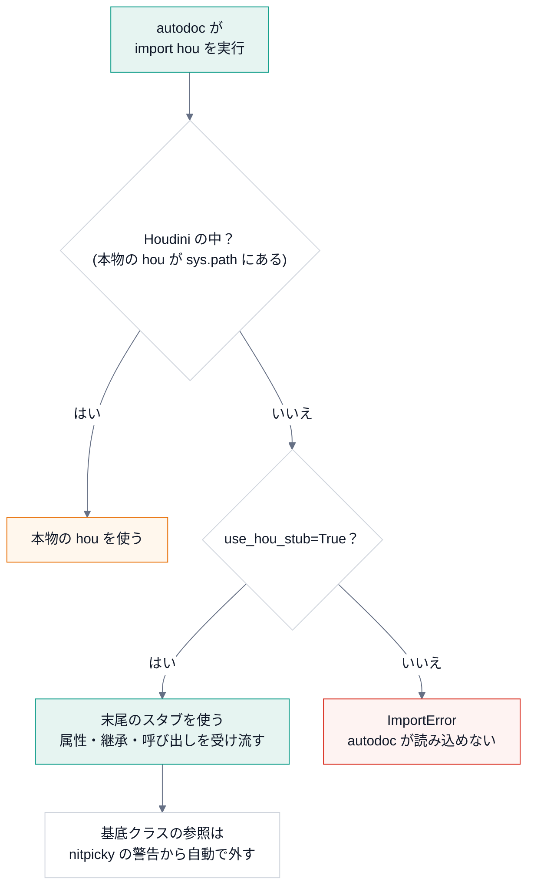

# Houdini の hou を使うコード

## 目的

Houdini の外では `import hou` ができない。`hou` を使うコードも、Houdini なしで autodoc とテストが通るように、
スタブ ({py:mod}`docspipeline.stubs.hou`) を共有する。

## 仕組み

スタブの場所は `sys.path` の **末尾** に足す。Houdini の中では、本物の `hou` が先に見つかる。



## 使い方

```python
config = build_config(confdir=__file__, project="X", author="me", package_paths=["../src"], use_hou_stub=True)
globals().update(config)
```

## 見るポイント

- スタブの場所は `sys.path` の **末尾** に足す。Houdini の中で `sphinx-build` を動かすと、本物の `hou` が使われる。
- `hou.Node` のような属性は、継承できるクラスとして返る。`hou.node("/obj")` のような呼び出しも通るが、
  何も実装していないので、返る値に意味は無い。
- スタブを継承したクラスの基底クラスは、文書の上でリンクにならない。nitpicky の警告からは自動で外れる。

## 使うときの注意

- テストで値を返す挙動が必要なら、テスト側で必要な関数だけを差し替える。スタブを育てて本物に近づけない。
- DCCPanelKit の `StandaloneHost` と共有する構想は、そのリポジトリが無いため、ここでは実装していない。
  スタブは単独のファイル (`docspipeline/stubs/hou.py`) なので、必要になったら `PYTHONPATH` で共有できる。
