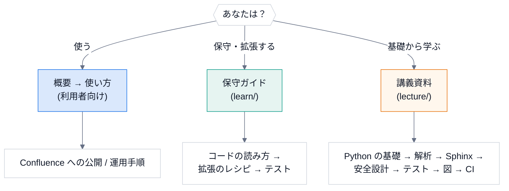

# DocsPipeline

docstring から API 文書を自動生成し、構成図を加えて、Confluence に公開するための共通設定と CLI。

## どこから読むか



| 読者 | 入口 |
|---|---|
| 文書を作って公開したい | [概要](overview.md) → [使い方](usage.md) → [Confluence への公開](confluence.md) |
| 保守・拡張したい | [保守ガイド](learn/index.md) |
| 基礎から、講義のように学びたい | [講義資料](lecture/index.md) (全 14 回。実行できる例と演習つき) |
| 文書を更新する | [運用手順](runbook.md) |

```{toctree}
:hidden:
:maxdepth: 2
:caption: 利用者向け

overview
design
usage
confluence
cpp
hou
output-formats
runbook
```

```{toctree}
:hidden:
:maxdepth: 2
:caption: 保守・拡張する人向け

learn/index
```

```{toctree}
:hidden:
:maxdepth: 1
:caption: 講義資料

lecture/index
```

```{toctree}
:hidden:
:caption: リファレンス

api
```
