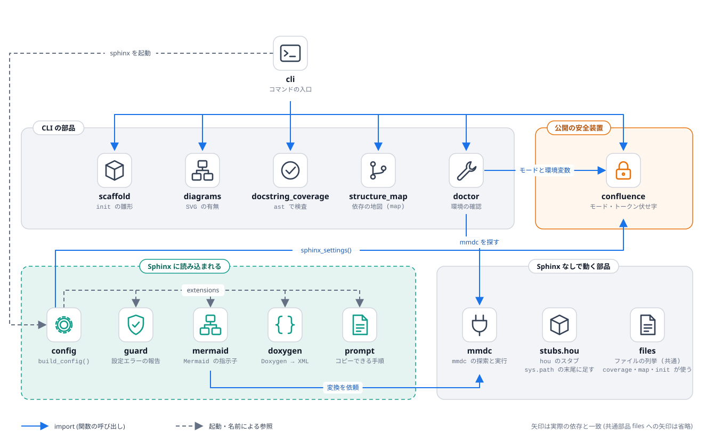

# コードの読み方

## 目的

どのファイルに何があり、**どの順に読めば迷わないか** を示す。



青の実線は import・関数の呼び出し、灰色の破線は別のプロセスの起動と、拡張の登録を表す。

## 見るポイント

### 読む順番

```{list-table}
:header-rows: 1
:widths: 6 24 70

* - 順
  - ファイル
  - 見るもの
* - 1
  - `docspipeline/confluence.py`
  - **一番短く、一番大事**。モード (`current_mode`)、必須の環境変数 (`REQUIRED_ENV`)、Sphinx に渡す設定 (`sphinx_settings`)、伏せ字 (`mask_secrets`)。外部に触れない純粋な関数だけで、テストしやすい作りの手本
* - 2
  - `docspipeline/config.py`
  - `build_config()`。引数が増えるたびにここを通る。上から順に「パスの登録 → 拡張の一覧 → nitpicky → 辞書の組み立て → Confluence 設定」
* - 3
  - `docspipeline/guard.py`
  - **一番小さな Sphinx 拡張** (30 行弱)。`setup()` と、イベントへの接続の最小の形
* - 4
  - `docspipeline/mermaid.py`
  - 外部コマンド (`mmdc`) を呼ぶ拡張。`find_mmdc` → `render` (ハッシュでキャッシュ) → `MermaidDirective.run` → `_fallback` (三つの方針)
* - 5
  - `docspipeline/doxygen.py`
  - もう一つの外部コマンドの例。`make_doxyfile` (文字列を作るだけ) と `run_doxygen` (実行) が分かれている
* - 6
  - `docspipeline/cli.py`
  - コマンドの入口。一つのコマンドは、一つの `cmd_*` 関数 + `build_parser` の一行
* - 7
  - `docspipeline/scaffold.py`、`diagrams.py`、`doctor.py`、`docstring_coverage.py`、`structure_map.py`
  - CLI から呼ばれる部品。どれも「計算」と「表示」が分かれている。`structure_map` は、この地図そのものを作る ([機械の地図](09-structure-map.md))
* - 7'
  - `docspipeline/mmdc.py`、`files.py`
  - `mmdc` の探索と実行、Python ファイルの列挙。どちらも **Sphinx に依存しない葉** で、複数のモジュールが共有する (`files.py` は、`coverage`・`map`・`init` で「探さない場所」の規則を揃える)
* - 7''
  - `docspipeline/prompt.py`、`static/`
  - コピーできるプロンプトの拡張 (`.. prompt::`)。標準のノードだけで組み立て、ボタンは `static/dp_prompt.js` が足す
* - 8
  - `docspipeline/stubs/hou.py`
  - 属性参照・継承・呼び出しをすべて受け流す偽物。`_Meta` と `_Any` の二段構え
* - 9
  - `tools/diagrams/kit.py`、`build_diagrams.py`
  - 図の定義 (パネル・カード・矢印) から、`.drawio` と SVG を作る
```

### 副作用の置き場所

読みやすさ・テストしやすさのために、**副作用 (ファイル・プロセス・ネットワーク) は端に寄せている**。

| 層 | 例 | 副作用 |
|---|---|---|
| 計算だけ | `confluence.sphinx_settings`、`doxygen.make_doxyfile`、`scaffold.plan`、`docstring_coverage.scan_file` | なし (入力 → 出力) |
| 薄い実行 | `doxygen.run_doxygen`、`mermaid.render`、`cli._run` | プロセスの起動・ファイル書き込み |
| 入口 | `cli.main`、各 `setup(app)` | 引数・Sphinx との接続 |

新しい機能も、**「計算」を先に関数にして単体でテストし、実行は薄く** 書く。

### 設定が流れる道

1. 利用者の `docs/conf.py` → {py:func}`docspipeline.config.build_config` → 辞書 → `globals().update`
2. 辞書の中の `docspipeline_*` は、各拡張の `setup()` が `add_config_value` で登録した名前
3. 登録されていない名前は、Sphinx に **黙って無視される** (Confluence の `confluence_*` も同じ。だから `tests/test_confluence.py` が名前の実在を確かめている)

## 使うときの注意

* `docspipeline.config` は import しただけでは何もしない。副作用は `build_config()` を **呼んだとき** に起きる (`sys.path` の変更、`_generated/confluence_footer.xhtml` の書き込み)。
* 拡張 (`mermaid`・`doxygen`・`guard`) は `import docspipeline` の時点では読み込まれない。Sphinx が `extensions` の名前から読み込む。

## よくある誤り

* **`cli.py` に計算を書き足す**。コマンドが長くなったら、部品を別のモジュールへ出す (`scaffold.py` は、そうして `cli.py` から出した)。
* **core のモジュールから、拡張 (Sphinx を import するもの) を import する**。Sphinx が無い環境で、CLI 全体が起動しなくなる (実際に起きた)。両方が使う部品は `mmdc.py` のように、Sphinx に依存しない別のモジュールへ ([機械の地図](09-structure-map.md))。
* **`os.environ` を関数の奥で直接読む**。環境変数は引数 (`environ: Mapping[str, str] | None`) として受け取り、テストで差し替えられるようにする。`confluence.py` が手本。

## 関連

* 地図を機械で作るには [機械の地図](09-structure-map.md)
* 次は [ビルドの内側](03-build-internals.md)
* 責務の一覧は [API リファレンス](../api.rst)
