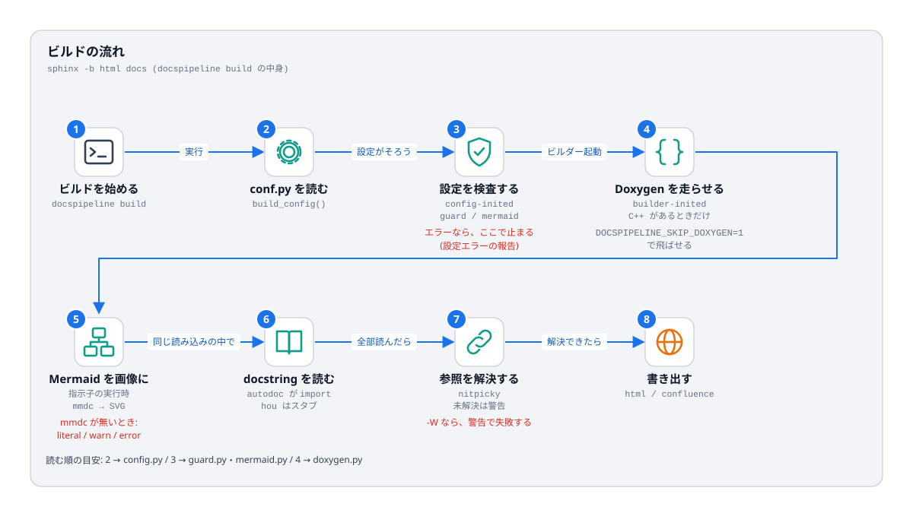

# ビルドの内側

## 目的

`sphinx -b html docs` を実行したとき、**どの順で、どのモジュールが働くか** を追えるようにする。
「ここで失敗した」と言われたときに、原因の候補を絞れる。



## 見るポイント

### 番号ごとの対応

```{list-table}
:header-rows: 1
:widths: 6 22 36 36

* - 番号
  - 段階
  - コードの場所
  - 失敗したときの見え方
* - 1
  - ビルドの開始
  - `cli.cmd_build` → `cli._sphinx`
  - `docspipeline: error` ではなく、Sphinx の出力がそのまま出る
* - 2
  - `conf.py` の実行
  - `config.build_config`
  - `conf.py` の例外は Sphinx が「設定ファイルにプログラムの誤り」と報告する
* - 3
  - 設定の検査
  - `guard._raise_config_error`、`mermaid._check_policy` (どちらも `config-inited`)
  - `Configuration error` と、DocsPipeline のメッセージ (環境変数が足りない、等)
* - 4
  - Doxygen の実行
  - `doxygen.run_doxygen` (`builder-inited`、`priority=100` で Breathe より先)
  - `doxygen が見つかりません` / `doxygen: ...` の警告
* - 5
  - Mermaid の変換
  - `mermaid.MermaidDirective.run`
  - `Mermaid をコードのまま表示します` (情報) / 警告 / エラー
* - 6
  - docstring の読み込み
  - Sphinx 標準の autodoc (`import` する)
  - `autodoc: failed to import ...` (パスや依存の不足)
* - 7
  - 参照の解決
  - Sphinx 標準 (`nitpicky = True`。`DOCSPIPELINE_OFFLINE=1` のときは切れる)
  - `reference target not found`
* - 8
  - 書き出し
  - ビルダー (`html` / `confluence`)
  - Confluence 形式では `unsupported code language` など
```

### 「優先度」と「順序」

`app.connect("builder-inited", handler, priority=100)` の `priority` は **小さいほど先**。Sphinx の既定は 500。
Doxygen の XML を、Breathe が読む前に作りたいので 100 にしている。
順序が大事な拡張を足すときは、イベントと優先度を図に書き足すこと。

### キャッシュと再実行

* Mermaid: `docs/_generated/mermaid/mermaid-<ハッシュ>.svg`。**コードが同じなら再変換しない**。ハッシュは、コード・形式・Mermaid の設定から作る。
* Doxygen: 毎回実行し、古い `xml/` を **先に消す** (消した関数が文書に残り続けるのを防ぐため)。
* Sphinx 自体の環境キャッシュ (`_build/.doctrees`) は、設定値が変わると作り直される (`add_config_value(..., "env")` の第 3 引数)。

## 使うときの注意

* 手元で再現するときは、**きれいな状態から** 始める: `rm -rf docs/_build docs/_generated docs/_doxygen`。キャッシュが原因の不具合を、避けられる。
* `-W` は警告をエラーにするが、`--keep-going` が無いと最初の警告で止まる。`docspipeline build` は両方を付ける。

## よくある誤り

* **拡張の中で `sys.exit` や素の `raise` を使う**。Sphinx は「内部エラー」として扱い、スタックトレースを出す。利用者向けの誤りは `ExtensionError` / `ConfigError` にする。
* **`parallel_read_safe` を確かめずに `True` にする**。共有の状態を書き換える拡張は `False`。`mermaid.render` は、一時ファイル → `os.replace` の一手で置くので `True` にできている。

## 関連

* Sphinx の公式文書: [イベントの一覧](https://www.sphinx-doc.org/en/master/extdev/event_callbacks.html)、[拡張の作り方](https://www.sphinx-doc.org/en/master/development/tutorials/index.html)
* 次は [拡張のしかた](04-extend.md)
