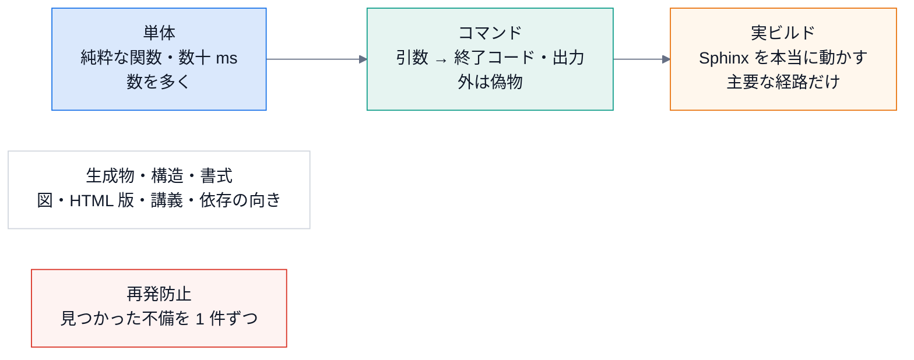

# テストの書き方

## 目的

このリポジトリのテストの **種類・置き場所・書き方** を揃え、変更に自信を持てるようにする。

## 見るポイント

### 三種類のテスト



| 種類 | ファイル | 何を確かめるか |
|---|---|---|
| 単体 | `test_confluence.py`、`test_docstring_coverage.py`、`test_doxygen.py`、`test_doctor.py`、`test_hou_stub.py` | 純粋な関数。外部に触れない。**速い (数十 ms)**。数を多く書く |
| コマンド | `test_cli.py`、`test_mermaid.py` | 引数 → 終了コード・出力。外のプロセスは **偽物に差し替える** |
| 実ビルド | `test_build.py` (`@pytest.mark.slow`) | サンプルと自分の文書を、Sphinx で本当にビルドする。**遅い (十数秒)**。主要な経路だけ |
| 生成物 | `test_diagrams.py` | 図の生成物が定義と一致し、重なり・はみ出しが無い。`module-map` の矢印が、実際の依存と一致する |
| 拡張 | `test_prompt.py` | `prompt` 拡張。秘密情報の検出、HTML (ボタンの部品が入る) と Confluence (ボタン無しのコードブロック) の出力。ボタンの動作は、ブラウザで確かめる ([拡張のしかた](04-extend.md) のレシピ 7) |
| 再発防止 | `test_robustness.py` | レビューで見つかった不備 (打ち間違いで検査が空になる・構文エラーで落ちる・循環を見逃す、など) の回帰テスト。**不備を直したら、ここに足す** |
| 構造 | `test_structure_map.py` | 依存の向きのルール (循環なし・Sphinx に依存してよいのは拡張だけ・葉のモジュール)。Sphinx を隠して core を import する実行テスト |
| 書式 | `test_mermaid_style.py` | Mermaid の標準の `%%{init}%%` の行。`check-mermaid` と `--fix` (冪等・インデント・閉じていないブロック) |
| HTML 版 | `test_site.py` | `site/` が元の文書・ソース・図と、ずれていない (ハッシュの印)。生のままの Mermaid や秘密らしき値が入っていない |
| 講義 | `test_lectures.py` | 講義の引用がソースと一致し、`# 実行できる` の例が本当に動いて、`# 出力` と一致する ([講義 第 10 回](../lecture/10-testing.md)) |

### 外部のものを偽物にする型

**1. 偽のコマンド (`mmdc`)**: 実行ファイルを一時ディレクトリに作る。`tests/test_mermaid.py::_fake_mmdc`。

```python
def _fake_mmdc(path, *, ok=True):
    body = f"#!{sys.executable}\nimport sys\n..."  # -o の出力先に SVG を書く / 失敗する
    path.write_text(body)
    path.chmod(path.stat().st_mode | stat.S_IEXEC)
    return [str(path)]
```

実ビルドのテストでは、環境変数 `DOCSPIPELINE_MMDC` で偽物を渡す (`test_build.py::test_mermaid_becomes_an_image_when_mmdc_exists`)。

**2. 関数の差し替え (`cli._run`)**: 子プロセスを起動せず、**何を起動しようとしたか** だけを記録する。

```python
commands = []
monkeypatch.setattr(cli, "_run", lambda cmd, env=None: commands.append((list(cmd), env)) or 0)
assert run("build", str(tmp_path), "-b", "confluence") == 0
assert commands[0][1]["DOCSPIPELINE_CONFLUENCE_MODE"] == "local"
```

**3. 環境変数**: `monkeypatch.setenv` / `delenv`。関数が `environ` を引数に取るなら、辞書をそのまま渡せる (`confluence.sphinx_settings({...})`)。

**4. PATH を絞る**: 「コマンドが無いとき」のテスト。`test_build.py::_env` が `PATH` を Python の置き場 + `/usr/bin` に絞るので、手元に `mmdc` があっても影響しない。

### 「テストが本当に効くか」を確かめる

書いたテストは、**わざと壊して落ちることを確かめる** (変異テストの手作業版)。

```bash
cp docspipeline/confluence.py /tmp/bak
sed -i 's/"confluence_publish": False,/"confluence_publish": True,/' docspipeline/confluence.py
python -m pytest -q tests/test_confluence.py     # 落ちるはず
cp /tmp/bak docspipeline/confluence.py           # 戻す
```

落ちなければ、そのテストは何も守っていない。

**落とし穴**: 書き換えが「同じ長さ」で「同じ秒」の中に行われると、Python が古い `.pyc` (バイトコードのキャッシュ) を使い、**壊したのに通る** ことがある。疑わしいときは `python -B -m pytest` で起動するか、`__pycache__` を消す ([講義 第 10 回](../lecture/10-testing.md))。

## 使うときの注意

* `tests/test_build.py` は `subprocess` で `python -m sphinx` を起動する。テストのプロセスの `sys.path` や `sys.modules` を汚さないため。**同じプロセスで Sphinx を何度も走らせない**。
* 実ビルドのテストは、サンプルを `tmp_path` に **コピーして** からビルドする。リポジトリ内に `_build` を作らない。
* 時間: `pytest -m "not slow"` で、単体とコマンドだけを走らせられる (数秒)。

## よくある誤り

* **実在する `mmdc` / `doxygen` に頼るテスト**。CI にも手元にも無いことがある。`skipif(shutil.which("doxygen") is None)` を付けるか、偽物にする。
* **トークンの値を、期待値にそのまま書く**。テストの出力にも出る。ダミー (`tok-0123456789abcdef`) を使う。
* **`assert A or B` のような、常に真になりやすい検査**。何を確かめたいのかを一つに絞る。

## 関連

* [拡張のしかた](04-extend.md)
* [トラブルシュート](07-troubleshooting.md)
