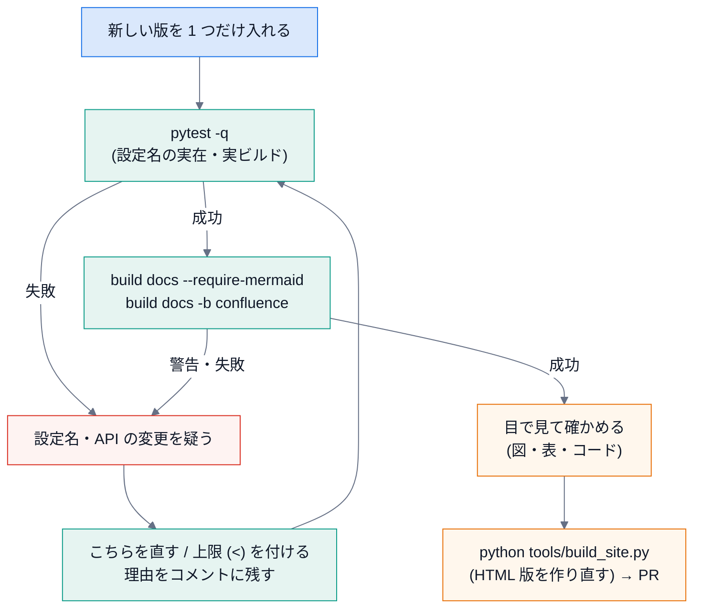

# メンテナンス

## 目的

依存の更新・設定の見直し・リリースなど、**定期的にやること** と、その手順を決めておく。

## 見るポイント

### 依存ごとの「壊れやすさ」

| 依存 | 壊れ方 | 備える |
|---|---|---|
| Sphinx | 拡張の API の変更・非推奨。警告が増える | CI の Python を二つ (最小と最新) で回す。`-W` が、警告の増加で落ちて気付かせてくれる |
| sphinxcontrib-confluencebuilder | **設定名が版で変わる** (設計書にも注意がある)。Sphinx は未知の名前を黙って無視する | `test_every_setting_name_is_registered_by_the_installed_confluence_builder`。更新したらまずこれ |
| Breathe / Doxygen | XML の形式の変更。指示子の変更 | `examples/cpp_sample` の実ビルドのテスト |
| mermaid-cli (`mmdc`) | Mermaid の文法の変更で、図が変わる・変換に失敗する | 図は **ハッシュでキャッシュ** するので、版を上げたら `docs/_generated` を消して作り直し、目で見る |
| furo (テーマ) | 見た目の変更 | 目視 (HTML を開く) |
| GitHub Actions | アクションの版の廃止 | `ci.yml` と雛形 (`docs.yml.tmpl`) の **両方** を直す |

### 依存を更新するとき



```bash
pip install -U sphinx myst-parser furo breathe sphinxcontrib-confluencebuilder
python -m pytest -q                       # 設定名の実在・実ビルド
docspipeline build docs --require-mermaid # 自分の文書
docspipeline build docs -b confluence     # Confluence 形式 (公開はしない)
ruff check . && ruff format --check .
```

警告が出たら、**その場で直すか、直さない理由を残す**。`nitpick_ignore_regex` を足して黙らせるのは最後の手段。

### バージョンとリリース

* バージョンは `docspipeline/__init__.py` の `__version__` **だけ** に書く。`pyproject.toml` は、ここから読む (`dynamic`)。拡張が Sphinx に返すバージョンも同じ。
* 雛形の CI (`docs.yml.tmpl`) は `pip install ... @main` を使っている。**公開したらタグかコミットに固定** する (コメントにも書いてある)。
* 変更の影響が大きいもの (`confluence.py` の既定、`init` の出力) は、`docs/` に **変更の理由** を残す。

### 定期の点検 (目安: 3 か月に一度)

- [ ] 依存を更新して、上の手順が通る
- [ ] `docspipeline coverage docspipeline --fail-under 100`
- [ ] `docspipeline map docspipeline --fail-on-cycle` と、依存の向きのテスト (`tests/test_structure_map.py`)
- [ ] `docs/confluence.md` の「検証できていないこと」が、まだ正しいか。環境が手に入ったなら、**検証して書き換える**
- [ ] 雛形から作った新しいリポジトリで、`init` → `build` が通る
- [ ] `python tools/build_site.py --check` と `python tools/quote_code.py docs/lecture --check` (HTML 版と講義が、元とずれていない)
- [ ] 固定している `mermaid-cli` の版 (`ci.yml` と `docs.yml.tmpl` の **2 か所**) を上げてよいか。上げたら図の見た目を確かめ、`python tools/build_site.py` で HTML 版を作り直す
- [ ] 公開した文書に、秘密情報・個人情報が無い ([運用手順](../runbook.md) の検索)
- [ ] リンク切れ (`linkcheck` の週次の結果)

## 使うときの注意

* **公開の既定を緩める変更**は、一人で決めない。`trample` / `purge` / `skip_commented_pages` / 親ページの必須は、手で書かれたページを守るための設定。
* 依存の更新は、**一つずつ** 行う。複数同時に上げて落ちると、原因が分からない。

## よくある誤り

* 依存の版を固定せず、CI が突然落ちる。落ちたら **原因の依存を特定してから** 固定する (固定する理由をコメントに書く)。
* `README` の「未検証のこと」を更新しない。検証したことが分からなくなる。

## 関連

* [トラブルシュート](07-troubleshooting.md)
* [運用手順](../runbook.md)
