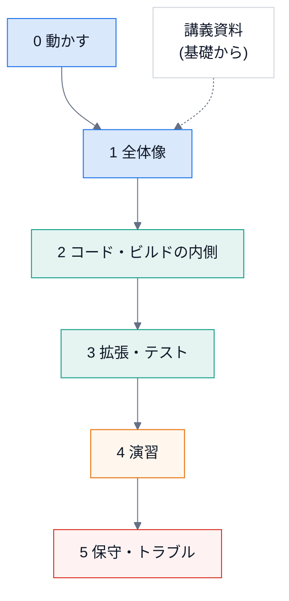

# 学習資料

DocsPipeline を **保守し、拡張できるようになる** ための資料。使うだけなら [使い方](../usage.md) で足りる。
ここは「中を読んで、直して、足せる」人向け。

## 目的

* 全体の仕組みを、図で説明できるようになる。
* どのファイルを、どの順で読めばよいかが分かる。
* 新しいコマンド・拡張・図・テンプレートを、**テストつきで** 足せる。
* 壊れたときに、症状から原因のファイルへ辿れる。

## 進め方



| 段階 | 読むもの | 目安 | できるようになること |
|---|---|---|---|
| 0 | 動かす (下の「まず動かす」) | 30 分 | サンプルを自分の手でビルドし、HTML を開ける |
| 1 | [全体像](01-overview.md) | 1 時間 | 「書く → 組み立てる → 届ける → 守る」を説明できる。用語が分かる |
| 2 | [コードの読み方](02-code-tour.md)、[ビルドの内側](03-build-internals.md) | 2 時間 | 好きなモジュールを、迷わずに開ける。ビルドの順序を追える |
| 3 | [拡張のしかた](04-extend.md)、[テストの書き方](05-testing.md) | 3 時間 | レシピどおりに、小さな機能を足せる |
| 4 | [演習](06-exercises.md) | 半日〜 | 答えの無い課題を、自分で設計して実装できる |
| 5 | [トラブルシュート](07-troubleshooting.md)、[メンテナンス](08-maintenance.md)、[機械の地図](09-structure-map.md) | 随時 | 依存の更新・障害の切り分けを一人でできる |
| (基礎から) | [講義資料](../lecture/index.md) | 全 14 回 | Python・`ast`・グラフ・Sphinx・テスト・図・CI を、基礎から順に。上の段階 1〜5 の **前** に読むと楽 |

## まず動かす

```bash
pip install -e ".[docs,cpp,confluence,dev]"
docspipeline doctor                                   # 何が使えるか (mmdc・doxygen など)
docspipeline build examples/python_sample/docs        # Python のサンプル
docspipeline build examples/cpp_sample/docs           # C++ のサンプル (doxygen が必要)
python -m pytest -q                                   # テスト (Sphinx の実ビルドを含む)
```

`docs/_build/html/index.html` をブラウザで開く。Mermaid の図がコードのまま出るなら、`mmdc` が無い
([トラブルシュート](07-troubleshooting.md))。

## 使うときの注意

* 手を動かしながら読むこと。各ページの「確認」のコマンドは、実際に実行して結果を見る。
* 外部のサービス (Confluence) には、この資料の範囲では **つながらなくてよい**。つなぐのは
  [Confluence への公開](../confluence.md) を読んでから。

## 関連

* [設計](../design.md) — なぜこの形にしたか
* [運用手順](../runbook.md) — 文書を古くしないための決まり
* [講義資料](../lecture/index.md) — 基礎から学ぶ (この資料は、その「実務編」)

```{toctree}
:hidden:
:maxdepth: 1

01-overview
02-code-tour
03-build-internals
04-extend
05-testing
06-exercises
07-troubleshooting
08-maintenance
09-structure-map
glossary
```
