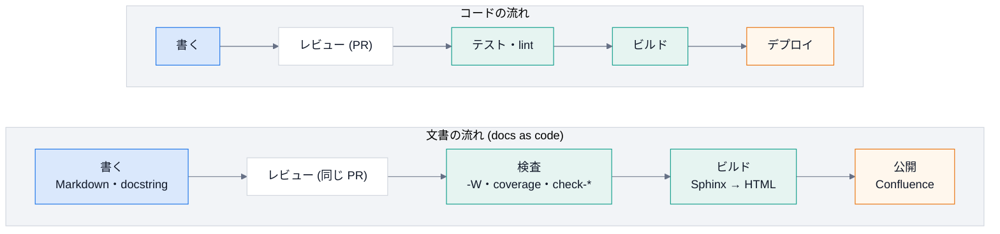
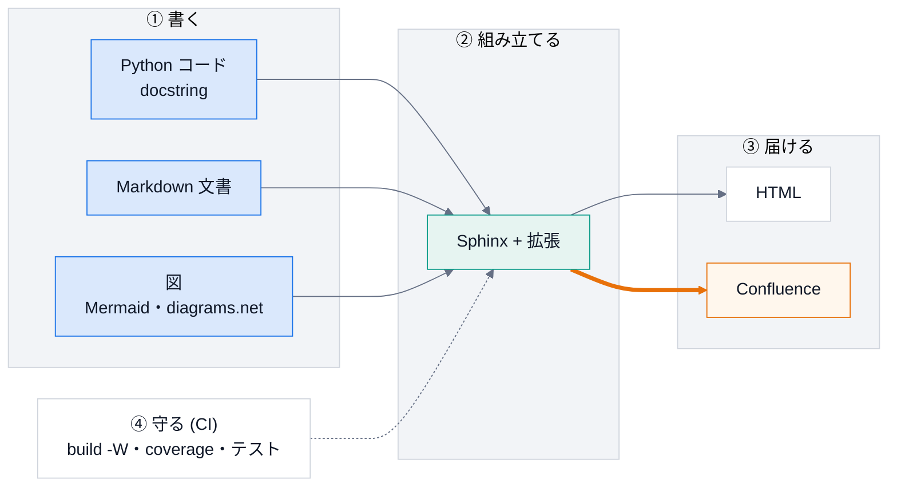

# 第 0 回 はじめに: 文書を「コード」として扱う

> 所要時間の目安: 1.5 時間 / 前提: コマンドラインの基本操作

## この回のゴール

- 文書が **なぜ古くなるのか**、そして、それをどう防ぐかを説明できる。
- 「docs as code」の考え方を、自分の言葉で説明できる。
- DocsPipeline の全体 (書く → 組み立てる → 届ける → 守る) と、リポジトリの構成を言える。
- 手元の環境を整えて、サンプルの文書をビルドできる。

## 1. 解きたい問題

文書は、書いた瞬間から古くなり始めます。コードは変わるのに、文書は誰も直さないからです。
DocsPipeline が解く問題は、次の表のとおりです。

| 問題 | 起きること | この仕組みの答え |
|---|---|---|
| コードを変えたのに文書が古い | 嘘の説明が残る | 文書を **コードの隣** に置き、同じ PR で更新する。docstring から API 文書を **自動生成** する |
| 文書の誤り (リンク切れ) に気付かない | 読者が迷う | ビルドの警告を **エラー扱い** にする (`-W`)。CI で毎回確かめる |
| 図が古い・手書きの図が実態と違う | 構成の理解を誤る | 図を **コードから生成** し、実際の依存と一致することを **テスト** で確かめる |
| 手作業の公開が壊れる・他人のページを上書きする | 事故になる | 公開を **段階的** にし、安全装置 (専用の親ページ配下だけ・消さない) を **コードに入れる** |
| 秘密情報 (API トークン) が漏れる | 重大な事故 | 環境変数だけに置き、出力から **伏せる**。CI では、必要なステップだけに渡す |

どれも「人が気を付ける」では防げません。**仕組み (自動化とテスト) で防ぐ** のが、この講義の一貫した考え方です。

## 2. Docs as code (文書をコードとして扱う)

コードには、バージョン管理・レビュー・テスト・ビルド・デプロイの仕組みがあります。
文書にも、同じ仕組みを当てはめます。



文書を、コードと **同じ道** に乗せると、次のことが手に入ります。

1. **差分が見える**: 文書の変更も、`git diff` とレビューの対象になる。
2. **壊れたら止まる**: リンク切れ・未解決の参照を、CI が止める。
3. **再現できる**: 誰の手元でも、同じコマンドで、同じ文書が作れる。
4. **自動化できる**: 生成・検査・公開を、人手なしで繰り返せる。

## 3. 全体像: 書く → 組み立てる → 届ける → 守る



| 段階 | 何をするか | 担当 (第何回で学ぶか) |
|---|---|---|
| ① 書く | docstring・Markdown・図を、人が書く | 第 1 回 (Python)・第 11 回 (図) |
| ② 組み立てる | Sphinx が読み込み、拡張が足りない機能を補う | 第 6・7 回 |
| ③ 届ける | HTML と Confluence に出す。公開は安全装置つき | 第 9 回 |
| ④ 守る | 検査とテストを、毎回、自動で走らせる | 第 10・12 回 |

道具の部品は、第 2〜5 回で学ぶ「文字列」「プロセス」「構文木」「グラフ」の上に立っています。

## 4. リポジトリを歩く

実際のリポジトリの構成を、コードで確かめましょう。次の例は、`docspipeline` パッケージの場所から、
リポジトリのルートを割り出して、直下の項目と、パッケージの中のモジュールを並べます。

```python
# 実行できる
from pathlib import Path
import docspipeline

package = Path(docspipeline.__file__).parent
root = package.parent
print("ルートの主な項目:")
for name in ("README.md", "pyproject.toml", "docs", "docspipeline", "examples", "tests", "tools"):
    print(" ", name, "(ディレクトリ)" if (root / name).is_dir() else "(ファイル)")
print("docspipeline/ のモジュール:")
for path in sorted(package.glob("*.py")):
    print(" ", path.name)
```

```text
# 出力
ルートの主な項目:
  README.md (ファイル)
  pyproject.toml (ファイル)
  docs (ディレクトリ)
  docspipeline (ディレクトリ)
  examples (ディレクトリ)
  tests (ディレクトリ)
  tools (ディレクトリ)
docspipeline/ のモジュール:
  __init__.py
  __main__.py
  cli.py
  config.py
  confluence.py
  diagrams.py
  docstring_coverage.py
  doctor.py
  doxygen.py
  files.py
  guard.py
  mermaid.py
  mmdc.py
  prompt.py
  scaffold.py
  structure_map.py
```

各モジュールの役割は、次のとおりです (詳しくは [コードの読み方](../learn/02-code-tour.md))。

| モジュール | 役割 | 主に学ぶ回 |
|---|---|---|
| `cli.py` | コマンドの入口 | 第 8 回 |
| `config.py` | Sphinx の共通設定 (`build_config`) | 第 6 回 |
| `confluence.py` | 公開の安全装置 | 第 9 回 |
| `mermaid.py`・`prompt.py`・`doxygen.py`・`guard.py` | Sphinx の拡張 | 第 7 回 |
| `mmdc.py`・`files.py` | `mmdc` の実行・ファイルの列挙 (Sphinx 不要の部品) | 第 2・3 回 |
| `docstring_coverage.py`・`structure_map.py` | ソースの静的解析 | 第 4・5 回 |
| `scaffold.py`・`doctor.py`・`diagrams.py` | 雛形・環境の確認・図の検査 | 第 8・11 回 |
| `stubs/hou.py` | Houdini の偽物 | 第 7 回 |

## 5. 環境を整える

```bash
$ git clone https://github.com/manato1201/DocsPipeline.git && cd DocsPipeline
$ python3 -m venv .venv && source .venv/bin/activate
$ pip install -e ".[docs,cpp,confluence,dev]"      # 本体 + 文書・C++・公開・開発の道具
$ npm install --no-save @mermaid-js/mermaid-cli@12.0.0   # 図の変換 (mmdc)。Node.js が要る
$ docspipeline doctor                               # 何が使えるか
```

`docspipeline doctor` の出力は、たとえば次のようになります (環境で変わります)。

```text
[OK  ] Python: 3.13.x
[OK  ] Sphinx: 9.x
[OK  ] MyST (Markdown の取り込み): 5.x
[OK  ] テーマ furo: 2025.x
[OK  ] Breathe (C++): 5.x
[OK  ] Confluence ビルダー: 3.x
[OK  ] mmdc (Mermaid → SVG): /path/to/mmdc
[OK  ] doxygen (C++): /usr/bin/doxygen
[OK  ] Confluence のモード: local
[なし] Confluence の環境変数: 未設定: ... (公開するときだけ必要)
```

- `OK` は使える。`NG` は **必須** なのに無い。`なし` は、無くてもよい (その機能を使うときだけ要る)。
- `mmdc` が無いと、Mermaid の図は **コードのまま** 表示されます (第 7 回で、なぜそうなっているかを学びます)。
- Confluence の環境変数が `なし` でも構いません。この講義では、Confluence に **つながなくてよい** です。

## 6. ハンズオン: サンプルをビルドする

```bash
$ docspipeline build examples/python_sample/docs --require-mermaid
$ open examples/python_sample/docs/_build/html/index.html     # macOS。Linux は xdg-open
```

ビルドが成功すると、`build succeeded.` と表示されます。HTML をブラウザで開き、次を確かめます。

1. 「API リファレンス」に、`Stopwatch` などの **docstring から作られた** 説明がある。
2. 「設計」に、Mermaid の図が **画像として** 描かれている (コードのままなら `mmdc` が無い)。

続けて、わざと壊してみましょう。サンプルの `docs/overview.rst` の末尾に、存在しない参照を足します。

```text
:ref:`存在しない参照`
```

もう一度 `docspipeline build examples/python_sample/docs` を実行すると、**失敗します**。
これが「壊れたら止まる」(`-W`) です。確かめたら、足した行を消して、元に戻してください。

## 7. この講義の読み方

講義の中のコードには、2 種類の印があります。

````text
```python
# 引用: docspipeline/files.py::iter_python_files
...
```
````

- `# 引用:` は、**リポジトリのソースから自動で作った** 引用です。今のコードと一致しています。
- `# 実行できる` は、**テストが実際に実行する** 例で、直後の `# 出力` が、本当の出力です。

講義を読んで「このコードを変えたい」と思ったら、実際に変えてみてください。引用がずれるので、
`python tools/quote_code.py docs/lecture` で更新し、`pytest` が通ることを確かめます。
これは、**文書とコードを同期させる仕組みそのもの** の実習にもなっています (第 10 回)。

## ハンズオンのまとめ

| 手順 | 確かめたこと |
|---|---|
| `docspipeline doctor` | 使える機能 (`mmdc`・`doxygen` など) の有無 |
| `build` (成功) | docstring から API 文書が作られる |
| `build` (わざと壊す) | 警告をエラー扱いにすると、壊れた文書を出さない |

## 確認問題

1. 「文書が古くなる」ことを防ぐために、DocsPipeline は **何を自動化** していますか。2 つ挙げてください。
2. `-W` (警告をエラー扱い) を付けないと、どんな事故が起きやすいですか。
3. 「docs as code」で、文書が **コードと同じ道** に乗ると、手に入る利点を 3 つ挙げてください。
4. `docspipeline doctor` で、`NG` と `なし` の違いは何ですか。
5. `mmdc` が無い環境でビルドすると、Mermaid の図はどうなりますか。

## 解答

1. 例: (a) docstring からの API 文書の生成、(b) ビルドの警告のエラー化と CI での検査、(c) 図の生成と、実際の依存との一致の検査、(d) 公開の段階化と安全装置。
2. リンク切れ・未解決の参照が **警告のまま** 公開され、誰も気付かない。警告は、ログに流れて、見落とされる。
3. 差分とレビューができる / 壊れたら CI が止める / 誰の手元でも再現できる / 自動化できる、のうちの 3 つ。
4. `NG` は、**必須** の部品 (Python・Sphinx・MyST・テーマ) が無い。文書をビルドできない。
   `なし` は、無くてもビルドできるが、その機能 (Mermaid の画像化・C++・公開) は使えない。
5. コードのまま (テキストとして) 表示される。方針は `docspipeline_mermaid_missing` で、`literal` (既定)・`warn`・`error` から選ぶ。

## まとめ

| 概念 | 要点 |
|---|---|
| 問題 | 文書は放っておくと古くなる。人の注意では防げない |
| docs as code | 文書を、コードと同じ道 (VCS・レビュー・テスト・ビルド・デプロイ) に乗せる |
| 全体像 | 書く → 組み立てる → 届ける。**守る** が、全体を支える |
| 道具 | Sphinx + 拡張。自前の部品は、Python の標準機能の上に立っている |

## 次回

[第 1 回 Python の基礎](01-python-basics.md): この講義のコードを読むのに必要な範囲を、実行しながら学びます。
