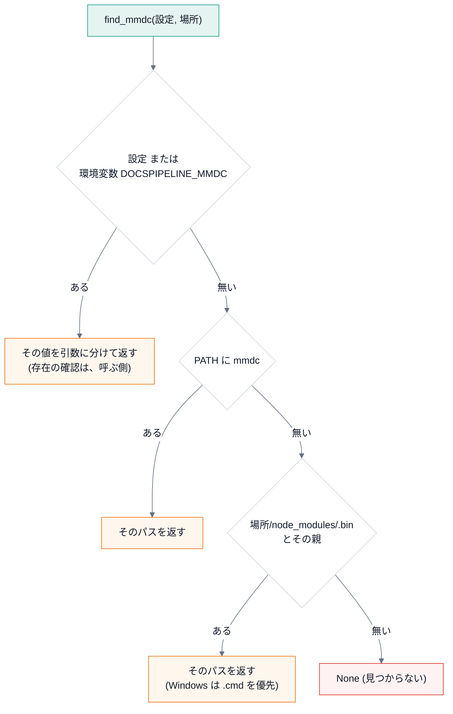

# 第 3 回 ファイルとプロセス

> 所要時間の目安: 3 時間 / 前提: 第 1・2 回

## この回のゴール

- ファイルを **安全に** 書く方法 (一時ファイルと、原子的な置き換え) を説明できる。
- **環境変数** を、関数の引数として受け取る設計の利点を説明できる。
- `subprocess` で外部コマンドを実行し、出力・終了コード・タイムアウトを扱える。
- **終了コード** の約束 (0 / 1 / 2) と、その使い分けを説明できる。
- 外部コマンドを **探す** 順序 (設定 → 環境変数 → `PATH` → ローカル) を読める。

DocsPipeline は、文書を作る道具ですが、仕事の大半は「**外部のプログラムを呼ぶ**」ことです
(`sphinx`・`mmdc`・`doxygen`)。この回で、その土台を作ります。

## 1. ファイルの読み書き

```python
# 実行できる
import tempfile
from pathlib import Path

with tempfile.TemporaryDirectory() as tmp:  # 使い終わると、中身ごと消える
    path = Path(tmp) / "memo.txt"
    path.write_text("日本語の行\n2 行目\n", encoding="utf-8")
    print(path.read_text(encoding="utf-8").splitlines())
    print(path.stat().st_size, "バイト")
    with open(path, "a", encoding="utf-8") as f:  # 追記
        f.write("3 行目\n")
    print(len(path.read_text(encoding="utf-8").splitlines()), "行")
    print(path.exists(), (Path(tmp) / "none.txt").exists())
```

```text
# 出力
['日本語の行', '2 行目']
25 バイト
3 行
True False
```

- **`with`** 文は、ブロックを抜けるとき、**必ず後始末** をします (ファイルを閉じる・一時ディレクトリを消す)。
  途中で例外が起きても、後始末は行われます。
- **`encoding="utf-8"` を、毎回、明示** します。省略すると、OS の既定 (Windows では cp932 など) になり、
  同じコードが、環境で違う結果になります (第 2 回)。

## 2. 安全な書き込み: 一時ファイルと原子的な置き換え

ファイルを **直接** 書き換えている最中に、プログラムが落ちると、**半端なファイル** が残ります。

```python
# 実行できる
import tempfile
from pathlib import Path

with tempfile.TemporaryDirectory() as tmp:
    target = Path(tmp) / "diagram.svg"
    target.write_text("<svg>完成した図</svg>", encoding="utf-8")

    try:
        with open(target, "w", encoding="utf-8") as f:  # 開いた時点で、中身が空になる
            f.write("<svg>書きかけ")
            raise RuntimeError("途中で落ちた")
    except RuntimeError:
        pass
    print("直接書いた結果:", repr(target.read_text(encoding="utf-8")))
```

```text
# 出力
直接書いた結果: '<svg>書きかけ'
```

元の「完成した図」が失われ、**書きかけ** が残りました。このファイルを別のプロセスが読むと、壊れた図を読みます。

対策は、**別の名前で書いてから、1 手で置き換える** ことです (**原子的な置き換え**)。

```python
# 実行できる
import os
import tempfile
from pathlib import Path

with tempfile.TemporaryDirectory() as tmp:
    target = Path(tmp) / "diagram.svg"
    target.write_text("<svg>完成した図</svg>", encoding="utf-8")

    part = target.with_suffix(".svg.part")
    try:
        part.write_text("<svg>書きかけ", encoding="utf-8")  # 別の名前に書く
        raise RuntimeError("途中で落ちた")  # ここで落ちても…
        os.replace(part, target)  # (到達しない)
    except RuntimeError:
        pass
    print("元のファイル:", repr(target.read_text(encoding="utf-8")))

    part.write_text("<svg>新しい図</svg>", encoding="utf-8")
    os.replace(part, target)  # 完成してから、置き換える
    print("置き換え後:", repr(target.read_text(encoding="utf-8")), "/ part は残る?", part.exists())
```

```text
# 出力
元のファイル: '<svg>完成した図</svg>'
置き換え後: '<svg>新しい図</svg>' / part は残る? False
```

`os.replace` は、同じ場所のファイルなら、**途中の状態を見せない** (置き換え前か、置き換え後のどちらか)。
他のプロセスが読んでも、半端なファイルを見ません。

DocsPipeline の `mmdc.render` は、この方法で SVG を置いています。

```python
# 抜粋: docspipeline/mmdc.py::render
        # 並列ビルドで半端なファイルを読まれないよう、同じ場所に写してから 1 手で置き換える。
        part = out.with_suffix(out.suffix + ".part")
        shutil.copyfile(tmp_out, part)
        os.replace(part, out)
```

- Sphinx は、文書を **並列で** 読むことがあります (`-j`)。2 つのプロセスが、**同じ図** を同時に作ろうとしても、
  どちらの置き換えも完結しているので、壊れません。
- 「同じ場所に写してから」が大事です。**別のドライブ** (一時ディレクトリが別の場所) だと、`os.replace` が
  原子的でなくなることがあります。そこで、出力先と同じディレクトリに `.part` を作っています。

## 3. 環境変数

**環境変数** は、プロセスに渡される、名前と値の対応です。設定やトークンを、**コードにも設定ファイルにも書かず** に渡せます。

```python
# 実行できる
import os

os.environ["DEMO_MODE"] = "dryrun"
print(os.environ.get("DEMO_MODE"))
print(os.environ.get("DEMO_UNSET"))  # 無ければ None
print(os.environ.get("DEMO_UNSET", "既定値"))  # 既定値を指定
print("DEMO_MODE" in os.environ)
del os.environ["DEMO_MODE"]
```

```text
# 出力
dryrun
None
既定値
True
```

### 設計: `os.environ` を、関数の奥で直接読まない

関数の中で `os.environ` を読むと、テストが難しくなります (テストのたびに、グローバルな状態を書き換える)。
代わりに、**環境を引数として受け取り**、省略時だけ `os.environ` を使います。

```python
# 引用: docspipeline/confluence.py::current_mode
def current_mode(environ: Mapping[str, str] | None = None) -> str:
    """環境変数から公開モードを決める。

    Args:
        environ: 環境変数。省略すると ``os.environ``。

    Returns:
        ``local`` / ``dryrun`` / ``publish`` のいずれか。未設定なら ``local``。

    Raises:
        ConfluenceSettingsError: 未知のモードが指定されたとき。
            黙って ``local`` に倒すと、公開したつもりで公開されない事故になる。
    """
    env = os.environ if environ is None else environ
    mode = (env.get(MODE_ENV) or "local").strip().lower()
    if mode not in MODES:
        raise ConfluenceSettingsError(f"{MODE_ENV} は {', '.join(MODES)} のいずれかにしてください (指定値: {mode!r})")
    return mode
```

- 型 `Mapping[str, str] | None`: 読み取り専用の対応 (辞書でも、`os.environ` でもよい)。
- `env = os.environ if environ is None else environ`: **省略時だけ** 本物の環境を使う。
- テストでは、**辞書を渡す** だけで、好きな環境を再現できます。

```python
# 実行できる
from docspipeline.confluence import ConfluenceSettingsError, current_mode

print(current_mode({}))  # 未設定 → local
print(current_mode({"DOCSPIPELINE_CONFLUENCE_MODE": " DryRun "}))  # 空白と大文字小文字を吸収
try:
    current_mode({"DOCSPIPELINE_CONFLUENCE_MODE": "publsh"})  # 綴り間違い
except ConfluenceSettingsError as exc:
    print("エラー:", exc)
```

```text
# 出力
local
dryrun
エラー: DOCSPIPELINE_CONFLUENCE_MODE は local, dryrun, publish のいずれかにしてください (指定値: 'publsh')
```

**綴り間違いを `local` に倒さない** のが、安全上の判断です。「公開したつもり」で公開されない事故より、
**止まって知らせる** ほうが、はるかに安全です (第 9 回)。

## 4. 外部コマンドを実行する (subprocess)

```python
# 実行できる
import subprocess
import sys

result = subprocess.run(
    [sys.executable, "-c", "import sys; print('標準出力'); print('標準エラー', file=sys.stderr); sys.exit(3)"],
    capture_output=True,  # 出力を受け取る
    text=True,  # bytes ではなく str で
    encoding="utf-8",
    errors="replace",  # 読めない文字は � にして、落ちない
    timeout=30,  # 30 秒で打ち切る
    check=False,  # 失敗しても例外にしない (終了コードを自分で見る)
)
print("終了コード:", result.returncode)
print("stdout:", repr(result.stdout))
print("stderr:", repr(result.stderr))
```

```text
# 出力
終了コード: 3
stdout: '標準出力\n'
stderr: '標準エラー\n'
```

| 引数 | 働き |
|---|---|
| コマンドは **リスト** | `["python", "-c", "..."]`。文字列 1 つにしない (空白や記号で、意図しない分割・**コマンドの注入** が起きる) |
| `capture_output=True` | 標準出力・標準エラーを、`result.stdout` / `.stderr` で受け取る |
| `text=True` + `encoding` + `errors` | 文字列として読む。**文字コードと、読めないときの扱いを明示** する |
| `timeout=秒` | 固まった外部コマンドを、打ち切る (`TimeoutExpired`) |
| `check=True` | 失敗 (終了コードが 0 以外) で `CalledProcessError` を投げる |

### 出力を流しながら加工する (`Popen`)

`subprocess.run` は、終わってから出力をまとめて返します。ビルドのように **長い処理** では、
出力を **リアルタイムで** 表示したい。このとき、`Popen` で、1 行ずつ読みます。

```python
# 引用: docspipeline/cli.py::_run
def _run(cmd: Sequence[str], env: dict[str, str] | None = None) -> int:
    """コマンドを走らせ、出力から API トークンを伏せて表示する。"""
    merged = {**os.environ, **(env or {})}
    with subprocess.Popen(
        list(cmd),
        stdout=subprocess.PIPE,
        stderr=subprocess.STDOUT,
        text=True,
        encoding="utf-8",
        errors="replace",  # 読めない文字で、ビルドの途中で落ちない
        env=merged,
    ) as proc:
        for line in proc.stdout or ():
            print(confluence.mask_secrets(line, merged), end="", flush=True)
        return proc.wait()
```

読み方:

1. `merged = {**os.environ, **(env or {})}`: 現在の環境に、**追加の環境** を重ねる (後ろが優先)。
   辞書の **展開** (`**`) で、2 つの辞書を 1 つにしています。
2. `stderr=subprocess.STDOUT`: 標準エラーを、標準出力に **まとめる**。出力の順序が保たれます。
3. `for line in proc.stdout or ()`: 1 行ずつ読む (`or ()` は、`stdout` が `None` のときの保険)。
4. **`mask_secrets`** を通してから `print`: トークンの値が混ざっていても、画面には `***` で出る。
5. `flush=True`: すぐに表示する (出力が溜まって、遅れて出るのを防ぐ)。
6. `with Popen(...) as proc:` と、最後の `proc.wait()`: 終了を待って、**終了コード** を返す。

同じ仕組みを、小さく作って動かしてみます。

```python
# 実行できる
import subprocess
import sys

SECRET = "tok-0123456789abcdef"


def run_masked(cmd, secret):
    with subprocess.Popen(
        cmd, stdout=subprocess.PIPE, stderr=subprocess.STDOUT, text=True, encoding="utf-8", errors="replace"
    ) as proc:
        for line in proc.stdout or ():
            print(line.replace(secret, "***"), end="")
        return proc.wait()


child = f"import sys; print('認証に失敗: {SECRET}'); print('続き', file=sys.stderr); sys.exit(2)"
code = run_masked([sys.executable, "-c", child], SECRET)
print("終了コード:", code)
```

```text
# 出力
認証に失敗: ***
続き
終了コード: 2
```

## 5. 終了コード

プロセスは、終了するとき **整数** を返します。シェルでは `$?` で読めます。**0 が成功、それ以外が失敗** です。

DocsPipeline の約束:

| コード | 意味 | 例 |
|---|---|---|
| `0` | 成功 | ビルド成功・検査に合格 |
| `1` | **検査に不合格** (処理は正しく動いた) | docstring が基準未満・循環がある・書き出しの漏れがある |
| `2` | **使い方・設定の誤り** (処理を始められなかった) | 存在しないパス・環境変数の不足・綴り間違い |

`1` と `2` を分ける理由: CI の担当者が、**終了コードだけで** 原因の種類を見分けられるようにするためです。
`2` なら「入力を直す」、`1` なら「コードや文書を直す」。

```python
# 実行できる
import subprocess
import sys
import tempfile

with tempfile.TemporaryDirectory() as tmp:
    for argv in (["coverage", tmp + "/nothing"], ["coverage", tmp]):
        r = subprocess.run(
            [sys.executable, "-m", "docspipeline", *argv], capture_output=True, text=True, encoding="utf-8"
        )
        print(argv[1].replace(tmp, "<tmp>"), "→ 終了コード", r.returncode)
        print("   ", (r.stdout + r.stderr).strip().replace(tmp, "<tmp>").splitlines()[-1])
```

```text
# 出力
<tmp>/nothing → 終了コード 2
    エラー: パスがありません: <tmp>/nothing
<tmp> → 終了コード 0
    docstring のカバレッジ: 100.0% (0/0)
```

存在しないパスは **2** (入力の誤り)。空のディレクトリは **0** (対象が無いので 100%)。

## 6. コマンドの文字列を、引数に分ける

環境変数 `DOCSPIPELINE_MMDC` には、`npx --no-install mmdc` のような **複数語のコマンド** を書けます。
これを引数のリストに分けるのが `shlex.split` です。ところが、**Windows のパス** では問題が起きます。

```python
# 実行できる
import shlex

print(shlex.split("npx --no-install mmdc"))
print(shlex.split(r"C:\Users\me\node_modules\.bin\mmdc.cmd"))  # POSIX の規則: \ が消える
print(shlex.split(r"C:\Users\me\node_modules\.bin\mmdc.cmd", posix=False))  # Windows の規則
```

```text
# 出力
['npx', '--no-install', 'mmdc']
['C:Usersmenode_modules.binmmdc.cmd']
['C:\\Users\\me\\node_modules\\.bin\\mmdc.cmd']
```

POSIX の規則では、バックスラッシュが **エスケープ文字** なので消えます (`C:Usersme...`)。
そこで、DocsPipeline は、OS に合わせて規則を切り替えます。

```python
# 引用: docspipeline/mmdc.py::split_command
def split_command(text: str, *, windows: bool | None = None) -> list[str]:
    """コマンドの文字列を、引数の列に分ける。

    POSIX の規則だと、Windows のパスの ``\\`` が消える (``C:\\Users\\me`` → ``C:Usersme``)。
    Windows では、``\\`` を残し、引用符だけを外す。

    Args:
        text: ``DOCSPIPELINE_MMDC`` などの値。
        windows: Windows の規則で分けるか。省略すると、実行中の OS に合わせる。
    """
    if windows is None:
        windows = os.name == "nt"
    parts = shlex.split(text, posix=not windows)
    if windows:
        parts = [p[1:-1] if len(p) >= 2 and p[0] == p[-1] and p[0] in "\"'" else p for p in parts]
    return parts
```

- `windows` を **引数で上書きできる** ので、**Linux 上でも、Windows の挙動をテストできます** (実機が無くても)。
- Windows の規則 (`posix=False`) は、引用符を **残す** ので、後で外します (`p[1:-1]`)。

## 7. 外部コマンドを探す

`mmdc` が、**どこにあるか** を、次の順で探します。



```python
# 引用: docspipeline/mmdc.py::find_mmdc
def find_mmdc(configured: str | None, confdir: str | Path) -> list[str] | None:
    """``mmdc`` の起動コマンドを探す。

    探す順序: 設定値 → 環境変数 ``DOCSPIPELINE_MMDC`` → ``PATH`` →
    ``confdir`` とその親の ``node_modules/.bin``。

    Returns:
        コマンドの引数列。見つからなければ ``None``。
    """
    explicit = configured or os.environ.get(MMDC_ENV)
    if explicit:
        return split_command(explicit)
    on_path = shutil.which("mmdc")
    if on_path:
        return [on_path]
    # Windows の npm は、拡張子なしのシェルスクリプトと mmdc.cmd の両方を置く。実行できるのは .cmd の方。
    names = ("mmdc.cmd", "mmdc") if sys.platform == "win32" else ("mmdc",)
    for base in (Path(confdir), Path(confdir).parent):
        for name in names:
            candidate = base / "node_modules" / ".bin" / name
            if candidate.exists():
                return [str(candidate)]
    return None
```

```python
# 引用: docspipeline/mmdc.py::command_exists
def command_exists(cmd: list[str]) -> bool:
    """コマンドの先頭 (実行ファイル) が、実在するか。``PATH`` の検索と、パスの直接指定の両方を見る。"""
    return bool(cmd) and (shutil.which(cmd[0]) is not None or Path(cmd[0]).exists())
```

- **明示された指定が最優先**。利用者が `DOCSPIPELINE_MMDC` を書いたなら、それに従う (勝手に別のものを使わない)。
- 次に `PATH`、最後に、プロジェクトの `node_modules/.bin` (`npm install` したものを、`PATH` に足さずに使える)。
- 見つからなければ `None`。**例外にしない** (呼ぶ側が、方針に従って決める。第 7 回)。
- `find_mmdc` は、明示指定の **存在を確かめません**。存在の確認は `command_exists` が別に行います
  (`docspipeline doctor` が使う)。「探す」と「確かめる」を分けているので、それぞれテストしやすい。

```python
# 実行できる
import os
import stat
import sys
import tempfile
from pathlib import Path
from docspipeline.mmdc import MMDC_ENV, command_exists, find_mmdc

os.environ.pop(MMDC_ENV, None)
with tempfile.TemporaryDirectory() as tmp:
    root = Path(tmp)
    os.environ["PATH"] = str(root / "empty")  # PATH には、何も無い
    print("1. 何も無い:", find_mmdc(None, root))

    binary = root / "node_modules" / ".bin" / "mmdc"
    binary.parent.mkdir(parents=True)
    binary.write_text("#!/bin/sh\n")
    binary.chmod(binary.stat().st_mode | stat.S_IEXEC)
    print("2. node_modules:", [Path(p).relative_to(root).as_posix() for p in find_mmdc(None, root)])

    print("3. 明示した指定:", find_mmdc("npx --no-install mmdc", root))
    print(
        "4. 存在の確認:",
        command_exists([sys.executable]),
        command_exists([str(root / "nope")]),
        command_exists([str(binary)]),
    )
```

```text
# 出力
1. 何も無い: None
2. node_modules: ['node_modules/.bin/mmdc']
3. 明示した指定: ['npx', '--no-install', 'mmdc']
4. 存在の確認: True False True
```

## 8. 失敗を、どう扱うか

外部コマンドは、**失敗するもの** です (無い・落ちる・固まる)。`mmdc.render` は、失敗を **1 つの例外** にまとめます。

```python
# 抜粋: docspipeline/mmdc.py::render
        try:
            proc = subprocess.run(
                args, capture_output=True, text=True, encoding="utf-8", errors="replace", timeout=180, check=False
            )
        except (OSError, subprocess.TimeoutExpired) as exc:
            raise MermaidRenderError(f"mmdc を実行できません: {exc}") from exc
        if proc.returncode != 0 or not tmp_out.exists():
            detail = (proc.stderr or proc.stdout).strip().splitlines()[-5:]
            raise MermaidRenderError("mmdc が失敗しました: " + " / ".join(detail))
```

- `OSError`: コマンドが **存在しない・実行できない**。`TimeoutExpired`: 180 秒で終わらない。
- 終了コードが 0 でも、**出力ファイルが無ければ** 失敗 (`not tmp_out.exists()`)。「成功したと言ったのに、何も作っていない」を見逃さない。
- エラーの文は、`mmdc` の出力の **最後の 5 行** (`[-5:]`) を使う。長い出力の、核心だけを伝える。
- **自前の例外** (`MermaidRenderError`) にまとめるので、呼ぶ側は、`except MermaidRenderError` だけを書けば足りる。

## ハンズオン

1. `docspipeline doctor` を実行し、`mmdc` の行を読む。`DOCSPIPELINE_MMDC=/nonexistent/mmdc docspipeline doctor` では、何と表示されるか。
2. `docspipeline coverage docs/nothing; echo $?` と `docspipeline coverage docs; echo $?` で、終了コードを比べる。
3. 第 4 節の `run_masked` を、自分の手で書き写して実行し、`SECRET` を変えてみる。

## 確認問題

1. ファイルを直接書き換える方法が、危険なのはなぜですか。原子的な置き換えは、どう解決しますか。
2. `.part` ファイルを、**出力先と同じディレクトリ** に作る理由は何ですか。
3. `current_mode` が、`os.environ` を直接読まず、`environ` を引数に取るのはなぜですか。
4. `subprocess.run` に、コマンドを **文字列 1 つ** ではなく **リスト** で渡す理由は何ですか。
5. 終了コード `1` と `2` を、使い分ける理由は何ですか。
6. `find_mmdc` が、見つからないとき **例外ではなく `None`** を返す理由は何ですか。
7. (書く問題) 外部コマンドを実行し、**標準出力の最後の 1 行** を返す関数 `last_line(cmd)` を書いてください。失敗 (終了コード 0 以外) なら `RuntimeError` を投げます。

## 解答

1. 書き込みの途中で落ちると、ファイルが **書きかけ** のまま残り、元の内容も失われる。他のプロセスが、壊れたファイルを読む。
   別名に書いてから `os.replace` で 1 手で置き換えれば、置き換え前か後かのどちらかしか、見えない。
2. 別のドライブ (ファイルシステム) をまたぐと、`os.replace` が、原子的でなくなる (コピーになる) ことがあるため。
3. テストで、**辞書を渡すだけ** で好きな環境を再現できる (グローバルな状態を書き換えずに済む)。
   関数の入力が、引数に **見える** ので、読む人にも分かりやすい。
4. 文字列だと、空白や記号 (`;`・`&&` など) で、**意図しない分割・コマンドの注入** が起きうる。
   リストなら、各要素が、そのまま 1 つの引数になる。
5. 呼ぶ側 (CI の担当者) が、**終了コードだけで** 原因の種類を見分けられるように。`2` は「入力・設定を直す」、`1` は「コードや文書を直す」。
6. 「見つからない」は、**異常ではなく、普通にある状態** で、対応 (コードのまま表示・警告・エラー) は、呼ぶ側の **方針** が決める。
   例外にすると、方針が `find_mmdc` の中に入り込んでしまう。
7. 例 (実行して確かめてある):

```python
# 実行できる
import subprocess
import sys


def last_line(cmd):
    r = subprocess.run(cmd, capture_output=True, text=True, encoding="utf-8", errors="replace", timeout=30, check=False)
    if r.returncode != 0:
        raise RuntimeError(f"失敗 (終了コード {r.returncode}): {r.stderr.strip()}")
    return r.stdout.strip().splitlines()[-1]


print(last_line([sys.executable, "-c", "print('a'); print('b')"]))
try:
    last_line([sys.executable, "-c", "import sys; sys.exit(5)"])
except RuntimeError as exc:
    print(exc)
```

```text
# 出力
b
失敗 (終了コード 5): 
```

## まとめ

| 概念 | 要点 | このリポジトリでの例 |
|---|---|---|
| `with` と文字コード | 後始末を保証し、`encoding` を明示する | 全てのファイル入出力 |
| 原子的な置き換え | 別名に書いて `os.replace`。同じディレクトリに | `mmdc.render` |
| 環境の注入 | `environ` を引数に取る。省略時だけ本物 | `confluence.current_mode` |
| subprocess | リストで渡す・文字コードを明示・`timeout`・自前の例外にまとめる | `mmdc.render`・`cli._run` |
| ストリーミング | `Popen` で 1 行ずつ。加工して、すぐ表示 | `cli._run` (伏せ字) |
| 終了コード | `0` 成功 / `1` 不合格 / `2` 使い方の誤り | `cli.main` |
| 探す と 確かめる | 分けると、それぞれテストしやすい | `find_mmdc` / `command_exists` |

## 次回

[第 4 回 構文木 (ast)](04-ast.md): コードを **実行せずに** 読む方法を学び、`docstring_coverage` を完全に読み解きます。
