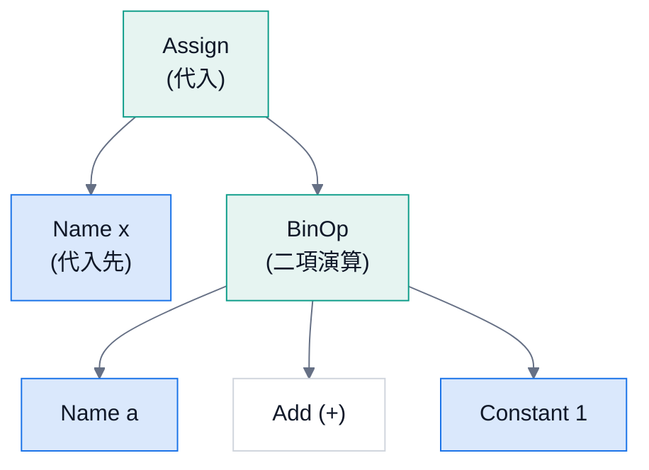
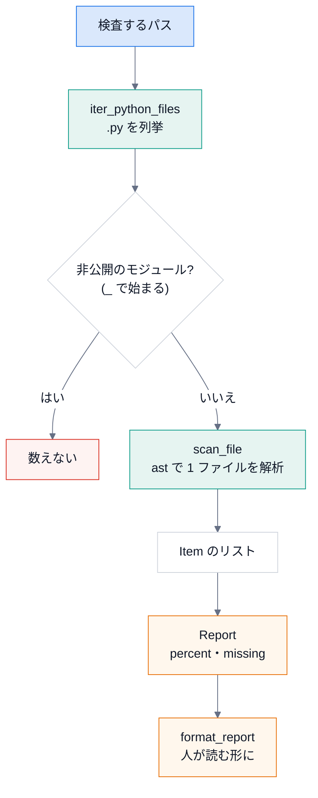

# 第 4 回 構文木 (ast) とソースの静的解析

> 所要時間の目安: 3.5 時間 / 前提: 第 1〜3 回

## この回のゴール

- ソースコードを **実行せずに** 読む (静的解析) 利点と限界を説明できる。
- 構文木 (AST) が、どんな **木構造** か説明でき、`ast` で歩ける。
- `docstring_coverage` (docstring が無い公開 API の検出) を、**1 行ずつ** 読んで説明できる。
- `structure_map` が、`import` 文から **依存を取り出す** 仕組み (相対 import の解決を含む) を説明できる。
- 静的解析の **限界** (見つけられないもの) を、具体例で挙げられる。

## 1. なぜ、コードを「実行せず」に読むのか

「このパッケージの公開関数のうち、docstring が無いものを数えたい」。方法は 3 つ考えられます。

| 方法 | 長所 | 短所 |
|---|---|---|
| (a) 正規表現で、`def` の行を探す | 手軽 | 文字列の中の `def`、コメント、複数行の引数、デコレータ、入れ子を **正しく扱えない** |
| (b) `import` して、実行時に調べる (`inspect`) | 正確 | **コードが実行される** (副作用・遅い)。`import hou` のように、環境が無いと **読み込めない** |
| (c) **構文木 (`ast`)** で読む | 正確で、**実行しない** | 実行時にしか決まらないもの (動的な処理) は、見えない |

DocsPipeline は (c) を選びました。理由は 2 つです。

1. **安全**: 他人のコードを読むだけで、実行しない。副作用 (ファイルの書き込み・ネットワーク) が起きない。
2. **環境に依らない**: Houdini の外でも、Sphinx が無い環境でも、動く。

## 2. 構文木とは

Python は、ソースを読むと、まず **構文木** (AST: Abstract Syntax Tree) に変えます。
`x = a + 1` は、次のような木になります。



- **節 (ノード)** が、文や式。**子** を持つ。
- 関数定義 (`FunctionDef`) の子には、引数・本体の文が並ぶ。
- 文字列の中の `def` や、コメントは、**木に現れない** (だから、正規表現のような誤認が起きない)。

`ast.parse` で木を作り、歩いてみましょう。次の関数は、木を **インデントつきで** 表示します
(ctx や演算子の節は省いて、見やすくしています)。

```python
# 実行できる
import ast


def outline(node, depth=0):
    skip = (ast.expr_context, ast.operator)
    for child in ast.iter_child_nodes(node):
        if isinstance(child, skip):
            continue
        label = type(child).__name__
        extra = getattr(child, "name", None) or getattr(child, "id", None) or getattr(child, "arg", None)
        if isinstance(child, ast.Constant):
            extra = repr(child.value)
        print("  " * depth + label + (f"  ({extra})" if extra else ""))
        outline(child, depth + 1)


source = "def total(items):\n    '''合計。'''\n    s = 0\n    for i in items:\n        s += i\n    return s\n"
outline(ast.parse(source))
```

```text
# 出力
FunctionDef  (total)
  arguments
    arg  (items)
  Expr
    Constant  ('合計。')
  Assign
    Name  (s)
    Constant  (0)
  For
    Name  (i)
    Name  (items)
    AugAssign
      Name  (s)
      Name  (i)
  Return
    Name  (s)
```

木の読み方:

- 最上位は `Module`。その子が、ファイルの **文の並び** (`body`)。
- `FunctionDef (total)` の子に、引数 `arguments`、そして本体。
- **docstring は、本体の先頭の `Expr` (式文) の中の `Constant` (文字列)** です。特別な構文ではなく、「先頭にある文字列の式」。

### 木を歩く 3 つの方法

| 方法 | 使い方 | 向く場面 |
|---|---|---|
| `ast.walk(tree)` | 全部の節を、順不同で取り出す | 「全ての `import` が欲しい」。**どこにあっても** よい |
| `ast.iter_child_nodes(node)` | **直接の子だけ** を取り出す | 自分で再帰して、**どこで止めるか** を決める |
| `ast.NodeVisitor` | 節の種類ごとのメソッド (`visit_FunctionDef`) | 節の種類ごとに、処理を分けたい |

DocsPipeline は、**自分で再帰** します (`iter_child_nodes`)。理由は、「関数の **中** は読まない」「`if TYPE_CHECKING:` の中は読まない」
のように、**降りない場所を決めたい** からです。`ast.walk` は、全部に降りてしまいます。

## 3. docstring_coverage を読む

目的: **公開 API のうち、docstring が無いものを数える**。

「公開 API」の定義 (モジュールの先頭の説明から):

- `_` で始まらない名前のモジュール・クラス・関数・メソッド。
- モジュールに `__all__` があるときは、そこに載っている名前だけ。
- `@overload` と、プロパティの `setter` / `deleter` は数えない。

### 3.1 データ構造

第 1 回で読みました (`Item` = 1 件、`Report` = 集計)。もう一度、全体の流れを図にします。



### 3.2 `__all__` を静的に読む

`__all__ = ["a", "b"]` は、どの名前を公開するかの宣言です。**実行せずに** 値を取り出します。

```python
# 引用: docspipeline/docstring_coverage.py::_exported
def _exported(tree: ast.Module) -> set[str] | None:
    """``__all__`` の中身を返す。無い (または静的に読めない) ときは ``None``。

    ``__all__ = [...]``・``__all__: list[str] = [...]``・``__all__ += [...]`` を読む。
    """
    names: set[str] | None = None
    for node in tree.body:
        if isinstance(node, ast.Assign) and any(isinstance(t, ast.Name) and t.id == "__all__" for t in node.targets):
            value_node, replace = node.value, True
        elif isinstance(node, ast.AnnAssign) and isinstance(node.target, ast.Name) and node.target.id == "__all__":
            if node.value is None:
                continue
            value_node, replace = node.value, True
        elif isinstance(node, ast.AugAssign) and isinstance(node.target, ast.Name) and node.target.id == "__all__":
            value_node, replace = node.value, False
        else:
            continue
        try:
            value = ast.literal_eval(value_node)
        except ValueError:
            return None
        if not (isinstance(value, list | tuple) and all(isinstance(v, str) for v in value)):
            return None
        names = set(value) if replace or names is None else names | set(value)
    return names
```

読み方:

1. `tree.body` を、先頭から順に見る (モジュール直下の文だけ)。
2. 3 種類の文を扱う: **代入** (`Assign`)、**型注釈つき代入** (`AnnAssign`)、**増分代入** (`AugAssign`、`+=`)。
   - `replace` は、「置き換え」(`=`) か、「足す」(`+=`) か。
3. **`ast.literal_eval(value_node)`**: 木の節を、**安全に** Python の値にします (リテラル = 書いてある値だけ)。
   `eval` と違い、**関数呼び出しなど、実行が必要なものは、`ValueError`** になります。
4. 値が `["a", "b"]` のような **文字列の並び** でなければ、`None` (= 静的に読めない)。
   → その場合は、「全部を公開」として扱う (安全側: 数え漏らすより、数え過ぎる)。
5. 最後に、集合 (`set`) にして返す。

```python
# 実行できる
import ast
from docspipeline.docstring_coverage import _exported

samples = {
    "代入": '__all__ = ["a", "b"]',
    "型注釈つき": '__all__: list[str] = ["a"]',
    "+= で足す": '__all__ = ["a"]\n__all__ += ["b"]',
    "動的 (読めない)": "__all__ = [name for name in dir()]",
    "無い": "x = 1",
}
for label, source in samples.items():
    names = _exported(ast.parse(source))
    print(f"{label:14}", None if names is None else sorted(names))  # 集合の順序は不定なので、整列して出す
```

```text
# 出力
代入             ['a', 'b']
型注釈つき          ['a']
+= で足す         ['a', 'b']
動的 (読めない)      None
無い             None
```

### 3.3 デコレータの名前

`@overload` や `@x.setter` は、「docstring を書く場所ではない」ので、数えません。デコレータの **名前だけ** を取り出します。

```python
# 引用: docspipeline/docstring_coverage.py::_decorator_names
def _decorator_names(node: ast.FunctionDef | ast.AsyncFunctionDef) -> set[str]:
    names = set()
    for dec in node.decorator_list:
        target = dec.func if isinstance(dec, ast.Call) else dec
        if isinstance(target, ast.Attribute):
            names.add(target.attr)
        elif isinstance(target, ast.Name):
            names.add(target.id)
    return names
```

デコレータは、3 つの形があります。

| 書き方 | 木の形 | 名前の取り出し方 |
|---|---|---|
| `@overload` | `Name` | `target.id` |
| `@value.setter` | `Attribute` | `target.attr` (`setter`) |
| `@dataclass(frozen=True)` | `Call` (呼び出し) | `dec.func` を取り出してから、上と同じ |

### 3.4 1 ファイルを解析する

```python
# 引用: docspipeline/docstring_coverage.py::scan_file
def scan_file(path: Path, *, module_name: str | None = None) -> list[Item]:
    """1 ファイルの公開 API を調べる。

    Args:
        path: Python のソースファイル。
        module_name: 結果に使うモジュール名。省略するとファイル名から付ける。

    Returns:
        見つかった項目。

    Raises:
        ValueError: ファイルが構文エラーのとき (ファイル名と行を含む)。
    """
    try:
        tree = ast.parse(path.read_text(encoding="utf-8"), filename=str(path))
    except SyntaxError as exc:
        raise ValueError(f"{path}:{exc.lineno}: 構文エラー: {exc.msg}") from exc
    module = module_name or path.stem
    exported = _exported(tree)
    items: list[Item] = []

    def visit_body(body: list[ast.stmt], prefix: str, top_level: bool) -> None:
        for node in body:
            if isinstance(node, (ast.If, ast.Try, ast.With)):
                # 条件つきの定義 (try: import ... / if sys.version_info ...) も、同じ階層として扱う
                visit_body(node.body, prefix, top_level)
                visit_body(getattr(node, "orelse", []), prefix, top_level)
                for handler in getattr(node, "handlers", []):
                    visit_body(handler.body, prefix, top_level)
                visit_body(getattr(node, "finalbody", []), prefix, top_level)
            elif isinstance(node, ast.ClassDef):
                if not _is_public(node.name) or (top_level and exported is not None and node.name not in exported):
                    continue
                qual = f"{prefix}.{node.name}"
                items.append(Item(path, qual, "class", node.lineno, ast.get_docstring(node) is not None))
                visit_body(node.body, qual, top_level=False)
            elif isinstance(node, (ast.FunctionDef, ast.AsyncFunctionDef)):
                if not _is_public(node.name) or (top_level and exported is not None and node.name not in exported):
                    continue
                decorators = _decorator_names(node)
                if decorators & {"overload", "setter", "deleter"}:
                    continue
                kind = "function" if top_level else "method"
                qual = f"{prefix}.{node.name}"
                items.append(Item(path, qual, kind, node.lineno, ast.get_docstring(node) is not None))

    items.append(Item(path, module, "module", 1, ast.get_docstring(tree) is not None))
    visit_body(tree.body, module, top_level=True)
    return items
```

細部を読みます。

1. **構文エラーを、場所つきの `ValueError` に**: `ast.parse` が `SyntaxError` を投げたら、
   `ファイル名:行: 構文エラー: 理由` にして、`raise ... from exc` で投げ直す。
   (スタックトレースを出さない。`coverage`・`map` が、これを終了コード 2 にする)
2. **入れ子の関数 `visit_body`** (クロージャ): 外側の `items`・`path`・`exported` を、**そのまま使える**。
   引数に渡さなくて済む。
3. **`if` / `try` / `with` の中**: `visit_body` を、**同じ階層として** 再帰して呼ぶ。
   `try: import fast ... except ImportError: def load(): ...` のような、条件つきの定義を拾うため。
4. **クラス**: 非公開・`__all__` に無い名前は、飛ばす。公開なら `Item` を作り、**中身 (メソッド) へ再帰**。
   このとき `top_level=False` にする (メソッドには、`__all__` を適用しない)。
5. **関数**: 同様に飛ばす条件を見て、デコレータが `overload`・`setter`・`deleter` なら、数えない。
6. **`ast.get_docstring(node) is not None`**: docstring があるか。
   (空の docstring `""` も、`None` ではない。空かどうかは見ていない)
7. 最後に、モジュール自身の `Item` を足し、本体を走査する。

```python
# 実行できる
import tempfile
from pathlib import Path
from docspipeline.docstring_coverage import scan_file

source = '''"""モジュールの説明。"""
__all__ = ["public", "Documented"]

def public():
    """説明あり。"""

def hidden_by_all():
    pass

def _private():
    pass

class Documented:
    """説明あり。"""

    def method(self):
        pass

    @property
    def value(self):
        """値。"""

    @value.setter
    def value(self, v):
        pass

class NotListed:
    pass
'''
with tempfile.TemporaryDirectory() as tmp:
    path = Path(tmp) / "sample.py"
    path.write_text(source, encoding="utf-8")
    for item in scan_file(path, module_name="sample"):
        print(f"{item.kind:9} {item.qualname:22} 行 {item.line:<3} docstring: {item.documented}")
```

```text
# 出力
module    sample                 行 1   docstring: True
function  sample.public          行 4   docstring: True
class     sample.Documented      行 13  docstring: True
method    sample.Documented.method 行 16  docstring: False
method    sample.Documented.value 行 20  docstring: True
```

確かめましょう。

- `hidden_by_all`・`_private`・`NotListed` は、**載っていない** (`__all__` に無い / `_` で始まる)。
- `Documented.value` は **1 件だけ** (`setter` は数えない)。
- `Documented.method` だけが `docstring: False`。

### 3.5 パッケージ全体

```python
# 引用: docspipeline/docstring_coverage.py::_is_private_module
def _is_private_module(path: Path, root: Path) -> bool:
    """``_`` で始まる名前 (``_compat.py``・``_impl/``) の下にあるか。``__init__`` は、パッケージ自身なので除く。"""
    if not root.is_dir():
        return False
    parts = path.relative_to(root).with_suffix("").parts
    return any(part.startswith("_") and part != "__init__" for part in parts)
```

```python
# 引用: docspipeline/docstring_coverage.py::_module_name
def _module_name(path: Path, root: Path) -> str:
    """``root`` からの相対パスでモジュール名を付ける。``root`` がパッケージなら、その名前から始める。"""
    if not root.is_dir():
        return path.stem
    parts = list(path.relative_to(root).with_suffix("").parts)
    if (root / "__init__.py").exists():
        parts.insert(0, root.name)
    if parts and parts[-1] == "__init__":
        parts.pop()
    return ".".join(parts) or root.name
```

```python
# 引用: docspipeline/docstring_coverage.py::scan
def scan(roots: Iterable[Path]) -> Report:
    """``roots`` 配下の公開 API を調べて集計する。

    Raises:
        ValueError: 存在しないパスがあるとき、または構文エラーのファイルがあるとき。
            存在しないパスを「100%」と報告すると、パスの打ち間違いや移動で、検査が黙って空になる。
    """
    items: list[Item] = []
    for root in roots:
        if not root.exists():
            raise ValueError(f"パスがありません: {root}")
        for path in iter_python_files([root]):
            if _is_private_module(path, root):
                continue  # 公開 API の定義は「_ で始まらない名前」。非公開のモジュールは数えない
            items.extend(scan_file(path, module_name=_module_name(path, root)))
    return Report(tuple(items))
```

- `_is_private_module`: パスの **どこかの部品** が `_` で始まれば、非公開 (`_compat.py`・`_impl/core.py`)。
  ただし `__init__` は、**パッケージ自身** なので除く。
- `_module_name`: `root` が **パッケージ** (`__init__.py` を持つ) なら、その名前から始める
  (`pkg/sub/leaf.py` → `pkg.sub.leaf`)。`__init__` は、パッケージ名そのもの。
- `scan`: **存在しないパスは `ValueError`** (第 3 回の「打ち間違いを成功させない」)。
  ファイルは `iter_python_files` で列挙し (第 1 回)、非公開を飛ばして、`scan_file` の結果を **足し込む** (`extend`)。

## 4. structure_map を読む: import から依存を取り出す

目的: モジュールどうしの **依存** (どれが、どれを使っているか) を、`import` 文から読み取る。

### 4.1 import 文の木

| 書き方 | 木の節 | 意味 |
|---|---|---|
| `import pkg.mod` | `Import` (`names=[alias('pkg.mod')]`) | `pkg.mod` を読み込む |
| `from pkg.mod import f` | `ImportFrom` (`module='pkg.mod'`, `level=0`) | 絶対 import |
| `from . import mod` | `ImportFrom` (`module=None`, `level=1`) | **相対 import**。`level` は、`.` の数 |
| `from ..x import f` | `ImportFrom` (`module='x'`, `level=2`) | 1 つ上のパッケージの `x` |

### 4.2 相対 import を、絶対名に直す

相対 import (`from . import a`) が指すモジュールは、**今のモジュールの位置** で決まります。
`level` が 1 なら「同じパッケージ」、2 なら「その親」。`__init__.py` (パッケージ自身) と、
普通のモジュールでは、**基準が違います**。

```python
# 引用: docspipeline/structure_map.py::_resolve_from
def _resolve_from(node: ast.ImportFrom, module: str, is_package: bool, known: set[str]) -> Iterator[str]:
    """``from ... import ...`` が指す、パッケージ内のモジュールを返す。"""
    if node.level:
        parts = module.split(".")
        # 相対 import の基準は、パッケージ (モジュールなら、それを含むパッケージ)
        base_parts = parts if is_package else parts[:-1]
        base_parts = base_parts[: len(base_parts) - (node.level - 1)]
        base = ".".join(base_parts)
        target = f"{base}.{node.module}" if node.module else base
    else:
        target = node.module or ""
    for alias in node.names:
        candidate = f"{target}.{alias.name}"
        if candidate in known:
            yield candidate
        elif target in known:
            yield target
```

計算の核心は、この 3 行です。

```python
# 抜粋: docspipeline/structure_map.py::_resolve_from
        base_parts = parts if is_package else parts[:-1]
        base_parts = base_parts[: len(base_parts) - (node.level - 1)]
        base = ".".join(base_parts)
```

- `parts` は、今のモジュール名を `.` で分けたもの (`["pkg", "sub", "x"]`)。
- **普通のモジュール** (`pkg.sub.x`) の基準は、それを含む **パッケージ** (`pkg.sub`) → 末尾を 1 つ落とす (`parts[:-1]`)。
- **パッケージ自身** (`pkg.sub` の `__init__.py`) の基準は、**自分自身** (`pkg.sub`)。
- さらに `level - 1` 個だけ、上へ登る (`level=2` なら、1 つ上)。

結果の `base` に、`node.module` と、`import` する名前を足して、**内部のモジュールか** を `known` (既知のモジュール名の集合) で確かめます。

```python
# 実行できる
import ast
from docspipeline.structure_map import _resolve_from

known = {"pkg", "pkg.a", "pkg.sub", "pkg.sub.x", "pkg.sub.y", "pkg.top"}


def show(stmt, module, is_package=False):
    node = ast.parse(stmt).body[0]
    print(f"{module:10} {stmt:28} →", sorted(_resolve_from(node, module, is_package, known)))


show("from . import a", "pkg.top")
show("from .a import f", "pkg.top")
show("from . import x", "pkg.sub.y")
show("from .. import top", "pkg.sub.x")
show("from . import y", "pkg.sub", is_package=True)
show("from pkg import top", "pkg.a")
show("from os import path", "pkg.a")
```

```text
# 出力
pkg.top    from . import a              → ['pkg.a']
pkg.top    from .a import f             → ['pkg.a']
pkg.sub.y  from . import x              → ['pkg.sub.x']
pkg.sub.x  from .. import top           → ['pkg.top']
pkg.sub    from . import y              → ['pkg.sub.y']
pkg.a      from pkg import top          → ['pkg.top']
pkg.a      from os import path          → []
```

読み取れましたか。

- `from .a import f` は、`f` が **関数** (モジュールではない) なので、`pkg.a` への依存になる (`target in known` の分岐)。
- `from . import x` は、`x` が **モジュール** (`pkg.sub.x`) なので、そのモジュールへの依存になる (`candidate in known`)。
- `from os import path` は、内部のモジュールではないので、何も返さない (外部ライブラリは、別に記録する)。

### 4.3 木を歩く: 実行時の依存だけを拾う

全ての `import` が、**実行時の依存** とは限りません。

| 場所 | 例 | 実行時の依存か |
|---|---|---|
| モジュール直下 | `from . import a` | **はい** (モジュールを読み込んだ時点で実行される) |
| `if TYPE_CHECKING:` の中 | 型検査のためだけの `import` | **いいえ** (実行時は、読まれない) |
| 関数の中 | `def f(): from . import b` | **遅延** (呼ばれたときに、初めて読み込まれる) |

この区別をするのが、`_walk` です。

```python
# 引用: docspipeline/structure_map.py::_is_type_checking
def _is_type_checking(test: ast.expr) -> bool:
    """``if TYPE_CHECKING:`` / ``if typing.TYPE_CHECKING:`` か。"""
    return (isinstance(test, ast.Name) and test.id == "TYPE_CHECKING") or (
        isinstance(test, ast.Attribute) and test.attr == "TYPE_CHECKING"
    )
```

```python
# 引用: docspipeline/structure_map.py::_walk
def _walk(node: ast.AST, deferred: bool = False) -> Iterator[tuple[ast.AST, bool]]:
    """ノードを順に返す。``deferred`` は、関数の中 (呼ばれたときに実行される) かどうか。

    ``if TYPE_CHECKING:`` の本体は、実行時には読み込まれないので返さない。
    """
    yield node, deferred
    if isinstance(node, ast.If) and _is_type_checking(node.test):
        children = node.orelse
    else:
        children = list(ast.iter_child_nodes(node))
    inside_function = deferred or isinstance(node, ast.FunctionDef | ast.AsyncFunctionDef | ast.Lambda)
    for child in children:
        yield from _walk(child, inside_function)
```

- **ジェネレータ** (`yield`) で、`(節, 遅延か)` の組を、**1 つずつ** 返す。
- `yield from _walk(child, ...)`: 子の結果を、そのまま **再帰して** 返す (`yield from` は、ジェネレータの入れ子を平らにする)。
- `if TYPE_CHECKING:` なら、**`orelse` (else の側) だけ** を降りる。`if` の本体は、降りない。
- 関数 (`FunctionDef`・`AsyncFunctionDef`・`Lambda`) の中に入ると、`deferred=True` を、**子孫へ引き継ぐ**。

```python
# 実行できる
import ast
from docspipeline.structure_map import _walk

source = """
import a
from typing import TYPE_CHECKING
if TYPE_CHECKING:
    import b
def f():
    import c
class K:
    import d
"""
for node, deferred in _walk(ast.parse(source)):
    if isinstance(node, ast.Import):
        print(node.names[0].name, "→", "遅延 (関数の中)" if deferred else "実行時 (直下)")
```

```text
# 出力
a → 実行時 (直下)
c → 遅延 (関数の中)
d → 実行時 (直下)
```

- `b` は、**出てきません** (`TYPE_CHECKING` の中)。
- `c` は、遅延。`d` は、**クラスの本体** (クラスの本体は、定義の時点で実行される) なので、実行時。

### 4.4 1 つのモジュールを分析する

```python
# 引用: docspipeline/structure_map.py::_analyze
def _analyze(path: Path, name: str, is_package: bool, known: set[str]) -> Module:
    text = path.read_text(encoding="utf-8")
    try:
        tree = ast.parse(text, filename=str(path))
    except SyntaxError as exc:
        raise ValueError(f"{path}:{exc.lineno}: 構文エラー: {exc.msg}") from exc
    runtime: set[str] = set()
    lazy: set[str] = set()
    references: set[str] = set()
    external: set[str] = set()
    root = name.split(".")[0]
    for node, deferred in _walk(tree):
        found = runtime if not deferred else lazy
        if isinstance(node, ast.Import):
            for alias in node.names:
                top = alias.name.split(".")[0]
                if top == root:
                    parts = alias.name.split(".")
                    while parts and ".".join(parts) not in known:
                        parts.pop()
                    if parts:
                        found.add(".".join(parts))
                else:
                    external.add(top)
        elif isinstance(node, ast.ImportFrom):
            if node.level or (node.module or "").split(".")[0] == root:
                found.update(_resolve_from(node, name, is_package, known))
            elif node.module:
                external.add(node.module.split(".")[0])
        elif isinstance(node, ast.Constant) and isinstance(node.value, str) and node.value in known:
            references.add(node.value)
    runtime.discard(name)
    lazy.discard(name)
    references.discard(name)
    return Module(
        name=name,
        path=path,
        is_package=is_package,
        summary=_first_line(ast.get_docstring(tree)),
        lines=len(text.splitlines()),
        public_api=_public_api(tree),
        imports=frozenset(runtime),
        references=frozenset(references - runtime),
        external=frozenset(external - {"__future__"}),
        deferred=frozenset(lazy - runtime),
    )
```

読み方 (木を歩き、**種類ごとに** 仕分けています)。

1. 構文エラーは、場所つきの `ValueError` (3.4 と同じ)。
2. `runtime` / `lazy` / `references` / `external` の **4 つの集合** を用意する。集合なので、同じ依存は、1 件にまとまる。
3. `for node, deferred in _walk(tree)`: 歩きながら、`found = runtime if not deferred else lazy` で、**入れる先を切り替える**。
4. `Import` (`import a.b.c`):
   - 先頭が **自分のパッケージ** (`root`) なら、内部。`a.b.c` → `a.b` → `a` と、**末尾を削りながら**、`known` にある最長のものを探す
     (`import pkg.mod.name` の `name` が関数でも、`pkg.mod` を見つけられる)。
   - そうでなければ、外部ライブラリとして、**先頭の名前** (`os.path` → `os`) を記録する。
5. `ImportFrom`: 相対 import (`level > 0`) か、自分のパッケージの絶対 import なら、`_resolve_from` で解決。外部なら、記録。
6. **文字列の定数** (`ast.Constant` で、値が `str`) が、`known` のモジュール名と **完全一致** すれば、`references` に入れる
   (Sphinx の `extensions = ["docspipeline.guard"]` のような、名前による読み込みを拾う)。
7. 最後に、自分自身への依存を除き、`Module` を作る。`references - runtime` は、**import でも読んでいるもの** を、参照から除く。

### 4.5 モジュール全体: パッケージを走査する

```python
# 引用: docspipeline/structure_map.py::scan_package
def scan_package(root: Path) -> Graph:
    """パッケージのディレクトリを読んで、地図を作る。

    Args:
        root: ``__init__.py`` を持つディレクトリ。

    Returns:
        モジュールの一覧と依存。

    Raises:
        ValueError: ``root`` がパッケージ (``__init__.py`` を持つディレクトリ) でないとき、
            または構文エラーのファイルがあるとき。
    """
    root = root.resolve()
    if not (root / "__init__.py").is_file():
        raise ValueError(f"パッケージではありません (__init__.py が無い): {root}")
    package = root.name
    files: dict[str, tuple[Path, bool]] = {}
    for path in iter_python_files([root]):
        parts = [package, *path.relative_to(root).with_suffix("").parts]
        is_package = parts[-1] == "__init__"
        if is_package:
            parts.pop()
        files[".".join(parts)] = (path, is_package)
    known = set(files)
    modules = tuple(_analyze(path, name, is_pkg, known) for name, (path, is_pkg) in sorted(files.items()))
    return Graph(package, modules)
```

- `__init__.py` が無いディレクトリは、`ValueError` (パッケージではない)。
- ファイルの一覧から、**ファイル名 → モジュール名** の対応を作る (`pkg/sub/x.py` → `pkg.sub.x`、`__init__` は削る)。
- **先に全ファイルの名前を集めて** (`known`)、それから分析する。内部かどうかの判定に、**全体の名前の一覧** が要るため。

実際に、小さなパッケージを作って、動かします。

```python
# 実行できる
import tempfile
import textwrap
from pathlib import Path
from docspipeline.structure_map import scan_package

files = {
    "pkg/__init__.py": '"""パッケージ。"""\n__version__ = "1"\n',
    "pkg/core.py": '"""中核。"""\nfrom . import util\nfrom .util import helper\nimport json\n',
    "pkg/util.py": '"""道具。"""\ndef helper():\n    from . import lazy_mod\n',
    "pkg/lazy_mod.py": '"""遅延で読まれる。"""\n',
    "pkg/cfg.py": '"""名前で読む。"""\nEXTENSIONS = ["pkg.core"]\n',
}
with tempfile.TemporaryDirectory() as tmp:
    for name, text in files.items():
        path = Path(tmp) / name
        path.parent.mkdir(parents=True, exist_ok=True)
        path.write_text(text, encoding="utf-8")
    graph = scan_package(Path(tmp) / "pkg")
    for m in graph.modules:
        if m.name == "pkg":
            continue
        print(
            f"{m.name:14} import={sorted(m.imports)} 遅延={sorted(m.deferred)} 参照={sorted(m.references)} 外部={sorted(m.external)}"
        )
```

```text
# 出力
pkg.cfg        import=[] 遅延=[] 参照=['pkg.core'] 外部=[]
pkg.core       import=['pkg.util'] 遅延=[] 参照=[] 外部=['json']
pkg.lazy_mod   import=[] 遅延=[] 参照=[] 外部=[]
pkg.util       import=[] 遅延=['pkg.lazy_mod'] 参照=[] 外部=[]
```

## 5. 静的解析の限界

| 見つけられないもの | 例 | 対処 |
|---|---|---|
| **動的な読み込み** | `importlib.import_module(name)` (`name` が変数) | 見つけられない。文書に、限界として書く |
| **組み立てた名前** | `"pkg." + "mod"` | 文字列の **完全一致** だけを拾う |
| **実行時にしか決まらない値** | `__all__ = [n for n in dir()]` | `None` (読めない) として、安全側で扱う |
| **別のファイルから足される** | `setattr(module, "x", ...)` | 見つけられない |
| **名前の衝突・変数での上書き** | `import os` のあと `os = 3` | 見分けない (木の形だけを見る) |

**「見つけられた = 正しい」ではなく、「見つけたものは、書いてある」** と理解します。
静的解析の結果は、**下書き** として扱い、人が確かめます (`docspipeline map` の出力の冒頭の警告が、これです)。

## ハンズオン

1. 第 2 節の `outline` を、自分の関数 (`docspipeline/files.py` の中身) に適用して、木を眺める。
   (`Path("docspipeline/files.py").read_text(encoding="utf-8")` を `ast.parse` に渡す)
2. `docspipeline map docspipeline --format mermaid` を実行し、出力を Mermaid の表示ツールで見る。
3. `docspipeline coverage docspipeline` の結果が 100% であることを確かめ、わざと docstring を 1 つ消して、変化を見る (戻すこと)。

## 確認問題

1. 静的解析 (`ast`) と、`import` して調べる方法 (`inspect`) の違いを、利点・欠点で説明してください。
2. `ast.literal_eval` と `eval` の、決定的な違いは何ですか。`_exported` が、前者を使う理由は。
3. `__all__` が、動的に作られていて読めないとき、`_exported` は `None` を返します。この **安全側の理由** は。
4. 普通のモジュールとパッケージ (`__init__.py`) で、相対 import の「基準」が違うのは、なぜですか。
5. `if TYPE_CHECKING:` の中の `import` と、関数の中の `import` は、なぜ、「循環の検出」の対象にしないのですか。
6. `ast.walk` でなく、**自分で再帰** する理由は何ですか。
7. (書く問題) ソース文字列から、**トップレベルの関数の名前** を、定義の順に返す関数 `function_names(source)` を書いてください
   (クラスの中のメソッドは含めない)。

## 解答

1. 静的解析は、**実行しない** ので安全で、環境 (Houdini・Sphinx) が無くても動く。ただし、実行時にしか決まらないものは見えない。
   `inspect` は、実際の値を見られて正確だが、**コードが実行され** (副作用・遅い)、環境が無いと読み込めない。
2. `literal_eval` は、**書いてある値 (リテラル) だけ** を、評価する。関数呼び出しなど、実行が必要なものは `ValueError`。
   `eval` は、**任意のコードを実行する**。他人のソースを読む道具に、`eval` は使えない (安全のため)。
3. 読めないのに「何も公開していない」と扱うと、**検査から漏れる** (数え忘れ)。「全部を公開」と扱えば、
   検査が **厳しい側** に倒れる (数え過ぎる)。品質の検査は、見逃すより、**厳しく** あるべき。
4. 相対 import の `.` は、「**今のパッケージ**」を指す。普通のモジュール `pkg.sub.x` を含むパッケージは `pkg.sub` だが、
   パッケージ自身 (`pkg.sub/__init__.py`) は、`pkg.sub` **そのもの** が、今のパッケージだから。
5. 実行時に **モジュールを読み込む順序** を決める依存ではないから。`TYPE_CHECKING` の中は、実行時には読まれない。
   関数の中は、呼ばれたときに読まれるので、**循環を断つ** 定番の書き方 (循環として報告すると、正しい対処が、誤検出になる)。
6. 「関数の中は、別扱い」「`TYPE_CHECKING` の `if` の本体は、降りない」のように、**降りない場所を決める** ため。
   `ast.walk` は、全ての節に降りる。
7. 例 (実行して確かめてある):

```python
# 実行できる
import ast


def function_names(source):
    tree = ast.parse(source)
    return [node.name for node in tree.body if isinstance(node, (ast.FunctionDef, ast.AsyncFunctionDef))]


print(function_names("def a(): pass\nclass K:\n    def method(self): pass\nasync def b(): pass\ndef c(): pass\n"))
```

```text
# 出力
['a', 'b', 'c']
```

## まとめ

| 概念 | 要点 | このリポジトリでの例 |
|---|---|---|
| 静的解析 | 実行せずに読む。安全・環境に依らない。動的なものは見えない | `docstring_coverage`・`structure_map` |
| AST | ソースの木。文字列やコメントに惑わされない | `ast.parse` |
| 自前の再帰 | 降りない場所を決められる | `_walk`・`visit_body` |
| `literal_eval` | リテラルだけを、安全に評価する | `_exported` |
| 相対 import | `level` と、「今のパッケージ」で決まる | `_resolve_from` |
| 実行時の依存 | 直下・`TYPE_CHECKING`・関数の中を、区別する | `_walk` |
| 限界 | 動的なもの・組み立てた名前は見えない。結果は下書き | `map` の警告 |

## 次回

[第 5 回 グラフとアルゴリズム](05-graph-algorithms.md): 取り出した依存を **グラフ** として扱い、循環を見つけるアルゴリズム (Tarjan) を学びます。
