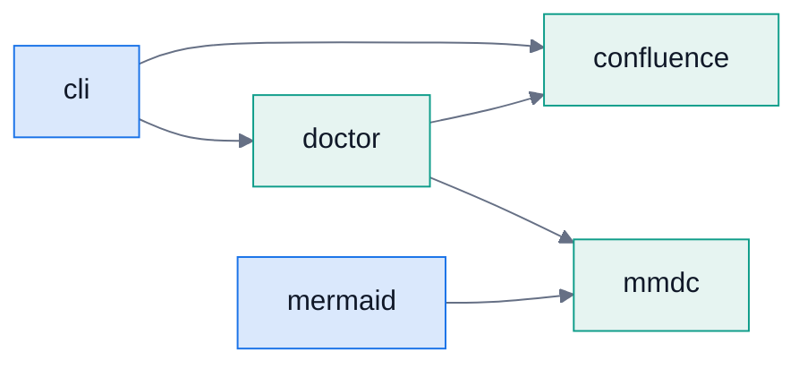
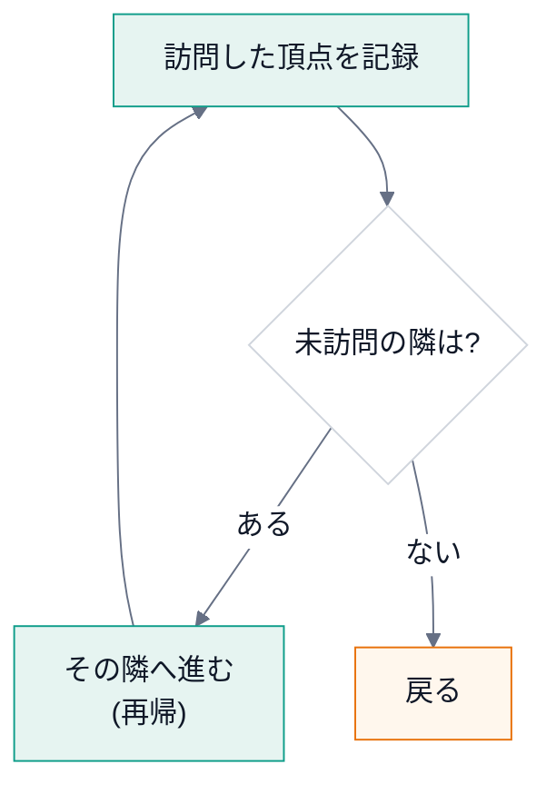
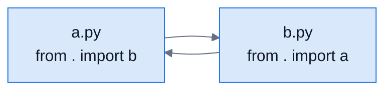
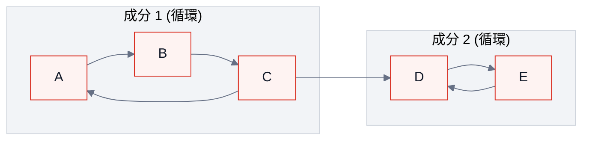
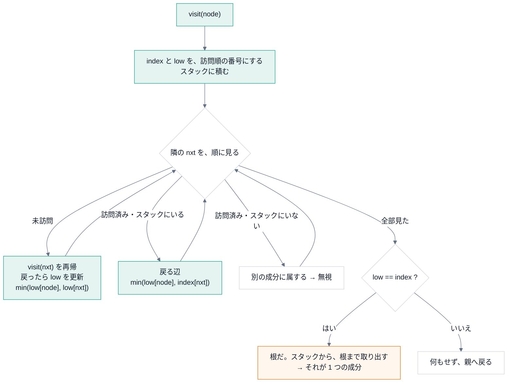
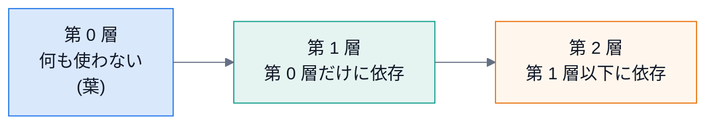

# 第 5 回 グラフとアルゴリズム

> 所要時間の目安: 3.5 時間 / 前提: 第 1〜4 回

## この回のゴール

- 依存関係を **グラフ** (頂点と辺) として表し、辞書で実装できる。
- **深さ優先探索 (DFS)** を、再帰と反復の両方で書ける。
- **循環** と **強連結成分 (SCC)** の関係を説明し、**Tarjan のアルゴリズム** を、追跡しながら理解できる。
- `Graph.cycles` を、1 行ずつ説明できる。
- アルゴリズムの **計算量** と、**再帰の限界** を説明できる。
- トポロジカル順序 (層への分け方) を書ける。

## 1. グラフとは

**グラフ** は、**頂点** (node) と、それをつなぐ **辺** (edge) の集まりです。
モジュールの依存を、「A が B を使う」を **A → B の辺** として表すと、**有向グラフ** になります。



| 用語 | 意味 |
|---|---|
| 頂点 (node) | モジュール |
| 有向辺 (edge) | A が B を `import` する (A → B) |
| 出次数 / 入次数 | その頂点から出る辺の数 / その頂点に入る辺の数 |
| 経路 (path) | 辺をたどって、頂点から頂点へ行く道 |
| 循環 (cycle) | 出発した頂点に、**戻ってこられる** 経路 |

### 隣接リスト: 辞書で表す

グラフの表し方で、最もよく使うのが **隣接リスト** です。「各頂点 → その頂点から行ける頂点の集まり」の辞書です。

```python
# 実行できる
graph = {
    "cli": {"confluence", "doctor"},
    "doctor": {"confluence", "mmdc"},
    "mermaid": {"mmdc"},
    "confluence": set(),
    "mmdc": set(),
}
print("cli の依存先:", sorted(graph["cli"]))
print("辺の数:", sum(len(v) for v in graph.values()), "/ 頂点の数:", len(graph))
print("入次数 (使われる数):", {n: sum(n in v for v in graph.values()) for n in sorted(graph)})
```

```text
# 出力
cli の依存先: ['confluence', 'doctor']
辺の数: 5 / 頂点の数: 5
入次数 (使われる数): {'cli': 0, 'confluence': 2, 'doctor': 1, 'mermaid': 0, 'mmdc': 2}
```

- 頂点を **キー** に、辺の行き先を **集合** にします。集合なので、**同じ辺の重複** が自然に消えます。
- 辞書の引きは、ほぼ一定の時間 (**O(1)**) です。「この頂点の隣は？」が、すぐ分かります。

`structure_map.Graph` は、各モジュールが持つ「依存先」から、**辺の集合** を作ります。

```python
# 引用: docspipeline/structure_map.py::Graph.edges
def edges(self, kind: str = "import", *, include_root: bool = False) -> set[tuple[str, str]]:
    """依存の組 ``(使う側, 使われる側)`` を返す。

    Args:
        kind: ``import``・``reference``・``deferred`` のいずれか。
            ``import`` はモジュール直下で実行される import、
            ``reference`` はモジュール名と一致する文字列、
            ``deferred`` は関数の中の import で、呼ばれたときに初めて読み込まれる。
        include_root: パッケージ自身 (``__init__``) への依存を含めるか。
            ``from . import __version__`` のような依存で、図が読みにくくなるので既定では除く。
    """
    result = set()
    for m in self.modules:
        for dst in {"import": m.imports, "reference": m.references, "deferred": m.deferred}[kind]:
            if include_root or dst != self.package:
                result.add((m.name, dst))
    return result
```

`{"import": m.imports, "reference": m.references, "deferred": m.deferred}[kind]` は、**辞書で分岐を書く** 書き方です
(`kind` の値で、どの集合を使うかを選ぶ。`if` の連鎖より、短く、表になって読みやすい)。
`include_root` が偽なら、パッケージ自身 (`__init__`) への辺を **除きます** (`from . import __version__` のような辺で、図が読みにくくなるため)。

## 2. 深さ優先探索 (DFS)

**DFS** は、行けるところまで **深く** 進み、行き止まりで **戻って**、別の道を試す探索です。



```python
# 実行できる
graph = {
    "cli": {"confluence", "doctor"},
    "doctor": {"confluence", "mmdc"},
    "mermaid": {"mmdc"},
    "confluence": set(),
    "mmdc": set(),
}


def reachable(graph, start):
    """start から、辺をたどって行ける頂点の集合 (start を含む)。"""
    seen = set()

    def visit(node):
        if node in seen:  # すでに来た頂点は、再び訪れない (循環があっても止まる)
            return
        seen.add(node)
        for nxt in sorted(graph[node]):
            visit(nxt)

    visit(start)
    return seen


print("cli が(間接的にも)使う:", sorted(reachable(graph, "cli")))
print("mermaid が使う:", sorted(reachable(graph, "mermaid")))
```

```text
# 出力
cli が(間接的にも)使う: ['cli', 'confluence', 'doctor', 'mmdc']
mermaid が使う: ['mermaid', 'mmdc']
```

**`seen` (訪問済みの集合) が、肝心** です。これが無いと、循環があるグラフで、**永遠に回り続けます**。

### 逆向きにたどる: 「変えたら、どこに影響するか」

`mmdc` を変えたとき、影響を受けるのは、`mmdc` を **使っている側** です。辺を **逆向き** にして、同じ DFS をします。

```python
# 実行できる
from pathlib import Path
import docspipeline
from docspipeline.structure_map import scan_package

graph = scan_package(Path(docspipeline.__file__).parent)
users = {m.name: set() for m in graph.modules}  # 逆向きの隣接リスト
for src, dst in graph.edges():
    users[dst].add(src)


def affected_by(target):
    seen, stack = set(), [target]
    while stack:  # 再帰を使わない書き方 (後で説明します)
        node = stack.pop()
        for user in users.get(node, ()):
            if user not in seen:
                seen.add(user)
                stack.append(user)
    return sorted(seen)


for target in ("docspipeline.mmdc", "docspipeline.confluence", "docspipeline.files"):
    print(target.split(".")[-1], "を変えると影響:", [n.split(".")[-1] for n in affected_by(target)])
```

```text
# 出力
mmdc を変えると影響: ['__main__', 'cli', 'doctor', 'mermaid']
confluence を変えると影響: ['__main__', 'cli', 'config', 'doctor']
files を変えると影響: ['__main__', 'cli', 'docstring_coverage', 'scaffold', 'structure_map']
```

これは **実際のリポジトリの、今の依存** です。保守のとき、「ここを変えて大丈夫か」を、機械で答えられます。

## 3. 循環とは、なぜ問題か

A が B を `import` し、B が A を `import` すると、**循環 import** です。



第 1 回で学んだとおり、`import` は、**読み込んだ時点でコードが実行** されます。
`a` を読み込む → 先頭で `b` を読み込む → `b` の先頭で `a` を読み込もうとする → **まだ `a` は途中** →
`a` の名前がまだ無くて、`ImportError` や、**中途半端な状態** になる。順序に依存する、**壊れやすい** 構造です。

「循環があるか」は、すぐ分かっても、「**どのモジュールが、1 つの輪になっているか**」を知りたい。
それを答えるのが、**強連結成分** です。

## 4. 強連結成分 (SCC) と Tarjan のアルゴリズム

**強連結成分**: 成分の中のどの 2 頂点も、**互いに** (行って戻って) 到達できる、**最大の** 頂点の集まり。



- {A, B, C} は互いに行き来できる → 1 つの成分。{D, E} も、別の成分。
- `C → D` の辺は、成分の **外へ出る** だけ (戻れない)。だから、2 つは **別の成分**。
- **大きさ 2 以上** の成分が、循環です。大きさ 1 の成分 (単独の頂点) は、循環ではありません。

### アルゴリズム: DFS に、2 つの数を持たせる

Tarjan のアルゴリズム (R. E. Tarjan, 1972) は、**DFS を 1 回** するだけで、全ての強連結成分を求めます。
各頂点に、2 つの数を付けます。

| 名前 | 意味 |
|---|---|
| `index` | **訪問した順番** (0, 1, 2, ...)。1 度決めたら変わらない |
| `low` (low-link) | その頂点から、**たどれる範囲で、最も小さい `index`** (スタックにいる頂点の中で) |

**成分の根の見つけ方**: DFS から戻るとき、`low == index` なら、その頂点が **成分の根** です
(自分より前の頂点には、戻れなかった = 成分は、ここで閉じる)。
訪問した頂点を **スタック** に積んでおき、根が見つかったら、**根まで取り出す** と、それが 1 つの成分になります。



### 実際に動かして、追跡する

次のグラフ (上の図と同じ) で、アルゴリズムを **ログつき** で動かします。

`A → B → C → A`、`C → D`、`D → E → D`。

```python
# 実行できる
def tarjan_trace(graph):
    index, low = {}, {}
    stack, on_stack = [], set()
    components, log = [], []
    counter = 0

    def visit(node, depth):
        nonlocal counter
        pad = "  " * depth
        index[node] = low[node] = counter
        counter += 1
        stack.append(node)
        on_stack.add(node)
        log.append(f"{pad}訪問 {node}  index={index[node]}")
        for nxt in sorted(graph[node]):
            if nxt not in index:
                visit(nxt, depth + 1)
                low[node] = min(low[node], low[nxt])
                log.append(f"{pad}戻り {node}  low={low[node]}  (子 {nxt} の low={low[nxt]})")
            elif nxt in on_stack:
                low[node] = min(low[node], index[nxt])
                log.append(f"{pad}戻る辺 {node}→{nxt}  low={low[node]}")
        if low[node] == index[node]:
            comp = []
            while True:
                top = stack.pop()
                on_stack.discard(top)
                comp.append(top)
                if top == node:
                    break
            log.append(f"{pad}根 {node}  (low==index)  → 成分 {sorted(comp)}")
            components.append(sorted(comp))

    for node in sorted(graph):
        if node not in index:
            visit(node, 0)
    return components, log


graph = {"A": {"B"}, "B": {"C"}, "C": {"A", "D"}, "D": {"E"}, "E": {"D"}}
components, log = tarjan_trace(graph)
print("\n".join(log))
print("成分:", components)
```

```text
# 出力
訪問 A  index=0
  訪問 B  index=1
    訪問 C  index=2
    戻る辺 C→A  low=0
      訪問 D  index=3
        訪問 E  index=4
        戻る辺 E→D  low=3
      戻り D  low=3  (子 E の low=3)
      根 D  (low==index)  → 成分 ['D', 'E']
    戻り C  low=0  (子 D の low=3)
  戻り B  low=0  (子 C の low=0)
戻り A  low=0  (子 B の low=0)
根 A  (low==index)  → 成分 ['A', 'B', 'C']
成分: [['D', 'E'], ['A', 'B', 'C']]
```

追跡を、順に読みましょう (上の出力と照らしてください)。

1. `A` を訪問 (`index=0`) → 隣の `B` へ → `C` へ (`index=2`)。
2. `C` の隣の `A` は、**訪問済みで、スタックにいる** → **戻る辺**。`low[C] = index[A] = 0`。
3. `C` の隣の `D` へ → `E` へ。`E` の隣の `D` は、スタックにいる → `low[E] = index[D]`。
4. `E` から戻ると `low[D] = low[E]` になる。`D` は `low == index` → **D が根**。スタックから `D` まで取り出す → 成分 **{D, E}**。
5. `C` に戻る。`low[C]` は `0` のまま (`D` は別の成分なので、影響しない)。`B`・`A` へ戻りながら、`low` が `0` に伝わる。
6. `A` で `low == index (0)` → **A が根**。スタックから `A` まで取り出す → 成分 **{A, B, C}**。

### 本物の実装と、同じ結果になるか

同じ依存を持つパッケージを作り、DocsPipeline の `Graph.cycles` に読ませて、比べます。

```python
# 実行できる
import tempfile
from pathlib import Path
from docspipeline.structure_map import scan_package

edges = {"a": ["b"], "b": ["c"], "c": ["a", "d"], "d": ["e"], "e": ["d"]}
with tempfile.TemporaryDirectory() as tmp:
    pkg = Path(tmp) / "pkg"
    pkg.mkdir()
    (pkg / "__init__.py").write_text("")
    for name, targets in edges.items():
        body = "".join(f"from . import {t}\n" for t in targets)
        (pkg / f"{name}.py").write_text(body)
    cycles = scan_package(pkg).cycles()
    print(cycles)
```

```text
# 出力
[['pkg.a', 'pkg.b', 'pkg.c'], ['pkg.d', 'pkg.e']]
```

`{A, B, C}` と `{D, E}` の 2 つが、見つかりました。次に、その実装を **1 行ずつ** 読みます。

### `Graph.cycles` を読む

```python
# 引用: docspipeline/structure_map.py::Graph.cycles
def cycles(self) -> list[list[str]]:
    """``import`` の循環を、強連結成分として返す (無ければ空)。

    パッケージ自身 (``__init__``) を経由する循環も含める。``__init__`` が子を import し、
    子が ``from pkg import X`` する形は、循環 import の典型だから。
    """
    graph: dict[str, set[str]] = {m.name: set() for m in self.modules}
    for src, dst in self.edges(include_root=True):
        graph[src].add(dst)
    index: dict[str, int] = {}
    low: dict[str, int] = {}
    stack: list[str] = []
    on_stack: set[str] = set()
    found: list[list[str]] = []
    counter = 0

    def visit(node: str) -> None:
        nonlocal counter
        index[node] = low[node] = counter
        counter += 1
        stack.append(node)
        on_stack.add(node)
        for nxt in sorted(graph[node]):
            if nxt not in index:
                visit(nxt)
                low[node] = min(low[node], low[nxt])
            elif nxt in on_stack:
                low[node] = min(low[node], index[nxt])
        if low[node] == index[node]:
            component = []
            while True:
                top = stack.pop()
                on_stack.discard(top)
                component.append(top)
                if top == node:
                    break
            if len(component) > 1:
                found.append(sorted(component))

    for name in sorted(graph):
        if name not in index:
            visit(name)
    return sorted(found)
```

| 行 | 読み方 |
|---|---|
| `graph = {m.name: set() ...}` | 全モジュールを、**空の隣接リスト** で初期化 (辺の無いモジュールも、頂点として入る) |
| `for src, dst in self.edges(include_root=True)` | 辺を足す。**パッケージ自身 (`__init__`) への辺も含める** (`__init__` が子を読み、子が `from pkg import X` する循環を見逃さない) |
| `index`・`low` | 上で説明した 2 つの数。辞書 |
| `stack`・`on_stack` | スタック (リスト) と、**「スタックにいるか」を O(1) で答える集合** |
| `counter`・`nonlocal` | 訪問順の番号。内側の関数で書き換えるので `nonlocal` |
| `visit` | 再帰関数。**入れ子** にして、外側の変数を、そのまま使う (クロージャ) |
| `for nxt in sorted(graph[node])` | 隣を **整列して** 見る。結果が、実行のたびに変わらない (**再現性**。集合の順序は、実行ごとに違う) |
| `if low[node] == index[node]` | 根の判定 |
| `if len(component) > 1` | **大きさ 1 の成分は、循環ではない** ので、捨てる |
| `found.append(sorted(component))` | 成分の中も、整列 (再現性) |
| `return sorted(found)` | 成分の並びも、整列 |

**自己ループ** (`a` が `a` を `import`) は、どうでしょう。`_analyze` が、`runtime.discard(name)` で、**自分自身を除いている**
ので、辺ができません。そもそも、モジュールが自分を `import` するのは、意味がないからです。

### 計算量

| 処理 | 時間 | 理由 |
|---|---|---|
| 辺の収集 (`edges`) | O(V + E) | 全モジュールと、全ての依存を 1 度ずつ見る |
| Tarjan (`visit` 全体) | **O(V + E)** | 各頂点を **1 度だけ** 訪問し、各辺を **1 度だけ** 見る |
| `sorted(...)` | O(V log V) と、各隣接の整列 | 再現性のため。支配的ではない |

V は頂点 (モジュール) の数、E は辺 (依存) の数。**辺の数に比例** なので、数千のモジュールでも、一瞬です。

## 5. 再帰の限界と、反復による書き換え

Python の再帰には **深さの上限** があります (既定 1000)。**依存の鎖が非常に長い** グラフで、再帰の DFS は `RecursionError` になります。

```python
# 実行できる
import sys

chain = {i: [i + 1] for i in range(3000)}  # 0 → 1 → 2 → ... → 3000 (長い鎖)
chain[3000] = []


def dfs_recursive(graph, node, seen):
    seen.add(node)
    for nxt in graph[node]:
        if nxt not in seen:
            dfs_recursive(graph, nxt, seen)


def dfs_iterative(graph, start):
    seen, stack = set(), [start]
    while stack:
        node = stack.pop()
        if node in seen:
            continue
        seen.add(node)
        stack.extend(graph[node])
    return seen


print("再帰の上限:", sys.getrecursionlimit())
try:
    dfs_recursive(chain, 0, set())
except RecursionError as exc:
    print("再帰:", type(exc).__name__)
print("反復: ", len(dfs_iterative(chain, 0)), "個の頂点に到達")
```

```text
# 出力
再帰の上限: 1000
再帰: RecursionError
反復:  3001 個の頂点に到達
```

**反復** (自前のスタック) なら、深さの制限がありません。`Graph.cycles` は **再帰で書いてある** ので、
**理論上は、鎖が 1000 段を超える依存で、落ちます**。実際の Python パッケージの依存の深さは、せいぜい数十段なので、
実害は無い、と判断しています。**これは、既知の限界** です (演習 2 で、反復版に直します)。

> 限界を **知っていて、書いておく** ことは、保守の大事な仕事です。「問題ない」と決めつけず、
> 「どの条件で壊れるか」と「なぜ、それを許容したか」を、残します。

## 6. 入口の候補: 集合の差

「**どこからも使われていないモジュール**」は、**入口** (コマンド・拡張・エントリーポイント) の候補です。
**使われている頂点の集合** を作り、全体から **引く** (集合の差) だけです。

```python
# 引用: docspipeline/structure_map.py::Graph.entry_points
def entry_points(self) -> list[str]:
    """どのモジュールからも使われていないモジュール (入口の候補)。"""
    used = {dst for _, dst in self.edges() | self.edges("reference")}
    return sorted(m.name for m in self.modules if m.name not in used and m.name != self.package)
```

- `self.edges() | self.edges("reference")`: 2 種類の辺の **和集合** (`|`)。
- `{dst for _, dst in ...}`: 辺の **行き先** だけを集めた集合 (`_` は、使わない値の慣習的な名前)。
- 使われていない (`not in used`) もののうち、パッケージ自身を除く。

```python
# 実行できる
from pathlib import Path
import docspipeline
from docspipeline.structure_map import scan_package

graph = scan_package(Path(docspipeline.__file__).parent)
print([name.split(".", 1)[1] for name in graph.entry_points()])
```

```text
# 出力
['__main__', 'config', 'stubs', 'stubs.hou']
```

`__main__`・`config`・`stubs.hou` などが出ます。これらは、**他のモジュールから `import` されず**、
Sphinx (`conf.py`)・`python -m`・CLI から、**外から** 使われます。

## 7. トポロジカル順序: 依存の「層」に分ける

循環が無いグラフ (**DAG**: 有向非巡回グラフ) では、**依存先から順に** 並べられます。
「何も使わないもの」を第 0 層、「第 0 層だけを使うもの」を第 1 層、…と分けると、**構造の地図** になります。



これは **カーンのアルゴリズム** (Kahn, 1962) の考え方です: 「依存先が、全部決まったものから、決めていく」。

```python
# 実行できる
from pathlib import Path
import docspipeline
from docspipeline.structure_map import scan_package


def levels(deps):
    """deps: {モジュール: 依存先の集合} (循環が無いこと)。各モジュールの層を返す。"""
    remaining = {m: set(d) for m, d in deps.items()}
    level, current = {}, 0
    while remaining:
        ready = sorted(m for m, d in remaining.items() if not d)  # 依存先が、全部決まった
        if not ready:
            raise ValueError("循環があります: " + ", ".join(sorted(remaining)))
        for m in ready:
            level[m] = current
            del remaining[m]
        for d in remaining.values():
            d.difference_update(ready)
        current += 1
    return level


graph = scan_package(Path(docspipeline.__file__).parent)
deps = {m.name: set() for m in graph.modules if m.name != "docspipeline"}
for src, dst in graph.edges():
    if src in deps and dst in deps:
        deps[src].add(dst)

by_level = {}
for name, lv in levels(deps).items():
    by_level.setdefault(lv, []).append(name.split(".", 1)[1])
for lv in sorted(by_level):
    print("第", lv, "層:", by_level[lv])

try:
    levels({"a": {"b"}, "b": {"a"}})
except ValueError as exc:
    print(exc)
```

```text
# 出力
第 0 層: ['confluence', 'diagrams', 'doxygen', 'files', 'guard', 'mmdc', 'prompt', 'stubs', 'stubs.hou']
第 1 層: ['config', 'docstring_coverage', 'doctor', 'mermaid', 'scaffold', 'structure_map']
第 2 層: ['cli']
第 3 層: ['__main__']
循環があります: a, b
```

- 循環があると、`ready` が **空になる** (依存先が決まらないものしか残らない) → 例外にできます。
  **循環の検出と、層分けは、同じ道具** で答えられます。
- 層の数は、**依存の最長の鎖** の長さです。層が浅いほど、構造が平らで、理解しやすい。

## 8. アルゴリズムの選び方

| 知りたいこと | アルゴリズム | 計算量 |
|---|---|---|
| ここから、行けるものは? (影響範囲) | DFS / BFS (逆辺なら「使っている側」) | O(V + E) |
| 循環はあるか。**どれが輪か** | **強連結成分** (Tarjan) | O(V + E) |
| 循環があるかだけ | DFS で「いま辿っている道」の再訪を見る / Kahn で残りを見る | O(V + E) |
| 依存の順序・層 | トポロジカルソート (Kahn) | O(V + E) |
| 最短の道 (辺の数) | 幅優先探索 (BFS) | O(V + E) |

どれも **O(V + E)**。グラフの大きさに **比例** で、速い。選ぶ基準は、計算量でなく、**何に答えたいか** です。

## ハンズオン

1. 第 4 節の `tarjan_trace` で、自分で作ったグラフ (たとえば、3 つの輪が、1 本の辺で連なるもの) の追跡を、紙に書いて予想してから、実行する。
2. `docspipeline map docspipeline --format json` を実行し、`entry_points` を読む。
3. 第 2 節の `affected_by` を、`docspipeline.config` について実行する。**何も影響しない** のは、なぜか。
   (ヒント: `config` は、他のモジュールから `import` されない。第 6 節の「入口」)

## 確認問題

1. 有向グラフで、「A から B に行けて、B から A にも行ける」関係にある頂点の集まりを、何と呼びますか。
2. DFS で、`seen` (訪問済み) の記録が無いと、何が起きますか。
3. Tarjan のアルゴリズムで、`low[node] == index[node]` が、何を意味するか説明してください。
4. `Graph.cycles` が、`for nxt in sorted(graph[node])` と、**整列** しているのは、なぜですか。
5. `len(component) > 1` で、大きさ 1 の成分を捨てる理由は何ですか。
6. 再帰の DFS が、危険になるのは、どんなときですか。直し方は。
7. 逆向きの隣接リスト (`users`) を作ると、どんな問いに答えられますか。
8. (書く問題) 反復の DFS で、`start` から行ける頂点を、**訪問した順** にリストで返す関数 `order(graph, start)` を書いてください
   (隣は、`sorted` の順に見る。再帰を使わない)。

## 解答

1. **強連結成分** (その中のどの 2 頂点も、互いに到達できる、最大の集まり)。大きさ 2 以上なら、循環。
2. 循環のあるグラフで、**同じ頂点を何度も訪れ、永遠に回り続ける** (再帰が深くなり、`RecursionError`、または無限ループ)。
3. その頂点から、**自分より前に訪問した頂点 (スタックにいるもの) へは、戻れなかった** こと。
   つまり、その頂点が、**強連結成分の根** で、スタックから根まで取り出したものが、1 つの成分になる。
4. 集合の反復順序は、**実行ごとに違う** (文字列のハッシュのランダム化)。整列しないと、
   同じ入力でも、結果の **並び** が変わり、テストと比較が不安定になる (**再現性**)。
5. 1 つの頂点だけの成分は、「自分に戻る道」(自己ループ) が無ければ、循環ではない。
   全ての頂点が、必ず、大きさ 1 以上の成分に入るので、そのままだと、循環の無い頂点が、全部「循環」として並んでしまう。
6. **依存の鎖が、再帰の上限 (既定 1000) を超える** とき (`RecursionError`)。自前のスタック (リスト) を使う **反復** に書き換える。
7. 「**このモジュールを変えたら、どこに影響するか**」(使っている側の、推移的な集合)。
8. 例 (実行して確かめてある):

```python
# 実行できる
def order(graph, start):
    seen, result, stack = set(), [], [start]
    while stack:
        node = stack.pop()
        if node in seen:
            continue
        seen.add(node)
        result.append(node)
        stack.extend(sorted(graph[node], reverse=True))  # スタックは後入れ先出し。逆順に積むと、小さい順に取り出せる
    return result


print(order({"a": {"c", "b"}, "b": {"d"}, "c": {"d"}, "d": set()}, "a"))
```

```text
# 出力
['a', 'b', 'd', 'c']
```

## まとめ

| 概念 | 要点 | このリポジトリでの例 |
|---|---|---|
| グラフ | 頂点と辺。隣接リスト (辞書 + 集合) が基本 | `Graph.edges` |
| DFS | 訪問済みの集合が肝心。逆辺で影響範囲 | 到達可能・影響範囲 |
| 循環・SCC | 互いに行き来できる最大の集まり。大きさ 2 以上が循環 | `Graph.cycles` |
| Tarjan | DFS 1 回。`index` と `low`。`low == index` で根 | O(V + E) |
| 再現性 | 集合の順序は不定。`sorted` で固定する | `cycles`・`entry_points` |
| 再帰の限界 | 深さの上限。反復 (自前のスタック) に直せる | 既知の限界 |
| 層分け | 依存先が決まったものから。循環も検出できる | Kahn |

## 次回

[第 6 回 Sphinx の考え方](06-sphinx-basics.md): 文書を **ビルド** する仕組み (読む → 解決 → 書く) と、reST / Markdown の基礎を学びます。
