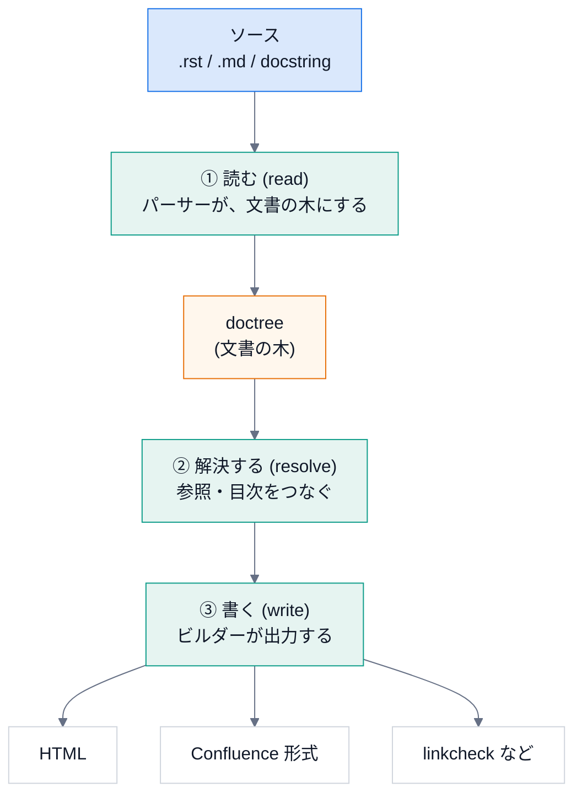
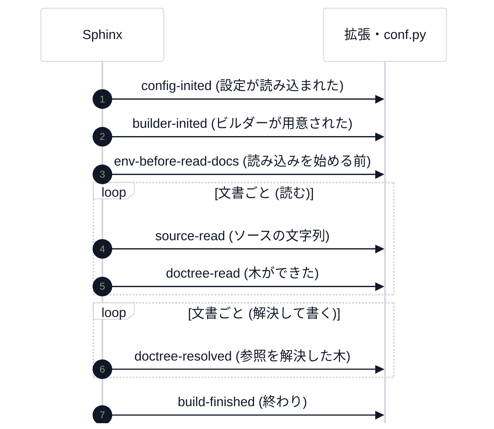
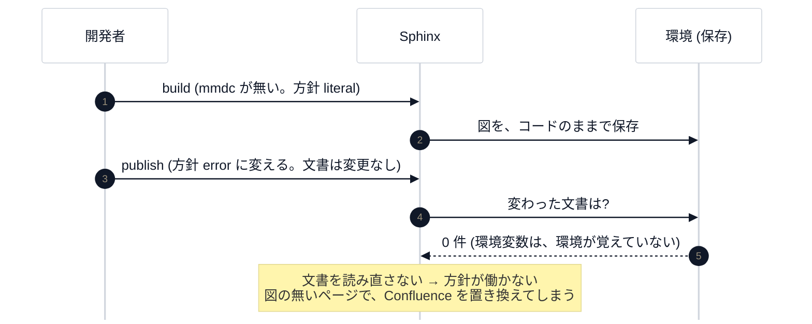
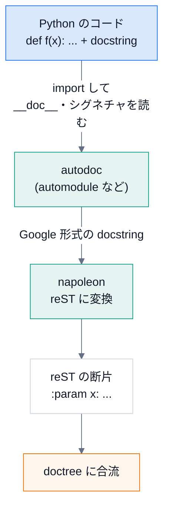

# 第 6 回 文書生成の基礎: Sphinx の考え方

> 所要時間の目安: 3.5 時間 / 前提: 第 1〜3 回 (第 4・5 回は、読まなくてもよい)

## この回のゴール

- 文書のビルドが、**読む → 解決する → 書く** の 3 段階であることを説明できる。
- **doctree** (文書の木) が、HTML や Confluence に **共通の中間表現** であることを説明できる。
- reStructuredText と Markdown (MyST) の対応が分かり、読み書きできる。
- **ディレクティブ・ロール・相互参照** と、nitpicky の関係を説明できる。
- **環境 (キャッシュ)** と、増分ビルドの仕組み、`-E` の意味を説明できる。
- autodoc と napoleon が、docstring から API 文書を作る流れを説明できる。
- `conf.py` と `build_config` を、読み解ける。

## 1. 文書のビルドとは

**Sphinx** は、文書の **ビルドツール** です。ソース (`.rst`・`.md`) を読み、**HTML** や **Confluence 形式** などを出します。
コンパイラが、ソースコードを機械語に変えるのと同じ位置づけです。



大事なのは、真ん中の **doctree** です。ソースの種類 (reST でも Markdown でも docstring でも) は、
**同じ形の木** に変わり、出力の種類 (HTML でも Confluence でも) は、**その木から** 作られます。
入口と出口が **どちらも交換できる** のは、この中間表現のおかげです。

## 2. 記法: reStructuredText と Markdown (MyST)

| やりたいこと | reStructuredText | Markdown (MyST) |
|---|---|---|
| 見出し | `題名`<br>`====` (下線) | `# 題名` |
| 強調 / 太字 | `*強調*` / `**太字**` | `*強調*` / `**太字**` |
| コード (行内) | ` ``code`` ` | `` `code` `` |
| 箇条書き | `- 項目` | `- 項目` |
| コードブロック | `.. code-block:: python` | ```` ```python ```` |
| 注意書き (ディレクティブ) | `.. note::` + 本文 | ```` ```{note} ```` |
| 相互参照 (ロール) | `` :py:func:`os.getcwd` `` | `` {py:func}`os.getcwd` `` |
| 別の文書へのリンク | `` :doc:`usage` `` | `[使い方](usage.md)` |
| 画像 | `.. image:: a.svg` | `` |
| Mermaid の図 | `.. mermaid::` | ```` ```mermaid ```` |

- **Markdown は GitHub でもそのまま読める**。この講義・保守ガイド・読み物の文書は、Markdown で書いています。
- **reST は表現力が高い** (ディレクティブ・ロールが、素直に書ける)。API リファレンス (`docs/api.rst`) は、reST です。
- MyST は、Markdown に **ディレクティブとロール** を足した拡張で、Sphinx が Markdown を読むために使います。

## 3. doctree を見る

docutils (Sphinx の土台) で、reST を読んで、木を **疑似 XML** で見てみましょう。

```python
# 実行できる
from docutils.core import publish_string

source = "題名\n====\n\n- 項目 *強調*\n- ``code``\n\n.. note:: 注意\n"
print(publish_string(source, writer_name="pseudoxml", settings_overrides={"report_level": 5}).decode())
```

```text
# 出力
<document ids="section-1" names="題名" source="<string>" title="題名">
    <title>
        題名
    <bullet_list bullet="-">
        <list_item>
            <paragraph>
                項目 
                <emphasis>
                    強調
        <list_item>
            <paragraph>
                <literal>
                    code
    <note>
        <paragraph>
            注意
```

- `<document>` が、全体の根。`<title>`・`<bullet_list>`・`<note>` が、**構造を表す節** (ノード)。
- `<paragraph>` の中に、`<emphasis>` (強調)・`<literal>` (コード) が入っている。**書式は、木の中の節** になっている。

次は、**同じソース** を、2 つの **出力** (writer) に渡します。

```python
# 実行できる
from docutils.core import publish_string

source = "題名\n====\n\n*強調* と ``code`` を含む段落。\n"
settings = {"report_level": 5}
print(
    publish_string(source, writer_name="html5", settings_overrides=settings)
    .decode()
    .split("<body>")[1]
    .split("</body>")[0]
    .strip()
)
print("-" * 20)
print(publish_string(source, writer_name="pseudoxml", settings_overrides=settings).decode().strip())
```

```text
# 出力
<main id="section-1">
<h1 class="title">題名</h1>

<p><em>強調</em> と <span class="docutils literal">code</span> を含む段落。</p>
</main>
--------------------
<document ids="section-1" names="題名" source="<string>" title="題名">
    <title>
        題名
    <paragraph>
        <emphasis>
            強調
         と 
        <literal>
            code
         を含む段落。
```

同じ木から、HTML (`<em>`・`<span class="pre">`) も、疑似 XML も、出せました。
**Confluence ビルダーも、同じ木から、Confluence のストレージ形式を出します。**

## 4. Sphinx のビルドを、中から見る

Sphinx は、ビルドの途中で、決まった **イベント** を通知します。拡張や `conf.py` は、それを **受け取って** 処理を足せます
(第 7 回)。実際に、どの順序で、何が起きるかを見てみましょう。

```python
# 実行できる
import io
import re
import tempfile
from pathlib import Path
from sphinx.application import Sphinx

CONF = """
extensions = ["myst_parser"]
source_suffix = {".rst": "restructuredtext", ".md": "markdown"}

def setup(app):
    def log(event, docname_at):
        def handler(*args):
            doc = args[docname_at] if docname_at is not None else ""
            print(f"  {event:22} {doc if isinstance(doc, str) else ''}")
        app.connect(event, handler)
    log("config-inited", None)
    log("builder-inited", None)
    log("env-before-read-docs", None)
    log("source-read", 1)          # (app, docname, source)
    log("doctree-read", None)
    log("doctree-resolved", 2)     # (app, doctree, docname)
    log("build-finished", None)
"""

with tempfile.TemporaryDirectory() as tmp:
    root = Path(tmp)
    (root / "conf.py").write_text(CONF, encoding="utf-8")
    (root / "index.rst").write_text("題名\n====\n\n.. toctree::\n\n   page\n", encoding="utf-8")
    (root / "page.md").write_text("# ページ\n\n本文 {py:func}`os.getcwd` と `code`。\n", encoding="utf-8")
    app = Sphinx(
        str(root),
        str(root),
        str(root / "out"),
        str(root / "doctrees"),
        "dummy",
        status=io.StringIO(),
        warning=io.StringIO(),
    )
    app.build()
```

```text
# 出力
  config-inited          
  builder-inited         
  env-before-read-docs   
  source-read            index
  doctree-read           
  source-read            page
  doctree-read           
  doctree-resolved       index
  doctree-resolved       page
  build-finished         
```

出力を、段階に分けて読みます。



| イベント | いつ | DocsPipeline での使い道 |
|---|---|---|
| `config-inited` | 設定 (`conf.py`) を読み終えた直後 | `guard` が、設定の誤りを報告する。`mermaid` が、方針の綴りを確かめる |
| `builder-inited` | ビルダーの準備後 | `doxygen` が、Doxygen を走らせる (Breathe より先に) |
| `source-read` | 文書のソースを読んだ | (使っていない) |
| `doctree-resolved` | 参照を解決した後 | (使っていない) |

**文書ごとに** 起きるイベント (`source-read` など) の、`index` と `page` の順序に注目してください (ファイル名の順)。
**拡張の中の処理** (たとえば、`mermaid` ディレクティブの実行) は、**`source-read` と `doctree-read` の間**、つまり
**文書を読んでいる最中** に起きます。

## 5. 環境と、増分ビルド

毎回、全ての文書を読み直すと、大きな文書は遅くなります。Sphinx は、読んだ結果 (**環境**: 全文書の木・参照の表など) を、
`doctrees/` に **保存** し、次のビルドでは、**変わった文書だけ** を読みます (**増分ビルド**)。

```python
# 実行できる
import io
import re
import tempfile
from pathlib import Path
from sphinx.application import Sphinx


def build(root, **kwargs):
    status = io.StringIO()
    app = Sphinx(
        str(root),
        str(root),
        str(root / "out"),
        str(root / "doctrees"),
        "dummy",
        status=status,
        warning=io.StringIO(),
        **kwargs,
    )
    app.build()
    plain = re.sub(r"\x1b\[[0-9;]*m", "", status.getvalue())
    return [line for line in plain.splitlines() if line.startswith("updating environment")][0]


with tempfile.TemporaryDirectory() as tmp:
    root = Path(tmp)
    (root / "conf.py").write_text('extensions = ["myst_parser"]\n', encoding="utf-8")
    (root / "index.md").write_text("# 題名\n\n本文。\n", encoding="utf-8")

    print("1 回目      :", build(root))
    print("2 回目      :", build(root))  # 変更なし
    (root / "index.md").write_text("# 題名\n\n本文を変えた。\n", encoding="utf-8")
    print("文書を変更  :", build(root))
    print("-E (freshenv):", build(root, freshenv=True))  # 保存した環境を使わない
```

```text
# 出力
1 回目      : updating environment: [new config] 1 added, 0 changed, 0 removed
2 回目      : updating environment: 0 added, 0 changed, 0 removed
文書を変更  : updating environment: 0 added, 1 changed, 0 removed
-E (freshenv): updating environment: [new config] 1 added, 0 changed, 0 removed
```

- **2 回目**: `0 added, 0 changed` ― 何も読み直さない。**速い**。
- **文書を変更**: 変わった 1 件だけを読み直す。
- **`-E` (`freshenv=True`)**: 保存した環境を **捨てて**、全部を読み直す。

### 設定が変わったら

設定値 (`add_config_value`) は、**変更が、どこに影響するか** を、第 3 引数で宣言します。

| 第 3 引数 | 意味 |
|---|---|
| `"env"` | 変わったら、**全文書を読み直す** (木の中身に影響する設定) |
| `"html"` | 変わったら、HTML を **書き直す** だけ (読み直しは不要) |
| `""` | 再ビルドは不要 |

```python
# 実行できる
import io
import re
import tempfile
from pathlib import Path
from sphinx.application import Sphinx

CONF = 'extensions = []\ndef setup(app):\n    app.add_config_value("greeting", "こんにちは", "env")\n'


def build(root, **kwargs):
    status = io.StringIO()
    Sphinx(
        str(root),
        str(root),
        str(root / "out"),
        str(root / "doctrees"),
        "dummy",
        status=status,
        warning=io.StringIO(),
        **kwargs,
    ).build()
    plain = re.sub(r"\x1b\[[0-9;]*m", "", status.getvalue())
    return [line for line in plain.splitlines() if line.startswith("updating environment")][0]


with tempfile.TemporaryDirectory() as tmp:
    root = Path(tmp)
    (root / "conf.py").write_text(CONF, encoding="utf-8")
    (root / "index.rst").write_text("題名\n====\n", encoding="utf-8")
    print(build(root))
    print(build(root))
    print(build(root, confoverrides={"greeting": "こんばんは"}))  # 設定値だけを変える
```

```text
# 出力
updating environment: [new config] 1 added, 0 changed, 0 removed
updating environment: 0 added, 0 changed, 0 removed
updating environment: [config changed ('greeting')] 1 added, 0 changed, 0 removed
```

設定を変えると、**文書は変わっていないのに**、`[config changed ('greeting')]` として、全部が読み直されます。

### 環境変数は、環境の外にある

ここに、**落とし穴** があります。環境が覚えているのは、**設定値** であって、**環境変数** ではありません。

DocsPipeline の `mermaid` 拡張は、`DOCSPIPELINE_MERMAID_MISSING=error` (mmdc が無ければ失敗) という **環境変数** で、
方針を切り替えます。ところが、**増分ビルド** では、こうなります。



実際に起きうる事故でした (レビューで見つかりました)。対策は、**公開系のモードでは、`-E` (保存した環境を使わない)** を付けることです。
`docspipeline publish --mode dryrun|publish` と `docspipeline build --require-mermaid` は、`-E` を付けて、全部を読み直します。

**教訓**: 「ビルドの結果に影響する入力」が、**環境の外** (環境変数・ファイル・時刻) にあるなら、
増分ビルドの **キャッシュは、それを知らない**。その入力が、方針を決めるなら、キャッシュを **使わない** か、
**設定値にして、環境に覚えさせる** かを、選びます。

## 6. ディレクティブ・ロール・相互参照

文書の中の **特別な記法** は、2 種類あります。

| 種類 | 範囲 | 例 | 書き方 (reST / MyST) |
|---|---|---|---|
| **ディレクティブ** | **ブロック** (段落の単位) | `note`・`image`・`code-block`・`mermaid`・`prompt` | `.. note::` / ```` ```{note} ```` |
| **ロール** | **行内** | `py:func`・`doc` | `` :py:func:`x` `` / `` {py:func}`x` `` |

**相互参照** (ロール) は、**2 段階** で処理されます。

1. **読む**とき: `pending_xref` (未解決の参照) という節を、木に置く。**まだ、参照先は分からない**。
2. **解決する**とき: 全文書の木が揃ってから、参照先を探し、**リンクに置き換える**。

前の節の木を、もう一度見てみましょう (`{py:func}` が、どう木に入るか)。

```python
# 実行できる
import io
import tempfile
from pathlib import Path
from sphinx.application import Sphinx


def outline(node, depth=0):
    for child in node.children:
        name = type(child).__name__
        print("  " * depth + name + (f"  {child.astext()!r}" if name == "Text" else ""))
        outline(child, depth + 1)


with tempfile.TemporaryDirectory() as tmp:
    root = Path(tmp)
    (root / "conf.py").write_text('extensions = ["myst_parser"]\n', encoding="utf-8")
    (root / "index.md").write_text("# ページ\n\n本文 {py:func}`os.getcwd` と `code`。\n", encoding="utf-8")
    app = Sphinx(
        str(root),
        str(root),
        str(root / "out"),
        str(root / "doctrees"),
        "dummy",
        status=io.StringIO(),
        warning=io.StringIO(),
    )
    app.build()
    outline(app.env.get_doctree("index"))
```

```text
# 出力
section
  title
    Text  'ページ'
  paragraph
    Text  '本文 '
    pending_xref
      literal
        Text  'os.getcwd()'
    Text  ' と '
    literal
      Text  'code'
    Text  '。'
```

`pending_xref` が、段落の中に入っています。**読み込み時点では、`os.getcwd` が何かは、誰も知りません**。

### nitpicky: 解決できない参照を、警告にする

既定では、解決できない参照は、**黙って普通の文字** になります。`nitpicky = True` にすると、**警告** になります。

- `-W` (警告をエラー扱い) と組み合わせると、**壊れた参照を、CI で止められる**。
- 標準ライブラリの型 (`pathlib.Path`) のような、**他の文書にある対象** は、**intersphinx** (他の文書の目次を取り込む仕組み) で解決する。
  外部につなげない環境では使えないので、`DOCSPIPELINE_OFFLINE=1` で、nitpicky ごと切る。

## 7. autodoc と napoleon: docstring から API 文書を作る



- **autodoc** は、Python のコードを **`import` して**、`__doc__` と、関数のシグネチャ (型ヒントを含む) を読み、
  文書の中に差し込みます。だから、**docstring の無い関数は、文書に載りません** (第 4 回で、これを検出する道具を作りました)。
- **autodoc は `import` する** (実行する) ので、`import hou` のように、環境が無いと読み込めないものは、
  **スタブ** で補います (`use_hou_stub`)。
- **napoleon** は、**Google 形式** (`Args:`・`Returns:`) の docstring を、reST (`:param x:`) に変換します。
  人が読みやすい形で書き、Sphinx が理解できる形に直してもらう、という分担です。

変換の様子を、本物の docstring で見ます。

```python
# 実行できる
import inspect
from sphinx.ext.napoleon import Config
from sphinx.ext.napoleon.docstring import GoogleDocstring
from docspipeline.docstring_coverage import scan_file

config = Config(napoleon_use_param=True, napoleon_use_rtype=False)
print("--- 元の docstring ---")
print(inspect.getdoc(scan_file))
print("--- napoleon が出す reST ---")
print(GoogleDocstring(inspect.getdoc(scan_file), config))
```

```text
# 出力
--- 元の docstring ---
1 ファイルの公開 API を調べる。

Args:
    path: Python のソースファイル。
    module_name: 結果に使うモジュール名。省略するとファイル名から付ける。

Returns:
    見つかった項目。

Raises:
    ValueError: ファイルが構文エラーのとき (ファイル名と行を含む)。
--- napoleon が出す reST ---
1 ファイルの公開 API を調べる。

:param path: Python のソースファイル。
:param module_name: 結果に使うモジュール名。省略するとファイル名から付ける。

:returns: 見つかった項目。

:raises ValueError: ファイルが構文エラーのとき (ファイル名と行を含む)。
```

| Google 形式 | 変換後 (reST) |
|---|---|
| `Args:` の `path: 説明` | `:param path: 説明` |
| `Returns:` | `:returns: ...` |
| `Raises:` の `ValueError: ...` | `:raises ValueError: ...` |

## 8. conf.py と build_config

Sphinx の設定は、**`conf.py`** (Python のファイル) に書きます。Sphinx は、これを **実行して**、その **変数** を設定として読みます。

**設定が多く、リポジトリごとに同じ内容を書くと、直したいとき、全部を直す羽目になります。**
そこで、共通の設定を `build_config` に集め、各リポジトリの `conf.py` は、**名前と場所だけ** にしました。

```python
# 抜粋ファイル: docs/conf.py
from docspipeline.config import build_config

config = build_config(
    confdir=__file__,
    project="DocsPipeline",
    author="manato1201",
    package_paths=["../"],
    license_note="参照した外部の資料は、構造と考え方だけを取り入れ、コード・画像・文章は写していません。",
)

# Sphinx / docutils の型は、この文書では解説しない (リンク先を持たない) ので警告から外す
config["nitpick_ignore_regex"] += [(r"py:.*", r"(sphinx|docutils)(\..*)?")]
globals().update(config)
```

- `build_config(...)` は **辞書** を返す。
- `config["nitpick_ignore_regex"] += ...`: **戻ってきた辞書を、各リポジトリが調整できる** (追記・上書き)。
- `globals().update(config)`: 辞書の中身を、`conf.py` の **変数** として登録する。Sphinx は、これを設定として読む。

### build_config を読む

```python
# 引用: docspipeline/config.py::build_config
def build_config(
    *,
    confdir: str | Path,
    project: str,
    author: str,
    release: str = "",
    language: str = "ja",
    package_paths: list[str | Path] | None = None,
    mock_imports: list[str] | None = None,
    use_hou_stub: bool = False,
    cpp_sources: list[str | Path] | None = None,
    cpp_predefined: list[str] | None = None,
    license_note: str = "",
    extra_extensions: list[str] | None = None,
) -> dict[str, Any]:
    """Sphinx の設定を辞書で返す。

    Args:
        confdir: ``conf.py`` の場所。``__file__`` をそのまま渡してよい。
        project: 文書の題名 (プロジェクト名)。
        author: 著作者名。
        release: バージョン表記。
        language: 文書の言語。
        package_paths: autodoc が ``import`` できるようにする Python のソースの場所
            (``confdir`` からの相対パス)。
        mock_imports: autodoc のときだけ偽物に差し替えるモジュール名。
        use_hou_stub: Houdini の ``hou`` が無い環境用のスタブを使うか。
            本物の ``hou`` が ``import`` できる環境では、そちらが優先される。
        cpp_sources: Doxygen に読ませる C++ のソースの場所 (``confdir`` からの相対パス)。
            指定すると Breathe と :mod:`docspipeline.doxygen` を有効にする。
        cpp_predefined: Doxygen のマクロ定義 (``PREDEFINED``)。
        license_note: 出典・ライセンスの注記。HTML のフッターと Confluence の各ページ末尾に固定する。
        extra_extensions: 追加の Sphinx 拡張。

    Returns:
        ``conf.py`` の名前空間へ ``update`` する設定の辞書。
    """
    confdir = Path(confdir).resolve()
    if confdir.is_file():
        confdir = confdir.parent
    offline = is_offline()

    for path in _resolve(confdir, package_paths or []):
        if str(path) not in sys.path:
            sys.path.insert(0, str(path))
    if use_hou_stub and str(STUBS_DIR) not in sys.path:
        # 末尾に足す。Houdini の中で動かすときは、本物の hou が先に見つかる。
        sys.path.append(str(STUBS_DIR))

    extensions = [
        "sphinx.ext.autodoc",
        "sphinx.ext.napoleon",
        "myst_parser",
        "docspipeline.guard",
        "docspipeline.mermaid",
        "docspipeline.prompt",
    ]
    if not offline:
        extensions.append("sphinx.ext.intersphinx")
    if cpp_sources:
        extensions += ["breathe", "docspipeline.doxygen"]
    if _has_module("sphinxcontrib.confluencebuilder"):
        extensions.append("sphinxcontrib.confluencebuilder")
    extensions += extra_extensions or []

    # 本物を import できない (偽物にしている) モジュールは、継承元などの参照が解決できない。
    # nitpicky の警告から外す。
    faked = list(mock_imports or []) + (["hou"] if use_hou_stub else [])
    nitpick_ignore_regex = [(r"py:.*", rf"{re.escape(name)}(\..*)?") for name in faked]

    year = date.today().year
    copyright_text = f"{year}, {author}"
    if license_note:
        copyright_text += f"。{license_note}"

    cfg: dict[str, Any] = {
        "project": project,
        "author": author,
        "copyright": copyright_text,
        "release": release,
        "language": language,
        "extensions": extensions,
        "source_suffix": {".rst": "restructuredtext", ".md": "markdown"},
        "exclude_patterns": ["_build", "_doxygen", "_generated", "Thumbs.db", ".DS_Store", "*.tmpl"],
        # 未解決の参照を警告にする。-W と組み合わせて、リンク切れを CI で止める。
        "nitpicky": not offline,
        "nitpick_ignore_regex": nitpick_ignore_regex,
        # autodoc / napoleon (Google 形式の docstring)
        "autodoc_default_options": {
            "members": True,
            "show-inheritance": True,
            "member-order": "bysource",
        },
        "autodoc_typehints": "description",
        "autodoc_mock_imports": list(mock_imports or []),
        "napoleon_google_docstring": True,
        "napoleon_numpy_docstring": False,
        # 既存の Markdown 文書の再利用
        "myst_enable_extensions": ["colon_fence", "deflist"],
        "myst_heading_anchors": 3,
        # ```mermaid の囲みを docspipeline.mermaid の指示子として扱う
        "myst_fence_as_directive": ["mermaid"],
        # 見た目
        "html_theme": "furo",
        "html_title": project,
    }
    if not offline:
        cfg["intersphinx_mapping"] = {"python": ("https://docs.python.org/3", None)}

    if cpp_sources:
        slug = project.replace(" ", "_")
        cfg["docspipeline_doxygen_project"] = slug
        cfg["docspipeline_doxygen_inputs"] = [str(p) for p in _resolve(confdir, list(cpp_sources))]
        cfg["docspipeline_doxygen_predefined"] = list(cpp_predefined or [])
        cfg["docspipeline_doxygen_output"] = str(confdir / "_doxygen")
        cfg["breathe_projects"] = {slug: str(confdir / "_doxygen" / "xml")}
        cfg["breathe_default_project"] = slug
        cfg["breathe_domain_by_extension"] = {"h": "cpp", "hpp": "cpp", "hh": "cpp"}

    footer = _write_confluence_footer(confdir, license_note) if license_note else None
    try:
        cfg.update(confluence.sphinx_settings(footer_file=footer))
    except confluence.ConfluenceSettingsError as exc:
        # conf.py の中で例外にすると、Sphinx はスタックトレースつきの内部エラーとして出す。
        # 公開しない設定のまま、メッセージを docspipeline.guard に渡して、整った形で失敗させる。
        cfg.update(confluence.sphinx_settings({}, footer_file=footer))
        cfg["docspipeline_config_error"] = str(exc)
    return cfg
```

大きな 5 つの塊に分けて読みます。

**(1) 準備: `sys.path`**

```python
# 抜粋: docspipeline/config.py::build_config
    for path in _resolve(confdir, package_paths or []):
        if str(path) not in sys.path:
            sys.path.insert(0, str(path))
    if use_hou_stub and str(STUBS_DIR) not in sys.path:
        # 末尾に足す。Houdini の中で動かすときは、本物の hou が先に見つかる。
        sys.path.append(str(STUBS_DIR))
```

- autodoc が `import` できるよう、利用者のソースの場所を、**`sys.path` の先頭** に足す (自分のコードを、優先して見つけさせる)。
- `hou` のスタブは、**末尾**。`import hou` は、`sys.path` を **先頭から** 探すので、**本物があれば、本物が先** に見つかる。
- `if ... not in sys.path`: 何度呼ばれても、**重複して足さない** (冪等)。

**(2) 拡張の一覧**

```python
# 抜粋: docspipeline/config.py::build_config
    extensions = [
        "sphinx.ext.autodoc",
        "sphinx.ext.napoleon",
        "myst_parser",
        "docspipeline.guard",
        "docspipeline.mermaid",
        "docspipeline.prompt",
    ]
    if not offline:
        extensions.append("sphinx.ext.intersphinx")
    if cpp_sources:
        extensions += ["breathe", "docspipeline.doxygen"]
    if _has_module("sphinxcontrib.confluencebuilder"):
        extensions.append("sphinxcontrib.confluencebuilder")
    extensions += extra_extensions or []
```

- **常に入れる** もの (autodoc・napoleon・MyST と、自前の 3 つ)、**条件つき** のもの (オフラインでない・C++ がある・ビルダーが入っている) に分けている。
- `_has_module`: **入っていれば使う** (任意の依存)。入っていなくても、HTML のビルドは、動く。

**(3) 設定の辞書**: `source_suffix` (`.rst` と `.md` を両方読む)・`nitpicky` (オフラインなら切る)・
autodoc のオプション・`myst_fence_as_directive = ["mermaid"]` (` ```mermaid ` を、自前の指示子に渡す)・テーマ。

**(4) C++ の設定**: `cpp_sources` があるときだけ、Doxygen と Breathe の設定を足す。

**(5) Confluence の設定と、エラーの先送り**

```python
# 抜粋: docspipeline/config.py::build_config
    try:
        cfg.update(confluence.sphinx_settings(footer_file=footer))
    except confluence.ConfluenceSettingsError as exc:
        # conf.py の中で例外にすると、Sphinx はスタックトレースつきの内部エラーとして出す。
        # 公開しない設定のまま、メッセージを docspipeline.guard に渡して、整った形で失敗させる。
        cfg.update(confluence.sphinx_settings({}, footer_file=footer))
        cfg["docspipeline_config_error"] = str(exc)
```

`conf.py` の中で例外を投げると、Sphinx は **スタックトレースつきの、分かりにくいエラー** にします。
そこで、**設定の誤りは、安全な設定 (公開しない) に差し替えて、メッセージを `docspipeline_config_error` に預け**、
後で、`guard` 拡張が `config-inited` のイベントで、**整った形で** 失敗させます (第 7 回)。
**「失敗させる場所を、選ぶ」設計** です。

実際に呼んで、結果を見ます。

```python
# 実行できる
import os
import tempfile
from pathlib import Path

os.environ["DOCSPIPELINE_OFFLINE"] = "1"
from docspipeline.config import build_config

with tempfile.TemporaryDirectory() as tmp:
    config = build_config(confdir=tmp, project="サンプル", author="me", cpp_sources=["../include"])
    keep = ("sphinx.", "myst", "breathe", "docspipeline.")
    print("拡張:", [e for e in config["extensions"] if e.startswith(keep)])
    print("nitpicky:", config["nitpicky"], "/ テーマ:", config["html_theme"])
    print("source_suffix:", config["source_suffix"])
    print("confluence_publish:", config["confluence_publish"])
    print("doxygen の入力:", [Path(p).name for p in config["docspipeline_doxygen_inputs"]])
```

```text
# 出力
拡張: ['sphinx.ext.autodoc', 'sphinx.ext.napoleon', 'myst_parser', 'docspipeline.guard', 'docspipeline.mermaid', 'docspipeline.prompt', 'breathe', 'docspipeline.doxygen']
nitpicky: False / テーマ: furo
source_suffix: {'.rst': 'restructuredtext', '.md': 'markdown'}
confluence_publish: False
doxygen の入力: ['include']
```

- オフラインなので、`intersphinx` が入らず、`nitpicky` が `False`。
- `cpp_sources` を渡したので、`breathe` と `docspipeline.doxygen` が入る。
- `confluence_publish` は **`False`** (既定の `local` モード。第 9 回)。

## 9. ビルダー: 同じ木を、別の形で出す

```python
# 実行できる
import io
import re
import tempfile
from pathlib import Path
from sphinx.application import Sphinx

with tempfile.TemporaryDirectory() as tmp:
    root = Path(tmp)
    (root / "conf.py").write_text('html_theme = "basic"\nextensions = ["myst_parser"]\n', encoding="utf-8")
    (root / "index.md").write_text("# 題名\n\n- 項目 **太字**\n- `code`\n", encoding="utf-8")
    for builder, name in (("text", "index.txt"), ("html", "index.html")):
        Sphinx(
            str(root),
            str(root),
            str(root / builder),
            str(root / "doctrees"),
            builder,
            status=io.StringIO(),
            warning=io.StringIO(),
        ).build()
    print("--- text ---")
    print((root / "text" / "index.txt").read_text(encoding="utf-8").strip())
    print("--- html (箇条書きの部分) ---")
    html = (root / "html" / "index.html").read_text(encoding="utf-8")
    print(re.search(r'<ul class="simple">.*?</ul>', html, re.S).group(0))
```

```text
# 出力
--- text ---
題名
****

* 項目 **太字**

* "code"
--- html (箇条書きの部分) ---
<ul class="simple">
<li><p>項目 <strong>太字</strong></p></li>
<li><p><code class="docutils literal notranslate"><span class="pre">code</span></code></p></li>
</ul>
```

同じソースから、**テキスト** と **HTML** が出ました。Confluence も、同じです (**ビルダー** を、`confluence` にするだけ)。

## ハンズオン

1. `docs/` を `docspipeline build docs` でビルドし、**もう一度** ビルドして、2 回目が速いことを確かめる。
   `docs/_build/.doctrees` が、**環境の保存先** です。
2. `docspipeline build docs --require-mermaid` を 2 回実行し、**毎回、全部を読み直す** (`-E`) ことを、ログで確かめる。
3. `docs/design.md` の一部の文を変えて、`docspipeline build docs` を実行する。**読み直された文書の数** を見る。

## 確認問題

1. Sphinx のビルドの 3 段階を、順に言ってください。
2. **doctree** が、中間表現であることの利点は何ですか。
3. `pending_xref` とは何ですか。なぜ、**読む段階では、解決できない** のですか。
4. 増分ビルドで、2 回目のビルドが速いのは、なぜですか。**環境変数が変わった**とき、何が起きますか。
5. `add_config_value("x", 1, "env")` の `"env"` は、何を意味しますか。
6. autodoc が、docstring の無い関数を、文書に載せないのは、なぜですか。
7. `build_config` が、**辞書を返す** (`globals().update` を内側で呼ばない) 設計の利点は何ですか。
8. (書く問題) Sphinx の API で、`index.md` だけの小さなプロジェクトを `dummy` ビルダーでビルドし、
   `index` の doctree に、**段落 (`paragraph`) が何個あるか** を数えて表示してください。

## 解答

1. ① **読む** (パーサーが、ソースから doctree を作る)、② **解決する** (参照・目次をつなぐ)、③ **書く** (ビルダーが、出力する)。
2. ソースの種類 (reST・Markdown・docstring) と、出力の種類 (HTML・Confluence・テキスト) を、**独立に増やせる**。
   入口が N 種類、出口が M 種類でも、作るのは、N + M 個で足りる (N × M 個ではない)。
3. 「どこかを指す参照」を、**木の中に置いた、未解決の印**。参照先 (別の文書・別の関数) が、**まだ読まれていないかもしれない**
   (全文書を読み終えて、初めて、参照先の一覧が揃う) ので、**読む段階では解決できず**、解決する段階まで、待つ。
4. 保存した **環境** (全文書の木) を、再利用して、**変わった文書だけ** を読み直すから。
   環境変数は、環境が **覚えていない** ので、変わっても、**文書が変わっていなければ、読み直されない** (方針が働かない)。
   → `-E` で、環境を使わずに、全部を読み直す。
5. その設定値が変わったら、**全文書を読み直す** (木の中身に影響する設定である)、という宣言。
   `"html"` なら、HTML の書き直しだけ。
6. autodoc は、`__doc__` (docstring) を材料に、文書を作る。**材料が無ければ、書くことがない** (既定では、`undoc-members` が偽)。
   だから、`docstring_coverage` のような、**別の検査** が要る。
7. **各リポジトリが、受け取った辞書を、調整できる** (追記・上書き・条件による差し替え)。
   内側で `globals().update` を呼ぶと、呼ぶ側が、**値を直す機会を失い**、また、`build_config` が、`conf.py` の **名前空間に依存** してしまう
   (テストしにくい)。辞書を返す関数は、**純粋** で、単体でテストできる。
8. 例 (実行して確かめてある):

```python
# 実行できる
import io
import tempfile
from pathlib import Path
from docutils import nodes
from sphinx.application import Sphinx

with tempfile.TemporaryDirectory() as tmp:
    root = Path(tmp)
    (root / "conf.py").write_text('extensions = ["myst_parser"]\n', encoding="utf-8")
    (root / "index.md").write_text("# 題名\n\n一つ目の段落。\n\n二つ目の段落。\n\n- 項目\n", encoding="utf-8")
    app = Sphinx(
        str(root),
        str(root),
        str(root / "out"),
        str(root / "doctrees"),
        "dummy",
        status=io.StringIO(),
        warning=io.StringIO(),
    )
    app.build()
    doctree = app.env.get_doctree("index")
    print(len(list(doctree.findall(nodes.paragraph))), "個")
```

```text
# 出力
3 個
```

(箇条書きの項目も、中身は `paragraph` なので、3 個になります。)

## まとめ

| 概念 | 要点 | このリポジトリでの例 |
|---|---|---|
| 3 段階 | 読む → 解決 → 書く | Sphinx のビルド |
| doctree | 入口と出口に共通の中間表現 | reST / Markdown → HTML / Confluence |
| イベント | ビルドの途中の合図。拡張が受け取る | `config-inited`・`builder-inited` |
| 環境と増分ビルド | 読んだ結果を保存し、変わった所だけ読む | `-E`・`add_config_value(..., "env")` |
| 環境の外の入力 | キャッシュは、環境変数を知らない | 公開系モードの `-E` |
| ロールと相互参照 | 読む段階で `pending_xref`、解決する段階でリンク | `{py:func}`・nitpicky |
| autodoc / napoleon | `import` して docstring を読む / Google 形式を reST に | API リファレンス |
| `build_config` | 共通設定を、辞書を返す関数に集める | `docs/conf.py` |

## 次回

[第 7 回 Sphinx 拡張を作る](07-sphinx-extensions.md): ディレクティブとイベントで、Sphinx に機能を足します。
