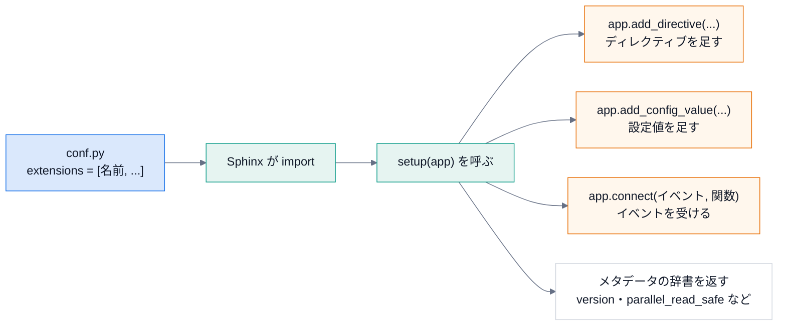
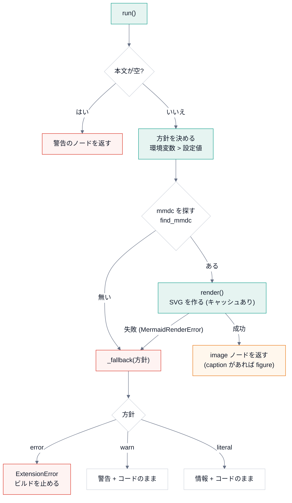
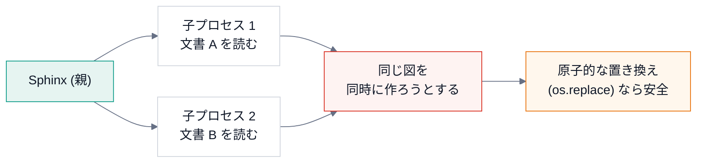

# 第 7 回 Sphinx 拡張を作る

> 所要時間の目安: 4 時間 / 前提: 第 1〜3 回・第 6 回

## この回のゴール

- Sphinx **拡張** の構造 (`setup(app)`・イベント・ディレクティブ・設定値) を説明できる。
- **自分で拡張を書き**、実際にビルドして、動かせる。
- DocsPipeline の 4 つの拡張 (`guard`・`prompt`・`mermaid`・`doxygen`) を、設計の理由まで含めて説明できる。
- **並列ビルド** と、拡張が守るべき約束 (原子的な書き込み・共有状態) を説明できる。
- 偽物 (スタブ) を、Python の **メタプログラミング** (`__getattr__`・メタクラス) で作る方法が分かる。
- 拡張を **テストする** 方法 (偽のコマンド・サブプロセスのビルド) が分かる。

## 1. 拡張とは

**拡張** は、`setup(app)` 関数を持つ Python のモジュールです。`conf.py` の `extensions` に **名前** を書くと、
Sphinx が読み込み、`setup(app)` を呼びます。拡張は、`app` を通して、Sphinx に **機能を登録** します。



| 登録するもの | API | 使い道 |
|---|---|---|
| ディレクティブ | `app.add_directive("名前", クラス)` | 文書の中に、新しい **ブロック** の記法を足す (`.. mermaid::`・`.. prompt::`) |
| ロール | `app.add_role("名前", 関数)` | 新しい **行内** の記法を足す |
| 設定値 | `app.add_config_value("名前", 既定値, 再ビルドの種類)` | 利用者が `conf.py` で指定できる設定を足す |
| イベントの受け取り | `app.connect("イベント名", 関数, priority=)` | ビルドの途中に、処理を差し込む |
| 静的ファイル | `app.add_css_file` / `app.add_js_file` | HTML に CSS・JavaScript を足す |

返す辞書:

| キー | 意味 |
|---|---|
| `version` | 拡張のバージョン |
| `parallel_read_safe` | **並列で文書を読んでも安全か** (後で詳しく) |
| `parallel_write_safe` | **並列で書き出しても安全か** |

## 2. 最小の拡張: guard

DocsPipeline で、いちばん小さい拡張です。

```python
# 引用: docspipeline/guard.py::_raise_config_error
def _raise_config_error(app: Sphinx, config: Any) -> None:
    if config.docspipeline_config_error:
        raise ConfigError(config.docspipeline_config_error)
```

```python
# 引用: docspipeline/guard.py::setup
def setup(app: Sphinx) -> dict[str, Any]:
    """Sphinx 拡張の登録。"""
    app.add_config_value("docspipeline_config_error", "", "env")
    app.connect("config-inited", _raise_config_error, priority=100)
    return {"version": __version__, "parallel_read_safe": True, "parallel_write_safe": True}
```

- `_raise_config_error(app, config)`: `config-inited` イベントのハンドラ。引数は、Sphinx が決めた形 (`app`, `config`)。
- `config.docspipeline_config_error` が **空でなければ**、`ConfigError` を投げる。
- `setup`: 設定値 `docspipeline_config_error` を、**既定値 `""`** で足す (`"env"`: 変わったら全文書を読み直す)。
  `config-inited` に、ハンドラを **`priority=100`** で接続する。

**なぜ、こう作るのか** (第 6 回の復習): `conf.py` の中で例外を投げると、Sphinx は、
スタックトレースつきの分かりにくいエラーにします。`build_config` は、誤りを **設定値に預け**、
この拡張が、設定を読み終えた直後に、**整った形で** 失敗させます。

```python
# 実行できる
import io
import re
import tempfile
from pathlib import Path
from sphinx.application import Sphinx
from sphinx.util.docutils import docutils_namespace

ANSI = re.compile(r"\x1b\[[0-9;]*m")


def run(root, builder="html", **kwargs):
    """ビルドして、(警告, 例外の文) を返す。docutils の登録を、毎回、元に戻す。"""
    status, warning = io.StringIO(), io.StringIO()
    error = None
    with docutils_namespace():
        try:
            Sphinx(
                str(root),
                str(root),
                str(root / "out" / builder),
                str(root / "doctrees"),
                builder,
                status=status,
                warning=warning,
                **kwargs,
            ).build()
        except Exception as exc:
            error = f"{type(exc).__name__}: {exc}"
    return ANSI.sub("", warning.getvalue()).replace(str(root), "<tmp>").strip(), error


with tempfile.TemporaryDirectory() as tmp:
    root = Path(tmp)
    (root / "index.rst").write_text("題名\n====\n", encoding="utf-8")
    conf = 'extensions = ["docspipeline.guard"]\ndocspipeline_config_error = "公開に必要な環境変数が足りません: CONFLUENCE_API_TOKEN"\n'
    (root / "conf.py").write_text(conf, encoding="utf-8")
    print("誤りがあるとき:", run(root))

    (root / "conf.py").write_text('extensions = ["docspipeline.guard"]\n', encoding="utf-8")
    print("誤りが無いとき:", run(root))
```

```text
# 出力
誤りがあるとき: ('', 'ConfigError: 公開に必要な環境変数が足りません: CONFLUENCE_API_TOKEN')
誤りが無いとき: ('', None)
```

`run` は、この回の後の例でも使う、**ビルドの補助関数** です。`docutils_namespace()` は、同じプロセスで、
Sphinx を **何度も** 作るとき、docutils の登録 (ノード・ディレクティブ) を、毎回、**元に戻します**
(戻さないと、「すでに登録されている」という警告が出ます)。

## 3. 自分の拡張を書く

「メモ」の箱を作る、30 行ほどの拡張を作ってみましょう。`.. memo:: 題名` と書くと、題名と本文の箱が出ます。

```python
# 実行できる
import io
import re
import sys
import tempfile
from pathlib import Path
from sphinx.application import Sphinx
from sphinx.util.docutils import docutils_namespace

MEMO_EXT = """
from docutils import nodes
from docutils.parsers.rst import Directive

class Memo(Directive):
    has_content = True                    # 本文を受け取る
    optional_arguments = 1                # 引数 (題名) は、あってもなくてもよい
    final_argument_whitespace = True      # 引数に、空白を含めてよい

    def run(self):
        title = self.arguments[0] if self.arguments else "メモ"
        body = "\\n".join(self.content)
        heading = nodes.paragraph("", "", nodes.strong(title, title))
        return [nodes.container("", heading, nodes.literal_block(body, body), classes=["memo"])]

def setup(app):
    app.add_directive("memo", Memo)
    return {"version": "0.1", "parallel_read_safe": True}
"""

with tempfile.TemporaryDirectory() as tmp:
    root = Path(tmp)
    (root / "memo_ext.py").write_text(MEMO_EXT, encoding="utf-8")
    (root / "conf.py").write_text(
        'import os, sys\nsys.path.insert(0, os.path.dirname(__file__))\nextensions = ["memo_ext"]\nhtml_theme = "basic"\n',
        encoding="utf-8",
    )
    (root / "index.rst").write_text("題名\n====\n\n.. memo:: 買い物\n\n   牛乳\n   卵\n", encoding="utf-8")
    with docutils_namespace():
        Sphinx(
            str(root),
            str(root),
            str(root / "out"),
            str(root / "doctrees"),
            "html",
            status=io.StringIO(),
            warning=io.StringIO(),
        ).build()
    html = (root / "out" / "index.html").read_text(encoding="utf-8")
    print(re.search(r'<div class="memo docutils container">.*?</pre></div>\s*</div>', html, re.S).group(0))
```

```text
# 出力
<div class="memo docutils container">
<p><strong>買い物</strong></p>
<div class="highlight-default notranslate"><div class="highlight"><pre><span></span><span class="n">牛乳</span>
<span class="n">卵</span>
</pre></div>
</div>
```

読み方:

1. **`Directive` のクラス属性** が、「どんな引数・本文を受け取るか」を宣言します。
   - `has_content = True`: 本文 (`self.content`: 行のリスト) を受け取る。
   - `optional_arguments = 1`: 引数 (`self.arguments`) が、0 個か 1 個。`required_arguments` なら、必須。
   - `final_argument_whitespace = True`: 最後の引数に、**空白を含めてよい** (題名が、複数の語でもよい)。
2. **`run()`** が、ディレクティブの **実体**。**ノードのリスト** を返す。このリストが、文書の木に、**そのまま挿入される**。
3. 返すのは、**標準のノード** (`container`・`paragraph`・`strong`・`literal_block`)。
4. `setup(app)`: `add_directive("memo", Memo)` で、`.. memo::` を登録する。メタデータを返す。

### なぜ「標準のノード」だけで組み立てるのか

独自のノード (`class MemoNode(nodes.General, nodes.Element)`) を作ることもできます。しかし、
**ノードごとに、各ビルダーへ「どう出力するか」を教える必要があります** (`app.add_node(MemoNode, html=(visit, depart), ...)`)。
教えていないビルダー (たとえば Confluence) は、**未知のノードで失敗する** か、黙って捨てます。

標準のノードだけなら、**全てのビルダーが、すでに知っています**。
DocsPipeline の `prompt` と `mermaid` は、この方針で作ってあります。

## 4. prompt 拡張: コピーできる手順

手順の説明に、Claude Code へ **そのまま渡せるプロンプト** を載せ、HTML ではコピーボタンを付ける拡張です。

```python
# 引用: docspipeline/prompt.py::PromptDirective
class PromptDirective(SphinxDirective):
    """``.. prompt::`` 指示子。引数は題名 (省略できる)。本文がプロンプト。"""

    has_content = True
    required_arguments = 0
    optional_arguments = 1
    final_argument_whitespace = True

    def run(self) -> list[nodes.Node]:
        """題名と本文を、標準のノード (container・paragraph・literal_block) で組み立てる。"""
        body = "\n".join(self.content).strip()
        if not body:
            return [self.state.document.reporter.warning("prompt の本文が空です", line=self.lineno)]

        found = find_secret(body)
        if found:
            logger.warning(
                "プロンプトに秘密情報らしき値が含まれています (%s)。環境変数の名前だけを書いてください",
                found,
                location=(self.env.docname, self.lineno),
            )

        title = self.arguments[0].strip() if self.arguments else DEFAULT_TITLE
        heading = nodes.paragraph("", "", nodes.strong(title, title), classes=["dp-prompt-title"])
        literal = nodes.literal_block(body, body, classes=["dp-prompt-body"])
        literal["language"] = "text"
        container = nodes.container("", heading, literal, classes=["dp-prompt"])
        self.set_source_info(container)
        return [container]
```

読み方:

1. **本文が空**なら、`reporter.warning(...)` で **警告のノード** を返す (例外にしない。文書の他の部分は、ビルドを続けられる)。
2. **`find_secret(body)`**: 秘密情報らしき記述があれば、**警告** を出す。第 2 回で読んだ正規表現。警告には **値を出さない** (`名前=***`)。
3. 題名を決める (引数が無ければ、既定の題名)。
4. **`container` (classes=`dp-prompt`) の中に、`paragraph` (題名) と `literal_block` (本文)**。標準のノードだけ。
5. `self.set_source_info(container)`: ノードに、**ファイルと行** を覚えさせる (警告に、場所が出るように)。

```python
# 引用: docspipeline/prompt.py::_add_static
def _add_static(app: Sphinx, config: Any) -> None:
    """コピーボタンの JavaScript と CSS を、HTML の静的ファイルに加える。"""
    static = str(STATIC_DIR)
    if static not in config.html_static_path:
        config.html_static_path.append(static)
```

```python
# 引用: docspipeline/prompt.py::setup
def setup(app: Sphinx) -> dict[str, Any]:
    """Sphinx 拡張の登録。"""
    app.add_directive("prompt", PromptDirective)
    app.connect("config-inited", _add_static)
    app.add_css_file("dp_prompt.css")
    app.add_js_file("dp_prompt.js")
    return {"version": __version__, "parallel_read_safe": True, "parallel_write_safe": True}
```

- `config-inited` で、拡張に同梱の `static/` ディレクトリを、`html_static_path` に足す (利用者が、設定しなくてよい)。
- `add_css_file` / `add_js_file`: HTML に、CSS と JavaScript を、読み込ませる。**HTML のビルダーだけ** が使い、Confluence では無視される。

実際に動かします。

```python
# 実行できる
import io
import re
import tempfile
from pathlib import Path
from sphinx.application import Sphinx
from sphinx.util.docutils import docutils_namespace

ANSI = re.compile(r"\x1b\[[0-9;]*m")


def run(root, builder="html"):
    warning = io.StringIO()
    with docutils_namespace():
        Sphinx(
            str(root),
            str(root),
            str(root / "out" / builder),
            str(root / "doctrees"),
            builder,
            status=io.StringIO(),
            warning=warning,
        ).build()
    return ANSI.sub("", warning.getvalue()).replace(str(root), "<tmp>").strip()


with tempfile.TemporaryDirectory() as tmp:
    root = Path(tmp)
    (root / "conf.py").write_text('extensions = ["docspipeline.prompt"]\nhtml_theme = "basic"\n', encoding="utf-8")
    (root / "index.rst").write_text(
        "題名\n====\n\n.. prompt:: 手順\n\n   docspipeline build docs を実行する。\n", encoding="utf-8"
    )
    print("警告:", run(root) or "なし")
    html = (root / "out" / "html" / "index.html").read_text(encoding="utf-8")
    print(re.search(r'<div class="dp-prompt docutils container">.*?</pre></div>', html, re.S).group(0))
    print(
        "JavaScript を読み込む:",
        "dp_prompt.js" in html,
        "/ ファイルが出力された:",
        (root / "out" / "html" / "_static" / "dp_prompt.js").is_file(),
    )

    (root / "index.rst").write_text(
        "題名\n====\n\n.. prompt::\n\n   export CONFLUENCE_API_TOKEN=abcd1234efgh5678\n", encoding="utf-8"
    )
    print("秘密情報らしき値:", run(root))
```

```text
# 出力
警告: なし
<div class="dp-prompt docutils container">
<p class="dp-prompt-title"><strong>手順</strong></p>
<div class="dp-prompt-body highlight-text notranslate"><div class="highlight"><pre><span></span>docspipeline build docs を実行する。
</pre></div>
JavaScript を読み込む: True / ファイルが出力された: True
秘密情報らしき値: <tmp>/index.rst:4: WARNING: プロンプトに秘密情報らしき値が含まれています (TOKEN=***)。環境変数の名前だけを書いてください
```

### ブラウザ側 (JavaScript と CSS)

コピーボタンは、**ブラウザの中で** JavaScript が足します。サーバー側 (Sphinx) は、箱と本文を出すだけです。
この分担で、**JavaScript が無い環境でも、本文は読めます** (ボタンが無いだけ)。

```javascript
// 抜粋ファイル: docspipeline/static/dp_prompt.js
  function copyText(text) {
    if (navigator.clipboard && window.isSecureContext) {
      return navigator.clipboard.writeText(text);
    }
    // https でないページ (file:// など) 向けの代替。選択して、コピーの命令を使う。
    return new Promise(function (resolve, reject) {
      var area = document.createElement("textarea");
      area.value = text;
      ...
      area.select();
      try {
        document.execCommand("copy") ? resolve() : reject(new Error("copy failed"));
      } catch (error) {
        reject(error);
      } finally {
        document.body.removeChild(area);
      }
    });
  }
```

| 部分 | 意味 |
|---|---|
| `navigator.clipboard.writeText` | **現代的なコピーの API**。ただし、**安全なコンテキスト** (`https` か `localhost`) でしか使えない |
| `window.isSecureContext` | 今のページが、安全なコンテキストか。**偽なら代替の経路へ** |
| `new Promise(function (resolve, reject) ...)` | **非同期の結果** を表す入れ物。成功なら `resolve()`、失敗なら `reject()` |
| 一時的な `textarea` | 画面外に作り、**選択して** `document.execCommand("copy")` を呼ぶ (古い API だが、広く動く) |
| `try ... finally` | コピーの成否に関わらず、**一時的な入力欄を必ず消す** |

```javascript
// 抜粋ファイル: docspipeline/static/dp_prompt.js
    button.addEventListener("click", function () {
      var text = pre.textContent.replace(/\s+$/, "");
      copyText(text).then(
        function () { report("コピーしました", false); },
        function () { report("コピーできませんでした。本文を選択してコピーしてください", true); }
      );
    });
```

- `pre.textContent`: 本文の **文字だけ** (色付けのための `<span>` は含まれない)。`replace(/\s+$/, "")` で、末尾の空白を落とす。
- `.then(成功, 失敗)`: 結果に応じて、**利用者に伝える**。失敗しても、「本文を選択してコピーしてください」と、**次の手** を示す。

```css
/* 抜粋ファイル: docspipeline/static/dp_prompt.css */
.dp-prompt {
  margin: 1.25rem 0;
  border: 1px solid var(--color-background-border, #d0d5dd);
  border-radius: 0.5rem;
  background: var(--color-background-secondary, #f8f9fb);
  overflow: hidden;
}
```

CSS は、テーマ (furo) の **色の変数** (`var(--color-background-border, 既定値)`) を使います。
新しい色を足さないので、**ライトモードとダークモードの両方** に、自然に合います。第 2 引数が、変数が無いときの **既定値** です。

**設計の原則** (この拡張の、判断のまとめ):

| 原則 | どう実現したか |
|---|---|
| 段階的な劣化 | JavaScript が無い → ボタンだけが消える。Confluence → 普通のコードブロック |
| 標準のノードだけ | どのビルダーでも、未知のノードで失敗しない |
| 秘密を、書かせない | 値らしきものがあれば警告し、**警告にも、値を出さない** |
| 失敗を、黙らせない | コピーに失敗したら、次の手を示す |
| 新しい色を足さない | テーマの変数を使い、ライト・ダークに合わせる |

## 5. mermaid 拡張: 外部コマンドを使う拡張

Mermaid のコードを、**画像 (SVG)** に変える拡張です。外部コマンド `mmdc` を使います (第 3 回)。

```python
# 引用: docspipeline/mermaid.py::MermaidDirective.run
def run(self) -> list[nodes.Node]:
    """本文を画像に変換して返す。変換できないときは ``docspipeline_mermaid_missing`` に従う。"""
    code = "\n".join(self.content).strip()
    if not code:
        return [self.state.document.reporter.warning("mermaid の本文が空です", line=self.lineno)]

    config = self.env.config
    policy = os.environ.get(MISSING_ENV) or config.docspipeline_mermaid_missing
    cmd = find_mmdc(config.docspipeline_mermaid_cmd, self.env.srcdir)

    if cmd is None:
        return self._fallback(code, policy, "mmdc (mermaid-cli) が見つかりません")

    out_dir = Path(self.env.srcdir) / "_generated" / "mermaid"
    puppeteer = os.environ.get(PUPPETEER_ENV) or config.docspipeline_mermaid_puppeteer_config
    try:
        image = render(
            code,
            out_dir,
            cmd=cmd,
            fmt=config.docspipeline_mermaid_format,
            puppeteer_config=puppeteer,
        )
    except MermaidRenderError as exc:
        return self._fallback(code, policy, str(exc))

    # 先頭の "/" は、ソースのルートからの相対を意味する。
    uri = "/" + image.relative_to(self.env.srcdir).as_posix()
    img = nodes.image(uri=uri, alt=self.options.get("alt", ""))
    img["candidates"] = {"*": uri}
    self.set_source_info(img)
    caption = self.options.get("caption")
    if not caption:
        return [img]
    figure = nodes.figure("", img)
    figure += nodes.caption(caption, caption)
    return [figure]
```

```python
# 引用: docspipeline/mermaid.py::MermaidDirective._fallback
def _fallback(self, code: str, policy: str, reason: str) -> list[nodes.Node]:
    if policy == "error":
        raise ExtensionError(f"{self.env.docname}: Mermaid を画像にできません。{reason}")
    if policy == "warn":
        logger.warning("Mermaid を画像にできません。%s", reason, location=(self.env.docname, self.lineno))
    else:
        logger.info("Mermaid をコードのまま表示します。%s", reason)
    block = nodes.literal_block(code, code)
    block["language"] = "text"
    self.set_source_info(block)
    return [block]
```

処理の流れを、図にします。



設計の判断を読みます。

1. **方針の決め方**: `os.environ.get(MISSING_ENV) or config.docspipeline_mermaid_missing`。環境変数が **優先** (CI が、設定ファイルを触らずに、厳しくできる)。
   (ただし、第 6 回で学んだとおり、環境変数は **キャッシュが知らない** ので、`-E` が要る)
2. **探す・変換する・方針に従う** が、**別の関数** に分かれている (`find_mmdc`・`render`・`_fallback`)。
   それぞれ、単体でテストできる。
3. **画像の URI**: `"/" + image.relative_to(self.env.srcdir).as_posix()`。**先頭の `/`** は、「ソースのルートからの相対」を表す。
   文書の場所に依らず、同じ書き方で、画像を指せる。`as_posix()` で、Windows でも `/` 区切り。
4. **`img["candidates"] = {"*": uri}`**: Sphinx が画像を **コピーして集める** ための情報。
5. **失敗しても、文書は壊さない** (`literal`・`warn` では、コードをそのまま表示する)。`error` のときだけ、止める。

方針ごとの挙動を、実際に確かめます (`mmdc` が **無い** 環境にして)。

```python
# 実行できる
import io
import os
import re
import shutil
import tempfile
from pathlib import Path
from sphinx.application import Sphinx
from sphinx.util.docutils import docutils_namespace

ANSI = re.compile(r"\x1b\[[0-9;]*m")


def run(root):
    warning, error = io.StringIO(), None
    with docutils_namespace():
        try:
            Sphinx(
                str(root),
                str(root),
                str(root / "out"),
                str(root / "doctrees"),
                "html",
                status=io.StringIO(),
                warning=warning,
            ).build()
        except Exception as exc:
            error = f"{type(exc).__name__}: {exc}"
    return ANSI.sub("", warning.getvalue()).replace(str(root), "<tmp>").strip(), error


with tempfile.TemporaryDirectory() as tmp:
    root = Path(tmp)
    (root / "empty").mkdir()
    os.environ["PATH"] = str(root / "empty")  # mmdc が、見つからない環境にする
    for name in ("DOCSPIPELINE_MMDC", "DOCSPIPELINE_MERMAID_MISSING"):
        os.environ.pop(name, None)
    (root / "index.rst").write_text("題名\n====\n\n.. mermaid::\n\n   flowchart LR\n     A --> B\n", encoding="utf-8")
    for policy in ("literal", "warn", "error"):
        conf = (
            f'extensions = ["docspipeline.mermaid"]\nhtml_theme = "basic"\ndocspipeline_mermaid_missing = "{policy}"\n'
        )
        (root / "conf.py").write_text(conf, encoding="utf-8")
        shutil.rmtree(root / "doctrees", ignore_errors=True)
        warning, error = run(root)
        print(f"{policy:8} 警告: {warning or 'なし'}")
        print(f"{'':8} 例外: {error}")
```

```text
# 出力
literal  警告: なし
         例外: None
warn     警告: <tmp>/index.rst:4: WARNING: Mermaid を画像にできません。mmdc (mermaid-cli) が見つかりません
         例外: None
error    警告: なし
         例外: ExtensionError: index: Mermaid を画像にできません。mmdc (mermaid-cli) が見つかりません
```

- `literal`: 警告も例外も出ず、**コードのまま** 表示される (手元の確認用)。
- `warn`: 場所つきの警告。`-W` なら、ビルドが失敗する。
- `error`: **例外** で、ビルドが止まる (CI・公開用)。

### キャッシュ: 同じ図を、2 度と変換しない

`mmdc` は、**偽物** (呼び出しを数えるだけのコマンド) に置き換えて、試せます。**外部コマンドを偽物にする** のは、テストの定石です (第 10 回)。

```python
# 実行できる
import io
import os
import shutil
import stat
import sys
import tempfile
from pathlib import Path
from sphinx.application import Sphinx
from sphinx.util.docutils import docutils_namespace

with tempfile.TemporaryDirectory() as tmp:
    root = Path(tmp)
    log = root / "calls.log"
    fake = root / "fake-mmdc"
    fake.write_text(
        f"#!{sys.executable}\nimport sys\nopen({str(log)!r}, 'a').write('呼ばれた\\n')\n"
        "out = sys.argv[sys.argv.index('-o') + 1]\nopen(out, 'w').write('<svg xmlns=\"http://www.w3.org/2000/svg\"/>')\n"
    )
    fake.chmod(fake.stat().st_mode | stat.S_IEXEC)
    os.environ["DOCSPIPELINE_MMDC"] = str(fake)

    (root / "conf.py").write_text('extensions = ["docspipeline.mermaid"]\nhtml_theme = "basic"\n', encoding="utf-8")
    (root / "index.rst").write_text("題名\n====\n\n.. mermaid::\n\n   flowchart LR\n     A --> B\n", encoding="utf-8")
    for i in (1, 2):
        shutil.rmtree(root / "doctrees", ignore_errors=True)  # 文書は、毎回、全部読み直す
        with docutils_namespace():
            Sphinx(
                str(root),
                str(root),
                str(root / "out"),
                str(root / "doctrees"),
                "html",
                status=io.StringIO(),
                warning=io.StringIO(),
            ).build()
        svgs = list((root / "_generated" / "mermaid").glob("*.svg"))
        print(f"{i} 回目: mmdc の呼び出し {len(log.read_text().splitlines())} 回 / SVG {len(svgs)} 個")
    html = (root / "out" / "index.html").read_text(encoding="utf-8")
    print("画像として取り込まれた:", 'src="_images/mermaid-' in html)
```

```text
# 出力
1 回目: mmdc の呼び出し 1 回 / SVG 1 個
2 回目: mmdc の呼び出し 1 回 / SVG 1 個
画像として取り込まれた: True
```

文書を **2 回とも全部読み直した** のに、`mmdc` の呼び出しは **1 回だけ**。2 回目は、**内容のハッシュ** で名付けた SVG が既にあるので、変換を飛ばしました (第 2 回)。

## 6. doxygen 拡張: 「計算」と「実行」を分ける

C++ のコメントから XML を作り、Breathe に渡す拡張です。

```python
# 引用: docspipeline/doxygen.py::make_doxyfile
def make_doxyfile(project: str, inputs: list[str], output: str, predefined: list[str]) -> str:
    """XML だけを出す最小の Doxyfile を作る。

    Args:
        project: Doxygen の ``PROJECT_NAME``。
        inputs: 読み込むソースの場所。
        output: 出力先 (この下の ``xml/`` が Breathe の入力になる)。
        predefined: ``PREDEFINED`` に渡すマクロ。

    Returns:
        Doxyfile の中身。
    """

    def q(value: str) -> str:
        return '"' + value.replace('"', '\\"') + '"'

    lines = {
        "PROJECT_NAME": q(project),
        "OUTPUT_DIRECTORY": q(output),
        "INPUT": " ".join(q(i) for i in inputs),
        "FILE_PATTERNS": _FILE_PATTERNS,
        "RECURSIVE": "YES",
        "GENERATE_XML": "YES",
        "XML_PROGRAMLISTING": "NO",
        "GENERATE_HTML": "NO",
        "GENERATE_LATEX": "NO",
        "QUIET": "YES",
        # コメントの書式の誤りは拾う。コメントが無いこと自体は、docspipeline coverage の役目。
        "WARNINGS": "YES",
        "WARN_IF_DOC_ERROR": "YES",
        "WARN_IF_UNDOCUMENTED": "NO",
        "JAVADOC_AUTOBRIEF": "YES",
        "MARKDOWN_SUPPORT": "YES",
        "ENABLE_PREPROCESSING": "YES",
        "MACRO_EXPANSION": "YES",
        "EXPAND_ONLY_PREDEF": "YES",
        "PREDEFINED": " ".join(predefined),
    }
    return "\n".join(f"{key} = {value}" for key, value in lines.items()) + "\n"
```

`make_doxyfile` は **純粋関数** です (文字列を作るだけで、ファイルも、プロセスも触らない)。だから、**そのままテストできます**。

```python
# 実行できる
from docspipeline.doxygen import make_doxyfile

text = make_doxyfile("My Engine", ["/src/a b", "/src/c"], "/out", ["Q_OBJECT=", "FOO"])
for line in text.splitlines():
    if line.split(" = ")[0] in (
        "PROJECT_NAME",
        "INPUT",
        "GENERATE_XML",
        "GENERATE_HTML",
        "WARN_IF_UNDOCUMENTED",
        "PREDEFINED",
    ):
        print(line)
```

```text
# 出力
PROJECT_NAME = "My Engine"
INPUT = "/src/a b" "/src/c"
GENERATE_XML = YES
GENERATE_HTML = NO
WARN_IF_UNDOCUMENTED = NO
PREDEFINED = Q_OBJECT= FOO
```

- パスに **空白** があっても、`"..."` で囲んで、正しく渡る (`q()`)。
- `GENERATE_XML = YES`・`GENERATE_HTML = NO`: **XML だけ** を出す (HTML は、Sphinx が作る)。
- `WARN_IF_UNDOCUMENTED = NO`: コメントが **無いこと** は、警告にしない。「書式の誤り」だけを拾う。
  (コメントの網羅は、別の道具の役目 → 役割を分ける)

実行する側です。

```python
# 引用: docspipeline/doxygen.py::run_doxygen
def run_doxygen(app: Sphinx) -> None:
    """``builder-inited`` で Doxygen を走らせ、警告を Sphinx の警告として転送する。

    Raises:
        sphinx.errors.ExtensionError: ``doxygen`` が無い、または失敗したとき。
    """
    config = app.config
    inputs: list[str] = config.docspipeline_doxygen_inputs
    if not inputs:
        return

    if os.environ.get(SKIP_ENV, "").lower() in _TRUE:
        logger.info("%s が設定されているため Doxygen を飛ばします", SKIP_ENV)
        return

    doxygen = shutil.which(config.docspipeline_doxygen_cmd)
    if doxygen is None:
        raise ExtensionError(
            f"doxygen が見つかりません。インストールするか、{SKIP_ENV}=1 で C++ の節を飛ばしてください"
        )

    output = Path(config.docspipeline_doxygen_output)
    output.mkdir(parents=True, exist_ok=True)
    # 古い XML が残って、消したはずの関数が文書に出続けるのを避ける。
    shutil.rmtree(output / "xml", ignore_errors=True)

    doxyfile = output / "Doxyfile"
    doxyfile.write_text(
        make_doxyfile(
            config.docspipeline_doxygen_project,
            inputs,
            str(output),
            config.docspipeline_doxygen_predefined,
        ),
        encoding="utf-8",
    )
    logger.info("Doxygen を実行します: %s", doxyfile)
    proc = subprocess.run(
        [doxygen, str(doxyfile)], capture_output=True, text=True, encoding="utf-8", errors="replace", check=False
    )
    for line in proc.stderr.splitlines():
        if line.strip():
            logger.warning("doxygen: %s", line.strip())
    if proc.returncode != 0:
        raise ExtensionError(f"doxygen が失敗しました (終了コード {proc.returncode})")
```

| 行 | 読み方 |
|---|---|
| `if not inputs: return` | C++ の指定が無ければ、**何もしない** (早期の `return`) |
| `SKIP_ENV` | 環境変数で、**飛ばせる** (Doxygen が無い環境の手元確認用) |
| `shutil.which` | Doxygen が **無ければ、`ExtensionError`** (黙って飛ばさない) |
| `shutil.rmtree(output / "xml")` | **古い XML を消す**。消さないと、削除した関数が、文書に出続ける |
| `subprocess.run(... encoding, errors)` | 文字コードを明示 (第 3 回) |
| `for line in proc.stderr.splitlines(): logger.warning` | Doxygen の **警告を、Sphinx の警告に転送**。`-W` で、書式の誤りが、CI を止める |
| `if proc.returncode != 0` | 失敗したら `ExtensionError` |

登録の部分:

```python
# 抜粋: docspipeline/doxygen.py::setup
    # Breathe より先に走らせる (小さい数字ほど先)。
    app.connect("builder-inited", run_doxygen, priority=100)
```

**`priority`** は、同じイベントのハンドラの **実行順序** です (**小さい数ほど先**。既定は 500)。
Breathe は、Doxygen の XML を **読む側** なので、XML を作る `run_doxygen` が、**先に** 走らなければなりません。

## 7. 並列ビルドと、拡張が守る約束

Sphinx は、`-j N` で、文書を **N 個のプロセスで並列に** 読めます。拡張は、それが **安全** か (`parallel_read_safe`) を宣言します。



| 危険 | 例 | 対策 |
|---|---|---|
| **共有ファイルへの同時の書き込み** | 2 つのプロセスが、同じ SVG を書く | **別名に書いて `os.replace`** (第 3 回)。`mmdc.render` |
| **共有の変数の書き換え** | 拡張のグローバル変数に、結果を溜める | 溜めない。溜めるなら、`env-merge-info` などで、**親に集約する** |
| **プロセスをまたぐ状態への依存** | 「最初に読んだ文書で、設定を決める」 | 設定は、`config-inited` で **1 回だけ** |

| 拡張 | `parallel_read_safe` | `parallel_write_safe` | 理由 |
|---|---|---|---|
| `guard` | はい | はい | 状態を持たない |
| `mermaid` | はい | はい | SVG の書き込みが、原子的 |
| `prompt` | はい | はい | 状態を持たない |
| `doxygen` | はい | (宣言なし) | `builder-inited` で **1 回だけ** 走る。書き出しの段階には関与しない |

## 8. 設定値の約束

```python
# 抜粋: docspipeline/mermaid.py::setup
    app.add_config_value("docspipeline_mermaid_cmd", None, "env")
    app.add_config_value("docspipeline_mermaid_format", "svg", "env")
    app.add_config_value("docspipeline_mermaid_missing", "literal", "env")
    app.add_config_value("docspipeline_mermaid_puppeteer_config", None, "env")
```

- **名前の接頭辞** (`docspipeline_`) で、他の拡張と **衝突しない** ようにする。
- **既定値** を必ず持つ (`conf.py` に書かなくても、動く)。
- **検証** は、`config-inited` で行う (`_check_policy`)。**綴りの間違いを、早く、読みやすい形で** 知らせる。

```python
# 引用: docspipeline/mermaid.py::_check_policy
def _check_policy(app: Sphinx, config: Any) -> None:
    for value in (config.docspipeline_mermaid_missing, os.environ.get(MISSING_ENV) or "literal"):
        if value not in MISSING_POLICIES:
            raise ExtensionError(
                f"docspipeline_mermaid_missing は {', '.join(MISSING_POLICIES)} のいずれかにしてください: {value!r}"
            )
    if config.docspipeline_mermaid_format not in ("svg", "png"):
        raise ExtensionError("docspipeline_mermaid_format は svg か png にしてください")
```

**落とし穴**: Sphinx は、`conf.py` の **知らない名前を、黙って無視** します (`docspipeline_mermaid_mising = "error"` と綴りを間違えても、エラーにならない)。
だから、「名前が登録されているか」を、**テストで確かめる** のが、安全です (Confluence の設定名で、実際にそうしています。第 9 回)。

## 9. 偽物を作る: hou のスタブ (メタプログラミング)

Houdini の外では、`import hou` ができません。`hou` を使うコードを **autodoc で読む** ために、**何を呼んでも通る偽物** を作りました。
Python の、**動的な属性アクセス** の仕組みを使います。

```python
# 引用: docspipeline/stubs/hou.py::_Meta
class _Meta(type):
    """クラス属性の参照を、新しいプレースホルダーのクラスで返す。"""

    def __getattr__(cls, name: str) -> Any:
        if name.startswith("__") and name.endswith("__"):
            raise AttributeError(name)
        return _placeholder(f"{cls.__name__}.{name}")
```

```python
# 引用: docspipeline/stubs/hou.py::_Any
class _Any(metaclass=_Meta):
    """何を呼んでも自分自身を返す、何もしないオブジェクト。"""

    def __init__(self, *args: Any, **kwargs: Any) -> None:
        pass

    def __getattr__(self, name: str) -> Any:
        if name.startswith("__") and name.endswith("__"):
            raise AttributeError(name)
        return self

    def __call__(self, *args: Any, **kwargs: Any) -> Any:
        return self

    def __iter__(self) -> Any:
        return iter(())

    def __bool__(self) -> bool:
        return False
```

```python
# 引用: docspipeline/stubs/hou.py::_placeholder
def _placeholder(name: str) -> type:
    if name not in _cache:
        _cache[name] = _Meta(name.rsplit(".", 1)[-1], (_Any,), {"__module__": "hou"})
    return _cache[name]
```

```python
# 引用: docspipeline/stubs/hou.py::__getattr__
def __getattr__(name: str) -> Any:
    """``hou.<名前>`` をすべてプレースホルダーとして返す (モジュールの属性参照)。"""
    if name.startswith("__") and name.endswith("__"):
        raise AttributeError(name)
    return _placeholder(name)
```

| 仕組み | 働き |
|---|---|
| **モジュールの `__getattr__`** (PEP 562) | `hou.Node` のように、**無い名前を参照** したとき、この関数が呼ばれる。`_placeholder(名前)` を返す |
| **メタクラス `_Meta` の `__getattr__`** | **クラスの属性** (`hou.Node.something`) の参照を、さらにプレースホルダーのクラスにする |
| **`_Any` のメソッド** | `__init__` (何でも受け取る)・`__getattr__` (自分を返す)・`__call__` (呼べる)・`__iter__` (空)・`__bool__` (偽) |
| **`_cache`** | 同じ名前は、**同じクラス** を返す (`hou.Node is hou.Node`)。継承や `isinstance` が、安定する |
| **`__xxx__` を、`AttributeError`** | `__wrapped__` や `__len__` などの特殊な名前を、**偽物に答えさせない**。`inspect`・`copy`・`pickle` などの道具が、偽物を本物と誤解して、おかしな動きをするのを避ける |

```python
# 実行できる
import sys
from docspipeline.config import STUBS_DIR

sys.path.append(str(STUBS_DIR))  # 末尾に足す (本物の hou があれば、そちらが先に見つかる)
import hou


class MyNode(hou.Node):  # 偽物のクラスを、継承できる
    def count(self):
        return len(list(self.children()))


print("クラスとして使える:", isinstance(hou.Node, type), "/ 同じ名前は同じもの:", hou.Node is hou.Node)
print("継承したクラス:", MyNode.__mro__[1].__name__, "/ モジュール名:", hou.Node.__module__)
print("子ノードの数:", MyNode().count())
print("何を呼んでも通る:", hou.node("/obj/geo1").children().anything.at.all() is not None)
print("真偽は偽:", bool(hou.node("/obj")), "/ 反復は空:", list(hou.selectedNodes()))
try:
    hou.__wrapped__
except AttributeError as exc:
    print("特殊な名前は AttributeError:", exc)
```

```text
# 出力
クラスとして使える: True / 同じ名前は同じもの: True
継承したクラス: Node / モジュール名: hou
子ノードの数: 0
何を呼んでも通る: True
真偽は偽: False / 反復は空: []
特殊な名前は AttributeError: __wrapped__
```

**限界を、知っておく**: これは **何も実装していない** 偽物です。値を返す挙動が要るテストは、テスト側で、必要な関数だけを差し替えます。
偽物を、本物に近づけて **育てない** (保守の負担が、増え続ける)。

## 10. 拡張をテストする

拡張のテストの定石は、次の 3 つです。

1. **純粋な部分を、単体でテスト**: `make_doxyfile`・`find_secret`・`split_command` のような、入力 → 出力だけの関数。
2. **外部コマンドを、偽物に**: 偽の `mmdc` (呼び出しを数える・失敗させる・存在しない)。環境変数 `DOCSPIPELINE_MMDC` で渡す。
3. **本当に Sphinx でビルド**: 一時ディレクトリに小さなプロジェクトを作り、ビルドして、出力 (HTML・警告) を確かめる。

3. は、**別のプロセス** (`subprocess` で `python -m sphinx`) で行うと、テストのプロセスの状態 (`sys.path`・docutils の登録) を、汚しません。
同じプロセスで行うなら、この回で使った **`docutils_namespace()`** で、登録を元に戻します。

実際のテストの一部を読みます (`tests/test_prompt.py`)。

```python
# 抜粋: tests/test_prompt.py::test_a_secret_like_value_fails_a_strict_build_without_echoing_it
    leaked = "CONFLUENCE_API_TOKEN=abcd1234efgh5678"
    docs = _project(tmp_path, rst=f"手順\n====\n\n.. prompt::\n\n   次を実行する: {leaked}\n")
    result = _build(docs, "html")
    assert result.returncode != 0
    output = result.stderr + result.stdout
    assert "秘密情報らしき値" in output
    assert "abcd1234efgh5678" not in output  # 警告にも、値は出さない
```

「警告が出る」だけでなく、最後の行で、「**警告に、値が出ない**」(コメントのとおり) も、確かめています。**安全のための性質も、テストにする** のが、ポイントです。

## ハンズオン

1. 第 3 節の `memo` 拡張に、**オプション** `:level:` (`info`・`warn`) を足し、箱の `class` に反映する。(演習の解答に、例があります)
2. `docspipeline build docs` で、`mmdc` が無い状態 (`PATH` から外す) にして、`DOCSPIPELINE_MERMAID_MISSING` を `literal`・`warn`・`error` に変えて、挙動を見る。
3. `docspipeline/static/dp_prompt.js` を読み、ボタンを押したときの流れを、**紙に書く**。

## 確認問題

1. `setup(app)` が、返す辞書の `parallel_read_safe` は、何を宣言していますか。
2. 独自のノードを作らず、**標準のノードだけ** で組み立てる利点は何ですか。
3. `app.connect("builder-inited", run_doxygen, priority=100)` の `priority=100` は、何のためですか。
4. `mermaid` 拡張で、方針を決めるとき、**環境変数が、設定値より優先** されるのは、なぜですか。それが、増分ビルドで問題になるのは、なぜですか。
5. `doxygen` 拡張が、`make_doxyfile` と `run_doxygen` に、分かれている利点は何ですか。
6. 「警告に、秘密情報の値を出さない」を、テストでも確かめているのは、なぜですか。
7. `hou` のスタブが、`__wrapped__` のような名前を `AttributeError` にするのは、なぜですか。
8. (書く問題) `.. memo::` に `:level:` オプションを足し、`memo-warn` のような `class` を付けてください。

## 解答

1. 拡張が、**文書の並列な読み込み** (`-j N`) の下でも、安全に動く、という宣言。共有のファイル・変数を、競合して壊さないこと。
2. 独自のノードは、**ビルダーごとに、出力の方法を教える必要** がある。標準のノードなら、全てのビルダー (HTML・Confluence・テキスト) が、**すでに知っている**。
   未対応のビルダーで、失敗したり、黙って捨てられたりしない。
3. 同じイベントのハンドラの **実行順序** を決めるため (小さい数が先)。Breathe が XML を読む前に、Doxygen を走らせたい。
4. CI が、`conf.py` を **変えずに**、環境変数だけで、方針を厳しくできるから。ただし、環境が覚えているのは **設定値** だけで、
   環境変数は覚えていない。**文書が変わっていないと、読み直されず**、拡張が走らないので、方針が働かない (`-E` で、読み直させる)。
5. `make_doxyfile` は **純粋関数** で、ファイルやプロセスに触らないので、単体で、速く、確実にテストできる。
   副作用のある `run_doxygen` は、薄く、小さくなる。
6. 安全のための性質 (秘密を出さない) は、**機能が正しく動くこと** と同じくらい大事で、**壊れやすい** (出力を整えるとき、うっかり値を足す)。
   テストにしておけば、将来の変更で、うっかり漏らしたとき、気付ける。
7. `inspect`・`copy`・`pickle`・テストの道具などが、特殊な名前 (`__wrapped__` など) の有無を **調べて**、挙動を変える。
   偽物が、何にでも「ある」と答えると、これらの道具が、**偽物を本物と誤解して**、無限ループや、おかしな動きをする。
8. 例 (実行して確かめてある):

```python
# 実行できる
import io
import re
import sys
import tempfile
from pathlib import Path
from sphinx.application import Sphinx
from sphinx.util.docutils import docutils_namespace

MEMO_EXT = """
from docutils import nodes
from docutils.parsers.rst import Directive, directives

class Memo(Directive):
    has_content = True
    optional_arguments = 1
    final_argument_whitespace = True
    option_spec = {"level": directives.unchanged}      # :level: を受け取る

    def run(self):
        title = self.arguments[0] if self.arguments else "メモ"
        level = self.options.get("level", "info")
        body = "\\n".join(self.content)
        heading = nodes.paragraph("", "", nodes.strong(title, title))
        return [nodes.container("", heading, nodes.literal_block(body, body), classes=["memo", f"memo-{level}"])]

def setup(app):
    app.add_directive("memo", Memo)
    return {"version": "0.1", "parallel_read_safe": True}
"""

with tempfile.TemporaryDirectory() as tmp:
    root = Path(tmp)
    (root / "memo_ext.py").write_text(MEMO_EXT, encoding="utf-8")
    (root / "conf.py").write_text(
        'import os, sys\nsys.path.insert(0, os.path.dirname(__file__))\nextensions = ["memo_ext"]\nhtml_theme = "basic"\n',
        encoding="utf-8",
    )
    (root / "index.rst").write_text("題名\n====\n\n.. memo:: 注意\n   :level: warn\n\n   火を使う\n", encoding="utf-8")
    with docutils_namespace():
        Sphinx(
            str(root),
            str(root),
            str(root / "out"),
            str(root / "doctrees"),
            "html",
            status=io.StringIO(),
            warning=io.StringIO(),
        ).build()
    html = (root / "out" / "index.html").read_text(encoding="utf-8")
    print(re.search(r'<div class="[^"]*memo-warn[^"]*">', html).group(0))
```

```text
# 出力
<div class="memo memo-warn docutils container">
```

## まとめ

| 概念 | 要点 | このリポジトリでの例 |
|---|---|---|
| 拡張 | `setup(app)` で、ディレクティブ・設定値・イベントを登録 | 4 つの拡張 |
| ディレクティブ | `run()` が、ノードのリストを返す | `.. mermaid::`・`.. prompt::` |
| 標準のノード | どのビルダーでも通る | `prompt`・`mermaid` |
| 優先度 | 小さい数が先。順序の依存を、明示する | `doxygen` (`priority=100`) |
| 外部コマンド | 探す・実行・方針に従う、を分ける。失敗しても文書を壊さない | `mermaid`・`mmdc` |
| 純粋と副作用 | 計算を純粋関数にして、薄い実行層を残す | `make_doxyfile` / `run_doxygen` |
| 並列安全 | 共有ファイルは原子的に。宣言する | `parallel_read_safe` |
| 段階的な劣化 | JS なし・Confluence でも、読める | `prompt` |
| 偽物 | モジュールの `__getattr__`・メタクラスで、何でも通る偽物 | `stubs/hou.py` |
| テスト | 純粋関数・偽のコマンド・本当のビルド。安全の性質も | `tests/test_prompt.py` |

## 次回

[第 8 回 CLI と雛形](08-cli-and-scaffold.md): コマンドラインの設計 (`argparse`・終了コード) と、テンプレートからの雛形生成を学びます。
