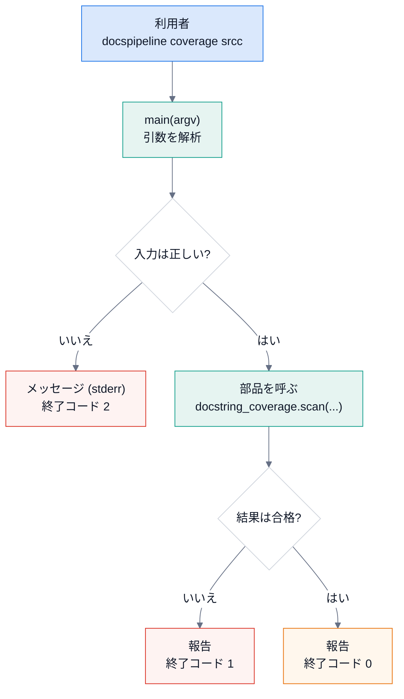
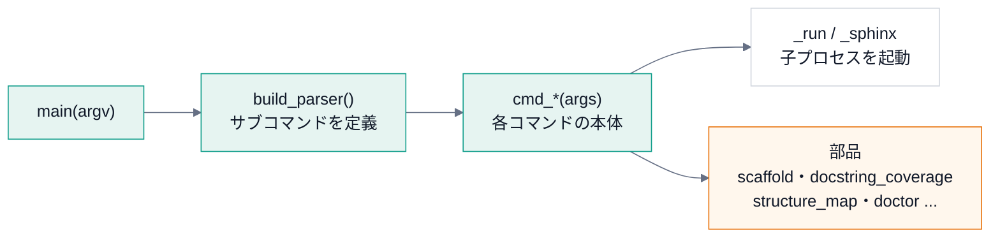
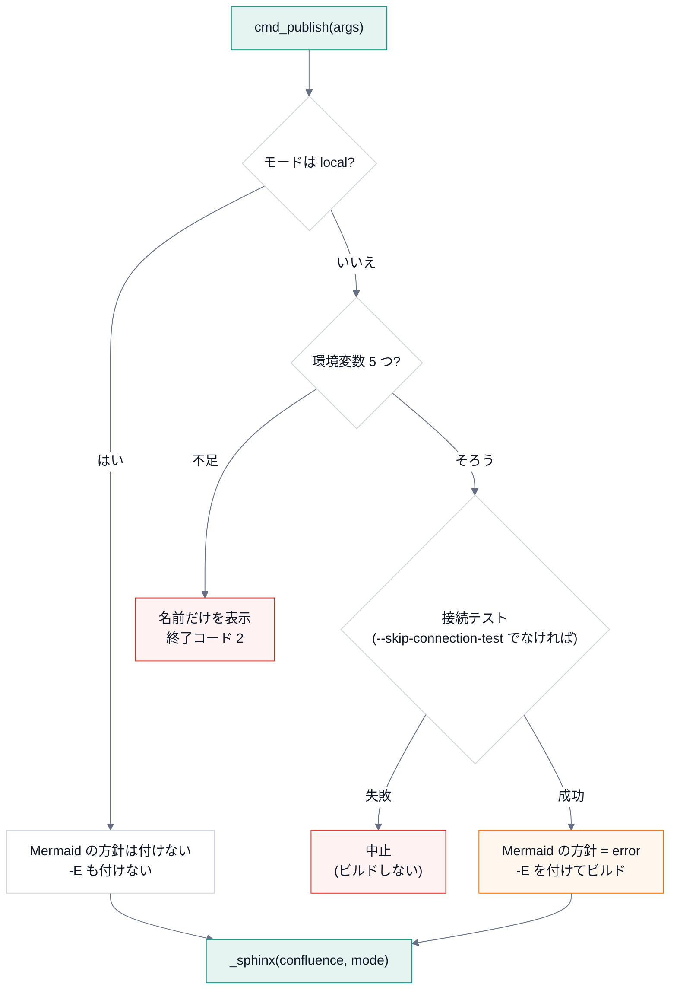
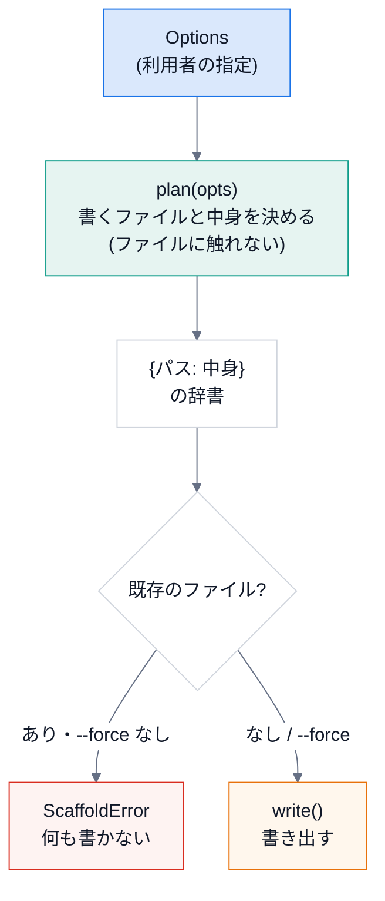
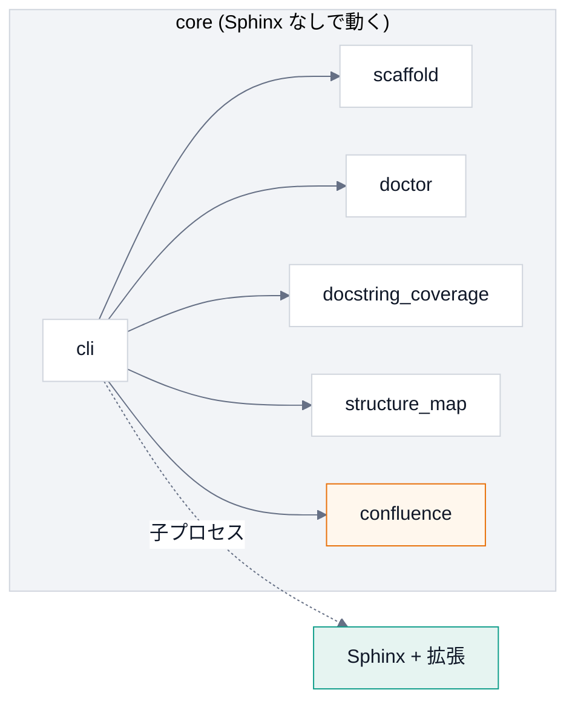

# 第 8 回 CLI の設計と、雛形の生成

> 所要時間の目安: 3.5 時間 / 前提: 第 1〜3 回

## この回のゴール

- コマンドラインツール (CLI) の **設計の原則** (薄い CLI・終了コード・入力の検証) を説明できる。
- `argparse` で、**サブコマンドつきの CLI** を作れる。
- `cli.py` の構造を、**全体から細部まで** 読める。
- **雛形生成** (テンプレートの展開) を、「計画」と「書き出し」に分ける設計を説明できる。
- `doctor` のように、**状態をデータで表し、表示と判定を分ける** 設計を説明できる。

## 1. CLI の設計原則

DocsPipeline の CLI は、`docspipeline build`・`docspipeline coverage` のように、**サブコマンド** を持ちます。
作るときの原則は、次の 5 つです。

| 原則 | 意味 | 破ると、どうなるか |
|---|---|---|
| **薄い CLI** | コマンドは、**引数を受けて、部品を呼ぶだけ**。計算は、別の関数・モジュールに置く | CLI が膨らみ、**テストできない・再利用できない** |
| **終了コードの約束** | `0` 成功 / `1` 不合格 / `2` 使い方の誤り | CI が、原因の種類を見分けられない |
| **打ち間違いを成功させない** | 存在しないパス・綴りの誤りは、**エラー** | 検査が **黙って空** になる (「100%」と報告する) |
| **秘密を出さない** | 環境変数は **名前だけ** を示し、出力から値を伏せる | トークンが、ログに残る |
| **依存を持ち込まない** | CLI の入口は、**標準ライブラリだけ** で動く | Sphinx が無い環境で、`doctor` すら動かない |

最後の原則は、**実際に破って、事故になりました** (第 10 回で振り返ります)。



## 2. argparse の基本

`argparse` は、Python の標準ライブラリの、**コマンドライン引数の解析器** です。

```python
# 実行できる
import argparse

parser = argparse.ArgumentParser(prog="demo", description="例")
parser.add_argument("paths", nargs="+")                                   # 1 個以上の位置引数
parser.add_argument("--fail-under", type=float, metavar="PERCENT")        # 値を取るオプション (型変換つき)
parser.add_argument("--format", choices=("text", "json"), default="text") # 選択肢
parser.add_argument("--force", action="store_true")                       # 付けたら True
parser.add_argument("--package", action="append", default=[])             # 何度でも指定できる (リストに溜まる)

args = parser.parse_args(["a.py", "b.py", "--fail-under", "80", "--package", "x", "--package", "y", "--force"])
print(args)
print(args.fail_under + 1, type(args.fail_under).__name__)
for bad in (["--format", "xml", "a.py"], [], ["a.py", "--fail-under", "abc"]):
    try:
        parser.parse_args(bad)
    except SystemExit as exc:
        print("引数", bad, "→ SystemExit(終了コード", exc.code, ")")
```

```text
# 出力
Namespace(paths=['a.py', 'b.py'], fail_under=80.0, format='text', force=True, package=['x', 'y'])
81.0 float
引数 ['--format', 'xml', 'a.py'] → SystemExit(終了コード 2 )
引数 [] → SystemExit(終了コード 2 )
引数 ['a.py', '--fail-under', 'abc'] → SystemExit(終了コード 2 )
```

- 引数が間違っていると、`argparse` は、**使い方を表示して、終了コード 2 で終了** します (`SystemExit(2)`)。
  DocsPipeline の「**2 = 使い方の誤り**」は、`argparse` の標準の挙動と、**同じ約束** です。
- `type=float`: 文字列 `"80"` が、自動で `80.0` になる。変換できなければ、エラー。
- `action="store_true"`・`"append"`: フラグ・複数指定。

### サブコマンド

`git commit`・`git push` のように、**動詞** で機能を分けるのが、サブコマンドです。

```python
# 実行できる
import argparse

def cmd_add(args):
    print("足す:", args.a + args.b)
    return 0

def cmd_hello(args):
    print(f"こんにちは、{args.name}")
    return 0

parser = argparse.ArgumentParser(prog="demo")
sub = parser.add_subparsers(dest="command", required=True)

p = sub.add_parser("add", help="足し算")
p.add_argument("a", type=int)
p.add_argument("b", type=int)
p.set_defaults(func=cmd_add)                 # この動詞のときに、呼ぶ関数

p = sub.add_parser("hello", help="挨拶")
p.add_argument("name")
p.set_defaults(func=cmd_hello)

def main(argv=None):
    args = parser.parse_args(argv)
    return args.func(args)                   # 選ばれた関数を呼んで、終了コードを返す

print("終了コード:", main(["add", "2", "3"]))
print("終了コード:", main(["hello", "世界"]))
```

```text
# 出力
足す: 5
終了コード: 0
こんにちは、世界
終了コード: 0
```

**`set_defaults(func=...)` のパターン**: 各サブコマンドに、**呼ぶ関数を結び付けて** おき、`main` は、
解析した結果の `func` を呼ぶだけ。`if args.command == "add": ... elif ...` の、長い分岐が要りません。

`main(argv)` が、`argv` を **引数で受け取り**、**終了コードを返す** (`sys.exit` しない) 点も大事です。
テストで、`main([...])` と呼んで、戻り値を調べられます。`sys.exit` は、**一番外側** (`__main__.py`) だけが呼びます。

```python
# 抜粋ファイル: docspipeline/__main__.py
import sys

from .cli import main

sys.exit(main())
```

```python
# 抜粋ファイル: pyproject.toml
[project.scripts]
docspipeline = "docspipeline.cli:main"
```

- `python -m docspipeline` → `__main__.py` が動く。
- `pip install` すると、`[project.scripts]` により、`docspipeline` という **コマンド** が作られ、`docspipeline.cli:main` を呼ぶ
  (戻り値が、そのまま終了コードになる)。

## 3. cli.py を読む

### 3.1 全体の構造



### 3.2 main

```python
# 引用: docspipeline/cli.py::main
def main(argv: Sequence[str] | None = None) -> int:
    """CLI の入口。

    Args:
        argv: 引数。省略すると ``sys.argv`` を使う。

    Returns:
        終了コード。設定の誤りは 2。
    """
    args = build_parser().parse_args(argv)
    try:
        return args.func(args)
    except confluence.ConfluenceSettingsError as exc:
        print(f"設定エラー: {exc}", file=sys.stderr)
        return 2
```

- `args.func(args)`: サブコマンドの関数を呼ぶ。
- **`ConfluenceSettingsError` を、ここで受ける**: 設定の誤りは、**例外を、1 か所で、終了コード 2 に変える**。
  各コマンドの中で、いちいち `try` を書かなくてよい (**例外の変換を、入口に集める**)。

### 3.3 coverage: 入力の検証と、終了コード

```python
# 引用: docspipeline/cli.py::cmd_coverage
def cmd_coverage(args: argparse.Namespace) -> int:
    """``coverage``: docstring が無い公開 API を一覧し、基準に満たなければ失敗にする。"""
    try:
        report = docstring_coverage.scan([Path(p) for p in args.paths])
    except ValueError as exc:
        print(f"エラー: {exc}", file=sys.stderr)
        return 2
    print(docstring_coverage.format_report(report, base=Path.cwd()))
    if args.fail_under is not None and report.percent < args.fail_under:
        print(f"カバレッジが基準 {args.fail_under}% を下回っています", file=sys.stderr)
        return 1
    return 0
```

読み方:

1. `docstring_coverage.scan(...)` は、**存在しないパス・構文エラー** で `ValueError` を投げる (第 4 回)。
   `cmd_coverage` は、それを受けて、**`エラー: ...` を標準エラーに出し、`2` を返す**。
2. 結果を **標準出力** に出す (`format_report`)。**メッセージの種類で、出力先を分ける**: 結果 → stdout、エラー → stderr。
3. `args.fail_under is not None and report.percent < args.fail_under` → **`1`** (不合格)。基準を指定しなければ、不合格にはしない。
4. それ以外は `0`。

3 つの終了コードが、**1 つの関数の中で、使い分けられている** のが、分かります。

```python
# 実行できる
import contextlib
import io
import tempfile
from pathlib import Path
from docspipeline import cli

def run(root, *argv):
    out, err = io.StringIO(), io.StringIO()
    with contextlib.redirect_stdout(out), contextlib.redirect_stderr(err):
        code = cli.main(list(argv))
    last = out.getvalue().strip().splitlines()[-1:]                  # 標準出力の、最後の行だけ
    return code, last, err.getvalue().strip().replace(str(root), "<tmp>")

with tempfile.TemporaryDirectory() as tmp:
    root = Path(tmp)
    (root / "good.py").write_text('"""説明。"""\n\ndef f():\n    """説明。"""\n')
    (root / "bad.py").write_text("def g():\n    pass\n")
    print("存在しないパス :", run(root, "coverage", str(root / "none")))
    print("全部ある       :", run(root, "coverage", str(root / "good.py"), "--fail-under", "100"))
    print("基準を下回る   :", run(root, "coverage", str(root), "--fail-under", "100"))
    print("基準なし       :", run(root, "coverage", str(root)))
```

```text
# 出力
存在しないパス : (2, [], 'エラー: パスがありません: <tmp>/none')
全部ある       : (0, ['docstring のカバレッジ: 100.0% (2/2)'], '')
基準を下回る   : (1, ['docstring のカバレッジ: 50.0% (2/4)'], 'カバレッジが基準 100.0% を下回っています')
基準なし       : (0, ['docstring のカバレッジ: 50.0% (2/4)'], '')
```

(各行は、`(終了コード, 標準出力の最後の行, 標準エラー)` です。一時ディレクトリの名前は、`<tmp>` に置き換えています。)

### 3.4 子プロセスを起動する: `_run` と `_sphinx`

`_run` は第 3 回で読みました。`_sphinx` は、**Sphinx を起動する、1 か所の入口** です。

```python
# 引用: docspipeline/cli.py::_sphinx
def _sphinx(
    builder: str, docs: Path, *, mode: str, strict: bool, extra_env: dict[str, str] | None = None, fresh: bool = False
) -> int:
    """Sphinx を走らせる。

    Confluence のモードは **必ず引数で決める** (環境変数に残っていた値は使わない)。
    ``build`` が、環境の都合で意図せず公開してしまうのを防ぐため。
    """
    out = docs / "_build" / builder
    cmd = [sys.executable, "-m", "sphinx", "-b", builder, str(docs), str(out)]
    if strict:
        # 警告をエラー扱いにする。--keep-going で、止まらずに全部の警告を出す。
        cmd += ["-W", "--keep-going"]
    if fresh:
        # 保存済みの環境 (増分ビルドのキャッシュ) を使わず、全部を読み直す。
        # 環境変数の方針 (Mermaid が画像にならなければ失敗) は、読み込み時にしか効かない。
        # 前のビルドが「コードのまま」で済ませたページを、変更なしとして飛ばされると、方針が素通りする。
        cmd += ["-E"]
    return _run(cmd, {confluence.MODE_ENV: mode, **(extra_env or {})})
```

| 部分 | 意味 |
|---|---|
| `mode` を、**必ず引数で** 受け取る | Confluence のモードを、**呼ぶ側が決める**。環境変数に残っていた値で、意図せず公開しない (第 9 回) |
| `strict` → `-W --keep-going` | 警告をエラーに。`--keep-going` で、止まらずに全部の警告を出す |
| `fresh` → `-E` | 保存した環境を使わない (第 6 回の、増分ビルドの落とし穴の対策) |
| `{confluence.MODE_ENV: mode, **(extra_env or {})}` | 環境変数を、辞書で組み立てて渡す |

**Sphinx を、`import` せずに、子プロセスとして起動する** ことが、設計のポイントです。CLI が Sphinx を `import` すると、
Sphinx が無い環境で、**CLI 全体が起動しません**。子プロセスなら、`build` を使うときだけ、Sphinx が要ります。

### 3.5 各コマンドの本体

```python
# 引用: docspipeline/cli.py::cmd_build
def cmd_build(args: argparse.Namespace) -> int:
    """``build``: Sphinx でビルドする。Confluence 形式でも公開はしない (``local`` 固定)。"""
    extra = {"DOCSPIPELINE_MERMAID_MISSING": "error"} if args.require_mermaid else None
    return _sphinx(
        args.builder,
        Path(args.docs),
        mode="local",
        strict=not args.no_strict,
        extra_env=extra,
        fresh=args.require_mermaid,
    )
```

```python
# 引用: docspipeline/cli.py::cmd_publish
def cmd_publish(args: argparse.Namespace) -> int:
    """``publish``: Confluence 形式でビルドする。公開するのは ``--mode publish`` のときだけ。

    ``dryrun`` と ``publish`` では、先に接続テストを行い、失敗したらビルドしない。
    """
    if args.mode != "local":
        if not _require_confluence_env():
            return 2
        if not args.skip_connection_test:
            print("== 接続テスト ==")
            rc = cmd_confluence_check(argparse.Namespace(docs=args.docs))
            if rc != 0:
                print("接続テストに失敗したため、中止します", file=sys.stderr)
                return rc
    print(f"== Confluence ビルド (mode={args.mode}) ==")
    # 接続する・公開するときは、Mermaid が画像にならなければ失敗させる。
    # 黙ってコードのままにすると、Confluence のページが、図の無いページに置き換わってしまう。
    extra = {"DOCSPIPELINE_MERMAID_MISSING": "error"} if args.mode != "local" else None
    return _sphinx(
        "confluence", Path(args.docs), mode=args.mode, strict=args.strict, extra_env=extra, fresh=args.mode != "local"
    )
```

`cmd_publish` を、流れにします。



**順序が、安全のための設計** です。ネットワークにつなぐ前に、①環境変数、②接続テストを、**この順に** 確かめます。
(安い検査を先に、高い・危ない処理を後に。**早く失敗する (fail fast)**)

### 3.6 build_parser

全部の引数の定義は、`build_parser` に **集まって** います。

```python
# 引用: docspipeline/cli.py::build_parser
def build_parser() -> argparse.ArgumentParser:
    """``docspipeline`` の引数の定義を作る。"""
    parser = argparse.ArgumentParser(prog="docspipeline", description="API 文書の生成と Confluence への公開")
    sub = parser.add_subparsers(dest="command", required=True)

    p = sub.add_parser("init", help="リポジトリに docs/ の雛形と CI を作る")
    p.add_argument("target", help="対象リポジトリのルート")
    p.add_argument("--project", required=True, help="文書の題名")
    p.add_argument("--author", required=True)
    p.add_argument(
        "--package", action="append", default=[], metavar="PATH", help="Python のソース (docs/ からの相対)。複数可"
    )
    p.add_argument("--cpp", action="append", default=[], metavar="PATH", help="C++ のソース (docs/ からの相対)。複数可")
    p.add_argument("--hou", action="store_true", help="Houdini の hou スタブを使う")
    p.add_argument(
        "--min-coverage", type=int, default=80, metavar="PERCENT", help="CI の docstring 網羅の基準 (既定 80)"
    )
    p.add_argument("--force", action="store_true", help="既存のファイルを上書きする")
    p.set_defaults(func=cmd_init)

    p = sub.add_parser("build", help="Sphinx でビルドする (既定は警告をエラー扱い。公開はしない)")
    p.add_argument("docs", nargs="?", default="docs")
    p.add_argument("-b", "--builder", default="html")
    p.add_argument("--no-strict", action="store_true", help="警告をエラー扱いにしない")
    p.add_argument("--require-mermaid", action="store_true", help="mmdc が無ければ失敗させる (CI 用)")
    p.set_defaults(func=cmd_build)

    p = sub.add_parser("linkcheck", help="外部リンクの切れを確認する")
    p.add_argument("docs", nargs="?", default="docs")
    p.set_defaults(func=cmd_linkcheck)

    p = sub.add_parser("coverage", help="docstring が無い公開 API を一覧する")
    p.add_argument("paths", nargs="+")
    p.add_argument("--fail-under", type=float, metavar="PERCENT")
    p.set_defaults(func=cmd_coverage)

    p = sub.add_parser("check-diagrams", help=".drawio に書き出した SVG があるか確認する")
    p.add_argument("docs", nargs="?", default="docs")
    p.set_defaults(func=cmd_check_diagrams)

    p = sub.add_parser("confluence-check", help="Confluence への接続・認証・権限を確認する")
    p.add_argument("docs", nargs="?", default="docs")
    p.set_defaults(func=cmd_confluence_check)

    p = sub.add_parser("publish", help="Confluence 形式でビルドする。公開は --mode publish のときだけ")
    p.add_argument("docs", nargs="?", default="docs")
    p.add_argument(
        "--mode",
        choices=confluence.MODES,
        default="local",
        help="local: 出力のみ (既定) / dryrun: 接続して確認のみ / publish: 公開",
    )
    p.add_argument("--skip-connection-test", action="store_true")
    # 文書の品質は build (-W) で止める。コメント付きのページを飛ばしたときの警告で、公開まで失敗させない
    p.add_argument("--strict", action="store_true", help="警告をエラー扱いにする (既定は警告を表示するだけ)")
    p.set_defaults(func=cmd_publish)

    p = sub.add_parser("map", help="ソースを構文解析して、依存の地図を作る (外部へは送信しない)")
    p.add_argument("package", help="__init__.py を持つディレクトリ")
    p.add_argument("--format", choices=("markdown", "mermaid", "json"), default="markdown")
    p.add_argument("-o", "--output", help="書き出すファイル (省略すると標準出力)")
    p.add_argument("--fail-on-cycle", action="store_true", help="import の循環があれば失敗させる")
    p.set_defaults(func=cmd_map)

    p = sub.add_parser("check-mermaid", help="Mermaid ブロックが、標準の %%%%{init}%%%% の行で始まるか確認する")
    p.add_argument("paths", nargs="*", default=["docs", "README.md"], help="検査する場所 (既定: docs と README.md)")
    p.add_argument("--fix", action="store_true", help="足りない行を入れる")
    p.set_defaults(func=cmd_check_mermaid)

    p = sub.add_parser("mermaid-style", help="標準の %%%%{init}%%%% の行と classDef を表示する")
    p.set_defaults(func=cmd_mermaid_style)

    p = sub.add_parser("doctor", help="手元の環境で使える機能を確認する")
    p.set_defaults(func=cmd_doctor)
    return parser
```

- **サブコマンドごとの定義が、同じ形** で並ぶ (`add_parser` → `add_argument`... → `set_defaults`)。新しいコマンドも、この形で足す。
- `help=` の文は、`--help` に出る。日本語で、**何をするか** を書く。
- 注意: `argparse` の `help` の中の `%` は、**書式の記号** として扱われる。`%%` と書くと、`%` が出る
  (`%%{init}%%` を見せたいので、`%%%%{init}%%%%` と書いてある)。

## 4. 雛形の生成 (scaffold)

`docspipeline init` は、リポジトリに、**`docs/` の雛形** と **CI の設定** を作ります。テンプレートは、パッケージに同梱されています。

### 4.1 設計: 「計画」と「書き出し」を分ける



「**まず計画を立て、全部が問題なければ、書く**」。途中で失敗して、**半端なファイル群** が残るのを、避けられます。

```python
# 引用: docspipeline/scaffold.py::Options
@dataclass(frozen=True)
class Options:
    """``init`` の入力。"""

    target: Path
    project: str
    author: str
    package: tuple[str, ...] = ()
    cpp: tuple[str, ...] = ()
    hou: bool = False
    min_coverage: int = 80
```

```python
# 引用: docspipeline/scaffold.py::plan
def plan(opts: Options) -> dict[Path, str]:
    """書き出すファイルと中身を決める。ファイルには触れない。"""
    values = _values(opts)
    result: dict[Path, str] = {}
    for src in sorted(TEMPLATES.rglob("*.tmpl")):
        rel = src.relative_to(TEMPLATES)
        if rel.with_suffix("").name == "cpp.rst" and not opts.cpp:
            continue
        if rel.with_suffix("").name == "api.rst" and not opts.package:
            continue
        # 1 回の走査で置き換える。値の中に @@名前@@ があっても、さらに置き換わらない
        text = re.sub(r"@@(\w+)@@", lambda m: values.get(m.group(1), m.group(0)), src.read_text(encoding="utf-8"))
        result[opts.target / _destination(rel)] = text
    return result
```

```python
# 引用: docspipeline/scaffold.py::write
def write(opts: Options, *, force: bool = False) -> list[Path]:
    """雛形を書き出して、作ったファイルを返す。

    Raises:
        ScaffoldError: 既存のファイルがあり、``force`` が偽のとき。何も書かずに止まる。
    """
    files = plan(opts)
    existing = [p for p in files if p.exists()]
    if existing and not force:
        raise ScaffoldError(existing)
    for dest, text in files.items():
        dest.parent.mkdir(parents=True, exist_ok=True)
        dest.write_text(text, encoding="utf-8")
    return list(files)
```

- **`Options`**: 利用者の指定を、**不変の `dataclass`** にまとめる (第 1 回)。関数に、`target`・`project`・... を何個も渡さずに済む。
- **`plan`**: テンプレートを読み、`@@名前@@` を **1 回の走査で** 置き換える (第 2 回)。**ファイルには触れず**、`{パス: 中身}` の辞書を返す。
  → **テストが簡単** (ファイルを作らず、辞書の中身を調べられる)。
- **`write`**: `plan` の結果から、**既存のファイルを調べて**、あれば `ScaffoldError` (`force` なら上書き)。書くのは、**最後**。

```python
# 実行できる
import tempfile
from pathlib import Path
from docspipeline import scaffold

with tempfile.TemporaryDirectory() as tmp:
    target = Path(tmp)
    (target / "src").mkdir()
    opts = scaffold.Options(target=target, project="サンプル", author="me", package=("../src",), min_coverage=90)
    files = scaffold.plan(opts)                       # 計画だけ。ファイルは作られない
    print("計画されたファイル:")
    for path in sorted(files):
        print("  ", path.relative_to(target).as_posix())
    print("書く前に、存在するか:", any(p.exists() for p in files))

    conf = next(text for path, text in files.items() if path.name == "conf.py")
    print([line for line in conf.splitlines() if "project=" in line or "package_paths" in line])
    workflow = next(text for path, text in files.items() if path.name == "docs.yml")
    print([line.strip() for line in workflow.splitlines() if "coverage" in line and "docspipeline" in line])

    scaffold.write(opts)
    print("書いた後に、存在するか:", all(p.exists() for p in files))
    try:
        scaffold.write(opts)                          # もう一度 (既存あり)
    except scaffold.ScaffoldError as exc:
        print("ScaffoldError:", len(exc.existing), "個が既にある")
    print("missing_sources:", [p.name for p in scaffold.missing_sources(scaffold.Options(target, "X", "me", package=("../scr",)))])
```

```text
# 出力
計画されたファイル:
   .github/workflows/docs.yml
   docs/.gitignore
   docs/api.rst
   docs/conf.py
   docs/design.rst
   docs/index.rst
   docs/overview.rst
   docs/page-template.rst.tmpl
書く前に、存在するか: False
["        project='サンプル',", "        package_paths=['../src'],"]
['run: docspipeline coverage src --fail-under 90']
書いた後に、存在するか: True
ScaffoldError: 8 個が既にある
missing_sources: ['scr']
```

### 4.2 書き出し先の規則

テンプレートの **名前** と、書き出す **名前** は、同じではありません。

```python
# 引用: docspipeline/scaffold.py::_destination
def _destination(rel: Path) -> Path:
    """雛形の相対パスから、書き出し先の相対パスを決める。"""
    rel = rel.with_suffix("")  # 末尾の .tmpl を外す
    if rel.parts[0] == "github":
        rel = Path(".github", *rel.parts[1:])
    if rel.name == "gitignore":
        rel = rel.with_name(".gitignore")
    if rel.name == "page-template.rst":
        # 雛形は Sphinx に読ませない (toctree に無い警告を避ける) ので、拡張子を残す
        rel = rel.with_name("page-template.rst.tmpl")
    return rel
```

| テンプレートの名前 | 書き出す名前 | 理由 |
|---|---|---|
| `conf.py.tmpl` | `conf.py` | `.tmpl` を外す |
| `github/workflows/docs.yml.tmpl` | `.github/workflows/docs.yml` | `.github` は **ドットで始まる** |
| `gitignore.tmpl` | `.gitignore` | 〃 |
| `page-template.rst.tmpl` | `page-template.rst.tmpl` | 雛形そのものは、Sphinx に **読ませない** (拡張子を残す) |

**なぜ、テンプレート側の名前にドットを付けないのか**: ドットで始まるファイルは、**パッケージの配布物 (wheel) に含まれない** ことがありました
(実際に、`.gitignore.tmpl` が、wheel から漏れました)。そこで、テンプレートの名前は、ドットなしにして、**書き出すときに付ける** ようにしました。
**「配布物を作って、中身を確かめる」までが、テスト** です (第 12 回)。

### 4.3 入力の検証: 実在しない場所

```python
# 引用: docspipeline/scaffold.py::missing_sources
def missing_sources(opts: Options) -> list[Path]:
    """``--package`` / ``--cpp`` で指定された、実在しないソースの場所を返す (``docs/`` からの相対で解決)。

    打ち間違いのまま作ると、API ページが空で、CI が何も検査しない文書になる。
    """
    docs = opts.target / "docs"
    return [(docs / p).resolve() for p in (*opts.package, *opts.cpp) if not (docs / p).resolve().is_dir()]
```

`--package ../scr` のような **打ち間違い** を、書き出す **前** に見つけます。見逃すと、API ページが空の文書と、**何も検査しない CI** ができます。
`cmd_init` は、これを受けて、**何も書かずに終了コード 2** にします。

```python
# 引用: docspipeline/cli.py::cmd_init
def cmd_init(args: argparse.Namespace) -> int:
    """``init``: ``docs/`` の雛形と CI の設定を作る。既存のファイルは ``--force`` なしでは上書きしない。"""
    opts = scaffold.Options(
        target=Path(args.target).resolve(),
        project=args.project,
        author=args.author,
        package=tuple(args.package),
        cpp=tuple(args.cpp),
        hou=args.hou,
        min_coverage=args.min_coverage,
    )
    missing = scaffold.missing_sources(opts)
    if missing:
        for path in missing:
            print(f"エラー: ソースの場所がありません: {path}", file=sys.stderr)
        print("--package / --cpp は、docs/ からの相対パスで、実在する場所を指定してください", file=sys.stderr)
        return 2
    try:
        created = scaffold.write(opts, force=args.force)
    except scaffold.ScaffoldError as exc:
        for path in exc.existing:
            print(f"既にあります: {path}", file=sys.stderr)
        print("上書きするには --force を付けてください", file=sys.stderr)
        return 1
    for path in created:
        print(f"作成: {path}")
    print(f"次の手順: pip install 'docspipeline[docs]' && docspipeline build {opts.target / 'docs'}")
    return 0
```

## 5. doctor: 状態を「データ」で表す

`docspipeline doctor` は、手元の環境で **何が使えるか** を一覧します。設計のポイントは、**判定 (データ) と、表示 (文字列) と、終了コード** が、**別の関数** に分かれていることです。

```python
# 引用: docspipeline/doctor.py::Check
@dataclass(frozen=True)
class Check:
    """確認の結果 1 件。"""

    name: str
    ok: bool
    detail: str
    required: bool = False
```

```python
# 引用: docspipeline/doctor.py::format_checks
def format_checks(checks: list[Check]) -> str:
    """人が読む形に整形する。"""
    lines = []
    for c in checks:
        mark = "OK  " if c.ok else ("NG  " if c.required else "なし")
        lines.append(f"[{mark}] {c.name}: {c.detail}")
    return "\n".join(lines)
```

```python
# 引用: docspipeline/doctor.py::exit_code
def exit_code(checks: list[Check]) -> int:
    """必須の項目が 1 つでも失敗していれば 1。"""
    return 1 if any(c.required and not c.ok for c in checks) else 0
```

- **`Check`**: 1 項目の結果 (`name`・`ok`・`detail`・`required`)。**不変のデータ**。
- **`run_checks`**: 環境を調べて、`Check` の **リスト** を返す (表示しない)。
- **`format_checks`**: リストを、人が読む形にする (`OK`・`NG`・`なし`)。
- **`exit_code`**: **必須の項目が失敗** していれば `1`。`NG` (必須) と `なし` (任意) の違いを、**`required` の 1 つの印** で表す。

```python
# 実行できる
from docspipeline import doctor

checks = [
    doctor.Check("Sphinx", True, "9.x", required=True),
    doctor.Check("mmdc", False, "無い: 図はコードのまま出る"),
    doctor.Check("Breathe", False, "pip install 'breathe'", required=False),
]
print(doctor.format_checks(checks))
print("終了コード:", doctor.exit_code(checks))
print("必須が欠けると:", doctor.exit_code([*checks, doctor.Check("Python", False, "3.9", required=True)]))

env = {"DOCSPIPELINE_CONFLUENCE_MODE": "publsh", "CONFLUENCE_API_TOKEN": "tok-0123456789abcdef"}
rows = doctor.run_checks(env)
mode = next(c for c in rows if c.name == "Confluence のモード")
secret_rows = [c for c in rows if "tok-0123456789abcdef" in c.detail]
print("モード:", mode.ok, "|", mode.detail)
print("トークンの値が、出力に含まれる行:", len(secret_rows), "件")
```

```text
# 出力
[OK  ] Sphinx: 9.x
[なし] mmdc: 無い: 図はコードのまま出る
[なし] Breathe: pip install 'breathe'
終了コード: 0
必須が欠けると: 1
モード: False | DOCSPIPELINE_CONFLUENCE_MODE は local, dryrun, publish のいずれかにしてください (指定値: 'publsh')
トークンの値が、出力に含まれる行: 0 件
```

- **綴りの誤りの、モード** は、`ok=False` で、**メッセージつき** で返る (例外にせず、一覧の 1 行にする。`doctor` は、**問題を報告する道具** だから)。
- トークンの **値は、どの行にも出ない** (名前の有無だけ)。

## 6. 設計の振り返り: 依存の向き

CLI の入口が **Sphinx を import しない** こと (第 7 回の `core` と拡張) は、構造のテストで守られています。



(図は **主なもの** だけです。`cli` は、ほかに `mmdc`・`diagrams`・共通部品の `files` も import します。全部の矢印は、第 11 回の構成図 (`module-map`) にあります。)

実際の依存を、第 5 回の `docspipeline map` で確かめます。

```python
# 実行できる
from pathlib import Path
import docspipeline
from docspipeline.structure_map import scan_package

graph = scan_package(Path(docspipeline.__file__).parent)
cli = graph.get("docspipeline.cli")
print("cli が import する (内部):", sorted(n.split(".")[-1] for n in cli.imports))
print("cli が import する (外部):", sorted(cli.external))
print("sphinx / docutils を import するモジュール:",
      sorted(m.name.split(".")[-1] for m in graph.modules if m.external & {"sphinx", "docutils"}))
```

```text
# 出力
cli が import する (内部): ['confluence', 'diagrams', 'docstring_coverage', 'doctor', 'files', 'mmdc', 'scaffold', 'structure_map']
cli が import する (外部): ['argparse', 'collections', 'os', 'pathlib', 'subprocess', 'sys']
sphinx / docutils を import するモジュール: ['doxygen', 'guard', 'mermaid', 'prompt']
```

`cli` の外部の import は、**標準ライブラリだけ** (`argparse`・`subprocess`・`sys` など)。
Sphinx を import するのは、**拡張だけ** です。

## ハンズオン

1. `docspipeline --help` と `docspipeline init --help` を実行して、`build_parser` の定義と見比べる。
2. `docspipeline init /tmp/demo --project "My Tool" --author me --package ../src; echo $?` と、**`/tmp/demo/src` を作ってから** 同じコマンドを実行して、違いを見る。
3. 一時ディレクトリで `docspipeline init` した結果の `docs/conf.py` と `.github/workflows/docs.yml` を読む。

## 確認問題

1. 「薄い CLI」とは、どういう設計ですか。利点を 2 つ挙げてください。
2. `main(argv)` が、`sys.exit` を呼ばず、**終了コードを返す** のは、なぜですか。
3. 終了コード `1` と `2` の使い分けを、例とともに説明してください。
4. `set_defaults(func=...)` のパターンの利点は何ですか。
5. `plan` と `write` を分ける利点は何ですか。
6. テンプレートの名前に、ドットを付けず (`gitignore.tmpl`)、書き出すときに付ける理由は何ですか。
7. `doctor` で、`Check` (データ)・`format_checks`・`exit_code` を、別の関数に分ける利点は何ですか。
8. (書く問題) `argparse` で、`wc` コマンドのように、ファイルを 1 個以上受け取り、**各ファイルの行数** を表示する CLI の `main(argv)` を書いてください。
   存在しないファイルがあれば、標準エラーに書いて、終了コード 2 を返します。

## 解答

1. 引数を受けて、**部品を呼ぶだけ** の CLI。計算は、別のモジュールの関数に置く。
   利点: (a) 部品を、CLI 抜きで **単体テスト** できる。(b) 別の入口 (Python から・別のコマンド) からも **再利用** できる。
2. テストで、`main([...])` と呼んで、**戻り値を調べられる** (`sys.exit` は、プロセスを終わらせてしまう)。
   `sys.exit` は、一番外側 (`__main__.py`・エントリーポイント) だけが呼ぶ。
3. `2` = **使い方・入力の誤り** (処理を始められなかった。例: 存在しないパス、環境変数の不足)。直すのは、**入力・設定**。
   `1` = **処理は動いたが、不合格** (例: docstring が基準未満、循環がある)。直すのは、**コードや文書**。
   CI の担当者が、終了コードだけで、対応の方向を見分けられる。
4. `if/elif` の長い分岐が要らない。**サブコマンドの定義と、その実装の対応** が、`build_parser` の中で、隣り合って並ぶ。
   新しいコマンドを足すとき、`main` を触らずに済む。
5. 計画の段階は、**ファイルに触れない** ので、テストが簡単で、安全。全部の検査 (既存のファイルなど) に **合格してから** 書くので、
   途中で失敗しても、**半端なファイル群が残らない**。
6. ドットで始まるファイルは、パッケージの配布物 (wheel) に **含まれないことがある** (実際に、漏れた)。
   ドットなしの名前なら、確実に含まれる。書き出す側で、ドットを付ける。
7. **判定 (データ)・表示・終了コード** が、それぞれ別の理由で変わる。別にしておけば、
   (a) 表示を変えても判定は壊れない、(b) **ファイルや環境を使わず**、`Check` のリストを作るだけで、表示と終了コードをテストできる、
   (c) 将来、JSON など別の表示を足しやすい。
8. 例 (実行して確かめてある):

```python
# 実行できる
import argparse
import contextlib
import io
import sys
import tempfile
from pathlib import Path

def main(argv=None):
    parser = argparse.ArgumentParser(prog="lines")
    parser.add_argument("files", nargs="+")
    args = parser.parse_args(argv)
    missing = [f for f in args.files if not Path(f).is_file()]
    if missing:
        for name in missing:
            print(f"エラー: ファイルがありません: {name}", file=sys.stderr)
        return 2
    for name in args.files:
        print(f"{len(Path(name).read_text(encoding='utf-8').splitlines()):>4} {Path(name).name}")
    return 0

with tempfile.TemporaryDirectory() as tmp:
    a, b = Path(tmp) / "a.txt", Path(tmp) / "b.txt"
    a.write_text("1\n2\n3\n")
    b.write_text("x\n")
    print("終了コード:", main([str(a), str(b)]))
    err = io.StringIO()
    with contextlib.redirect_stderr(err):
        code = main([str(a), str(Path(tmp) / "none.txt")])
    print("終了コード:", code, "|", err.getvalue().strip().replace(tmp, "<tmp>"))
```

```text
# 出力
   3 a.txt
   1 b.txt
終了コード: 0
終了コード: 2 | エラー: ファイルがありません: <tmp>/none.txt
```

## まとめ

| 概念 | 要点 | このリポジトリでの例 |
|---|---|---|
| 薄い CLI | 引数を受けて、部品を呼ぶだけ | `cmd_*` と、各モジュール |
| 終了コード | `0` 成功 / `1` 不合格 / `2` 使い方の誤り | `cmd_coverage` |
| `main(argv)` | 終了コードを **返す**。`sys.exit` は外側だけ | `__main__.py` |
| サブコマンド | `add_subparsers` + `set_defaults(func=...)` | `build_parser` |
| 例外の変換 | 設定の誤りを、入口で終了コード 2 に | `main` |
| 打ち間違い | 黙って成功させず、書く前に止める | `missing_sources` |
| 計画と書き出し | 副作用を、最後の 1 手に | `scaffold.plan` / `write` |
| データで表す | 判定・表示・終了コードを分ける | `doctor` |
| 依存の向き | CLI は、標準ライブラリだけ。Sphinx は子プロセス | `_sphinx` |

## 次回

[第 9 回 公開と安全設計](09-publishing-safety.md): 「公開する」処理の **脅威** を整理し、安全装置を、設計から読み解きます。
