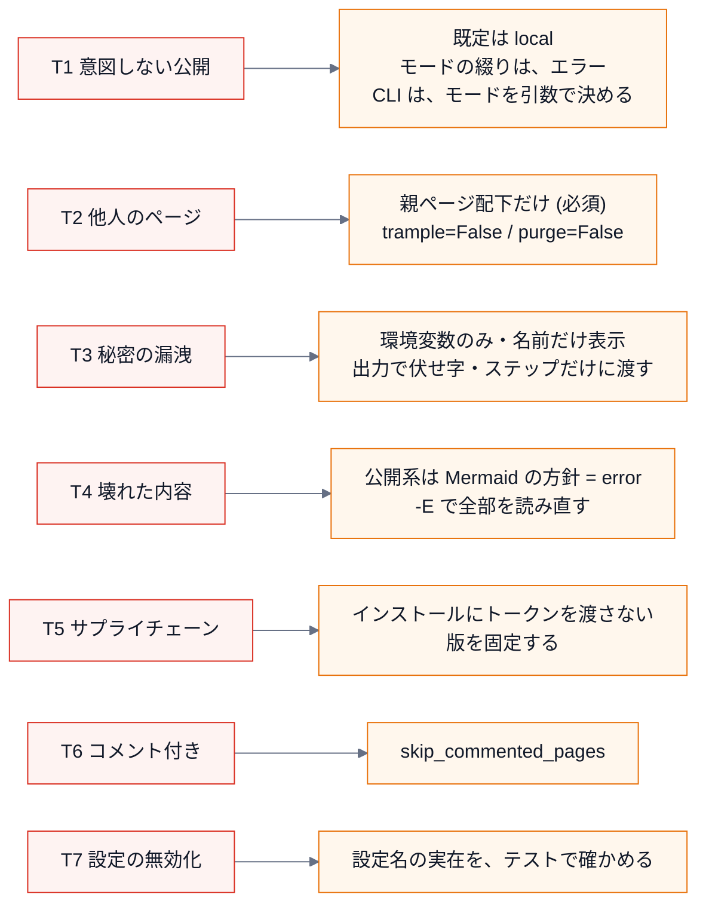
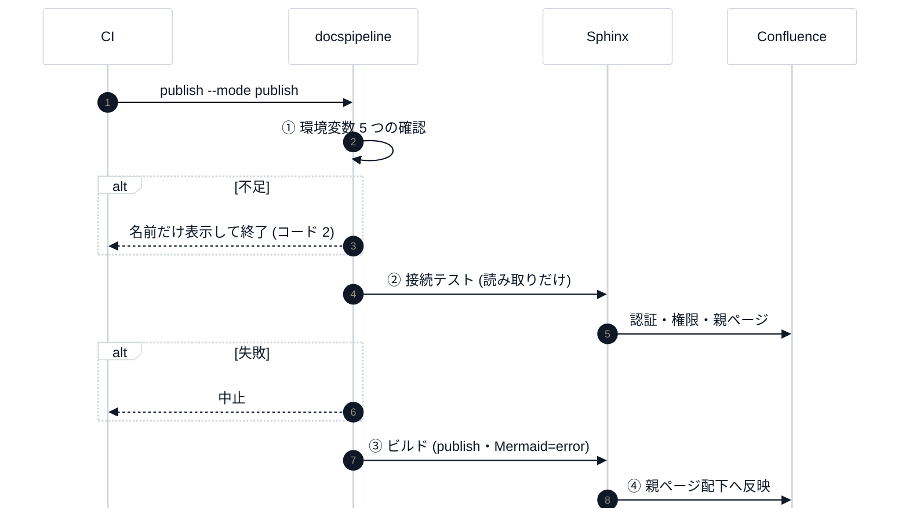

# 第 9 回 公開と安全設計

> 所要時間の目安: 3.5 時間 / 前提: 第 3・6・8 回

## この回のゴール

- 「公開する」処理の **脅威** を、洗い出して整理できる。
- 安全設計の **6 つの原則** を、実際のコードで説明できる。
- `confluence.py` を読み、**なぜ、その設定を、明示しているのか** を説明できる。
- 設定名の **誤り・改名** を、テストで守る方法を説明できる。
- CI で **秘密を渡す範囲を絞る** (最小権限) 方法を説明できる。
- **「検証できていないこと」を、正直に書く** 方法を身に付ける。

> この回は、「何を作ったか」より、「**何を、どう防ぐと決めたか**」が主題です。
> コードを読む前に、**脅威を言葉にする** ところから始めます。

## 1. 脅威を言葉にする

文書を Confluence に公開する処理は、**取り返しがつきにくい** 操作です (他人のページを書き換える・消す、情報を外へ出す)。
まず、**何が、どう間違いうるか** を、洗い出します。

| # | 脅威 | 具体的な場面 | 被害 |
|---|---|---|---|
| T1 | **意図しない公開** | モードの綴りの誤りが、黙って別の動作になる。環境に、古い設定が残っている | 公開するつもりでなかったものが、公開される (または、公開したつもりで公開されない) |
| T2 | **他人のページの上書き・削除** | 親ページの外に、同じ題名のページがある。今回の出力に無いページを、掃除と称して消す | 人が手で書いたページが、失われる |
| T3 | **秘密の漏洩** | トークンが、ログ・文書・リポジトリ・CI の出力に出る。依存のインストール scripts が、環境変数を読む | アカウントの乗っ取り |
| T4 | **壊れた内容での置き換え** | 図が画像にならず、コードのままのページで、置き換える (増分ビルドのキャッシュが、方針を素通りさせる) | 良いページが、壊れたページに変わる |
| T5 | **サプライチェーン** | 公開のジョブが、固定されていない依存 (`@main`・最新版) を、トークンつきで実行する | 依存が改ざんされると、トークンが盗まれる |
| T6 | **反応のあるページの破壊** | 読者がコメントを付けたページを、黙って上書きする | 議論の文脈が失われる |
| T7 | **安全設定の無効化** | ビルダーの設定名が、版で変わる。Sphinx は、知らない名前を **黙って無視** する | `purge=False` などが、**効かなくなる** |

脅威は、**起きてから** ではなく、**作る前** に言葉にします。対策が、脅威に **対応している** ことを、後から確かめられるからです。

## 2. 防御との対応



## 3. 安全設計の 6 つの原則

| # | 原則 | 意味 | このリポジトリでの例 |
|---|---|---|---|
| 1 | **安全側が既定** | 何も指定しなければ、**何も起きない** | モードの既定は `local` (ネットワークにつながない) |
| 2 | **暗黙より明示** | 安全に関わる値は、**環境任せにせず、コードで書く** | `confluence_publish: False` を、**必ず** 書く |
| 3 | **最小権限** | 必要な **場所だけ** に、必要な **間だけ** 渡す | トークンは、公開のステップだけ |
| 4 | **早く止まる** | 危ない処理の **前** に、安い検査で止める | 環境変数 → 接続テスト → ビルド、の順 |
| 5 | **秘密は、名前だけ** | 値を、メッセージ・ログに出さない | 不足は、変数の **名前だけ** を示す |
| 6 | **未検証は、未検証と書く** | 確かめていないことを、確かめたように書かない | 「検証できていないこと」の節 |

## 4. confluence.py を読む

### 4.1 定数: 必須の環境変数と、秘密

```python
# 抜粋ファイル: docspipeline/confluence.py
MODE_ENV = "DOCSPIPELINE_CONFLUENCE_MODE"
MODES = ("local", "dryrun", "publish")
REQUIRED_ENV = (SERVER_URL_ENV, SPACE_KEY_ENV, PARENT_PAGE_ENV, USER_ENV, TOKEN_ENV)
SECRET_ENV = (TOKEN_ENV,)
```

- `REQUIRED_ENV` の中に、**`PARENT_PAGE_ENV` (親ページ)** が入っています。親ページが無いと、公開できません。
  **「公開先を絞ること」を、省略できない設定** にしています (原則 2)。
- `SECRET_ENV`: **伏せる対象** の一覧。値を持つ変数が増えたら、ここに足す。

### 4.2 モードと、足りない設定

`current_mode` は、第 3 回で読みました。**綴りの誤りを、`local` に倒さず、エラー** にします (T1)。

```python
# 引用: docspipeline/confluence.py::missing_env
def missing_env(environ: Mapping[str, str] | None = None) -> list[str]:
    """公開に必要で、未設定の環境変数の名前を返す。"""
    env = os.environ if environ is None else environ
    return [name for name in REQUIRED_ENV if not env.get(name)]
```

**足りない変数の「名前」だけ** を返します (値は、見ません)。メッセージにも、名前だけが出ます (原則 5)。

### 4.3 sphinx_settings: 設定を、全部、明示する

```python
# 引用: docspipeline/confluence.py::sphinx_settings
def sphinx_settings(
    environ: Mapping[str, str] | None = None,
    *,
    footer_file: str | None = None,
) -> dict[str, Any]:
    """Sphinx Confluence ビルダーの設定を組み立てる。

    公開の可否に関わる項目は、環境変数に頼らず必ずここで明示する。ビルダーは未設定の
    ``confluence_*`` を同名の環境変数から補うので、明示しないと、環境に
    ``CONFLUENCE_PUBLISH`` が残っているだけで意図せず公開されうる。

    Args:
        environ: 環境変数。省略すると ``os.environ``。
        footer_file: 各ページの末尾に付ける XHTML ファイルのパス (出典・ライセンスの注記)。

    Returns:
        ``conf.py`` の名前空間へ取り込む設定の辞書。

    Raises:
        ConfluenceSettingsError: ``dryrun`` / ``publish`` で必須の設定が足りないとき。
    """
    env = os.environ if environ is None else environ
    mode = current_mode(env)

    settings: dict[str, Any] = {
        "confluence_publish": False,
        # 親ページの下に Sphinx の目次どおりの階層で置く。
        "confluence_page_hierarchy": True,
        # 手で作られたページを消さない・奪わない。いずれもビルダーの既定だが、
        # 安全に関わるので明示する。trample が False だと、親ページ配下の外にある同じ題名の
        # 既存ページを更新しようとした時点で、ビルダーがエラーで止まる。
        "confluence_cleanup_purge": False,
        "confluence_cleanup_archive": False,
        "confluence_publish_trample": False,
        # 未解決のインラインコメントが付いたページは更新しない (警告は出る)。
        # 人が読んで反応しているページを守る。解決済みのコメントだけなら更新する。
        "confluence_publish_skip_commented_pages": "ignored-resolved",
        "confluence_disable_notifications": True,
    }
    if footer_file:
        settings["confluence_footer_file"] = footer_file

    if mode == "local":
        return settings

    missing = missing_env(env)
    if missing:
        raise ConfluenceSettingsError(f"{mode} モードには次の環境変数が必要です: {', '.join(missing)}")

    settings.update(
        {
            "confluence_publish": True,
            "confluence_publish_dryrun": mode == "dryrun",
            "confluence_server_url": env[SERVER_URL_ENV],
            "confluence_space_key": env[SPACE_KEY_ENV],
            # 専用の親ページ配下だけを対象にする。
            "confluence_parent_page": env[PARENT_PAGE_ENV],
            "confluence_server_user": env[USER_ENV],
            "confluence_api_token": env[TOKEN_ENV],
            "confluence_api_token_scoped": env.get(TOKEN_SCOPED_ENV, "").lower() in _TRUE,
        }
    )
    prefix = env.get(PAGE_PREFIX_ENV)
    if prefix:
        # 既存ページとの題名の衝突を避けたいときに使う。
        settings["confluence_publish_prefix"] = prefix
    return settings
```

読み方 (設定の辞書を作る関数です)。

1. **最初に、安全な設定を、必ず入れる**: `confluence_publish: False`・`cleanup_purge: False`・`cleanup_archive: False`・
   `publish_trample: False`・`skip_commented_pages`・`disable_notifications`。
2. `local` なら、**ここで返す** (公開の設定を、何も足さない)。**ネットワークにつなぐ設定が、そもそも入らない**。
3. それ以外 (`dryrun`/`publish`) は、**必須の環境変数** を確かめ、足りなければ `ConfluenceSettingsError` (名前だけを示す)。
4. そろっていれば、接続の設定を足す。`confluence_publish_dryrun` は、`dryrun` のときだけ `True`。
5. `confluence_parent_page` に、**環境変数の親ページ** を渡す (公開先の限定)。

| 設定 | 値 | 何を守るか (脅威) |
|---|---|---|
| `confluence_publish` | `False` (`local`) | **T1**: 公開しない |
| `confluence_publish_dryrun` | `True` (`dryrun`) | **T1**: 確認だけ (ページを変更しない) |
| `confluence_parent_page` | 環境変数 (必須) | **T2**: 親ページ配下に限る |
| `confluence_publish_trample` | `False` | **T2**: 親ページ **外** の同名ページを、上書きしない (エラーで止まる) |
| `confluence_cleanup_purge` / `cleanup_archive` | `False` | **T2**: 今回の出力に **無い** ページを、消さない・アーカイブしない |
| `confluence_publish_skip_commented_pages` | `"ignored-resolved"` | **T6**: 未解決のコメントが付いたページを、更新しない |
| `confluence_disable_notifications` | `True` | 更新の通知で、人を煩わせない |

### 4.4 「環境任せにしない」の意味 (T1)

Confluence ビルダーは、**設定が未指定のとき、同名の環境変数から値を補います** (`CONFLUENCE_PUBLISH` など)。
つまり、**環境に `CONFLUENCE_PUBLISH=1` が残っているだけで、意図せず公開が有効になりえます**。
そこで、`sphinx_settings` は、公開の可否に関わる設定を、**環境変数に頼らず、必ず明示** します。

```python
# 実行できる
from docspipeline import confluence

FULL = {
    "CONFLUENCE_SERVER_URL": "https://example.atlassian.net/wiki/",
    "CONFLUENCE_SPACE_KEY": "DOCS",
    "CONFLUENCE_PARENT_PAGE": "Auto Docs",
    "CONFLUENCE_SERVER_USER": "me@example.com",
    "CONFLUENCE_API_TOKEN": "tok-0123456789abcdef",
}

local = confluence.sphinx_settings({**FULL, "CONFLUENCE_PUBLISH": "1"})        # 環境に、公開の印が残っている
print("local     publish:", local["confluence_publish"], "| 接続の設定:", sorted(k for k in local if "server" in k or "api_token" in k))

dry = confluence.sphinx_settings({**FULL, confluence.MODE_ENV: "dryrun"})
print("dryrun    publish:", dry["confluence_publish"], "dryrun:", dry["confluence_publish_dryrun"], "親ページ:", dry["confluence_parent_page"])

pub = confluence.sphinx_settings({**FULL, confluence.MODE_ENV: "publish"})
print("publish   publish:", pub["confluence_publish"], "dryrun:", pub["confluence_publish_dryrun"])
for name in ("trample", "cleanup_purge", "cleanup_archive"):
    key = "confluence_publish_trample" if name == "trample" else f"confluence_{name}"
    print("  安全の設定", key, "=", pub[key])

missing = {k: v for k, v in FULL.items() if k != "CONFLUENCE_API_TOKEN"}
try:
    confluence.sphinx_settings({**missing, confluence.MODE_ENV: "publish"})
except confluence.ConfluenceSettingsError as exc:
    print("不足:", exc)
```

```text
# 出力
local     publish: False | 接続の設定: []
dryrun    publish: True dryrun: True 親ページ: Auto Docs
publish   publish: True dryrun: False
  安全の設定 confluence_publish_trample = False
  安全の設定 confluence_cleanup_purge = False
  安全の設定 confluence_cleanup_archive = False
不足: publish モードには次の環境変数が必要です: CONFLUENCE_API_TOKEN
```

- `local` は、環境に `CONFLUENCE_PUBLISH=1` が **あっても**、`publish` が `False`。接続の設定も、**入っていない**。
- 不足のメッセージに、**トークンの値は出ません** (名前だけ)。

### 4.5 トークンを伏せる

`mask_secrets` は、第 2 回で読みました。CLI が起動した子プロセスの出力を、**1 行ずつ** 通します (第 3 回の `_run`)。

## 5. 設定名の実在を、テストで守る (T7)

Sphinx は、`conf.py` の **知らない名前を、黙って無視** します。Confluence ビルダーの設定名が、版で **改名** されたり、
こちらが **綴りを間違えたり** すると、`purge=False` のような安全設定が、**黙って効かなくなります**。

実際に、確かめてみましょう。ビルダーが **登録している** 設定名を、調べます。

```python
# 実行できる
import io
import tempfile
from pathlib import Path
from sphinx.application import Sphinx
from sphinx.util.docutils import docutils_namespace

with tempfile.TemporaryDirectory() as tmp:
    root = Path(tmp)
    (root / "conf.py").write_text("extensions = ['sphinxcontrib.confluencebuilder']\n", encoding="utf-8")
    (root / "index.rst").write_text("題名\n====\n", encoding="utf-8")
    with docutils_namespace():
        app = Sphinx(str(root), str(root), str(root / "out"), str(root / "doctrees"), "confluence",
                     status=None, warning=None)
        for name in ("confluence_cleanup_purge", "confluence_publish_trample", "confluence_purge", "confluence_publsh"):
            print(f"{name:32}", "登録されている" if name in app.config.values else "**登録されていない** (黙って無視される)")
```

```text
# 出力
confluence_cleanup_purge         登録されている
confluence_publish_trample       登録されている
confluence_purge                 **登録されていない** (黙って無視される)
confluence_publsh                **登録されていない** (黙って無視される)
```

`confluence_purge` (間違い) は、**登録されていません**。もし、`sphinx_settings` に、この名前を書いていたら、**何も起きず、何も防げません**。
そこで、テストが、`sphinx_settings` の **全ての名前が、ビルダーに登録されているか** を確かめます。

```python
# 抜粋: tests/test_confluence.py::test_every_setting_name_is_registered_by_the_installed_confluence_builder
    pytest.importorskip("sphinxcontrib.confluencebuilder")
    from sphinx.application import Sphinx
    env = {**FULL, confluence.MODE_ENV: "publish", "CONFLUENCE_API_TOKEN_SCOPED": "1", "CONFLUENCE_PAGE_PREFIX": "p"}
    names = set(confluence.sphinx_settings(env, footer_file="/x"))
    unknown = sorted(n for n in names if n not in app.config.values)
    assert not unknown, f"ビルダーに無い設定名: {unknown}"
```

- **全モード・全オプションを有効にした** 設定を作り (`names`)、1 つずつ `app.config.values` と照合する。
- **ビルダーを更新して、設定名が変わったとき**、このテストが落ちる (= 黙って無効になる前に、気付ける)。
- 「**ビルダーの設定名は、版で変わる**」(設計書のリスク) への、**機械的な備え** です。

> 一般化すると: **「黙って無視される」入力** (設定名・環境変数の名前・コマンドの引数) を持つ仕組みには、
> 「**名前が、実在するか**」を確かめるテストを、必ず添える。

## 6. 公開のコマンド: 順序が、安全を作る

`docspipeline publish` の流れは、第 8 回で読みました。安全の観点で、もう一度見ます。



**危険な処理 (④) は、最後**。その前に、①安い検査 → ②読み取りだけの検査 → ③手元で壊れないか、を済ませます (原則 4)。

## 7. CI で、秘密を渡す範囲を絞る (T3・T5)

公開のジョブは、`.github/workflows/ci.yml` にあります。**どこに、トークンが渡されているか** に注目します。

```yaml
# 抜粋ファイル: .github/workflows/ci.yml
  publish:
    # リポジトリ変数 CONFLUENCE_PUBLISH が 'true' のときだけ、main への反映で公開する
    if: github.event_name == 'push' && github.ref == 'refs/heads/main' && vars.CONFLUENCE_PUBLISH == 'true'
    environment: confluence
    concurrency: confluence-publish
      - name: Install tools
        # トークンは、ここには渡さない。pip / npm が、依存のインストール scripts を走らせるため
      - name: Publish to Confluence
        # 接続テスト → 公開。トークンは、このステップだけに渡す。出力からは伏せられる
        env:
          CONFLUENCE_API_TOKEN: ${{ secrets.CONFLUENCE_API_TOKEN }}
        run: docspipeline publish docs --mode publish
```

| 設定 | 意味 | 脅威 |
|---|---|---|
| `if: ... vars.CONFLUENCE_PUBLISH == 'true'` | **変数を `true` にしない限り、公開しない** (手動のスイッチ) | T1 |
| `github.ref == 'refs/heads/main'` | main への反映の **ときだけ** (PR では、公開しない) | T1 |
| `environment: confluence` | GitHub の **環境** (承認者・シークレットの範囲を、環境ごとに設定できる) | T3 |
| `concurrency` | 公開が **同時に 2 つ走らない** | T2 |
| **トークンは、「Publish」のステップの `env:` だけ** | `Install tools` (pip・npm) には、**見せない** | **T3・T5** |

**なぜ、ステップだけに絞るのか**: `pip install` や `npm install` は、依存パッケージの **インストール scripts** を実行します。
依存が (更新・乗っ取りで) 悪意のあるものに変わったとき、**ジョブ全体の環境変数にトークンがあると、読まれて、外へ送られます**。
ステップだけに渡せば、インストールの時点では、**環境に、トークンが無い**。

この性質も、**テスト** で守られています。

```python
# 抜粋: tests/test_robustness.py::test_the_api_token_reaches_only_the_publish_step
    for name, workflow in _workflows(tmp_path).items():
        job = workflow["jobs"]["publish"]
        assert "CONFLUENCE_API_TOKEN" not in job.get("env", {}), name
        holders = [s for s in job["steps"] if "CONFLUENCE_API_TOKEN" in s.get("env", {})]
        assert [s["name"] for s in holders] == ["Publish to Confluence"], name
```

YAML を **データとして読み**、「トークンを持つのが、公開のステップだけか」を検査しています。
設定ファイル (YAML) も、**コードと同じように、テストできる** のです。

**版の固定**: `npm install --no-save @mermaid-js/mermaid-cli@12.0.0` のように、**版を固定** します (T5)。
最新版を、毎回、自動で取り込むと、**公開のジョブが、検証していないコードを、トークンの近くで実行** しえます。
雛形 (`docs.yml.tmpl`) には、`pip install ... @main` が残っています。これは **可変** なので、**タグかコミットに固定する** よう、コメントで促しています。

## 8. 検証できていないことを、正直に書く (原則 6)

実際の Confluence の環境 (アカウント・スペース) が **手元に無い** ので、次は **未検証** です。

| 未検証 | 理由 | どう書いたか |
|---|---|---|
| 実際の `dryrun` / `publish` | 環境が無い | 「検証できていないこと」の節に、**箇条書きで** |
| Mermaid の SVG の、Confluence の画面での見え方 | 〃 | 「出力ファイルに入るところまでは、確認した」と、**確認した範囲を明記** |
| `skip_commented_pages` などの、実環境での挙動 | 〃 | 同上 |

**書き方の作法**:

1. **確かめた範囲** と **確かめていない範囲** を、**分けて** 書く (「添付ファイルとして入るところまでは確認」)。
2. 「たぶん大丈夫」と書かない。**未検証なら、そう書き**、**検証の手順** (`dryrun` を、専用の親ページで、まず試す) を添える。
3. 後で検証したら、**書き換える** (保守の周期に、見直しを入れる。第 12 回)。

**未検証を隠すことは、嘘をつくことと同じ** です。安全設計の文書で、これを隠すと、**安全だと誤解した人が、確認せずに公開します**。

## 9. 事例から学ぶ: 見つかった不備

この回の対策の多くは、**レビューで見つかった不備** への対応です。振り返りの形式で、整理します (**誰が悪い、ではなく、仕組みのどこに穴があったか**)。

| 不備 | 症状 | 原因 | 見つけ方 | 対策 | 学び |
|---|---|---|---|---|---|
| 増分ビルドが、方針を素通り | `mmdc` が無いのに、公開でエラーにならず、図の無いページで置き換えうる | 方針 (環境変数) を、**環境 (キャッシュ) が覚えていない** | 独立のコードレビュー + 再現 | 公開系は `-E` | **環境の外の入力** は、キャッシュを破る |
| トークンの渡し範囲 | `pip`/`npm` の scripts から、トークンが読める | ジョブ全体の `env` に置いていた | レビュー | **ステップだけ** に渡す + 構造のテスト | 最小権限 |
| 打ち間違いで、検査が空 | `coverage srcc` が **100%** と報告 | 存在しないパスを、エラーにしていなかった | レビュー + 再現 | 存在しないパスは **終了コード 2** | 入力の検証 |
| CI の関門が、常に成功 | 生成した CI の `coverage` に、基準が無く、0% でも通る | `--fail-under` を、付けていなかった | レビュー | `--min-coverage` を付ける | **失敗しえない検査** は、検査ではない |
| `doctor` が、CLI を壊す | Sphinx が無い環境で、全コマンドが起動しない | `doctor` → `mermaid` (Sphinx) の import | **依存の地図** (`docspipeline map`) | `mmdc.py` に分離 + 構造のテスト | **動く環境でしか試さない** と、依存の誤りは見えない |

最後の行は、**自分で入れた不備** です。**自分のコードにも、同じ穴が空く** ことを、受け入れて、**仕組み (テスト・地図・レビュー)** で、見つけます。

## ハンズオン

1. 第 4.4 節のコードで、`CONFLUENCE_PUBLISH` 以外の **紛らわしい環境変数** (`CONFLUENCE_PURGE=1` など) を足し、設定が変わらないことを確かめる。
2. `tests/test_confluence.py` の、設定名のテストを、わざと壊す: `confluence.py` の `confluence_cleanup_purge` を `confluence_purge` に変えて `pytest` を実行する。**どのテストが、落ちるか** 見る (戻すこと)。
3. `.github/workflows/ci.yml` の `publish` ジョブを読み、「トークンが、どのステップに渡るか」を、**自分の言葉で** 説明する。

## 確認問題

1. 公開処理の脅威を、3 つ以上、挙げてください (誰が・何が・どう失敗するか)。
2. `confluence_publish: False` を、**環境変数に頼らず、必ず書く** のは、なぜですか。
3. `confluence_publish_trample = False` と `confluence_cleanup_purge = False` は、それぞれ、何を守りますか。
4. 「早く止まる」原則で、`publish` の検査の順序は、どうなっていますか。なぜ、その順ですか。
5. Sphinx が、知らない設定名を黙って無視することは、安全設定にとって、どんな危険ですか。どう備えていますか。
6. トークンを、ジョブ全体の `env` ではなく、**ステップの `env`** に置く理由は何ですか。
7. 「検証できていないこと」を書くとき、守る作法を 2 つ挙げてください。
8. (考える問題) 「公開のたびに、親ページ配下の **古いページを、自動で全部消す**」機能を、足したいと言われました。
   どんな **脅威** があり、**何を確かめて**、どう **設計** しますか。

## 解答

1. 例: (T1) モードの綴りの誤りで、意図しない動作になる。(T2) 親ページ外の同名ページを上書きする・今回の出力に無いページを消す。
   (T3) トークンが、ログ・CI の出力・依存のインストールから漏れる。(T4) 図が画像にならないまま、ページを置き換える。
2. ビルダーは、**未指定の設定を、同名の環境変数から補う**。環境に `CONFLUENCE_PUBLISH=1` が **残っているだけ** で、意図せず公開が有効になりうる。
   コードで必ず明示すれば、環境の状態に、**左右されない**。
3. `trample = False`: **親ページ配下の外** にある、同じ題名の既存ページを、**上書きしない** (エラーで止まる)。
   `cleanup_purge = False`: **今回の出力に無い** ページを、**消さない**。どちらも、**人が手で書いたページ** を守る。
4. ① 環境変数 (ネットワーク不要・安い) → ② 接続テスト (読み取りだけ) → ③ ビルド (手元で壊れないか) → ④ 公開 (取り返しがつきにくい)。
   **安くて安全な検査を先に**、危険な処理を最後に。失敗したとき、被害が出る前に止められる。
5. `purge=False` のような安全設定を、**綴りの間違い・ビルダーの改名** で、知らないうちに **無効** にしてしまう (エラーが出ない)。
   備え: `sphinx_settings` の **全ての名前が、ビルダーに登録されているか** を、テストで確かめる。
6. `pip install` / `npm install` が実行する **依存のインストール scripts** (悪意あるものに変わりうる) が、トークンを読めないようにするため。
   公開のステップだけが、トークンを持つ (**最小権限**)。
7. (a) **確かめた範囲** と **確かめていない範囲** を、分けて書く。(b) 「たぶん」と書かず、**未検証と明記** し、**検証の手順** を添える。
   (c) 検証できたら、書き換える。
8. 脅威: **T2 の拡大版** (人が手で書いたページを、巻き込んで消す)・誤った親ページの指定での **広範囲の削除**・取り戻せない。
   確かめること: 削除の **対象の範囲** (親ページ配下に限るか)・**どのページが、手で書かれたか** を判別できるか (ラベル・作成者)・
   **復元できるか** (ゴミ箱・バージョン履歴)。
   設計: **既定は、消さない** (オプトイン)。まず **一覧だけ** を出す (`dryrun`)。**人の承認** を挟む。対象は、**ラベルなどで、自動生成と分かるページだけ**。
   削除ではなく **アーカイブ** にする案も検討する。

## まとめ

| 概念 | 要点 | このリポジトリでの例 |
|---|---|---|
| 脅威の整理 | 作る **前** に、何が・どう間違うかを言葉にする | T1〜T7 |
| 安全側が既定 | 何も指定しなければ、何も起きない | モード `local` |
| 暗黙より明示 | 環境任せにしない | `confluence_publish: False` |
| 最小権限 | 必要な場所・間だけ | トークンは、公開のステップだけ |
| 早く止まる | 安い検査を先に | `publish` の順序 |
| 名前だけを示す | 値を出さない | `missing_env`・`mask_secrets` |
| 黙って無視されるものを守る | 名前の実在を、テストで | 設定名のテスト |
| 設定ファイルも、テストする | YAML をデータとして検査 | ワークフローのテスト |
| 未検証は、未検証と書く | 確かめた範囲を、明記する | 「検証できていないこと」 |

## 次回

[第 10 回 テスト](10-testing.md): ここまでに出てきた **テストの技法** (偽物・変異・構造・回帰) を、体系的にまとめます。
