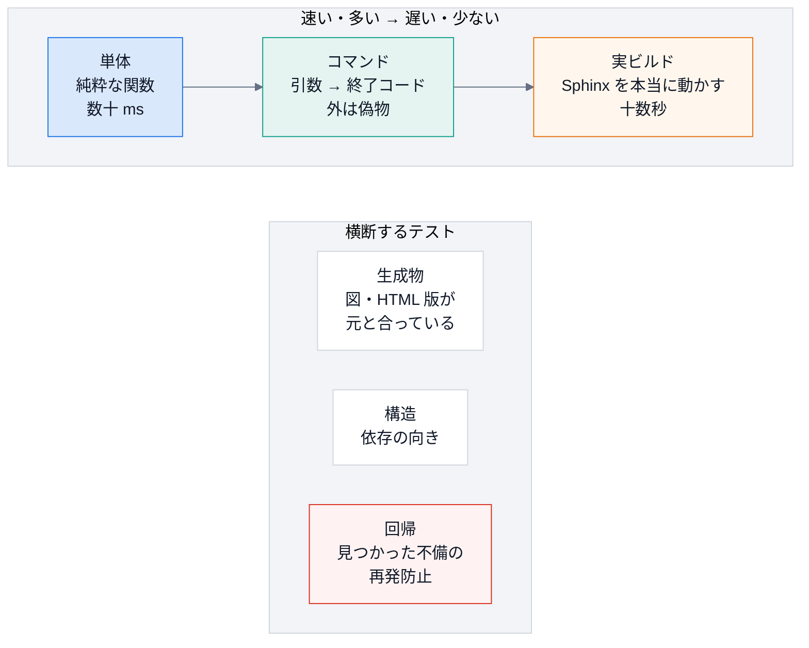
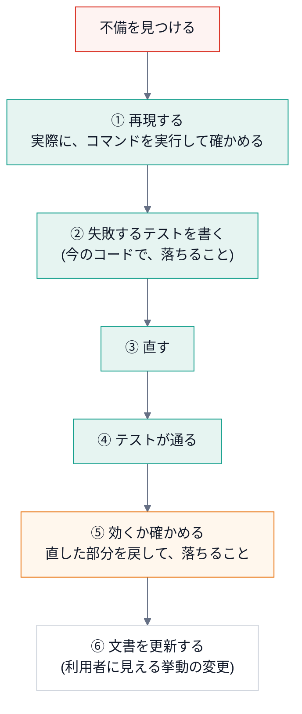

# 第 10 回 テスト

> 所要時間の目安: 4 時間 / 前提: 第 1〜9 回 (特に第 3・7・9 回)

## この回のゴール

- テストの **種類** (単体・コマンド・実ビルド・生成物・構造・回帰) と、それぞれの役目を説明できる。
- `pytest` の基本 (`assert`・フィクスチャ・`parametrize`・`tmp_path`・`monkeypatch`) を使える。
- **偽物** (偽のコマンド・偽の環境・関数の差し替え) の作り方を、使い分けられる。
- **変異テスト** (テストのテスト) を、手作業でできる。
- **構造テスト** (依存の向き・生成物のずれ) の考え方を、説明できる。
- 不備を見つけたとき、**再現 → 失敗するテスト → 修正 → 効くか確認** の手順で、回帰テストを足せる。

## 1. なぜテストを書くのか

ここまでの講義で、**レビューで見つかった不備** が、何度も出てきました。

| 不備 | もし、テストが無かったら |
|---|---|
| 存在しないパスを、「100%」と報告する | 打ち間違いで、**検査が黙って空** になる。誰も気付かない |
| 増分ビルドが、公開の方針を素通りする | 図の無いページで、Confluence を **置き換える** |
| Sphinx が無い環境で、CLI 全体が起動しない | 利用者が、**最初のコマンドで、つまずく** |

テストは、**「いま動いている」ことの確認** ではなく、「**将来、壊したときに、気付ける**」ための仕組みです。
人は、変更のたびに、全部を見直せません。**機械に、見張らせます**。

## 2. テストの種類



| 種類 | ファイル (例) | 確かめること |
|---|---|---|
| 単体 | `test_confluence.py`・`test_docstring_coverage.py`・`test_doxygen.py` | 純粋な関数。**数を多く** 書く |
| コマンド | `test_cli.py`・`test_mermaid.py` | 引数 → 終了コード・出力。外のプロセスは **偽物** |
| 実ビルド | `test_build.py`・`test_prompt.py` | Sphinx を **本当に** 動かす。主要な経路だけ |
| 生成物 | `test_diagrams.py`・`test_site.py`・`test_lectures.py` | 生成物が、元と **ずれていない** |
| 構造 | `test_structure_map.py` | **依存の向き** のルール |
| 回帰 | `test_robustness.py` | 見つかった不備の **再発防止** |

**形は、ピラミッド** です。速くて小さいテストを、**たくさん**、遅くて大きいテストを、**少し**。
実ビルドのテストは、重要ですが、遅く、原因の切り分けが難しい。**問題の大半を、単体テストで捕まえる** のが、理想です。

## 3. pytest の基本

`pytest` は、Python のテストの、標準的な道具です。**`test_` で始まる関数** を、自動で見つけて、実行します。

```python
# 実行できる
import re
import subprocess
import sys
import tempfile
from pathlib import Path

def pytest_summary(root, *args):
    r = subprocess.run([sys.executable, "-B", "-m", "pytest", "-q", "-p", "no:cacheprovider", "--tb=no", *args],
                       cwd=root, capture_output=True, text=True, encoding="utf-8")
    last = [line for line in r.stdout.splitlines() if line.strip()][-1]
    return re.sub(r" in [0-9.]+s.*$", "", last)                         # 実行時間は、毎回違うので除く

MINI = '''
def total(prices, tax=0.1):
    """税込みの合計 (小数 2 桁)。"""
    if tax < 0:
        raise ValueError("税率は 0 以上")
    return round(sum(prices) * (1 + tax), 2)
'''

TESTS = '''
import pytest
from mini import total

def test_total_adds_tax():
    assert total([100, 200]) == 330.0

@pytest.mark.parametrize("prices, expected", [([], 0.0), ([100], 110.0), ([1, 2, 3], 6.6)])
def test_total_for_several_inputs(prices, expected):
    assert total(prices) == expected

def test_negative_tax_is_rejected():
    with pytest.raises(ValueError, match="税率"):
        total([1], tax=-0.1)

def test_with_a_temporary_directory(tmp_path):
    path = tmp_path / "prices.txt"
    path.write_text("100\\n200\\n")
    prices = [int(line) for line in path.read_text().splitlines()]
    assert total(prices, tax=0) == 300

def test_capturing_output(capsys):
    print("こんにちは")
    assert capsys.readouterr().out == "こんにちは\\n"

def test_changing_the_environment(monkeypatch):
    import os
    monkeypatch.setenv("DEMO", "1")
    assert os.environ["DEMO"] == "1"
'''

with tempfile.TemporaryDirectory() as tmp:
    root = Path(tmp)
    (root / "mini.py").write_text(MINI, encoding="utf-8")
    (root / "test_mini.py").write_text(TESTS, encoding="utf-8")
    print(pytest_summary(root))
```

```text
# 出力
8 passed
```

| 道具 | 働き |
|---|---|
| **`assert 式`** | 式が偽なら、**失敗**。`pytest` が、式の中の値を、失敗の表示に出してくれる |
| **`@pytest.mark.parametrize`** | 同じテストを、**入力の組を変えて**、繰り返す。1 つの関数が、3 つのテストになる (上の例で、全部で 8 つ) |
| **`pytest.raises(例外, match=)`** | 「この処理は、**この例外を投げる**」ことを、確かめる。`match` は、メッセージの正規表現 |
| **`tmp_path`** (フィクスチャ) | テストごとの **一時ディレクトリ** (`Path`)。終わると、片付く |
| **`capsys`** | 標準出力・標準エラーを、**捕まえて**、調べる |
| **`monkeypatch`** | 環境変数・属性・辞書を、**テストの間だけ** 書き換える。終わると、**自動で元に戻る** |

**フィクスチャ** とは、テストの **準備物** を、関数の **引数の名前** で受け取る仕組みです
(`def test_x(tmp_path)` と書くだけで、`pytest` が、一時ディレクトリを作って渡す)。

## 4. 偽物の使い分け

テストしたい対象が、**外の世界** (環境変数・外部コマンド・ファイル・ネットワーク) に触れると、
テストが、**遅く・不安定・危険** になります。**偽物に置き換えて**、対象の **ロジックだけ** を、確かめます。

| 偽物 | 使う場面 | 例 |
|---|---|---|
| **偽の環境** (辞書を渡す) | 関数が `environ` を **引数で受ける** | `confluence.sphinx_settings({...})` |
| **一時ディレクトリ** | ファイルを作る・読む | `tmp_path` |
| **偽のコマンド** (実行ファイル) | 外部コマンドを、**本当に起動** する処理 | 偽の `mmdc` (呼び出しを数える・失敗する) |
| **関数の差し替え** (`monkeypatch`) | 内部の関数を、**呼ばれたかだけ** 見たい | `cli._run` を、記録するだけの関数に |

### 関数の差し替え: 「何を起動しようとしたか」だけを見る

`docspipeline build` は、子プロセスで Sphinx を起動します。テストで、**本当に起動する必要はありません**。
「**どんなコマンドと環境で、起動しようとしたか**」だけを、確かめれば足ります。

```python
# 実行できる
from docspipeline import cli

calls = []
cli._run = lambda cmd, env=None: calls.append((list(cmd), env or {})) or 0     # 本物の _run を、記録だけの関数に差し替える

print("build --require-mermaid:", cli.main(["build", "docs", "--require-mermaid"]))
cmd, env = calls[0]
print("  -W:", "-W" in cmd, "/ -E:", "-E" in cmd)
print("  モード:", env["DOCSPIPELINE_CONFLUENCE_MODE"], "/ Mermaid の方針:", env["DOCSPIPELINE_MERMAID_MISSING"])

print("build (指定なし)        :", cli.main(["build", "docs"]))
cmd, env = calls[1]
print("  -W:", "-W" in cmd, "/ -E:", "-E" in cmd, "/ 方針:", env.get("DOCSPIPELINE_MERMAID_MISSING"))
```

```text
# 出力
build --require-mermaid: 0
  -W: True / -E: True
  モード: local / Mermaid の方針: error
build (指定なし)        : 0
  -W: True / -E: False / 方針: None
```

`-W` (警告をエラーに) は、どちらでも付く。`-E` と、Mermaid の方針は、`--require-mermaid` のときだけ。
**子プロセスを起動せずに**、この約束を、**一瞬で** 確かめられました。

(上の例は、本物の `cli._run` を **直接書き換えて** います。`pytest` の `monkeypatch.setattr` なら、**テストの後に、自動で元に戻ります**。)

実際のテストの例です。

```python
# 引用: tests/test_cli.py::test_publish_runs_connection_test_first_and_stops_on_failure
def test_publish_runs_connection_test_first_and_stops_on_failure(tmp_path, monkeypatch):
    for name in confluence.REQUIRED_ENV:
        monkeypatch.setenv(name, "x" * 12)
    commands = []
    monkeypatch.setattr(cli, "_run", lambda cmd, env=None: commands.append(list(cmd)) or 1)
    assert run("publish", str(tmp_path), "--mode", "publish") == 1
    assert len(commands) == 1 and "connection-test" in commands[0]
```

- `monkeypatch.setenv`: 5 つの環境変数を、ダミーの値で設定する。
- `monkeypatch.setattr(cli, "_run", ...)`: 起動を、**記録して、失敗 (`1`) を返す** 関数に差し替える。
- 確かめること: **接続テストの 1 回目で止まった** (`len(commands) == 1`)・それが `connection-test` だった。
  = 「接続テストが失敗したら、**ビルドを始めない**」(第 9 回の「早く止まる」)。

### 偽のコマンド: 実行ファイルを、テストの中で作る

外部コマンドを **本当に起動** する処理 (`mmdc.render`) は、**偽の実行ファイル** で試します。

```python
# 引用: tests/test_mermaid.py::_fake_mmdc
def _fake_mmdc(path, *, ok=True):
    """-o の出力先に、固定の SVG を書くだけの偽 mmdc。"""
    body = textwrap.dedent(
        f"""\
        #!{sys.executable}
        import sys
        args = sys.argv[1:]
        if not {ok!r}:
            print("boom", file=sys.stderr)
            sys.exit(3)
        out = args[args.index("-o") + 1]
        open(out, "w").write('<svg xmlns="http://www.w3.org/2000/svg"/>')
        """
    )
    path.write_text(body)
    path.chmod(path.stat().st_mode | stat.S_IEXEC)
    return [str(path)]
```

- 一時ディレクトリに、**Python の小さなスクリプト** を、実行ファイルとして作る (`#!{sys.executable}`・実行権限)。
- `ok=True`: `-o` の出力先に、**SVG を書く** だけ。`ok=False`: 標準エラーに `boom` と書いて、**終了コード 3**。
- 本物の `mmdc` (Chromium が要る・遅い) の **代わり** に、成功と失敗の、**両方の道** を試せる。

## 5. 変異テスト: テストのテスト

**「テストが通る」ことは、「テストが役に立つ」ことを、意味しません。** 何も確かめていないテストも、通ります。
そこで、**わざとコードを壊して** (変異)、**テストが落ちるか** を確かめます。落ちなければ、そのテストは、その部分を守っていません。

```python
# 実行できる
import re
import subprocess
import sys
import tempfile
from pathlib import Path

def pytest_summary(root):
    r = subprocess.run([sys.executable, "-B", "-m", "pytest", "-q", "-p", "no:cacheprovider", "--tb=no"],
                       cwd=root, capture_output=True, text=True, encoding="utf-8")
    last = [line for line in r.stdout.splitlines() if line.strip()][-1]
    return re.sub(r" in [0-9.]+s.*$", "", last)

SOURCE = '''
def is_failing(percent, fail_under):
    """基準を **下回る** とき True。基準と同じなら、合格 (False)。"""
    return percent < fail_under
'''

WEAK = 'from m import is_failing\n\ndef test_clearly_below():\n    assert is_failing(10, 80)\n'
STRONG = WEAK + '\ndef test_exactly_at_the_threshold_passes():\n    assert not is_failing(80, 80)\n\ndef test_above():\n    assert not is_failing(99, 80)\n'

with tempfile.TemporaryDirectory() as tmp:
    root = Path(tmp)
    mutant = SOURCE.replace("percent < fail_under", "percent <= fail_under")      # 変異: < を <= に
    for label, tests in (("弱いテスト", WEAK), ("強いテスト", STRONG)):
        (root / "test_m.py").write_text(tests, encoding="utf-8")
        (root / "m.py").write_text(SOURCE, encoding="utf-8")
        original = pytest_summary(root)
        (root / "m.py").write_text(mutant, encoding="utf-8")
        mutated = pytest_summary(root)
        print(f"{label}: 元のコード → {original} / 壊したコード → {mutated}")
```

```text
# 出力
弱いテスト: 元のコード → 1 passed / 壊したコード → 1 passed
強いテスト: 元のコード → 3 passed / 壊したコード → 1 failed, 2 passed
```

- **弱いテスト**: 壊したコード (`<` を `<=` に変えた) でも、**通ってしまう**。境界 (基準ちょうど) を、見ていないから。
- **強いテスト**: **境界の値** を試すので、壊したコードで **落ちる**。テストが、その部分を守っている証拠。

> **落とし穴: バイトコードのキャッシュ**
> 上の例で、`pytest` を `python -B` (バイトコードを書かない) で起動しているのは、理由があります。
> Python は、`.py` を読み込んだ結果 (`.pyc`) を `__pycache__` に保存し、**更新時刻 (秒単位) とファイルの大きさ** が同じなら、**古い `.pyc` を再利用** します。
> 変異が「`2` を `1` に変える」ような **同じ長さの書き換え** で、しかも **同じ秒** の中に行われると、
> **変異が反映されず、「テストが通ってしまった」** ように見えます。実際、この講義の例で、`-B` を付けずに繰り返し実行したところ、
> 結果が「`2 passed`」と「`1 failed, 1 passed`」の間で **ゆれました**。
> テストが「通る」理由が分からないときは、**キャッシュを疑う** (`__pycache__` を消す、または `-B`)。

このリポジトリでは、テストを書いたあと、**実際に修正を戻して、テストが落ちることを確かめました**。手順は簡単です。

1. 修正したファイルの、**直した部分だけ** を、元の (壊れた) 形に戻す。
2. `pytest` を実行する。**狙いのテストが、落ちる** ことを確かめる。
3. 修正を戻して、`pytest` が通ることを確かめる。

**境界値を試す**: 「基準ちょうど」「0 件」「空文字」「最大値」は、**間違いが潜みやすい** 場所です。

## 6. 構造テスト: 設計の約束を、テストにする

「Sphinx が無くても、CLI が動く」という **設計の約束** は、普通のテスト (機能のテスト) では、**見えません** (テスト環境には、Sphinx が入っている)。
そこで、**依存の向き** そのものを、テストにします。

```python
# 引用: tests/test_structure_map.py::test_only_sphinx_extensions_import_sphinx
def test_only_sphinx_extensions_import_sphinx(graph):
    # core の CLI (init / coverage / map / doctor) は、Sphinx が入っていない環境でも動くこと
    offenders = {
        m.name: sorted(m.external & {"sphinx", "docutils"})
        for m in graph.modules
        if m.external & {"sphinx", "docutils"}
    }
    assert set(offenders) <= SPHINX_EXTENSIONS, offenders
```

(第 5 回の `docspipeline map` と同じ読み取りで、各モジュールが `import` する外部ライブラリを調べ、
**Sphinx・docutils を import してよいのは、拡張だけ** であることを、確かめます。)

もう 1 つ、**実際に Sphinx を隠して**、import できるかを確かめるテストがあります。

```python
# 引用: tests/test_structure_map.py::test_the_cli_starts_without_sphinx_installed
def test_the_cli_starts_without_sphinx_installed():
    """Sphinx を隠した状態で、core のモジュールを import できる (doctor 経由で Sphinx を引き込んだ不具合の再発防止)。"""
    code = (
        "import sys\n"
        "for name in ('sphinx', 'docutils', 'myst_parser'):\n"
        "    sys.modules[name] = None\n"
        "import docspipeline.cli, docspipeline.doctor, docspipeline.config, docspipeline.structure_map\n"
        "print('ok')\n"
    )
    result = subprocess.run([sys.executable, "-c", code], capture_output=True, text=True, check=False, cwd=ROOT)
    assert result.returncode == 0 and "ok" in result.stdout, result.stderr
```

`sys.modules[name] = None` は、**「その名前の import を、失敗させる」** 印です。これを **先に** 設定してから、
`docspipeline.cli` などを import し、**エラーにならない** ことを確かめます。

```python
# 実行できる
import subprocess
import sys

def run(code):
    r = subprocess.run([sys.executable, "-c", code], capture_output=True, text=True, encoding="utf-8")
    return r.returncode, (r.stderr.strip().splitlines() or [""])[-1][:70]

BLOCK = "import sys\nfor n in ('sphinx', 'docutils'):\n    sys.modules[n] = None\n"
print("core (cli)        :", run(BLOCK + "import docspipeline.cli, docspipeline.doctor\n"))
print("拡張 (mermaid)    :", run(BLOCK + "import docspipeline.mermaid\n"))
```

```text
# 出力
core (cli)        : (0, '')
拡張 (mermaid)    : (1, 'ModuleNotFoundError: import of docutils halted; None in sys.modules')
```

- `core` (`cli`・`doctor`) は、Sphinx が **無くても** import できる (終了コード 0)。
- 拡張 (`mermaid`) は、docutils / Sphinx を import するので、**失敗する** (終了コード 1。最後の行が、その理由)。これは **想定どおり** (拡張は、Sphinx が要る)。

**機能のテストでは、見えない約束** (依存の向き・生成物の一致・設定名の実在) を、**テストとして、書き下す**。これが、構造テストです。

## 7. 生成物と文書のテスト

**コードから作るもの** (図・HTML 版・この講義の引用) は、元が変わると、**ずれます**。ずれを、テストで検出します。

| 対象 | どう確かめるか |
|---|---|
| 構成図 (`.drawio.svg`) | 定義から **作り直した結果** と、コミットしたものが **一致** するか (`test_diagrams.py`) |
| 構成図の矢印 | **実際の依存** と、図の矢印が、一致するか (第 11 回) |
| HTML 版 (`site/`) | 元の文書・ソース・図の **ハッシュ** が、記録と一致するか (第 12 回) |
| **この講義** | 引用が、**今のソースと一致**。実行例の出力が、**本当の出力と一致** |

最後の行を見ましょう。講義の整合を、確かめるテストです。

```python
# 引用: tests/test_lectures.py::test_quotes_and_excerpts_match_the_current_source
@pytest.mark.parametrize("path", LECTURES, ids=lambda p: p.name)
def test_quotes_and_excerpts_match_the_current_source(path):
    assert quote_code.problems(path.read_text(encoding="utf-8")) == []
```

```python
# 引用: tests/test_lectures.py::_runnable
def _runnable(path: Path):
    blocks = quote_code.fenced_blocks(path.read_text(encoding="utf-8"))
    for i, block in enumerate(blocks):
        if block.lines and block.lines[0].strip() == quote_code.RUN_MARK:
            nxt = blocks[i + 1] if i + 1 < len(blocks) else None
            expected = None
            if nxt and nxt.lines and nxt.lines[0].strip() == quote_code.OUTPUT_MARK:
                expected = "\n".join(nxt.lines[1:]).strip()
            yield block.start + 1, "\n".join(block.lines[1:]), expected
```

- 講義の Markdown から、**コードブロックを取り出し**、`# 実行できる` で始まるものを、**実際に実行**。
- 直後のブロックが `# 出力` なら、**標準出力と一致** することを確かめる (`result.stdout.strip() == expected`)。
- 実行は、`python -I` (**隔離モード**: 環境変数・ユーザーの設定に、左右されない) で行う。

**文書を、テストできるコード** として扱うと、「**説明が、嘘になる**」ことが、起きなくなります (第 0 回の、docs as code)。

### 決定的であること

実行例の出力を、**毎回、同じ** にしないと、テストが **不安定** (flaky) になります。よくある原因は、**順序** です。

```python
# 実行できる
import subprocess
import sys

code = "print(list({'apple', 'banana', 'cherry', 'date'}))"
orders = set()
for seed in range(8):
    r = subprocess.run([sys.executable, "-c", code], env={"PYTHONHASHSEED": str(seed)}, capture_output=True, text=True)
    orders.add(r.stdout.strip())
print("集合を、そのまま出すと、異なる順序の数:", len(orders) > 1)

fixed = "print(sorted({'apple', 'banana', 'cherry', 'date'}))"
orders = {subprocess.run([sys.executable, "-c", fixed], env={"PYTHONHASHSEED": str(seed)}, capture_output=True, text=True).stdout.strip() for seed in range(8)}
print("整列して出すと、異なる順序の数:", len(orders))
```

```text
# 出力
集合を、そのまま出すと、異なる順序の数: True
整列して出すと、異なる順序の数: 1
```

- **集合 (`set`) の反復の順序は、実行ごとに違う** (文字列のハッシュが、実行のたびに、ランダムに決まる)。
- **`sorted` で、順序を固定** する。`Graph.cycles` が `sorted(...)` するのも、同じ理由 (第 5 回)。
- 他の原因: 現在時刻・乱数・ファイルの列挙順・並列処理の完了順・**一時ディレクトリの名前** (出力に含めない)。

## 8. 回帰テスト: 不備を見つけたら

不備を見つけたとき、**直して終わり** にしません。**同じ不備が、二度と入らない** ようにします。



**① 再現** が大事です。「たぶん、こうなる」ではなく、**実際に動かして、その症状を見る**。
**②** で、**先に、失敗するテスト** を書くのは、「**テストが、その不備を捕まえられる**」ことを、確かめるためです
(最初から通るテストは、不備を見ていないかもしれない)。

`tests/test_robustness.py` は、見つかった不備を、**1 つずつ** 記録しています。

| 不備 | 回帰テスト (名前) |
|---|---|
| 存在しないパスで、検査が空になる | `test_coverage_of_a_missing_path_is_an_error_not_100_percent` |
| 構文エラーで、スタックトレース | `test_syntax_errors_name_the_file_and_line` |
| `__init__` を経由する循環の見逃し | `test_cycle_through_the_package_init_is_detected` |
| 公開系で、Mermaid の方針が無い | `test_publish_beyond_local_requires_mermaid_images` |
| 増分ビルドが方針を素通り | `test_publish_and_required_mermaid_rebuild_from_scratch` |
| トークンの渡し範囲 | `test_the_api_token_reaches_only_the_publish_step` |
| 型検査用の import を、循環と誤認 | `test_type_checking_import_is_not_a_dependency` |

**テストの名前は、「何を守るか」を、文で書きます**。落ちたとき、名前を読むだけで、**何が壊れたか** が分かります。

## 9. テストを書く作法

| 作法 | 理由 |
|---|---|
| **名前は、振る舞いを、文で** (`test_missing_path_is_an_error`) | 落ちたとき、読むだけで分かる |
| **1 つのテストで、1 つの振る舞い** | 落ちた原因が、一意に分かる |
| **準備 → 実行 → 確認** (Arrange・Act・Assert) の順 | 読みやすい |
| **ほんとうに確かめたいことだけ** を `assert` | 偶然の詳細 (メッセージの句読点) に頼ると、**無関係な変更で落ちる** |
| **偽物は、必要最小限** | 偽物だらけだと、**偽物の挙動しか、確かめていない** |
| **決定的に** (時刻・乱数・順序・一時パスに頼らない) | 不安定なテストは、**信用されなくなる** |
| **境界値と、失敗の道** を試す | 一本道の成功だけでは、壊れやすい所が守られない |
| **遅いテストに印** (`@pytest.mark.slow`) | `-m "not slow"` で、速いものだけ回せる |

## ハンズオン

1. `pytest -q tests/test_confluence.py` を実行する。次に、`docspipeline/confluence.py` の `"confluence_publish": False,` を `True` に **書き換えて**、もう一度実行する。**落ちるテストの名前** を読む (戻すこと)。
2. `pytest -q -m "not slow"` と `pytest -q` の、**実行時間** を比べる。
3. `tests/test_cli.py` から、好きなテストを 1 つ選び、**何を守っているか** を、一文で書く。

## 確認問題

1. 「テストが通る」ことと、「テストが役に立つ」ことは、なぜ同じではありませんか。
2. 変異テストの手順を、説明してください。
3. `cli._run` を、`monkeypatch` で差し替えて、テストする利点は何ですか。**何を確かめられなく** なりますか。
4. 構造テストは、機能のテストでは捕まえられない、何を捕まえますか。例を挙げてください。
5. `sys.modules["sphinx"] = None` は、何をしますか。なぜ、それをテストで使うのですか。
6. 実行例の出力を、**決定的** にするために、何に注意しますか。例を 2 つ挙げてください。
7. 不備を直したあと、「**修正を戻して、テストが落ちるか**」を確かめるのは、なぜですか。
8. (書く問題) 第 3 節の `total` に、**「`prices` が空でも、`0.0` を返す」** ことを確かめる回帰テストを足してください。さらに、
   `total` の `round(..., 2)` を `round(..., 1)` に変えた **変異** で、そのテストの組が **落ちる** ことを、確かめてください。

## 解答

1. 何も確かめていない (`assert` が、常に真) テストも、通る。**境界・失敗の道・安全の性質** を見ていないテストは、
   コードが壊れても、通ってしまう。テストが **その部分を守っているか** は、わざと壊して、確かめる。
2. ① 守りたい部分の、**条件を 1 つ変える** (`<` を `<=`、`+` を `-`、行を消す)。② `pytest` を実行し、**狙いのテストが落ちる** ことを確かめる。
   ③ 落ちなければ、**テストが足りない** (境界値を足す)。④ 変異を **戻す**。
3. **子プロセスを起動せず**、一瞬で、安全に、「**どんなコマンド・環境で起動しようとしたか**」を確かめられる (引数の組み立て・順序・失敗時の中止)。
   確かめられなくなるのは、**実際に Sphinx が、そのコマンドで動くか** (それは、実ビルドのテストの役目)。
4. **設計の約束** (依存の向き・生成物のずれ・名前の実在)。例: 「core が Sphinx を import しない」。
   テスト環境には Sphinx が入っているので、機能のテストでは、違反しても、通ってしまう。
5. 以後の `import sphinx` を、**失敗させる** (`ImportError`)。**Sphinx が無い環境を、再現する** ため。
   その状態で `docspipeline.cli` が import できれば、「core は、Sphinx に依存しない」と、**実際に** 確かめられる。
6. 例: (a) 集合・辞書の **順序** に頼らない (`sorted` で整列)。(b) **一時ディレクトリの名前**・現在時刻・乱数を、出力に含めない (置き換える)。
   (c) ファイルの列挙順 (`sorted`)・並列処理の完了順。
7. **テストが、その不備を、本当に捕まえられる** ことを、確かめるため。直しても、テストが通るなら、
   そのテストは、不備を見ていない (直してなくても、通っていた) 可能性がある。
8. 例 (実行して確かめてある):

```python
# 実行できる
import re
import subprocess
import sys
import tempfile
from pathlib import Path

def pytest_summary(root):
    r = subprocess.run([sys.executable, "-B", "-m", "pytest", "-q", "-p", "no:cacheprovider", "--tb=no"],
                       cwd=root, capture_output=True, text=True, encoding="utf-8")
    last = [line for line in r.stdout.splitlines() if line.strip()][-1]
    return re.sub(r" in [0-9.]+s.*$", "", last)

SOURCE = 'def total(prices, tax=0.1):\n    return round(sum(prices) * (1 + tax), 2)\n'
TESTS = '''
from mini import total

def test_empty_prices_give_zero():
    assert total([]) == 0.0

def test_rounds_to_two_decimals():
    assert total([1, 2, 3], tax=0.111) == 6.67
'''

with tempfile.TemporaryDirectory() as tmp:
    root = Path(tmp)
    (root / "test_mini.py").write_text(TESTS, encoding="utf-8")
    (root / "mini.py").write_text(SOURCE, encoding="utf-8")
    print("元のコード:", pytest_summary(root))
    (root / "mini.py").write_text(SOURCE.replace("round(sum(prices) * (1 + tax), 2)", "round(sum(prices) * (1 + tax), 1)"), encoding="utf-8")
    print("round を 1 桁に:", pytest_summary(root))
```

```text
# 出力
元のコード: 2 passed
round を 1 桁に: 1 failed, 1 passed
```

(空の `prices` のテストだけでは、桁数の変異は、捕まえられません。**桁数のテスト** が、それを捕まえます。1 つのテストが、全てを守るわけではない例です。)

## まとめ

| 概念 | 要点 | このリポジトリでの例 |
|---|---|---|
| テストの種類 | 単体 → コマンド → 実ビルド。生成物・構造・回帰 | `tests/` |
| pytest | `assert`・`parametrize`・`tmp_path`・`monkeypatch`・`capsys` | 全てのテスト |
| 偽物 | 環境は辞書・コマンドは偽の実行ファイル・内部は差し替え | `_fake_mmdc`・`cli._run` |
| 変異テスト | わざと壊して、落ちるか確かめる | 修正を戻す確認 |
| 構造テスト | 設計の約束を、テストにする | `test_structure_map.py` |
| 文書のテスト | 引用・実行例が、嘘にならない | `test_lectures.py` |
| 決定的 | 順序・時刻・一時パスに頼らない | `sorted` |
| 回帰テスト | 再現 → 失敗するテスト → 修正 → 効くか確認 | `test_robustness.py` |

## 次回

[第 11 回 図を作る](11-diagrams.md): SVG・座標・折れ線・drawio・Mermaid で、**読みやすい図** を、コードから作ります。
