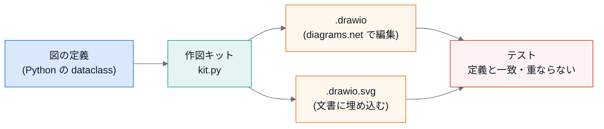
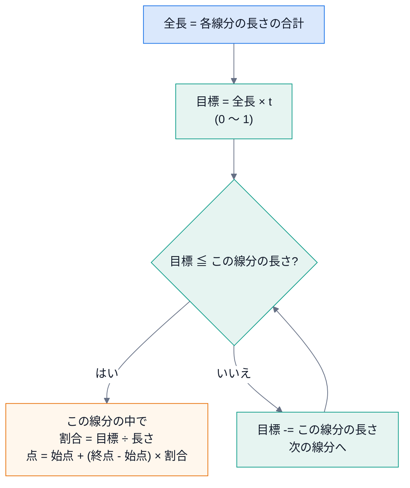
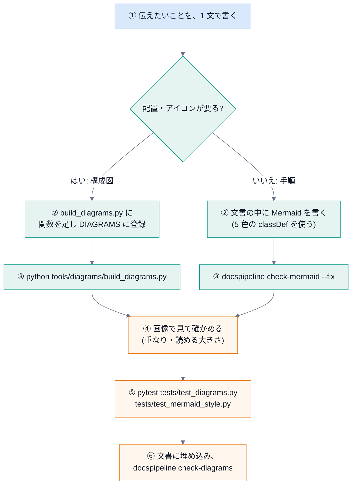

# 第 11 回 図を作る

> 所要時間の目安: 4 時間 / 前提: 第 1・2・4・5 回 (特に dataclass と文字列処理)

## この回のゴール

- **読みやすい図** の条件 (番号・まとまり・色の意味・ラベル) を、説明できる。
- SVG の最小の部品 (`rect`・`text`・`polyline`・`marker`・`viewBox`) を、手で書ける。
- **折れ線の途中の点** を求めるアルゴリズム (ラベルの位置) を、説明できる。
- 図を **データ** (dataclass) で定義し、そこから **SVG と drawio の両方** を作る仕組みを、読める。
- 図の **重なり・はみ出し** を、テストで検出する方法を、説明できる。
- 図の矢印を、**実際のコードの依存と、一致させる** 方法を、説明できる。
- Mermaid の **標準の見た目** (init の行・5 色の `classDef`) を、守る仕組みを、説明できる。
- **新しい図を足す手順** を、実行できる。

## 1. 読みやすい図の条件

図は、**文章で伝えにくい「つながり」と「順序」を、一目で伝える** ために描きます。ところが、描けば読みやすくなる、わけではありません。
このリポジトリの図は、次の 3 つの **型** を、手本にして作り直しました。

| 型 | 特徴 | 使いどころ |
|---|---|---|
| **番号つきの流れ** | 丸い番号が、実行の順を示す。矢印にひとこと添える | 手順・公開の流れ・ビルドの流れ |
| **まとまりの枠 (パネル)** | 用途ごとに枠でくくり、枠に題名。部品は **アイコン + 名前 + 等幅の説明** | 全体像・モジュールの地図 |
| **強調する経路** | 主な経路だけ **色を変える** (オレンジ)。止まる所は赤 | 「ここが大事」を示したいとき |

そこから導いた **作図の約束** です。

| 約束 | 理由 |
|---|---|
| 1 枚の図で、**1 つのこと** を伝える | 欲張ると、線が交差して読めなくなる |
| 順序があるなら、**1 から番号** を付ける | 矢印をたどらなくても、順が分かる |
| 関係の近い部品は、**枠でくくる** | 目が、まとまりで追える |
| 矢印の **色に意味** を持たせる (青 = 主・灰の破線 = 補助・オレンジ = 強調・赤の破線 = 止まる) | 凡例を読まなくても、重みが分かる |
| 矢印には、**何が流れるか** を添える | 「→」だけでは、意味が分からない |
| 部品は **名前 (太字) + 説明 (等幅・灰色)** の 2 段 | 名前を先に拾い、必要なら説明を読める |
| 線は **直角に折る**。交差は避ける | 斜めの線は、行き先が曖昧になる |
| 図の **矢印は、実際の依存と一致** させる | 図が嘘になると、読者が誤解する (テストで守る) |



**手で描いた図は、コードが変わると、古くなります**。そこで、図を **データ** で定義し、そこから **機械で作り**、
元との **ずれ** を、テストで見つけます (第 0 回の「文書もコード」)。

実物を見ましょう。公開の流れの図です。


(番号 1〜7 が実行順。灰色のカードが処理、オレンジが外への反映。赤い文字は「止まる条件」。)

## 2. 図の種類を選ぶ

| 種類 | 向いているもの | このリポジトリでの使い所 | 作り方 |
|---|---|---|---|
| **構成図** (diagrams.net) | 全体像・部品の配置・アイコン | `docs/diagrams/*.drawio(.svg)` | `kit.py` で生成 |
| **フローチャート** (Mermaid) | 手順・判断の分かれ道 | 各文書の手順 | Markdown の中に書く |
| **シーケンス図** (Mermaid) | 登場者どうしの、時間順のやりとり | ビルドの呼び出し | Markdown の中に書く |
| **表** | 属性の比較・対応 | 全体 | Markdown |

**選び方**: ①配置や見た目に気を配りたい → 構成図。②文書の中で、文章と一緒に更新したい → Mermaid。③比べたいだけ → 表。
**図が要らない場合** もあります。3 行で言えることは、文章で書きます。

## 3. SVG の基礎

**SVG** は、図を **XML の文章** で表す形式です。拡大しても、ぼやけません。ブラウザでそのまま表示できます。

```python
# 実行できる
import xml.dom.minidom

svg = """<svg xmlns="http://www.w3.org/2000/svg" width="300" height="120" viewBox="0 0 300 120">
<defs><marker id="arrow" viewBox="0 0 10 10" refX="9" refY="5" markerWidth="8" markerHeight="8" orient="auto-start-reverse"><path d="M0 0L10 5L0 10z" fill="#1a73e8"/></marker></defs>
<rect x="20" y="30" width="80" height="60" rx="12" fill="#ffffff" stroke="#d0d5dd"/>
<rect x="200" y="30" width="80" height="60" rx="12" fill="#ffffff" stroke="#d0d5dd"/>
<polyline points="100,60 200,60" fill="none" stroke="#1a73e8" stroke-width="2" marker-end="url(#arrow)"/>
<text x="60" y="65" text-anchor="middle" font-size="14">入力</text>
<text x="240" y="65" text-anchor="middle" font-size="14">出力</text>
</svg>"""

doc = xml.dom.minidom.parseString(svg)                      # XML として正しいか (壊れていれば例外)
for tag in ("rect", "polyline", "text", "marker"):
    print(f"{tag:9}", len(doc.getElementsByTagName(tag)))
```

```text
# 出力
rect      2
polyline  1
text      2
marker    1
```

| 部品 | 働き | 主な属性 |
|---|---|---|
| `<svg>` | 図全体 | `width`・`height` (表示の大きさ)、**`viewBox="x y 幅 高さ"`** (内部の座標の範囲) |
| `<rect>` | 四角 | `x`・`y` (左上)、`width`・`height`、`rx` (角の丸み) |
| `<text>` | 文字 | `x`・`y` (**文字の下端** の位置)、`text-anchor` (`start`・`middle`・`end`) |
| `<polyline>` | 折れ線 | `points="x1,y1 x2,y2 ..."` |
| `<marker>` | 矢じり | `<polyline marker-end="url(#id)">` で、線の終わりに付ける |
| `<g>` | まとめ | `transform="translate(x,y)"` で、中身を動かす |

**座標の向き**: 左上が原点 `(0, 0)`。**右が x の正、下が y の正** です (数学の座標と、y が逆)。
`viewBox` を `width`/`height` と同じにしておけば、座標は **そのまま px** です。このキットは、そうしています。

## 4. 文字幅の見積り

SVG では、**文字がどれだけ横に伸びるか** を、描く側が知る必要があります (ラベルの白い背景、カードの占有範囲、パネルの題名のタグ)。
ブラウザのように測れないので、**見積り** ます。

```python
# 引用: tools/diagrams/kit.py::text_width
def text_width(text: str, size: float, mono: bool = False) -> float:
    """文字列の幅 (px) の見積り。全角は 1 文字ぶん、半角は約 0.55 (等幅は 0.6) 文字ぶん。

    小数第 2 位に丸める。Python 3.12 から、浮動小数点の ``sum`` の誤差の出方が変わり、
    丸めないと、版によって生成物 (.drawio / .svg) の末尾の桁が違ってしまう。
    """
    ascii_w = 0.6 if mono else 0.55
    return round(sum(size if unicodedata.east_asian_width(c) in "WF" else size * ascii_w for c in text), 2)
```

- **全角** (`W`・`F`) は、フォントサイズと同じ幅。
- **半角** は、約 0.55 倍 (等幅フォントは 0.6 倍)。
- `unicodedata.east_asian_width(c)`: 文字の **東アジア幅** の区分。日本語・全角記号は `W`/`F`、英数字は `Na`。

```python
# 実行できる
import sys
from pathlib import Path

import docspipeline

sys.path.insert(0, str(Path(docspipeline.__file__).parents[1] / "tools" / "diagrams"))
from kit import text_width

print("構成図 (全角 3 文字, 15px)      :", text_width("構成図", 15))
print("abc (半角 3 文字, 15px)         :", round(text_width("abc", 15), 2))
print("abc (等幅 3 文字, 15px)         :", round(text_width("abc", 15, mono=True), 2))
print("構成 abc (全角 2 + 半角 4, 15px):", round(text_width("構成 abc", 15), 2))
```

```text
# 出力
構成図 (全角 3 文字, 15px)      : 45
abc (半角 3 文字, 15px)         : 24.75
abc (等幅 3 文字, 15px)         : 27.0
構成 abc (全角 2 + 半角 4, 15px): 63.0
```

(`構成 abc` には、半角の空白が 1 つ含まれる。数えると、全角 2・半角 4。)

**見積りの限界**: フォントごとの正確な幅ではありません。そのため、**余白を持たせ**、次の節の **重なり検査** で、実際に当たっていないかを確かめます。

**落とし穴: 浮動小数点の `sum` は、Python の版で、答えの末尾が違う**

```python
# 実行できる
print("小数第 2 位に丸めれば、版によらず:", round(sum([0.1] * 10), 2))
print("丸めた値どうしは、比べられる:", round(sum([0.1] * 10), 2) == round(0.1 * 10, 2))
```

```text
# 出力
小数第 2 位に丸めれば、版によらず: 1.0
丸めた値どうしは、比べられる: True
```

(丸めずに 10 個の 0.1 を足すと、Python 3.11 では `0.9999999999999999`、3.12 以降では `1.0` です。実際に、3 つの版で確かめました。)

Python 3.12 から、`sum` が浮動小数点の足し算の誤差を減らす計算 (補償つきの足し算) になりました。
そのため、`text_width` を丸めずに使うと、**同じコードが、版によって `320.2` と `320.2000000000002` を作り**、
**生成した `.drawio` が、版ごとにずれます**。CI は Python 3.11 と 3.13 の **両方** でテストするので、片方だけで作り直した図は、もう一方で落ちます。
そこで `text_width` は、**小数第 2 位に丸めて** 返します (誤差は 1e-13 程度なので、丸めの境目に当たることは、まず無い)。
実際に、このリポジトリで、3.11 でだけ `test_generated_files_match_the_definitions` が落ちて、見つかりました。
**浮動小数点の結果を、文字列として保存・比較するときは、丸める** のが定石です。

## 5. 折れ線の途中の点: ラベルの位置

矢印のラベルは、**矢印の途中** に置きたい。折れ線は、いくつもの線分でできているので、
「**全長の 50% の所**」を求めるには、**線分ごとの長さを足し引き** します。



```python
# 引用: tools/diagrams/kit.py::Diagram._path_point
@staticmethod
def _path_point(points: list[tuple[float, float]], t: float) -> tuple[float, float]:
    segs = [(points[i], points[i + 1]) for i in range(len(points) - 1)]
    lengths = [
        abs(b[0] - a[0]) + abs(b[1] - a[1])
        if (a[0] == b[0] or a[1] == b[1])
        else ((b[0] - a[0]) ** 2 + (b[1] - a[1]) ** 2) ** 0.5
        for a, b in segs
    ]
    target = sum(lengths) * t
    for (a, b), length in zip(segs, lengths, strict=True):
        if target <= length or (a, b) == segs[-1]:
            f = 0 if length == 0 else min(target / length, 1)
            return a[0] + (b[0] - a[0]) * f, a[1] + (b[1] - a[1]) * f
        target -= length
    return points[-1]
```

読み解きましょう。

1. `segs`: 隣り合う点の組 = 線分の列。`lengths`: 各線分の長さ。縦横の線 (折れ線の多くはこれ) は、**差の絶対値の和** で足りる。斜めは、ピタゴラスの定理 (`√(dx² + dy²)`)。
2. `target = sum(lengths) * t`: 全長の `t` の割合の所まで、**あと何 px 歩くか**。
3. 線分を順に見る。`target <= length` なら、**この線分の上** にある。そうでなければ、`target -= length` して次へ。
4. 最後の線分では、`(a, b) == segs[-1]` により、**必ず返す** (浮動小数点の誤差で、取りこぼさないため)。
5. `length == 0` (同じ点が続く) のときは、`f = 0` で **0 除算を避ける**。`min(target / length, 1)` で、行き過ぎも防ぐ。

```python
# 実行できる
import sys
from pathlib import Path

import docspipeline

sys.path.insert(0, str(Path(docspipeline.__file__).parents[1] / "tools" / "diagrams"))
from kit import Diagram

points = [(0, 0), (100, 0), (100, 50)]          # 右へ 100、下へ 50: 全長 150
for t in (0, 0.5, 0.8, 1):
    x, y = Diagram._path_point(points, t)
    print(f"t={t:<4} → ({x:g}, {y:g})")

print("同じ点が続く:", Diagram._path_point([(0, 0), (0, 0), (60, 0)], 0.5))
```

```text
# 出力
t=0    → (0, 0)
t=0.5  → (75, 0)
t=0.8  → (100, 20)
t=1    → (100, 50)
同じ点が続く: (30.0, 0.0)
```

- `t=0.5` → 目標 75。最初の線分 (長さ 100) の上で、`(75, 0)`。
- `t=0.8` → 目標 120。最初の線分を過ぎ (残り 20)、2 本目 (長さ 50) の上で、`(100, 20)`。
- **計算量**: 線分の数 `n` に対して `O(n)`。図の矢印は、せいぜい数本の線分なので、問題にならない。

## 6. 図をデータで定義する

図の部品を、**dataclass** で表します (第 1 回)。

| クラス | 表すもの | 主なフィールド |
|---|---|---|
| `Panel` | 用途ごとにまとめる枠 | `x, y, w, h, title, subtitle, fill, stroke, tab` |
| `Card` | アイコン + 名前 + 説明 | `cx, cy` (アイコンの中心)、`label`, `sub`, `icon`, `accent`, `badge` |
| `Edge` | 折れ線の矢印 | `points`、`label`、`color`、`dashed`、`label_t` |
| `Note` | 補足の文字 | `x, y, lines, color, anchor` |
| `Diagram` | 1 枚の図 | 上の 4 つの一覧 + `to_svg()` + `to_drawio()` |

```python
# 実行できる
import html
import sys
from pathlib import Path

import docspipeline

sys.path.insert(0, str(Path(docspipeline.__file__).parents[1] / "tools" / "diagrams"))
from kit import Card, Diagram, Edge, Panel

d = Diagram("demo", 400, 220)
d.panels.append(Panel(20, 20, 360, 180, "処理", tab=True))
d.cards += [
    Card(100, 100, "入力", "docs/*.md", "doc", "#1a73e8", badge=1),
    Card(300, 100, "出力", "_build/html", "globe", "#344054", badge=2),
]
d.edges.append(Edge([(134, 100), (266, 100)], "変換", "blue"))

drawio = d.to_drawio()                               # diagrams.net で開ける XML
svg = d.to_svg(drawio.strip())                       # 文書に埋め込む SVG (元の XML を、中に持つ)

print("drawio の図形・矢印の数 :", drawio.count("<mxCell") - 2)           # 先頭の 2 つ (id=0, 1) は枠組み
print("SVG の矢印 (polyline)    :", svg.count("<polyline"))
print("SVG の文字 (text)        :", svg.count("<text"))
embedded = html.unescape(svg.split('content="', 1)[1].split('"', 1)[0])
print("SVG が drawio を内蔵      :", embedded == drawio.strip())
```

```text
# 出力
drawio の図形・矢印の数 : 13
SVG の矢印 (polyline)    : 2
SVG の文字 (text)        : 8
SVG が drawio を内蔵      : True
```

**同じ定義から、2 つの形式** を作ります。

- `.drawio`: diagrams.net で **開いて、手直しできる** 元データ (XML)。
- `.drawio.svg`: 文書に **画像として埋め込む** SVG。さらに、`<svg content="...">` の中に **元の `.drawio` を内蔵** している。
  diagrams.net は、この SVG を **そのまま開き直して**、編集できる。

(`.drawio` だけをコミットすると、Sphinx は画像として表示できません。`docspipeline check-diagrams` が、`.drawio` に `.drawio.svg` が揃っているかを確かめます。)

### 描画の順序

`to_svg` の中は、**描く順序が、前後関係を決めます** (SVG は、後に書いたものが **手前** に出る)。

```mermaid
%%{init: {"theme":"base","fontFamily":"Noto Sans JP, Hiragino Sans, Meiryo, sans-serif","themeVariables":{"fontFamily":"Noto Sans JP, Hiragino Sans, Meiryo, sans-serif","primaryColor":"#ffffff","primaryBorderColor":"#d0d5dd","primaryTextColor":"#101828","lineColor":"#667085","clusterBkg":"#f2f4f7","clusterBorder":"#d0d5dd","edgeLabelBackground":"#ffffff"},"flowchart":{"wrappingWidth":480,"nodeSpacing":40,"rankSpacing":56,"padding":14},"sequence":{"mirrorActors":false,"wrap":false,"width":150,"actorMargin":30,"messageMargin":34}}}%%
flowchart LR
    A["① パネル<br/>(背景の枠)"]:::input --> B["② 矢印の線"]:::proc
    B --> C["③ カード<br/>(線の上に重ねる)"]:::proc
    C --> D["④ 矢印のラベル<br/>(白い背景つき)"]:::out
    D --> E["⑤ 補足の文字"]:::plain
    classDef input fill:#dae8fc,stroke:#1a73e8,color:#101828
    classDef proc fill:#e6f4f1,stroke:#0f9d8a,color:#101828
    classDef out fill:#fff7ed,stroke:#e8710a,color:#101828
    classDef stop fill:#fef3f2,stroke:#d92d20,color:#101828
    classDef plain fill:#ffffff,stroke:#d0d5dd,color:#101828
```



- **ラベルを最後** に描くのは、白い背景で **線を隠して、文字を読みやすく** するため。
- **カードを矢印の後** に描くのは、矢印が **カードの下に潜る** ようにして、端がずれても目立たなくするため。

### drawio の構造

`.drawio` は、`<mxfile>` の中に `<mxGraphModel>` があり、図形が `<mxCell>` として並びます。

```python
# 抜粋: tools/diagrams/kit.py::Diagram.to_drawio
cells = ['<mxCell id="0"/>', '<mxCell id="1" parent="0"/>']
...
        def add(value: str, style: str, x: float, y: float, w: float, h: float, vertex: bool = True) -> None:
...
                f'<mxCell id="c{n}" value="{html.escape(value, quote=True)}" style="{style}" {kind} parent="1">'
                f'<mxGeometry x="{x}" y="{y}" width="{w}" height="{h}" as="geometry"/></mxCell>'
...
            f'<mxfile host="app.diagrams.net"><diagram id="{self.name}" name="{self.name}">{model}</diagram></mxfile>\n'
```

- `id="0"` と `id="1"` は、diagrams.net の **決まった根** (レイヤー)。
- 図形は `vertex="1"`、矢印は `edge="1"`。位置は `<mxGeometry>`、見た目は `style` の `キー=値;` の並び。
- `html.escape(value, quote=True)`: 文字に `<`・`&`・`"` が含まれても、**XML が壊れない** ように変換する (第 2 回)。

## 7. 図の品質をテストする

図は、描いたあと **目で見て確かめる** 必要があります。ただ、人の目は、変更のたびに見直せません。
**機械で見つけられる欠陥** (重なり・はみ出し) は、テストにします。

### 重なり

各カードの **占有範囲** (`bbox`: アイコンと文字を含む長方形) が、他と重なっていないかを調べます。

```python
# 引用: tests/test_diagrams.py::_overlap
def _overlap(a, b, margin: float = 6) -> bool:
    """余白 (margin) を含めて重なるか。ぴったり接しているだけでも、読みにくいので重なりとみなす。"""
    return a[0] < b[2] + margin and b[0] < a[2] + margin and a[1] < b[3] + margin and b[1] < a[3] + margin
```

**2 つの長方形が重なる条件**: x 方向 **と** y 方向の **両方** で、区間が重なる。

- x 方向: `a の左 < b の右` かつ `b の左 < a の右`。y 方向も同じ。
- `margin`: **ぴったり接する** だけでも、読みにくいので、余白ぶん広げて判定する。

```python
# 実行できる
import sys
from pathlib import Path

import docspipeline

sys.path.insert(0, str(Path(docspipeline.__file__).parents[1] / "tools" / "diagrams"))
from kit import Card


def overlap(a, b, margin=6):
    return a[0] < b[2] + margin and b[0] < a[2] + margin and a[1] < b[3] + margin and b[1] < a[3] + margin


def collisions(cards):
    return [(a.label, b.label) for i, a in enumerate(cards) for b in cards[i + 1 :] if overlap(a.bbox, b.bbox)]


roomy = [Card(100, 100, "入力", "docs/*.md"), Card(300, 100, "出力", "_build/html")]
tight = [Card(100, 100, "入力", "docs/*.md"), Card(150, 100, "出力", "_build/html")]
print("間隔が十分      :", collisions(roomy))
print("間隔が足りない  :", collisions(tight))
print("入力のカードの占有範囲 (左, 上, 右, 下):", tuple(round(v, 1) for v in roomy[0].bbox))
```

```text
# 出力
間隔が十分      : []
間隔が足りない  : [('入力', '出力')]
入力のカードの占有範囲 (左, 上, 右, 下): (68.0, 68.0, 132.0, 178.0)
```

### はみ出し

- **キャンバス**: カード・パネル・矢印の点が、`0 〜 幅` / `0 〜 高さ` の中にあるか。
- **パネル**: パネルの中に置いたカードの文字が、**枠の外に出ていない** か。

```python
# 引用: tests/test_diagrams.py::test_cards_stay_inside_their_panel
@pytest.mark.parametrize("name", NAMES)
def test_cards_stay_inside_their_panel(name):
    d = build_diagrams.DIAGRAMS[name]()
    for c in d.cards:
        containing = [p for p in d.panels if p.x <= c.cx <= p.x + p.w and p.y <= c.cy <= p.y + p.h]
        for p in containing:
            left, _top, right, bottom = c.bbox
            assert left >= p.x and right <= p.x + p.w and bottom <= p.y + p.h, (
                f"{name}: {c.label} が {p.title} からはみ出す"
            )
```

(`parametrize` で、4 枚の図すべてに、同じ検査をする。)

### 生成物のずれ

```python
# 引用: tests/test_diagrams.py::test_svg_embeds_the_drawio_source_and_both_are_valid_xml
@pytest.mark.parametrize("name", NAMES)
def test_svg_embeds_the_drawio_source_and_both_are_valid_xml(name):
    drawio = (ROOT / "docs" / "diagrams" / f"{name}.drawio").read_text(encoding="utf-8")
    svg = (ROOT / "docs" / "diagrams" / f"{name}.drawio.svg").read_text(encoding="utf-8")
    xml.dom.minidom.parseString(drawio)
    xml.dom.minidom.parseString(svg)
    assert unescape(svg.split('content="', 1)[1].split('"', 1)[0]) == drawio.strip()
```

- 両方が、**正しい XML** として読める。
- SVG の中に内蔵した XML が、`.drawio` と **一致** する。**SVG だけを手で直す** と、ここで落ちる。

`test_generated_files_match_the_definitions` は、`build_diagrams.main(["--check"])` を呼び、
**定義から作り直した結果** と、コミットしたファイルが **一致** するかを確かめます。
定義を変えて、作り直しを忘れると、ここで落ちます。

## 8. 図を、実際のコードと一致させる

構成図の中で、最も **嘘になりやすい** のは、**依存の矢印** です。コードを変えても、図は、自然には直らないから。
`module-map` の矢印は、**実際の依存と、同じ読み取りで突き合わせて** います (第 5 回の `docspipeline map`)。

```python
# 引用: tests/test_diagrams.py::_real_edges
def _real_edges(kind: str) -> set[tuple[str, str]]:
    from docspipeline import structure_map

    graph = structure_map.scan_package(ROOT / "docspipeline")
    prefix = "docspipeline."
    return {
        (src.removeprefix(prefix), dst.removeprefix(prefix))
        for src, dst in graph.edges(kind)
        if src != "docspipeline.__main__"  # python -m の入口だけの依存は、図に描かない
    }
```

```python
# 引用: tests/test_diagrams.py::test_module_map_imports_match_the_real_imports
def test_module_map_imports_match_the_real_imports():
    drawn = set(build_diagrams.MODULE_IMPORTS)
    real = _real_edges("import")
    assert drawn - real == set(), f"実際には無い依存を描いている: {sorted(drawn - real)}"
    missing = {e for e in real - drawn if e[1] not in build_diagrams.UTILITY_MODULES}
    assert missing == set(), f"図に無い依存がある (MODULE_IMPORTS に足す): {sorted(missing)}"
```

2 つの集合の **差** を、両方向で調べます。

- `drawn - real`: **図にあって、実際に無い** = 嘘の矢印 (もう無い依存を、描き続けている)。
- `real - drawn`: **実際にあって、図に無い** = 描き漏れ (新しい依存を、足し忘れた)。ただし、共通部品 (`files`) への矢印は、図を埋めてしまうので、省く (`UTILITY_MODULES`)。

```python
# 実行できる
import sys
from pathlib import Path

import docspipeline
from docspipeline import structure_map

root = Path(docspipeline.__file__).parent
sys.path.insert(0, str(root.parent / "tools" / "diagrams"))
import build_diagrams

prefix = "docspipeline."
graph = structure_map.scan_package(root)
real = {
    (s.removeprefix(prefix), d.removeprefix(prefix))
    for s, d in graph.edges("import")
    if s != "docspipeline.__main__"
}
drawn = set(build_diagrams.MODULE_IMPORTS)

print("図の矢印の数        :", len(drawn))
print("嘘の矢印            :", sorted(drawn - real))
print("描き漏れ            :", sorted(e for e in real - drawn if e[1] not in build_diagrams.UTILITY_MODULES))

drawn_with_a_lie = drawn | {("config", "cli")}                       # わざと、実際には無い矢印を足す
print("嘘を足した場合       :", sorted(drawn_with_a_lie - real))
```

```text
# 出力
図の矢印の数        : 11
嘘の矢印            : []
描き漏れ            : []
嘘を足した場合       : [('config', 'cli')]
```

- 本物の図は、**嘘も描き漏れも無い** (両方 `[]`)。
- わざと足した矢印 `config → cli` は、**嘘の矢印として検出** される (実際には、`config` が import するのは `confluence` だけ。`cli` と `config` の間に、import の関係は無い)。

**図を最新に保つ最も確実な方法は、「ずれたら、テストが落ちる」ようにすること** です。

## 9. Mermaid の標準の見た目

文書の中の手順やフローは、**Mermaid** で書きます。1 つの図を、**2 つの場所** で、同じ見た目にする必要があります。

| 表示される場所 | 描くのは | 見た目の指定元 |
|---|---|---|
| GitHub (Markdown のまま) | GitHub の Mermaid | ブロックの **1 行目の `%%{init: ...}%%`** |
| Sphinx の HTML | `mmdc` (mermaid-cli) で SVG に | `mmdc` に渡す設定 (`MERMAID_CONFIG`) |

両者の見た目を、**同じ値** から作ります。

```python
# 抜粋ファイル: docspipeline/mmdc.py
FONT_FAMILY = "Noto Sans JP, Hiragino Sans, Meiryo, sans-serif"
THEME_VARIABLES = {
    "fontFamily": FONT_FAMILY,
    "primaryColor": "#ffffff",
    "lineColor": "#667085",
    "clusterBkg": "#f2f4f7",
FLOWCHART_CONFIG = {"wrappingWidth": 480, "nodeSpacing": 40, "rankSpacing": 56, "padding": 14}
SEQUENCE_CONFIG = {"mirrorActors": False, "wrap": False, "width": 150, "actorMargin": 30, "messageMargin": 34}
MERMAID_INIT = (
    "%%{init: "
```

| 設定 | 目的 |
|---|---|
| `theme: base` + `themeVariables` | 色を、構成図 (diagrams.net) と **揃える** |
| `fontFamily` (**設定の最上位** に) | 文字のフォントを、日本語に対応したものに。最上位に置かないと、効かない |
| `flowchart.wrappingWidth: 480` | 日本語の長い行が、**単語の途中で折り返される** のを防ぐ |
| `sequence.wrap: false` / `mirrorActors: false` | 順序図の幅を詰め、下に同じ参加者を繰り返さない |
| `htmlLabels: false` (`mmdc` のみ) | 文字を `<text>` で描く。`foreignObject` は、画像として取り込む先 (Confluence) で **文字が消える** ことがある |

### 5 色の classDef

部品の **役割** を色で示します。色の意味は、図が変わっても、**同じ** です。

```python
# 抜粋ファイル: docspipeline/mmdc.py
    classDef input fill:#dae8fc,stroke:#1a73e8,color:#101828
    classDef proc fill:#e6f4f1,stroke:#0f9d8a,color:#101828
    classDef out fill:#fff7ed,stroke:#e8710a,color:#101828
    classDef stop fill:#fef3f2,stroke:#d92d20,color:#101828
    classDef plain fill:#ffffff,stroke:#d0d5dd,color:#101828"""
```

| クラス | 色 | 意味 |
|---|---|---|
| `input` | 青 | 入力・始まり |
| `proc` | 緑 | Sphinx・処理 |
| `out` | オレンジ | 出力・公開 |
| `stop` | 赤 | 止まる・失敗 |
| `plain` | 白 | 補助 |

使うときは、ノードに `:::クラス名` を付けます (`A["開始"]:::input`)。

### 1 行目を、機械で揃える

`%%{init: ...}%%` の行は、長く、**手で写すと間違える** 行です。コマンドで確かめ、入れます。

```python
# 引用: docspipeline/mmdc.py::check_mermaid_text
def check_mermaid_text(text: str) -> list[int]:
    """標準の ``%%{init}%%`` の行で始まっていない Mermaid ブロックの、開きの行 (1 始まり) を返す。"""
    lines = text.splitlines()
    missing = []
    for start, end in mermaid_blocks(lines):
        first = _first_content_line(lines, start, end)
        if first is None or lines[first].strip() != MERMAID_INIT:
            missing.append(start + 1)
    return missing
```

```python
# 引用: docspipeline/mmdc.py::fix_mermaid_text
def fix_mermaid_text(text: str) -> str:
    """標準の ``%%{init}%%`` の行を、全ブロックの先頭に入れる。

    別の ``%%{init ...}%%`` で始まるブロックは、標準の行に置き換える。
    """
    lines = text.split("\n")
    for start, end in reversed(mermaid_blocks(lines)):
        indent = _FENCE_OPEN.match(lines[start]).group("indent")  # type: ignore[union-attr]
        first = _first_content_line(lines, start, end)
        if first is not None and lines[first].strip().startswith("%%{init"):
            lines[first] = indent + MERMAID_INIT
        elif first is None or lines[first].strip() != MERMAID_INIT:
            lines.insert(start + 1, indent + MERMAID_INIT)
    return "\n".join(lines)
```

- `mermaid_blocks`: コードブロックの囲み (` ``` ` や `~~~`、`:::{mermaid}`) を探す (第 2 回の正規表現と、囲みの長さの扱い)。
- `check_mermaid_text`: 各ブロックの **最初の中身の行** が、標準の行と一致するか。違う行番号の一覧を返す。
- `fix_mermaid_text`: **後ろのブロックから** 順に直す (行を挿入すると、後ろの行番号がずれるため。第 2 回の「後ろから置換」と同じ考え方)。別の `%%{init` で始まるものは、標準に置き換える。

```python
# 実行できる
from docspipeline.mmdc import MERMAID_INIT, check_mermaid_text, fix_mermaid_text

text = "説明\n\n```mermaid\nflowchart LR\n    A --> B\n```\n"
print("直す前: 足りないブロックの開きの行 =", check_mermaid_text(text))

fixed = fix_mermaid_text(text)
print("直した後: 足りないブロック            =", check_mermaid_text(fixed))
print("ブロックの 1 行目が標準の行?          =", fixed.splitlines()[3] == MERMAID_INIT)
print("もう一度直しても同じ (冪等)?          =", fix_mermaid_text(fixed) == fixed)
print("標準の行の長さ                        =", len(MERMAID_INIT), "文字")
```

```text
# 出力
直す前: 足りないブロックの開きの行 = [3]
直した後: 足りないブロック            = []
ブロックの 1 行目が標準の行?          = True
もう一度直しても同じ (冪等)?          = True
標準の行の長さ                        = 537 文字
```

**冪等** (べきとう): 何度実行しても、結果が同じ。`--fix` を、毎回の CI や、手元で、安心して回せます。

```bash
docspipeline check-mermaid docs          # 標準の行が無いブロックを、一覧する (CI で使う)
docspipeline check-mermaid docs --fix    # 全ブロックに、標準の行を入れる
docspipeline mermaid-style               # 標準の行と classDef の組を表示する (貼り付け用)
```

## 10. 新しい図を足す手順



構成図の関数の骨組みです (`build_internals` の冒頭)。

```python
# 抜粋: tools/diagrams/build_diagrams.py::build_internals
def build_internals() -> Diagram:
    d = Diagram("build-internals", 1200, 700)
    d.panels += [Panel(40, 40, 1120, 600, "ビルドの流れ", "sphinx -b html docs (docspipeline build の中身)")]
    d.cards += [
        Card(130, 200, "ビルドを始める", "docspipeline build", "terminal", GRAY, badge=1),
    d.edges += [
        Edge([(164, 200), (346, 200)], "実行", "blue"),
    return d
```

**座標の決め方のコツ**

1. まず、**列と行の格子** を決める (例: x = 130, 380, 630, 880 / y = 200, 450)。
2. カードの中心を格子に置く。カードの大きさは 64px なので、**矢印は、中心 ± 34px** から出して入れる (端に、少し隙間を空ける)。
3. 折り返す矢印は、**他のカードを避ける通り道** (上の例では、y = 340 の帯) を決めてから、点を並べる。
4. 描いたら、**画像にして見る** (ブラウザで開く)。テストは重なりを見つけるが、**読みやすさ** は、人が確かめる。

**よくある失敗**

| 失敗 | 原因 | 対策 |
|---|---|---|
| 文字が、枠からはみ出す | `text_width` の見積りが小さい / 説明が長い | 説明を短く、または `sub2` で 2 行に。テストが検出する |
| 矢印が、カードの上を横切る | 通り道を決めていない | 折れ線の点を足して迂回する |
| ラベルが、矢印の曲がり角に重なる | `label_t` が曲がり角の近く | `label_t` を動かす (`module-map` の `doctor → mmdc` は 0.4) |
| 図が大きすぎて、文字が小さい | 1 枚に詰め込みすぎ | 図を分ける (全体像 / 詳細) |
| SVG だけを直して、`.drawio` と食い違う | 手で編集した | 定義を直して作り直す。テストが検出する |

## ハンズオン

1. `python tools/diagrams/build_diagrams.py` を実行し、`git status` で、**差分が無い** (決定的に作られる) ことを確かめる。
2. `tools/diagrams/build_diagrams.py` の `publish_flow` で、カード 1 つの `cx` を **わざと 30 動かして**、`pytest tests/test_diagrams.py` を実行する。落ちるテストの名前を読む (元に戻すこと)。
3. `MODULE_IMPORTS` に、実際には無い `("config", "cli")` を足して、`pytest tests/test_diagrams.py::test_module_map_imports_match_the_real_imports` が落ちる様子を見る (戻すこと)。
4. 手元の Markdown に、標準の行の無い Mermaid ブロックを書き、`docspipeline check-mermaid` で検出し、`--fix` で直す。

## 確認問題

1. SVG の座標で、y の向きは、数学の座標と、どう違いますか。
2. `viewBox` と `width`/`height` が、同じ値のとき、座標は何の単位になりますか。
3. 折れ線 `[(0,0), (100,0), (100,50)]` の、全長の 80% の点は、どこですか。計算を示してください。
4. `_path_point` で、最後の線分に `or (a, b) == segs[-1]` がある理由を説明してください。
5. 2 つの長方形が重なる条件を、x 方向と y 方向に分けて説明してください。
6. 図の矢印と実際の依存の一致を、**2 方向の差** で調べるのは、なぜですか。それぞれ、何を検出しますか。
7. SVG の中に、元の `.drawio` を内蔵する利点は何ですか。
8. `fix_mermaid_text` が、**後ろのブロックから** 直すのは、なぜですか。
9. (書く問題) `Edge` の `label_t=0.5` の位置の点を、`Diagram._path_point` を使わずに、**縦横の線分だけの折れ線** について計算する関数 `midpoint(points)` を書いてください。`[(0,0), (100,0), (100,50)]` で `(75, 0)` を返すこと。

## 解答

1. 数学の座標は、y が **上向きに増える** が、SVG は **下向きに増える** (左上が原点)。
2. px (画面の点)。
3. 全長 = 100 + 50 = 150。80% → 120。最初の線分 (100) を過ぎ、残り 20 を、2 本目 (長さ 50) の上で歩く。20 ÷ 50 = 0.4 → `(100, 0 + 50 × 0.4)` = `(100, 20)`。
4. 浮動小数点の誤差で、`target` が全長を **わずかに超える** と、どの線分の `target <= length` も成り立たず、ループを抜けてしまう。
   最後の線分では **必ず返す** ことで、取りこぼさない (`min(..., 1)` で、行き過ぎも防ぐ)。
5. x 方向: `a の左 < b の右` **かつ** `b の左 < a の右`。y 方向も同じ。**両方** 成り立つとき、重なる。
6. `drawn - real` は **嘘の矢印** (もう無い依存を描き続ける)、`real - drawn` は **描き漏れ** (新しい依存を足し忘れ)。片方向だけでは、もう一方を見逃す。
7. **1 つのファイル** で、見た目 (SVG) と編集用の元データを持てる。diagrams.net で **そのまま開き直せる** ので、元の `.drawio` を別に探さなくてよい。
   ただし、SVG だけを手で直すと食い違うので、テストで検出する。
8. 行を **挿入** すると、後ろの行の番号が **ずれる** から。後ろから直せば、前のブロックの位置は変わらない。
9. 例 (実行して確かめてある):

```python
# 実行できる
def midpoint(points):
    lengths = [abs(b[0] - a[0]) + abs(b[1] - a[1]) for a, b in zip(points, points[1:], strict=False)]
    target = sum(lengths) / 2
    for (a, b), length in zip(zip(points, points[1:], strict=False), lengths, strict=True):
        if target <= length:
            f = target / length if length else 0
            return a[0] + (b[0] - a[0]) * f, a[1] + (b[1] - a[1]) * f
        target -= length
    return points[-1]

print(midpoint([(0, 0), (100, 0), (100, 50)]))
print(midpoint([(0, 0), (0, 40)]))
```

```text
# 出力
(75.0, 0.0)
(0.0, 20.0)
```

(縦横の線だけなので、長さは `|dx| + |dy|` で足ります。斜めの線がある場合は、ピタゴラスの定理が要ります。)

## まとめ

| 概念 | 要点 | このリポジトリでの例 |
|---|---|---|
| 読みやすい図 | 番号・まとまり・色の意味・ラベル | 3 つの型 |
| SVG | `rect`・`text`・`polyline`・`marker`・`viewBox`。y は下向き | `Diagram.to_svg` |
| 文字幅の見積り | 全角 = 1、半角 ≒ 0.55 | `text_width` |
| 折れ線の途中の点 | 線分の長さを足し引き。`O(n)` | `_path_point` |
| 図をデータで | dataclass → SVG と drawio | `Panel`・`Card`・`Edge` |
| 図のテスト | 重なり・はみ出し・生成物の一致 | `test_diagrams.py` |
| 図とコードの一致 | 2 方向の差 | `MODULE_IMPORTS` |
| Mermaid の標準 | init の行 + 5 色の classDef。機械で揃える | `check-mermaid --fix` |

## 次回

[第 12 回 CI と運用](12-ci-and-operations.md): ここまでの検査を **自動で回す** 仕組み (CI) と、HTML 版の配布・運用の手順をまとめます。
