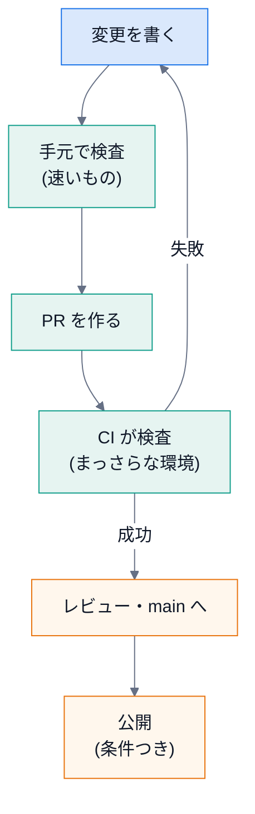
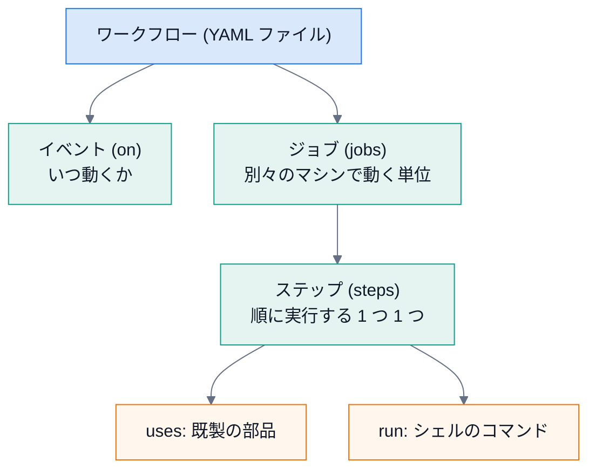
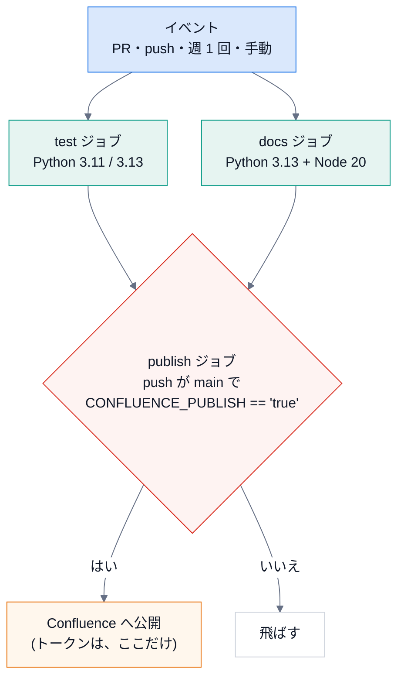
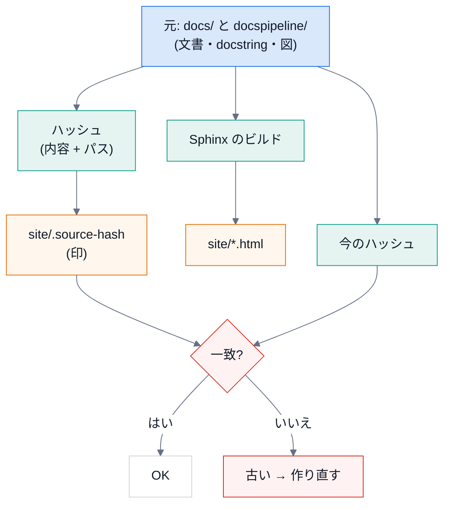
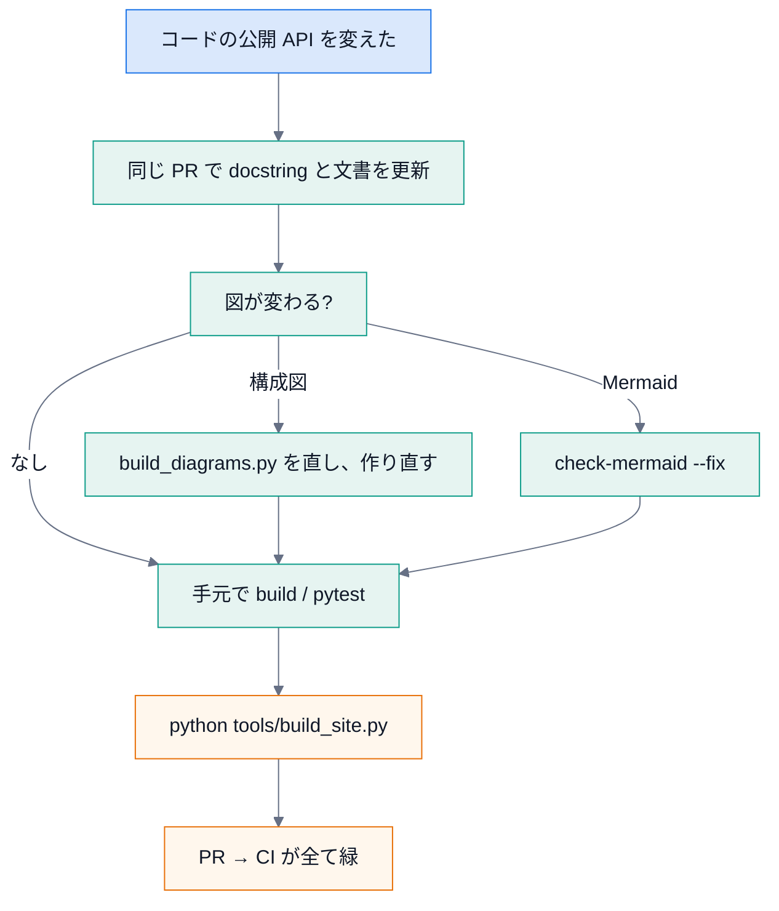
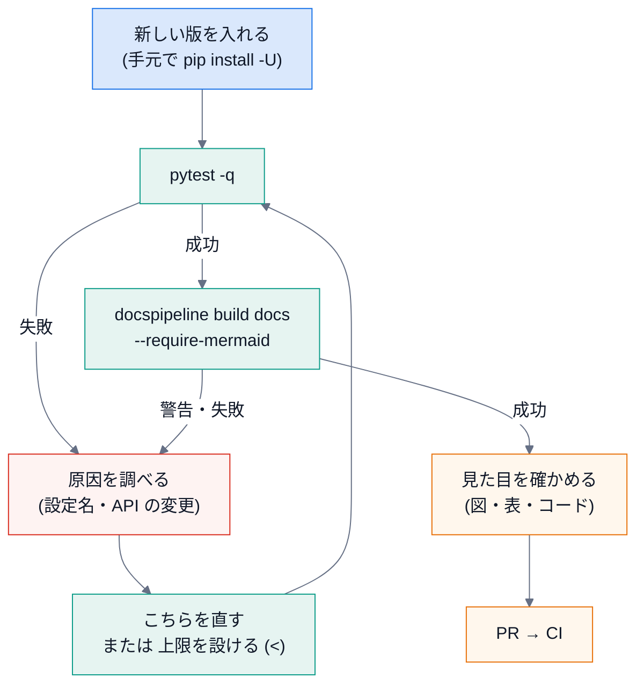

# 第 12 回 CI と運用

> 所要時間の目安: 4 時間 / 前提: 第 3・9・10・11 回

## この回のゴール

- **CI** (継続的インテグレーション) が、何のためにあるかを、説明できる。
- GitHub Actions の部品 (イベント・ジョブ・ステップ・マトリクス・条件・秘密) を、読める。
- このリポジトリの CI が、**どの検査で、何を守っているか** を、対応づけて説明できる。
- **YAML をデータとして読んで**、設定の約束 (秘密の渡し先など) を、検査できる。
- **HTML 版 (`site/`) のずれ検出** (ハッシュの印) の仕組みを、説明できる。
- 日常の運用 (文書の更新・公開の開始と停止・障害対応) の手順を、実行できる。
- **検証できていないこと** を、正直に区別して書ける。

## 1. CI とは

**CI** (Continuous Integration) は、変更を取り込むたびに、**検査を自動で走らせる** 仕組みです。

| 手作業 | CI |
|---|---|
| 検査を、**忘れる**・**省く** | 毎回、**必ず** 走る |
| 人の環境 (入れた道具の版) で結果が違う | **まっさらな環境** で走る (再現できる) |
| 失敗に気付くのが、**遅い** (公開後) | **変更の直後** に気付く (PR の画面で) |
| 「自分の環境では動く」 | 誰の環境でもない、**共通の環境** |

**早く失敗するほど、直すのが安い**。変更を書いた直後なら、原因は、その変更の中にあります。公開後に気付くと、探す範囲が広く、被害も出ています。



CI の仕事は、**ひとつの単純な約束** です。「**コマンドが、終了コード 0 で終わること**」。0 以外なら、そのステップは失敗し、ジョブも失敗し、PR に赤い印が付く。
だから、第 8 回の CLI は、**成功は 0、失敗は 0 以外** を、徹底していました。

## 2. GitHub Actions の部品

**ワークフロー** は、`.github/workflows/*.yml` に書く YAML ファイルです。



| キー | 意味 | このリポジトリでの使い方 |
|---|---|---|
| `on` | いつ動くか | `pull_request`・`push` (main)・`schedule` (週 1 回)・`workflow_dispatch` (手動) |
| `permissions` | CI に与える **権限** | `contents: read` (読むだけ。**最小権限**) |
| `env` | 環境変数 | `DOCSPIPELINE_PUPPETEER_CONFIG` (mmdc の設定) |
| `jobs.<名前>.runs-on` | 動くマシン | `ubuntu-latest` |
| `strategy.matrix` | 同じジョブを、**値を変えて** 複数回 | Python `3.11` と `3.13` |
| `needs` | 先に終わるべきジョブ | `publish` は `[test, docs]` の後 |
| `if` | 条件 | 公開は、`main` への反映 **かつ** 変数が `'true'` のとき |
| `environment` | 環境 (保護ルールを付けられる) | `confluence` |
| `concurrency` | 同時に動かさない | 公開は同時に 1 つだけ |
| `vars.NAME` / `secrets.NAME` | 設定値 / 秘密 | URL などは `vars`、トークンは `secrets` |
| `uses: アクション@版` | 既製の部品 | `actions/checkout@v4` など |
| `run:` | コマンド | `docspipeline build docs ...` |

**マトリクスで 2 つの版を試す理由**: 対応する **最小の版 (3.11)** と **最新 (3.13)** の両端が動けば、間も動く可能性が高い。
`fail-fast: false` で、片方が落ちても、もう片方を最後まで走らせ、**両方の結果を見られる** ようにする。

## 3. YAML をデータとして読む

ワークフローは、ただの **データ** です。読み込んで、約束を **テストできます** (第 9 回の「設定ファイルも、テストする」)。

```python
# 実行できる
from pathlib import Path

import docspipeline
import yaml

root = Path(docspipeline.__file__).parents[1]
ci = yaml.safe_load((root / ".github" / "workflows" / "ci.yml").read_text(encoding="utf-8"))

print("最上位のキー  :", list(ci))
print("ジョブ        :", list(ci["jobs"]))
for name, job in ci["jobs"].items():
    print(f"  {name:8} needs={job.get('needs', '-')!s:14} ステップ数={len(job['steps'])}")
```

```text
# 出力
最上位のキー  : ['name', True, 'permissions', 'env', 'jobs']
ジョブ        : ['test', 'docs', 'publish']
  test     needs=-              ステップ数=6
  docs     needs=-              ステップ数=12
  publish  needs=['test', 'docs'] ステップ数=5
```

**落とし穴**: 最上位のキーの 2 番目が、`'on'` ではなく **`True`** です。
YAML 1.1 の規則では、`on` は **真偽値の `true`** と解釈されます (`yes`・`no`・`off` も同じ)。GitHub は `on` と読みますが、PyYAML は `True` にします。
この資料のテストは、`jobs` のように、**この罠に当たらないキー** だけを読んでいます。

### 秘密の渡し先を、検査する

第 9 回の約束 (「トークンは、公開のステップだけ」) を、**CI の設定そのもの** で確かめます。

```python
# 引用: tests/test_robustness.py::test_the_api_token_reaches_only_the_publish_step
def test_the_api_token_reaches_only_the_publish_step(tmp_path):
    """トークンを job 全体の env に置くと、pip / npm のインストール scripts (依存の更新で変わりうる) からも読める。"""
    for name, workflow in _workflows(tmp_path).items():
        job = workflow["jobs"]["publish"]
        assert "CONFLUENCE_API_TOKEN" not in job.get("env", {}), name
        holders = [s for s in job["steps"] if "CONFLUENCE_API_TOKEN" in s.get("env", {})]
        assert [s["name"] for s in holders] == ["Publish to Confluence"], name
        assert "secrets.CONFLUENCE_API_TOKEN" in holders[0]["env"]["CONFLUENCE_API_TOKEN"], name
```

```python
# 実行できる
from pathlib import Path

import docspipeline
import yaml

root = Path(docspipeline.__file__).parents[1]
ci = yaml.safe_load((root / ".github" / "workflows" / "ci.yml").read_text(encoding="utf-8"))
publish = ci["jobs"]["publish"]

print("ジョブ全体の env のキー:", sorted(publish["env"]))
holders = [s["name"] for s in publish["steps"] if "CONFLUENCE_API_TOKEN" in s.get("env", {})]
print("トークンを持つステップ  :", holders)
others = [name for name, job in ci["jobs"].items() if name != "publish" and "CONFLUENCE_API_TOKEN" in repr(job)]
print("他のジョブに、トークンの名前がある?:", bool(others))
print("公開の条件 (if)        :", publish["if"])
```

```text
# 出力
ジョブ全体の env のキー: ['CONFLUENCE_PARENT_PAGE', 'CONFLUENCE_SERVER_URL', 'CONFLUENCE_SERVER_USER', 'CONFLUENCE_SPACE_KEY', 'DOCSPIPELINE_PUPPETEER_CONFIG']
トークンを持つステップ  : ['Publish to Confluence']
他のジョブに、トークンの名前がある?: False
公開の条件 (if)        : github.event_name == 'push' && github.ref == 'refs/heads/main' && vars.CONFLUENCE_PUBLISH == 'true'
```

- ジョブ全体の `env` に、**トークンは無い** (4 つの設定値と puppeteer の設定だけ)。
- トークンを持つのは、**公開のステップだけ**。
- `pip install` や `npm install` は、依存の **インストール用スクリプト** を走らせることがある。そこへ、トークンを渡さない。

## 4. このリポジトリの CI



### test ジョブ

| ステップ | コマンド | 守るもの |
|---|---|---|
| 依存を入れる | `pip install -e ".[docs,cpp,confluence,dev]"` | 本番と同じ依存で試す |
| Lint | `ruff check .` | 書き間違い・未使用の import・古い書き方 |
| 書式 | `ruff format --check .` | 書式の不一致 (直さず、検出だけ) |
| テスト | `pytest -q` | 第 10 回の全てのテスト (実ビルド・図・HTML 版・講義を含む) |

### docs ジョブ

| ステップ | コマンド | 守るもの |
|---|---|---|
| ビルド (HTML) | `docspipeline build docs --require-mermaid` | 警告 = 失敗 (`-W`)。**図が画像にならない** ことを許さない |
| ビルド (Confluence 形式) | `docspipeline build docs -b confluence --require-mermaid` | Confluence に載せられない書き方を、公開の **前** に見つける (ネットワーク不要) |
| 例のビルド | `docspipeline build examples/.../docs` | 雛形・サンプルが壊れていない |
| 図の書き出し | `docspipeline check-diagrams docs` | `.drawio` に `.drawio.svg` が揃っている |
| Mermaid の書式 | `docspipeline check-mermaid docs README.md` | 標準の `%%{init}%%` の行がある (第 11 回) |
| カバレッジ | `docspipeline coverage docspipeline --fail-under 100` | 公開 API の docstring が、全てある |
| リンク切れ | `docspipeline linkcheck docs` | **週 1 回・手動のときだけ**。外部サイトは、こちらの変更と無関係に落ちるため、PR を止めない |

### publish ジョブ

| 約束 | 設定 |
|---|---|
| 先に `test` と `docs` が成功 | `needs: [test, docs]` |
| main への反映だけ | `if: github.event_name == 'push' && github.ref == 'refs/heads/main' && ...` |
| 明示的に有効にした場合だけ | `vars.CONFLUENCE_PUBLISH == 'true'` (**変数を外せば止まる**) |
| 同時に 2 つ走らない | `concurrency: confluence-publish` |
| 承認や制限を付けられる | `environment: confluence` (保護ルールは、リポジトリの設定で行う) |
| トークンは公開のステップだけ | 上の検査 |
| 道具の版を固定 | `@mermaid-js/mermaid-cli@12.0.0` |

### コマンドの終了コードが、CI の判定

```python
# 実行できる
import subprocess
import sys
import tempfile
from pathlib import Path

CODE = '"""m."""\n\n\ndef good():\n    """ok."""\n\n\ndef bad():\n    pass\n'

with tempfile.TemporaryDirectory() as tmp:
    (Path(tmp) / "pkg").mkdir()
    (Path(tmp) / "pkg" / "m.py").write_text(CODE, encoding="utf-8")
    for threshold in (100, 50):
        r = subprocess.run([sys.executable, "-I", "-m", "docspipeline", "coverage", "pkg", "--fail-under", str(threshold)],
                           cwd=tmp, capture_output=True, text=True, encoding="utf-8")
        summary = [line for line in r.stdout.splitlines() if "カバレッジ:" in line]
        print(f"基準 {threshold:>3}% → 終了コード {r.returncode} / {summary[0]}")
```

```text
# 出力
基準 100% → 終了コード 1 / docstring のカバレッジ: 66.7% (2/3)
基準  50% → 終了コード 0 / docstring のカバレッジ: 66.7% (2/3)
```

3 つの関数のうち 2 つに docstring がある (66.7%)。基準が 100% なら **終了コード 1 = CI が赤**、50% なら 0 = 緑です。
**同じ測定結果でも、基準 (閾値) で、合否が変わる**。基準は、設定として明示します (`--fail-under`)。

## 5. 手元で CI を再現する

CI の失敗を、**手元で再現** できないと、直せません。CI が走らせるコマンドは、そのまま手元でも走ります。

| 目的 | コマンド |
|---|---|
| 依存を入れる | `pip install -e ".[docs,cpp,confluence,dev]"` |
| Lint と書式 | `ruff check .` / `ruff format --check .` (直すなら `ruff format .`) |
| 速いテストだけ | `pytest -q -m "not slow"` |
| 全てのテスト | `pytest -q` |
| 文書のビルド | `docspipeline build docs --require-mermaid` (`mmdc` が要る) |
| 環境の確認 | `docspipeline doctor` |
| 図を作り直す | `python tools/diagrams/build_diagrams.py` |
| Mermaid の書式を直す | `docspipeline check-mermaid docs --fix` |
| 講義の引用・出力を更新 | `python tools/quote_code.py docs/lecture --outputs` |
| HTML 版を作り直す | `python tools/build_site.py` |

**環境の差に注意**: CI は `ubuntu-latest` の **まっさらな環境** です。手元で通って CI で落ちるときの、典型的な原因です。

| 症状 | 疑うこと |
|---|---|
| 手元だけ通る | 手元にだけ入っている道具 (mmdc・doxygen)、残っている生成物 (`_build`)、古いキャッシュ |
| CI だけ通る | CI が **まっさらな環境** なので、手元の汚れが原因 (`docs/_build` を消して試す) |
| Python の版で結果が違う | 3.11・3.12・3.13 で、`ast.dump` の表示が違う。浮動小数点の `sum` の末尾の桁も違う (第 11 回の実例: 図の生成物が、3.11 でだけずれた) |
| 時々だけ落ちる | 順序・時刻・キャッシュ (第 10 回の「決定的であること」) |

## 6. HTML 版 (`site/`) のずれを検出する

Sphinx で作った HTML を、`site/` に **コミット** しています (ブラウザで `site/index.html` を開けば、サーバーなしで読める)。
すると、**文書を変えたのに HTML を作り直し忘れる** 事故が起きます。これを、**ハッシュの印** で検出します。



```python
# 引用: tools/build_site.py::compute_hash
def compute_hash(root: Path = ROOT) -> str:
    """元の文書・ソース・図の内容から、ハッシュを作る。パスと内容の両方を含める。"""
    digest = hashlib.sha256()
    for path in source_files(root):
        digest.update(path.relative_to(root).as_posix().encode("utf-8"))
        digest.update(b"\0")
        # 改行コードの違い (Windows など) でハッシュが変わらないようにする
        digest.update(path.read_bytes().replace(b"\r\n", b"\n"))
        digest.update(b"\0")
    return digest.hexdigest()
```

```python
# 引用: tools/build_site.py::source_files
def source_files(root: Path = ROOT) -> list[Path]:
    """ハッシュの元になるファイルを、整列して返す。"""
    files = []
    for name in SOURCES:
        base = root / name
        for path in sorted(base.rglob("*")):
            if not path.is_file() or path.suffix in SKIP_SUFFIXES:
                continue
            if SKIP_DIRS.intersection(path.relative_to(base).parts):
                continue
            files.append(path)
    return files
```

設計の判断を読み解きます。

| 判断 | 理由 |
|---|---|
| **HTML の出力そのもの** を比べず、**元** のハッシュを比べる | HTML は、Sphinx・テーマの版で変わる。元が同じなら「同じ内容」と言える |
| ハッシュに **パスも** 含める | 内容が同じでも、ファイルを改名・追加したら、別物 |
| 区切りに `\0` (ヌル文字) | `"ab" + "c"` と `"a" + "bc"` のような、**連結の曖昧さ** を防ぐ |
| 改行コードを `\n` にそろえる | Windows (CRLF) で、ハッシュが変わるのを防ぐ |
| `sorted` で整列 | ファイルの列挙順に依存しない (**決定的**) |
| 生成物・キャッシュ (`_build` など) を除く | それらは、元ではない |
| `site/` 自身を含めない | 印を書くと、印が変わる、という循環を避ける |

```python
# 実行できる
import sys
import tempfile
from pathlib import Path

import docspipeline

sys.path.insert(0, str(Path(docspipeline.__file__).parents[1] / "tools"))
import build_site

with tempfile.TemporaryDirectory() as tmp:
    root = Path(tmp)
    (root / "docs" / "_build").mkdir(parents=True)
    (root / "docspipeline").mkdir()
    (root / "docs" / "a.md").write_text("# A\n", encoding="utf-8")
    (root / "docspipeline" / "m.py").write_text('"""m."""\n', encoding="utf-8")

    base = build_site.compute_hash(root)
    print("ハッシュの長さ                  :", len(base))
    (root / "docs" / "_build" / "junk.html").write_text("x", encoding="utf-8")
    print("生成物を足しても同じ            :", build_site.compute_hash(root) == base)
    (root / "docs" / "a.md").write_bytes(b"# A\r\n")
    print("改行コードだけ違っても同じ      :", build_site.compute_hash(root) == base)
    (root / "docs" / "a.md").write_text("# B\n", encoding="utf-8")
    print("文書の中身が変われば違う        :", build_site.compute_hash(root) != base)
```

```text
# 出力
ハッシュの長さ                  : 64
生成物を足しても同じ            : True
改行コードだけ違っても同じ      : True
文書の中身が変われば違う        : True
```

**運用**: 文書・docstring・図を変えたら、`python tools/build_site.py` で作り直します (`mmdc` が要る)。忘れると、`pytest` (と CI) が落ちます。

> **この仕組みが検出できないこと**: ハッシュは、**元が変わったか** を見るだけです。`site/` の **HTML を手で書き換えた** 場合は、検出できません
> (HTML の中身まで、毎回再生成して比べるのは、版の違いで揺れるため、あえてやっていません)。`site/` は生成物で、手で直さない、という約束を守ってください。

## 7. 日常の運用

### 文書を更新する



### Confluence への公開を、始める・止める

| 操作 | 手順 |
|---|---|
| **始める** | ①専用のスペースと親ページを用意 → ②手元で `confluence-check` と `publish --mode dryrun` → ③リポジトリに変数 4 つとシークレット 1 つを登録 → ④変数 `CONFLUENCE_PUBLISH` を `true` に |
| **止める** | 変数 `CONFLUENCE_PUBLISH` を **外す** (または `true` 以外に)。公開ジョブが、飛ばされる |
| **トークンを替える** | シークレット `CONFLUENCE_API_TOKEN` を更新する。**古いトークンは、Atlassian 側で無効にする** |

**止める操作が、1 か所で、速い** ことが大事です (事故のとき、考えずに止められる)。

### 障害対応

| 症状 | まず見るもの | 対処 |
|---|---|---|
| CI の docs ジョブが赤 | ログの最初の `WARNING`/`ERROR` | 警告の原因を直す (消すための例外は最後の手段) |
| 図がコードのまま出る | `mmdc` の有無 (`docspipeline doctor`) | `npm install` / `DOCSPIPELINE_MMDC` |
| `mmdc` が CI で起動しない | Chromium のサンドボックス | `DOCSPIPELINE_PUPPETEER_CONFIG` に `--no-sandbox` の設定 |
| 公開が意図せず走った/走らない | `vars.CONFLUENCE_PUBLISH`・`if` の条件・main への push か | 変数と条件を確認 |
| 公開が途中で失敗 | 接続テストの出力 (トークンは伏せられる) | 認証・権限・親ページの確認 |
| site が古いと言われる | `python tools/build_site.py --check` | 作り直してコミット |

## 8. 保守の周期

文書の仕組みは、**作って終わり** ではありません。外の世界 (Sphinx・拡張・Confluence・Node) が変わるからです。
**いつ・何を見直すか** を決めておくと、気付くのが遅れません。以下は、このリポジトリの構成から導いた **推奨** です (自動化されているのは、表の「自動」の列だけ)。

| 周期 | 見ること | 自動 | 手順 |
|---|---|---|---|
| 変更のたび | lint・テスト・ビルド・図・Mermaid の書式・カバレッジ | CI (PR ごと) | 赤になったら、その PR で直す |
| 週 1 回 | 外部リンクの切れ | CI (`schedule`) | `docspipeline linkcheck docs` の出力を読み、直す |
| 月 1 回 (推奨) | 依存の新しい版 (Sphinx・furo・myst-parser・confluencebuilder) | 手動 | 手元で `pip install -U` → `pytest` と `docspipeline build`。落ちたら、**設定名の変更** (第 9 回 T7) を疑う |
| 半年に 1 回 (推奨) | `mermaid-cli` の固定版 | 手動 | `ci.yml` と雛形の `@12.0.0` を上げ、図の見た目を確かめる (**2 か所を同時に**) |
| 新しい版を使うとき | Python の対応範囲 | CI の matrix | `pyproject.toml` の `requires-python` と、matrix の版を揃える |
| 講義・学習資料を直したとき | 引用と出力 | `pytest` | `python tools/quote_code.py docs/lecture --outputs` |

> 「推奨」の行は、**この資料が提案する運用** で、リポジトリの中に強制する仕組みはありません。チームの事情に合わせて、決め直してください。

**依存を上げるときの順序**



**範囲指定 (`>=`) と固定 (`==`) の使い分け**: ライブラリとして配る `pyproject.toml` は **範囲指定** (利用者の環境と衝突しにくい)。
公開 (トークンを使う) ジョブで動かす **道具** は **固定** (`mermaid-cli@12.0.0`)。固定した版は、**自分で上げる** 責任が生じます。

## 9. 検証できていないこと

**自分が確かめた範囲** と **確かめていない範囲** を、分けて書くのも、運用の一部です。この資料の時点で、次の項目は、手元では確かめていません。

| 項目 | 状況 |
|---|---|
| GitHub 上での `ci.yml` の実行 | **未検証**。YAML の構造と約束は、テストで読んで確かめた。実際の実行は、GitHub 上で初めて走る |
| `environment: confluence` の保護ルール | **未検証**。リポジトリの設定で、人が付ける (承認者・対象ブランチの制限など) |
| 実際の Confluence への公開 | **未検証**。認証情報がなく、`dryrun` までの経路をテストで確かめた |
| Windows での動作 | **一部のみ**。コマンド分割・`.cmd` の探索などは、Windows の挙動を想定したテストがあるが、Windows 上では動かしていない |
| Python の版 | 3.11 と 3.13 は、手元で `pytest` を全て通した。**3.12 は、図の生成物の一致だけ** 確かめた (CI の対象にも入っていない) |
| 将来の版 (Sphinx・furo・confluencebuilder) | 範囲指定の依存 (`>=`) なので、新しい版で変わりうる。週 1 回の CI と、定期的な見直しで気付く |

**「確かめた」と書けるのは、実際に確かめたことだけ** です。推測を事実のように書くと、運用で、誤った安心を生みます。

## ハンズオン

1. `ruff check .` と `ruff format --check .` を実行する。わざと、`docspipeline/files.py` に使わない `import os` を足して、`ruff check` が何を言うかを読む (戻すこと)。
2. `docspipeline coverage docspipeline --fail-under 100; echo $?` を実行し、終了コードを確かめる。
3. `ci.yml` を読み込み、`publish` ジョブの `if` を表示するスクリプトを書く (本文の例を参考に)。
4. `python tools/build_site.py --check` の結果を確かめる。次に、`docs/runbook.md` に空行を 1 つ足して、もう一度実行する (戻すこと)。

## 確認問題

1. CI が、手作業の検査より優れている点を、3 つ挙げてください。
2. `needs`・`if`・`concurrency` は、それぞれ何を守りますか。
3. PyYAML で `ci.yml` を読むと、`on` が `True` になるのは、なぜですか。どう対処しますか。
4. トークンを、`publish` ジョブ全体の `env` ではなく、1 つのステップの `env` に置く理由は何ですか。
5. リンク切れの検査 (`linkcheck`) を、PR ごとに走らせず、週 1 回にしているのは、なぜですか。
6. `site/` の印のハッシュに、ファイルの **パス** を含めるのは、なぜですか。区切りに `\0` を使うのは、なぜですか。
7. HTML 版の「ずれ検出」が、検出できないことは何ですか。
8. 「手元では通るが、CI で落ちる」とき、まず何を疑いますか。3 つ挙げてください。
9. (書く問題) `ci.yml` を読み込み、**`permissions` が `contents: read` だけ** であることを確かめるテストを書いてください。

## 解答

1. ①毎回必ず走る (忘れない・省けない)。②まっさらな環境で走る (再現できる)。③変更の直後に気付く (PR の画面で。直すのが安い)。
2. `needs`: 前提のジョブ (テストと文書ビルド) が **成功してから** 公開する。`if`: **条件を満たすとき** (main への push かつ変数が `'true'`) だけ公開する。
   `concurrency`: 公開が **同時に複数** 走って、互いに壊し合うのを防ぐ。
3. YAML 1.1 では、`on` が真偽値の `true` と解釈される (`yes`・`off` なども同様)。PyYAML は 1.1 に従う。
   対処: `jobs` のように影響を受けないキーだけを読む。または、`ci[True]` で読む。キーを文字列として扱いたいなら、読み込み時に変換する。
4. `pip install` や `npm install` が走らせる、依存のインストール用スクリプトから、**トークンを読めなくする** ため (最小権限)。
   ジョブ全体の `env` に置くと、そのジョブの **全てのステップ** から読める。
5. 外部サイトは、**こちらの変更と無関係に** 落ちる (一時的な停止・移転)。PR ごとに走らせると、**無関係な理由で PR が赤くなる**。
   週 1 回なら、切れたリンクに気付きつつ、日々の作業を止めない。
6. 内容が同じでも、**ファイルを改名・追加した** ら別物だから (パスが無いと、改名を検出できない)。
   `\0` は、**連結の曖昧さ** を防ぐ (パス `a` + 内容 `bc` と、パス `ab` + 内容 `c` が、同じバイト列にならない)。
7. `site/` の HTML を **手で書き換えた** こと (元の変更だけを見るため)。`site/` は生成物で、手で直さない、という約束で守る。
8. ①手元にだけ入っている道具 (mmdc・doxygen)。②手元に残った生成物・キャッシュ (`docs/_build`)。③Python や依存の **版の違い** (3.11 と 3.13 など)。
9. 例 (実行して確かめてある):

```python
# 実行できる
from pathlib import Path

import docspipeline
import yaml


def only_reads_the_repository(workflow):
    return workflow.get("permissions") == {"contents": "read"}


root = Path(docspipeline.__file__).parents[1]
ci = yaml.safe_load((root / ".github" / "workflows" / "ci.yml").read_text(encoding="utf-8"))
print("ci.yml は、読み取りだけ:", only_reads_the_repository(ci))
print("権限を足した場合      :", only_reads_the_repository({"permissions": {"contents": "write"}}))
```

```text
# 出力
ci.yml は、読み取りだけ: True
権限を足した場合      : False
```

(テストにするなら、`assert only_reads_the_repository(ci)` と書きます。各ジョブに `permissions` が書かれていれば、そちらが優先されるので、ジョブごとの確認も要ります。)

## まとめ

| 概念 | 要点 | このリポジトリでの例 |
|---|---|---|
| CI | 変更のたびに、まっさらな環境で検査。終了コードが判定 | `ci.yml` |
| Actions の部品 | on・jobs・steps・matrix・needs・if・secrets | 3 ジョブ |
| 最小権限 | `contents: read`、トークンは 1 ステップ | `publish` |
| YAML をデータで | 読み込んで約束を検査。`on` は `True` に注意 | `test_robustness.py` |
| 再現 | CI のコマンドを、手元でも | 一覧表 |
| ずれ検出 | 元のハッシュの印。パス・改行・順序に注意 | `build_site.py` |
| 運用 | 更新・開始と停止・障害対応 | runbook |
| 正直さ | 確かめた範囲と、未検証の区別 | 「検証できていないこと」 |

## 次回

[第 13 回 総合演習](13-capstone.md): ここまでの全てを使って、**新しい機能を 1 つ、最初から最後まで** 足します。
