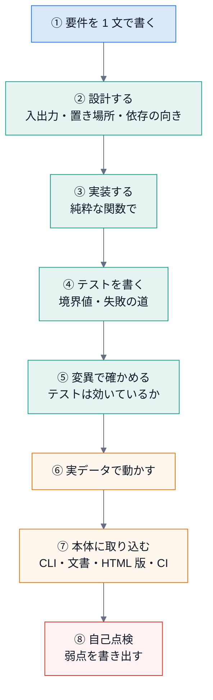
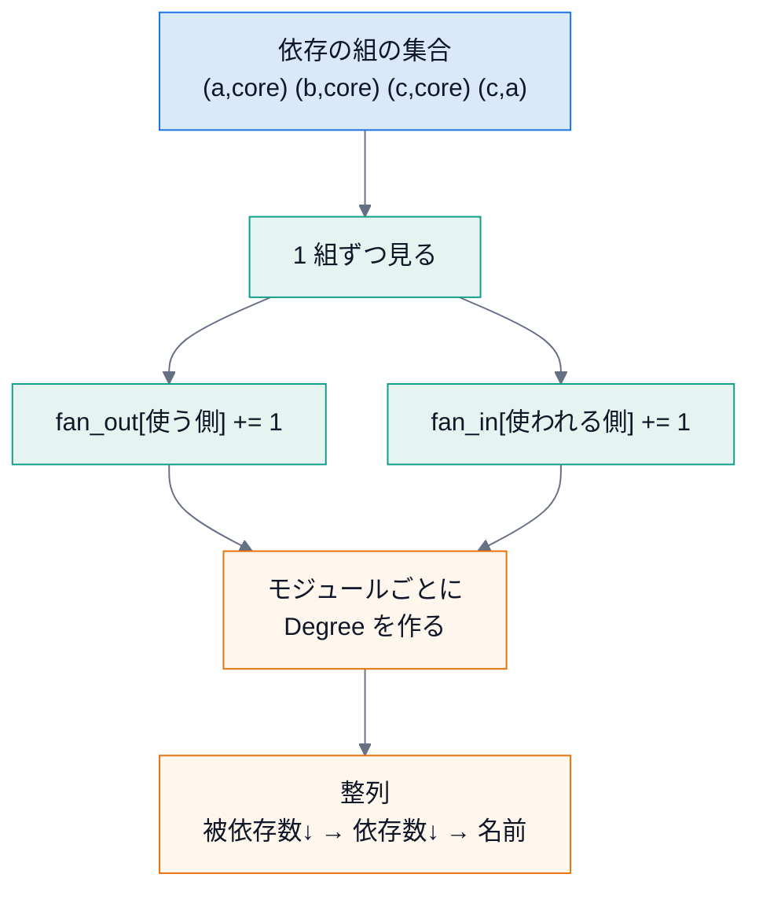
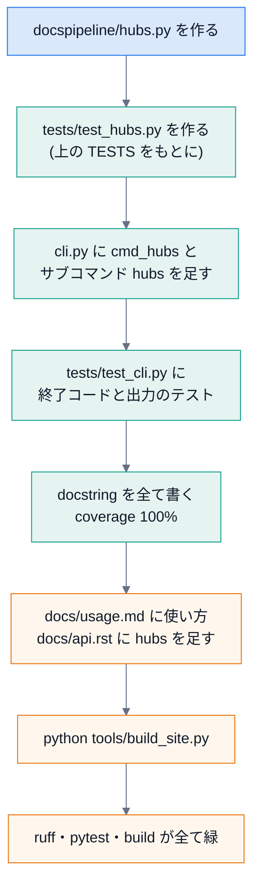

# 第 13 回 総合演習

> 所要時間の目安: 5 時間 / 前提: 第 1〜12 回

## この回のゴール

- 新しい機能を、**要件 → 設計 → 実装 → テスト → 変異 → 取り込み → 点検** の順に、最初から最後まで作れる。
- 実装の前に、**置き場所と依存の向き** を決められる。
- アルゴリズムの **計算量** を見積もり、素朴な書き方と比べられる。
- 自分の実装の **弱点を、自分で見つけて**、書き出せる。
- 機能を **本体に取り込む手順** (CLI・文書・テスト・HTML 版・CI) を、漏れなく挙げられる。

この回は、新しい知識を学ぶ回ではありません。**これまでの 12 回を、1 つの作業に通して使う** 回です。
題材は小さな機能ですが、手順は、実際の保守・拡張と同じです。

## 1. 題材と進め方

> **題材: 依存の中心 (ハブ) を探す機能**
> 多くのモジュールから使われているモジュールは、**変更の影響が広い**。そうしたモジュールを、一覧にしたい。



このリポジトリを **変更せずに**、一時ディレクトリの中で ①〜⑥ を行います (⑦ は手順を示すので、宿題として実際にやってみてください)。
こうすると、講義の例が、**実行して確かめられる** まま、リポジトリを汚しません。

## 2. ① 要件と ② 設計

### 要件を 1 文で書く

> 「パッケージの各モジュールについて、**何個のモジュールから import されているか (被依存数 = fan-in)**、
> **何個のモジュールを import しているか (依存数 = fan-out)** を数え、被依存数の多い順に並べる。
> 被依存数が基準以上のものを **ハブ** と呼ぶ。」

**1 文で書けない要件は、まだ分かっていません**。書けたら、次の 3 つを自問します。

| 自問 | この題材での答え |
|---|---|
| 入力は何か | 第 5 回の `Graph` (`scan_package` の結果)。ソースを再び読まない |
| 出力は何か | `Degree(name, fan_in, fan_out)` の並び。**表示の形は含めない** (表示は別の仕事) |
| 失敗するのは、どんなとき | 基準 (`minimum`) が 1 未満のとき。それ以外は、**空でも正常** |

### 置き場所と依存の向き (第 8 回・第 10 回)

| 案 | 長所 | 短所 | 判断 |
|---|---|---|---|
| `Graph` にメソッドを足す | 呼びやすい | `structure_map.py` が大きくなる。**地図の作成** と **地図の分析** が混ざる | 却下 |
| `cli.py` の中に書く | 手軽 | テストしにくい (引数や出力と混ざる)。CLI は薄く保つ | 却下 |
| **新しいモジュール `hubs.py`** | 純粋な関数だけ。テストしやすい | ファイルが 1 つ増える | **採用** |

`hubs.py` が import するのは `structure_map` だけ。`structure_map` は Sphinx を import しない (第 10 回の構造テスト) ので、
**新しいモジュールも core のまま** です。依存の向きは、`cli → hubs → structure_map` の一方向で、循環しません。

## 3. ③ 実装

### アルゴリズム: 数え上げ

依存の組 `(使う側, 使われる側)` の集合を **1 回だけ走査** し、使う側の `fan_out` と、使われる側の `fan_in` を、それぞれ +1 します。



**計算量の比較** (モジュール数 `M`、依存の数 `E`):

| 書き方 | 計算量 | 説明 |
|---|---|---|
| 素朴: モジュールごとに、全ての依存を走査して数える | `O(M × E)` | 「`pkg.core` の被依存数」を、毎回全部の依存から数える |
| **採用: 1 回走査して `Counter` に足す** | `O(M + E)` + 整列 `O(M log M)` | 依存を 1 度見るだけ |

このリポジトリの規模 (十数モジュール) では、どちらも一瞬です。それでも **`Counter` を選ぶ** のは、
書き方が **短く・読みやすく**、規模が大きくなっても **困らない** からです (第 5 回: 計算量は、規模が増えたときに効く)。

### 整列の鍵

整列の鍵は、`(-被依存数, -依存数, 名前)` です。

- マイナスを付けて、**多い順** (降順)。
- 同数のときは、依存数の多い順、最後に **名前順**。名前を入れるのは、**出力を決定的** にするため (第 10 回)。

### 弱点を、最初から意識する

`Graph.edges` には、依存の **種類** があります (第 5 回)。

| 種類 | 意味 |
|---|---|
| `import` | モジュール直下の import (読み込み時に実行される) |
| `deferred` | 関数の中の import (呼ばれたときに初めて読み込まれる) |
| `reference` | モジュール名と一致する文字列 (`extensions = ["pkg.ext"]` など) |

どれを数えるかで、結果が変わります。**既定は `import` だけ** にし、引数 `kinds` で選べるようにします。

## 4. ④ テストと ⑤ 変異

以下は、実装・テスト・変異・実データでの実行を、**ひとつにまとめた例** です。上から読んでください。

- `HUBS`: 実装 (モジュール `hubs.py` の中身)。
- `TESTS`: テスト。小さなパッケージを `tmp_path` に作って `scan_package` にかける (偽物を作らず、**本物の読み取り** を使う)。
- 変異: 実装を 4 通りに壊して、**どのテストが落ちるか** を確かめる。
- 最後に、本物の `docspipeline` に対して実行する。

```python
# 実行できる
import re
import subprocess
import sys
import tempfile
from pathlib import Path

import docspipeline

HUBS = '''"""依存の中心 (ハブ) を探す。被依存数 (fan-in) が多いモジュールは、変更の影響が広い。"""

from __future__ import annotations

from collections import Counter
from collections.abc import Iterable
from dataclasses import dataclass

from docspipeline.structure_map import Graph


@dataclass(frozen=True)
class Degree:
    """1 つのモジュールの次数。"""

    name: str
    fan_in: int  # このモジュールを import するモジュールの数
    fan_out: int  # このモジュールが import するモジュールの数


def degrees(graph: Graph, kinds: Iterable[str] = ("import",)) -> list[Degree]:
    """全モジュールの次数を、被依存数の多い順 (同数なら依存数の多い順、名前順) に返す。

    Args:
        graph: ``scan_package`` の結果。
        kinds: 数える依存の種類 (``import``・``deferred``・``reference``)。
    """
    edges: set[tuple[str, str]] = set()
    for kind in kinds:
        edges |= graph.edges(kind)  # 集合の和: 同じ組が 2 種類にあっても、1 回だけ数える
    fan_in: Counter[str] = Counter()
    fan_out: Counter[str] = Counter()
    for src, dst in edges:
        fan_out[src] += 1
        fan_in[dst] += 1
    rows = [Degree(m.name, fan_in[m.name], fan_out[m.name]) for m in graph.modules]
    return sorted(rows, key=lambda d: (-d.fan_in, -d.fan_out, d.name))


def hubs(graph: Graph, minimum: int = 3, kinds: Iterable[str] = ("import",)) -> list[Degree]:
    """被依存数が ``minimum`` 以上のモジュール。

    Raises:
        ValueError: ``minimum`` が 1 未満のとき (全モジュールが該当してしまい、意味が無いため)。
    """
    if minimum < 1:
        raise ValueError("minimum は 1 以上にしてください")
    return [d for d in degrees(graph, kinds) if d.fan_in >= minimum]
'''

TESTS = '''
import pytest
from docspipeline.structure_map import scan_package
from hubs import Degree, degrees, hubs

STAR = {
    "core": '"""core."""\\n',
    "a": "from . import core\\n",
    "b": "from . import core\\nfrom . import core as again\\n",
    "c": "from . import core\\nfrom . import a\\n",
}


def make_graph(tmp_path, files):
    pkg = tmp_path / "pkg"
    pkg.mkdir()
    (pkg / "__init__.py").write_text('"""pkg."""\\n')
    for name, body in files.items():
        (pkg / f"{name}.py").write_text(body)
    return scan_package(pkg)


def test_counts_the_modules_that_import_it_and_that_it_imports(tmp_path):
    rows = {d.name: d for d in degrees(make_graph(tmp_path, STAR))}
    assert rows["pkg.core"] == Degree("pkg.core", fan_in=3, fan_out=0)
    assert rows["pkg.c"] == Degree("pkg.c", fan_in=0, fan_out=2)
    assert rows["pkg.a"] == Degree("pkg.a", fan_in=1, fan_out=1)


def test_importing_the_same_module_twice_counts_once(tmp_path):
    rows = {d.name: d for d in degrees(make_graph(tmp_path, STAR))}
    assert rows["pkg.b"].fan_out == 1


def test_order_is_fan_in_then_fan_out_then_name(tmp_path):
    names = [d.name for d in degrees(make_graph(tmp_path, STAR))]
    assert names == ["pkg.core", "pkg.a", "pkg.c", "pkg.b", "pkg"]


def test_hubs_use_the_threshold_inclusively(tmp_path):
    graph = make_graph(tmp_path, STAR)
    assert [d.name for d in hubs(graph, minimum=3)] == ["pkg.core"]
    assert hubs(graph, minimum=4) == []


@pytest.mark.parametrize("minimum", [0, -1])
def test_a_threshold_below_one_is_rejected(tmp_path, minimum):
    with pytest.raises(ValueError, match="1 以上"):
        hubs(make_graph(tmp_path, STAR), minimum=minimum)


def test_a_package_with_no_modules_has_no_hubs(tmp_path):
    graph = make_graph(tmp_path, {})
    assert hubs(graph) == []
    assert [d.fan_in for d in degrees(graph)] == [0]


def test_imports_inside_functions_count_only_when_asked(tmp_path):
    graph = make_graph(tmp_path, {**STAR, "d": "def f():\\n    from . import core\\n"})
    core = lambda kinds: next(d for d in degrees(graph, kinds) if d.name == "pkg.core")
    assert core(("import",)).fan_in == 3
    assert core(("import", "deferred")).fan_in == 4
'''


def pytest_summary(root):
    r = subprocess.run(
        [sys.executable, "-B", "-m", "pytest", "-q", "-p", "no:cacheprovider", "--tb=no"],
        cwd=root,
        capture_output=True,
        text=True,
        encoding="utf-8",
    )
    last = [line for line in r.stdout.splitlines() if line.strip()][-1]
    return re.sub(r" in [0-9.]+s.*$", "", last)


MUTANTS = {
    "被依存と依存を取り違える": ("fan_in[dst] += 1", "fan_in[src] += 1"),
    "基準を「以上」でなく「超える」に": ("d.fan_in >= minimum", "d.fan_in > minimum"),
    "整列から依存数を外す": ("(-d.fan_in, -d.fan_out, d.name)", "(-d.fan_in, d.name)"),
    "基準の検査を 0 未満に緩める": ("if minimum < 1:", "if minimum < 0:"),
}

with tempfile.TemporaryDirectory() as tmp:
    root = Path(tmp)
    (root / "test_hubs.py").write_text(TESTS, encoding="utf-8")
    (root / "hubs.py").write_text(HUBS, encoding="utf-8")
    print("元の実装        :", pytest_summary(root))
    for label, (old, new) in MUTANTS.items():
        assert HUBS.count(old) == 1, label
        (root / "hubs.py").write_text(HUBS.replace(old, new), encoding="utf-8")
        result = pytest_summary(root)
        print(f"変異: {label}: {'見つけた' if 'failed' in result else '見逃した'} ({result})")

    (root / "hubs.py").write_text(HUBS, encoding="utf-8")
    sys.path.insert(0, tmp)
    import hubs
    from docspipeline.structure_map import scan_package

    graph = scan_package(Path(docspipeline.__file__).parent)
    prefix = "docspipeline."
    print("--- 本物の docspipeline (import だけ) ---")
    for d in hubs.degrees(graph)[:4]:
        print(f"  {d.name.removeprefix(prefix):12} 被依存 {d.fan_in}  依存 {d.fan_out}")
    print("ハブ (被依存 3 以上):", [d.name.removeprefix(prefix) for d in hubs.hubs(graph)])
    plain = next(d for d in hubs.degrees(graph) if d.name == prefix + "guard")
    wide = next(d for d in hubs.degrees(graph, ("import", "reference")) if d.name == prefix + "guard")
    print("guard の被依存: import だけ =", plain.fan_in, "/ 名前による参照も数えると =", wide.fan_in)
```

```text
# 出力
元の実装        : 8 passed
変異: 被依存と依存を取り違える: 見つけた (4 failed, 4 passed)
変異: 基準を「以上」でなく「超える」に: 見つけた (1 failed, 7 passed)
変異: 整列から依存数を外す: 見つけた (1 failed, 7 passed)
変異: 基準の検査を 0 未満に緩める: 見つけた (1 failed, 7 passed)
--- 本物の docspipeline (import だけ) ---
  files        被依存 4  依存 0
  confluence   被依存 3  依存 0
  mmdc         被依存 3  依存 0
  cli          被依存 1  依存 8
ハブ (被依存 3 以上): ['files', 'confluence', 'mmdc']
guard の被依存: import だけ = 0 / 名前による参照も数えると = 1
```

### 読み解く

| 観点 | 見るところ |
|---|---|
| テストは **本物の読み取り** を使う | `make_graph` が、`tmp_path` に小さなパッケージを書き、`scan_package` にかける。`Graph` を偽造しない |
| 境界値 | `minimum` が **ちょうど 3 のとき含む** (以上)・4 で空・0 と −1 で例外・モジュールが無い |
| 重複 | 同じモジュールを 2 回 import しても、**1 回** と数える (依存は集合) |
| 順序 | 完全な順序を **1 つのテスト** で確かめる (3 段の鍵のうち 1 つを外すと、順序が変わるように、データを選んだ) |
| 変異 | 4 通りの壊し方を、**すべて見つけた** ことを確かめた。1 つでも見逃したら、テストを足す |

### 弱点: 見えているものと、見えていないもの

最後の 2 行に、**この実装の限界** が出ています。`guard` は、`import` の依存だけで数えると、**どこからも使われていない** ように見えます。
実際には、`config` が **名前の文字列** で読み込んでいます (第 7 回)。名前による参照も数えると、被依存数は増えます。

**ハブの一覧は、「どの種類の依存を数えたか」を添えないと、誤解を生みます**。数字は、定義とセットで読みます。

(上位の `files` は、第 11 回の図で矢印を省いた **共通部品** です。ハブ = 悪いもの、ではありません。**変更の影響が広いので、慎重に変える** という目印です。)

## 5. ⑦ 本体に取り込む

実装が確かめられたら、**本体 (リポジトリ) に取り込み**ます。ここは、宿題として、実際にやってください。



CLI の足し方は、既存のコマンドを手本にします (第 8 回)。

```python
# 引用: docspipeline/cli.py::cmd_check_mermaid
def cmd_check_mermaid(args: argparse.Namespace) -> int:
    """``check-mermaid``: 全ての Mermaid ブロックが、標準の ``%%{init}%%`` の行で始まっているかを確かめる。

    GitHub (Markdown のまま) と Sphinx (``mmdc`` で SVG にした HTML) で、図の色とフォントを揃えるため。
    ``--fix`` で、足りない行を入れる。
    """
    roots = [Path(p) for p in args.paths]
    missing_paths = [p for p in roots if not p.exists()]
    if missing_paths:
        for path in missing_paths:
            print(f"エラー: パスがありません: {path}", file=sys.stderr)
        return 2
    problems = 0
    for path in iter_markdown_files(roots):
        text = path.read_text(encoding="utf-8")
        lines = mmdc.check_mermaid_text(text)
        if not lines:
            continue
        if args.fix:
            path.write_text(mmdc.fix_mermaid_text(text), encoding="utf-8")
            print(f"修正: {path} ({len(lines)} か所)")
        else:
            problems += len(lines)
            for line in lines:
                print(f"{path}:{line}: Mermaid ブロックが、標準の %%{{init}}%% の行で始まっていません")
    if problems:
        print("docspipeline check-mermaid --fix で、標準の行を入れられます", file=sys.stderr)
    return 1 if problems else 0
```

| 手本から学ぶこと | 新しいコマンドでは |
|---|---|
| 1 つの関数が 1 つのコマンド。`argparse.Namespace` を受け、`int` (終了コード) を返す | `cmd_hubs(args) -> int` |
| **最初に入力を検査** する (パスが無ければ 2 で終わる) | パッケージのパスが無ければ、2 で終わる |
| 結果は標準出力、**問題は標準エラー** | 一覧は標準出力、警告は標準エラー |
| 問題があれば 1、無ければ 0 | `--fail-over N` を付けるなら、基準超えの個数で決める (任意) |
| docstring を書く (coverage 100% が CI の関門) | `Args`・`Returns` まで書く |

取り込みの **漏れ防止チェックリスト** です。

| 確認 | 方法 |
|---|---|
| 構造のルールを守っている | `pytest tests/test_structure_map.py` (core が Sphinx を import しない) |
| Sphinx が無くても、動く | 第 10 回の `sys.modules[...] = None` のテストが通る |
| 公開 API の docstring がある | `docspipeline coverage docspipeline --fail-under 100` |
| 文書に載っている | `docs/api.rst` の一覧に足し、`docs/usage.md` に使い方 |
| 文書のコマンド例が、本物と合う | 第 8 回の `argparse` のヘルプと照合 |
| HTML 版が最新 | `python tools/build_site.py` |
| 構成図が、依存と一致 | 新しい import (`cli → hubs`) を `MODULE_IMPORTS` に足す (第 11 回。足さないとテストが落ちる) |

最後の項目に注意してください。**新しい依存を足すと、構成図のテストが落ちます**。それは、不具合ではなく、**図を直し忘れていることの検出** です。

## 6. ⑧ 自己点検

仕上げに、自分の実装を、**批判的に** 読みます。弱点を探すのは、**書いた本人の仕事**です。

| 観点 | この実装では | 対処 |
|---|---|---|
| 反例を探す | 推移的な依存 (a → b → core) の影響は数えていない。**直接** の被依存数だけ | 名前に `direct` と付ける、または推移閉包 (第 5 回の DFS) を足す |
| 数えないもの | 動的な import (`importlib.import_module(変数)`) は、見つけられない | 文書に「静的に読める依存のみ」と明記する |
| 定義の揺れ | `import` だけか、名前の参照も含むかで、順位が変わる | 出力に、数えた種類を添える |
| 基準の根拠 | 既定の `minimum=3` に、根拠は無い | 「目安」と書く。調整できる引数にする |
| 規模 | `O(M + E)` で足りる | 問題なし |
| 失敗の道 | 空のパッケージ・基準 0 を試した | 十分 |
| 将来の変更 | `Module` に新しい依存の種類が増えたら | `kinds` に未知の名前が来ると `Graph.edges` が `KeyError`。**入力の検査を足す** か、文書に書く |

最後の行は、実際に **見つかった弱点** です。確かめましょう。

```python
# 実行できる
from pathlib import Path

import docspipeline
from docspipeline.structure_map import scan_package

graph = scan_package(Path(docspipeline.__file__).parent)
try:
    graph.edges("typo")
except KeyError as error:
    print("未知の種類を渡すと、KeyError:", error)
```

```text
# 出力
未知の種類を渡すと、KeyError: 'typo'
```

`KeyError: 'typo'` では、**何が間違いか** が伝わりません。利用者に向けた機能なら、`ValueError("kinds は import / deferred / reference のいずれか")` のように、
**分かるメッセージ** で止めるべきです (第 9 回の「早く止まる」)。**これは、課題として、残します**。

## 7. 拡張の課題

| 課題 | 使う知識 |
|---|---|
| `kinds` の検査を足し、分かるメッセージで `ValueError` にする。テストを足す | 第 10 回 (回帰テスト) |
| ハブを **Mermaid の図** で出す (ハブを `out`、他を `plain` の色に)。`check-mermaid` を通す | 第 11 回 |
| **推移的な被依存数** (間接的に、どれだけのモジュールが影響を受けるか) を数える。循環があっても止まるように | 第 5 回 (DFS・訪問済み) |
| `docspipeline hubs --format json` を足す。出力の形は、`to_json` に倣う | 第 8 回 |
| 閾値を、設定ファイルから読む。**未知のキー** を検出する | 第 6〜9 回 |
| 実行時間を測り、モジュール数 1000 の合成データで `O(M × E)` と比べる | 第 5 回 |

## 8. まとめと、これからの学び方

| 学んだこと | 第 何 回 |
|---|---|
| Python の基本・データの形 (dataclass・集合・辞書) | 1 |
| 文字列・正規表現・テキストの変換 | 2 |
| ファイル・プロセス・環境変数・エラー処理 | 3 |
| `ast` による静的解析 | 4 |
| グラフ・循環検出・整列 | 5 |
| Sphinx の仕組みと設定 | 6〜7 |
| CLI と雛形 | 8 |
| 公開の安全設計 | 9 |
| テストの技法 | 10 |
| 図づくり | 11 |
| CI と運用 | 12 |

**保守・拡張の心得**

1. 変更の前に、**何を守るか** (テスト・図・文書・安全の約束) を確かめる。
2. 変更は、**小さく・1 つの目的** で。直したら、**直したことを、テストに記録** する。
3. **コードと文書と図を、一緒に** 変える。ずれは、テストで検出する。
4. 失敗は、**早く・分かりやすく**。黙って成功するより、止まるほうが安全。
5. **確かめたことと、確かめていないこと** を、分けて書く。

## 確認問題

1. 新しい機能を足す前に、**置き場所と依存の向き** を決めるのは、なぜですか。
2. `degrees` を、`Counter` を使わず、「モジュールごとに全ての依存を走査」して書くと、計算量はどうなりますか。
3. 整列の鍵に、名前を入れる理由は何ですか。
4. 変異テストで、4 通りの変異を全て見つけた、ということは、何を意味しますか。何を意味 **しません** か。
5. `hubs` が `kinds` を引数に取るのは、どんな問題への対処ですか。
6. 新しい import (`cli → hubs`) を足すと、図のテストが落ちるのは、なぜですか。落ちたら、何をしますか。
7. この実装の弱点を、新しく 1 つ挙げ、その対処を書いてください (本文の表に無いもの)。
8. (書く問題) `Degree` の一覧を、**Markdown の表** にする関数 `to_markdown(rows)` を書いてください。空の一覧では、`(なし)` の 1 行を返すこと。

## 解答

1. 後から直す費用が**高い**から。置き場所を誤ると、**循環 import**・Sphinx への依存の混入・テストしにくい構造になり、直すには呼び出し側もすべて変える必要がある。
   事前に決めておけば、構造テストが、違反を自動で見つけてくれる。
2. `O(M × E)`。モジュール `M` 個のそれぞれについて、依存 `E` 個を全部見るため。`Counter` で 1 回走査すれば `O(M + E)` (整列は別に `O(M log M)`)。
3. 被依存数と依存数が同じモジュールの順序を**固定**し、出力を**決定的**にするため。固定しないと、実行ごとに順序が揺れ、テストと文書の出力が不安定になる。
4. 意味すること: テストが、**その 4 通りの壊し方には、効いている**。意味しないこと: **全ての誤りを見つけられる**わけではない (思いつかなかった壊し方は、試していない)。変異は、テストを強くする道具で、完全性の証明ではない。
5. **何を依存と数えるか** によって、ハブの順位が変わる問題。`import` だけだと、名前の文字列で読み込まれるモジュール (`guard` など) が、「使われていない」ように見える。
6. 図の矢印と、実際の依存の**ずれ**を、テストが検出するから。`MODULE_IMPORTS` に、新しい矢印 (と、図の中での折れ線) を足し、`build_diagrams.py` で図を作り直す。
7. 例: 「ハブの判定の基準が、モジュール数に関係なく固定 (3)。小さなパッケージでは全部がハブ、大きなパッケージでは基準が低すぎる」。
   対処: 割合 (上位何 %) でも指定できるようにする、または基準を設定可能にして、出力に基準を添える。
8. 例 (実行して確かめてある):

```python
# 実行できる
from dataclasses import dataclass


@dataclass(frozen=True)
class Degree:
    name: str
    fan_in: int
    fan_out: int


def to_markdown(rows):
    if not rows:
        return "(なし)"
    lines = ["| モジュール | 被依存 | 依存 |", "|---|---:|---:|"]
    lines += [f"| `{r.name}` | {r.fan_in} | {r.fan_out} |" for r in rows]
    return "\n".join(lines)


print(to_markdown([Degree("pkg.core", 3, 0), Degree("pkg.a", 1, 1)]))
print(to_markdown([]))
```

```text
# 出力
| モジュール | 被依存 | 依存 |
|---|---:|---:|
| `pkg.core` | 3 | 0 |
| `pkg.a` | 1 | 1 |
(なし)
```

(数値の列を右寄せにする `---:` は、Markdown の表の書き方です。表示の形を決める関数は、**数える関数とは別** にして、それぞれ単独でテストできるようにします。)

## まとめ

| 概念 | 要点 |
|---|---|
| 進め方 | 要件 → 設計 → 実装 → テスト → 変異 → 取り込み → 点検 |
| 設計 | 入出力・置き場所・依存の向きを先に決める。表示と計算を分ける |
| 実装 | 純粋な関数。計算量を見積もる。出力は決定的に |
| テスト | 本物の読み取りを使う。境界値・失敗の道・重複・順序 |
| 変異 | 壊してみて、テストが落ちるかを確かめる |
| 取り込み | CLI・docstring・文書・図・HTML 版・CI を漏れなく |
| 自己点検 | 弱点を書き出す。残す課題も、正直に書く |

## 次回

これで講義は終わりです。[用語集](../learn/glossary.md) と [学習資料](../learn/index.md) を手元に置いて、**実際に手を動かして**、保守・拡張を進めてください。
