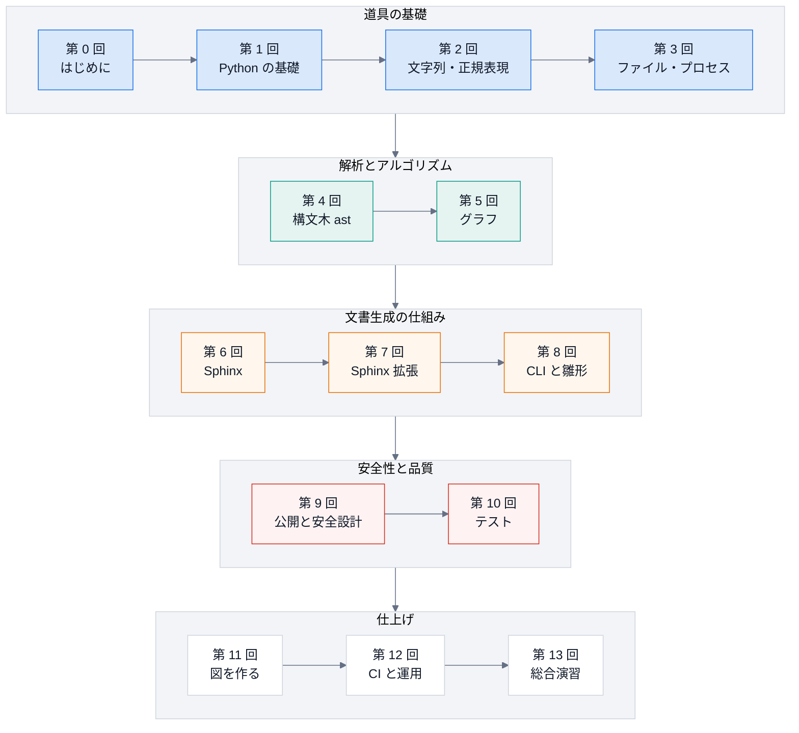

# 講義資料: 文書を「コード」として作り、安全に公開する

DocsPipeline を題材に、**基礎から、保守・拡張できるところまで** を、講義の形で学ぶ資料です。
Python の基礎・文字列処理・プロセス・構文木・グラフのアルゴリズム・Sphinx・テスト・図・CI を、
「実際に動いているコード」を読みながら順に積み上げます。

## この講義の特徴

- **実際のコードを読む**。講義の引用は、リポジトリのソースから自動で作っています。
  コードが変わって説明が古くなると、テストが失敗します (`tests/test_lectures.py`)。
- **実行できる例には、実行結果が付く**。`# 実行できる` のコードは、テストが本当に実行し、
  `# 出力` の内容と一致することを確かめています。手で写した「それらしい出力」はありません。
- **各回に演習と解答**。読むだけで終わらず、自分で書いて確かめます。
- **図で説明する**。流れ・順序・状態・依存を、Mermaid の図 (GitHub でもそのまま描かれる) で示します。

## 学習の地図



青 = 道具の基礎、緑 = 解析とアルゴリズム、オレンジ = 文書生成の仕組み、赤 = 安全性と品質、白 = 仕上げ。

| 回 | テーマ | 学ぶこと | 題材 (このリポジトリ) |
|---|---|---|---|
| [0](00-introduction.md) | はじめに | 解く問題、docs as code、全体像、環境構築 | `docspipeline doctor`・サンプルのビルド |
| [1](01-python-basics.md) | Python の基礎 | 型ヒント・関数・ジェネレータ・例外・dataclass・pathlib・パッケージ | `files.py`・`docstring_coverage.Item` |
| [2](02-text-processing.md) | 文字列・正規表現・ハッシュ | Unicode・文字の幅・正規表現・置換の落とし穴・ハッシュ・JSON・伏せ字 | `scaffold`・`mmdc`・`confluence.mask_secrets` |
| [3](03-files-and-processes.md) | ファイルとプロセス | 一時ファイルと原子的な置き換え・環境変数・subprocess・終了コード | `mmdc.render`・`cli._run` |
| [4](04-ast.md) | 構文木 (ast) | 木構造・走査・静的解析・相対 import の解決 | `docstring_coverage`・`structure_map._analyze` |
| [5](05-graph-algorithms.md) | グラフとアルゴリズム | グラフ・DFS・強連結成分 (Tarjan)・計算量・再帰の限界 | `Graph.cycles` |
| [6](06-sphinx-basics.md) | Sphinx の考え方 | reST と Markdown・doctree・ビルダー・autodoc・環境キャッシュ | `config.build_config` |
| [7](07-sphinx-extensions.md) | Sphinx 拡張 | イベント・ディレクティブ・外部コマンド・並列安全・フロントエンド | `guard`・`prompt`・`mermaid`・`doxygen` |
| [8](08-cli-and-scaffold.md) | CLI と雛形 | argparse・終了コード・薄い CLI・テンプレート・純粋関数 | `cli`・`scaffold`・`doctor` |
| [9](09-publishing-safety.md) | 公開と安全設計 | 脅威の整理・安全側の既定・最小権限・未検証の書き方 | `confluence`・`ci.yml` |
| [10](10-testing.md) | テスト | pytest・偽物・変異テスト・構造テスト・回帰テスト | `tests/` 全体 |
| [11](11-diagrams.md) | 図を作る | SVG・座標・折れ線・drawio・Mermaid・読みやすさの原則 | `tools/diagrams`・`check-mermaid` |
| [12](12-ci-and-operations.md) | CI と運用 | GitHub Actions・YAML をデータとして検査・生成物のずれの検出・運用手順・保守の周期 | `ci.yml`・`tools/build_site.py` |
| [13](13-capstone.md) | 総合演習 | 要件 → 設計 → 実装 → テスト → 変異 → 取り込み → 自己点検 | 依存の中心 (ハブ) を探す機能・拡張の課題 6 題 |

## 進め方

1. **読む**: 各回の「この回のゴール」を先に読む。
2. **動かす**: 「ハンズオン」のコマンドを、実際に実行して、結果を見る。
3. **解く**: 「確認問題」を、解答を見ずに解く。
4. **照らす**: 「解答」と比べる。違ったら、本文に戻る。

所要時間の目安は、1 回あたり 1.5〜5 時間です (全 14 回で約 50 時間)。第 4・5・7・10・13 回は、手を動かす量が多めです。平日に 1 回ずつ進めるなら、3 週間ほどです。

## 前提と準備

- プログラミングの経験 (変数・条件分岐・繰り返し・関数) があること。Python は **初めてでもよい** (第 1 回で、必要な範囲を扱う)。
- Git とコマンドラインの基本操作。
- Python 3.11 以上、Node.js (Mermaid の変換に使う)、Doxygen (C++ の回だけ)。準備は [第 0 回](00-introduction.md) にある。

## 補助資料

- [保守ガイド](../learn/index.md): 保守・拡張の手順書 (レシピ・トラブルシュート)。この講義の「実務編」
- [用語集](../learn/glossary.md)
- [設計](../design.md): なぜこの形にしたか

```{toctree}
:hidden:
:maxdepth: 1
:caption: 講義

00-introduction
01-python-basics
02-text-processing
03-files-and-processes
04-ast
05-graph-algorithms
06-sphinx-basics
07-sphinx-extensions
08-cli-and-scaffold
09-publishing-safety
10-testing
11-diagrams
12-ci-and-operations
13-capstone
```
