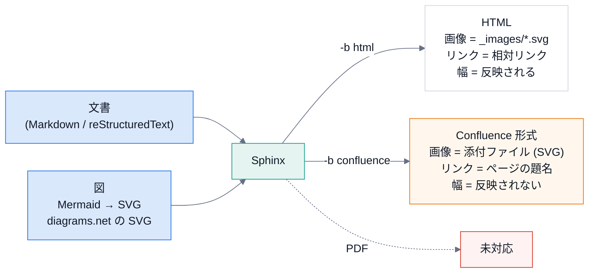

# 出力形式ごとの取り決め

## 目的

同じ文書を HTML と Confluence に出すときの違いを、先に決めておく。
下の表は、この文書自身を両方の形式でビルドして確かめた内容だけを書いている。

## 全体

## 取り決め

| 項目 | HTML (`-b html`) | Confluence (`-b confluence`) |
|---|---|---|
| Mermaid の図 | SVG に変換して `_images/` に置き、画像として表示する | 同じ SVG を、ページの添付ファイルとして取り込む |
| diagrams.net の図 | 書き出した `.drawio.svg` を画像として表示する | 同じく添付ファイルとして取り込む。`.drawio` の元ファイルは出力に入らない |
| 画像の幅 (`:width:`) | 反映される | 反映されない。幅に頼らない図にする |
| 文書どうしのリンク | 相対リンク | ページの題名で解決するリンクになる。題名はスペース内で一意なので、同じ題名の文書を作らない |
| コードブロックの言語 | Pygments の言語名 | Confluence のコードマクロが知らない言語 (`console`、`rst` など) は警告になる。`bash`・`text` などを使う |
| プロンプトのブロック | 題名・本文・コピーボタン | 題名と、普通のコードブロック (ボタンは出ない) |
| 出典・ライセンスの注記 | フッターの著作権表示に入る (`license_note`) | 各ページの末尾に、区切り線つきで付く |
| PDF | 未対応 (LaTeX のビルダーを設定していない) | 未対応 |

## 見るポイント

- `docspipeline build docs -b confluence` は、ネットワークにつながずに Confluence 形式の警告を確かめられる。CI でも実行する。
- 図は、幅の指定が無くても読める大きさで描く。
- Mermaid の図は、背景を白で描く (ダークモードの HTML でも、文字が読める)。

## 使うときの注意

- この表は、Confluence の **画面での見え方** を確かめたものではない。出力ファイルの内容を確認しただけで、
  実際の Confluence 環境は未検証 ([Confluence への公開](confluence.md))。

## 関連

- [設計](design.md)
- [Confluence への公開](confluence.md)
