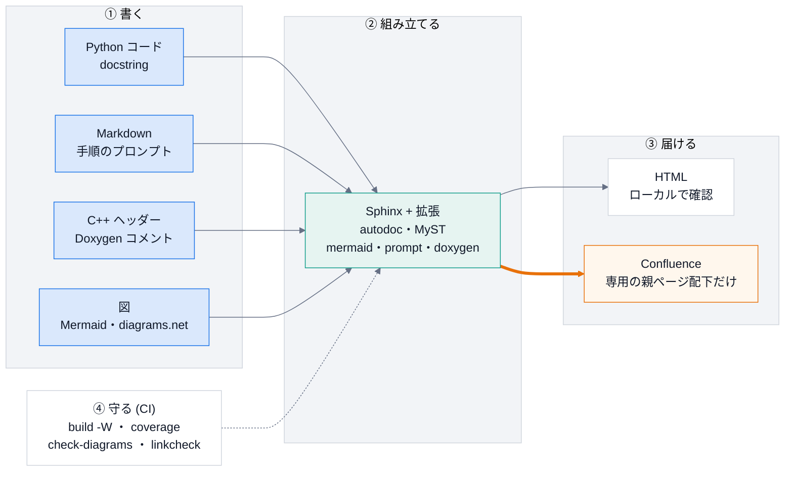

# 概要

## 目的

コードの docstring から API 文書を作り、構成図を加えて、Confluence に公開できるようにする。
各リポジトリは `docs/conf.py` に名前と対象のパスを書くだけで、拡張・autodoc・Markdown の取り込み・
Confluence の安全設定を DocsPipeline から受け取る。

## 全体像

「書く」ものを、Sphinx と拡張が「組み立て」、HTML と Confluence に「届ける」。「守る」は、CI が毎回確かめる項目。
オレンジの太い矢印が、公開の経路。



手で描いた詳しい構成図 (diagrams.net):


## 扱うもの

| 部品 | 役割 | このリポジトリでの場所 |
|---|---|---|
| Sphinx + autodoc / napoleon | Python の docstring (Google 形式) から API 文書を生成する | {py:mod}`docspipeline.config` |
| MyST | 既存の Markdown 文書をそのまま取り込む | {py:mod}`docspipeline.config` |
| Doxygen + Breathe | C++ のコメントから API 文書を生成する | {py:mod}`docspipeline.doxygen` |
| Mermaid → SVG | Mermaid の図をビルド時に画像へ変換する | {py:mod}`docspipeline.mermaid`、{py:mod}`docspipeline.mmdc` |
| プロンプトのブロック | 手順に、Claude Code へそのまま渡せるプロンプトを載せ、コピーボタンを付ける | {py:mod}`docspipeline.prompt` |
| Confluence ビルダー | 専用の親ページ配下へ公開する | {py:mod}`docspipeline.confluence` |
| `hou` スタブ | Houdini の外で `hou` を使うコードを文書化する | {py:mod}`docspipeline.stubs.hou` |
| 依存の地図 | ソースの依存を読み取り、構成の文書の下書きと、依存の向きの点検に使う | {py:mod}`docspipeline.structure_map` |

## 最短の手順

```bash
$ pip install "docspipeline[docs,cpp,confluence] @ git+https://github.com/manato1201/DocsPipeline"
$ docspipeline doctor                                               # 使える機能の確認
$ docspipeline init . --project "My Tool" --author "me" --package ../src
$ docspipeline build docs                                           # 警告をエラー扱いにしてビルド
```

`build` は警告をエラー扱いにする。リンク切れ・未解決の参照があれば失敗する。

## 見るポイント

- 公開は最後の工程。まずローカルの HTML で品質を確保する。公開先の設定が無くても、HTML までで完了できる。
- 既定のモードでは Confluence に一切つながらない ([Confluence への公開](confluence.md))。
- 保守・拡張する人は [保守ガイド](learn/index.md) から、基礎から学ぶ人は [講義資料](lecture/index.md) から読む。

## 使うときの注意

- 企業のコードや、企業の Confluence 連携の実装は、このリポジトリに持ち込まない。
- Mermaid の変換には `mmdc` (mermaid-cli) が要る。無い環境では、図はコードのまま表示される ([設計](design.md))。
- 文書の形式: 読み物は **Markdown (MyST)**、API リファレンス (`api.rst`) は reStructuredText。
  どの Markdown も、GitHub でそのまま読める (Mermaid の図も描かれる)。HTML 版は `site/` にある ([運用手順](runbook.md))。
