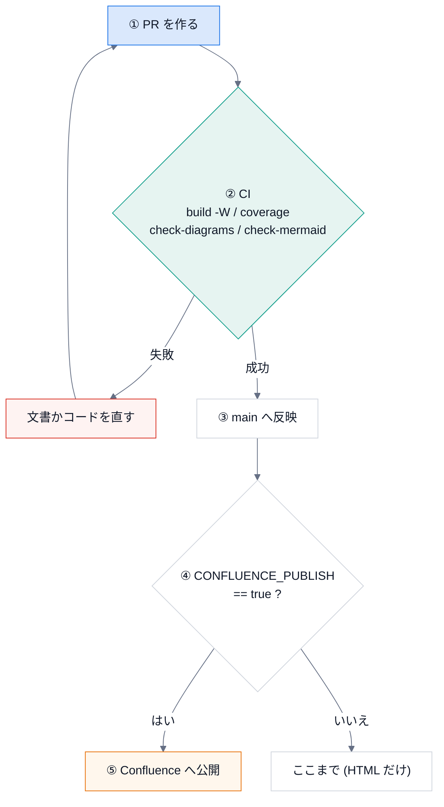

# 運用手順

文書を古くしないための手順と、更新のルール。

## 更新のルール

1. コードの公開 API を変えたら、**同じ PR** で docstring と文書を更新する。
2. docstring は Google 形式で、日本語で書く。公開 API (`_` で始まらない名前) には必ず書く。
3. 図は diagrams.net (`.drawio` と、書き出した `.drawio.svg`) か Mermaid で描く。`.drawio` だけをコミットしない。
   このリポジトリの構成図は `tools/diagrams/build_diagrams.py` から生成する ([拡張のしかた](learn/04-extend.md))。
4. **Mermaid のブロックは、1 行目に標準の `%%{init}%%` の行を置く** (GitHub と HTML で、色とフォントが揃う)。
   手で書かずに `docspipeline check-mermaid --fix` で入れる。色の約束は [使い方](usage.md)。
5. 人が手で行う手順の説明には、Claude Code にそのまま渡せる **プロンプト** (`{prompt}`) を添えてよい。
   プロンプトには、秘密情報を書かない。「してはいけないこと」(コミットしない、値を書き写さない) を、最後に書く。
6. 新しいページは `docs/page-template.rst.tmpl` を元にして、目的 / 見るポイント / 使うときの注意 / よくある誤り / 関連、の順に書く。
7. 文書を変えたら、**HTML 版 (`site/`) を作り直す**: `python tools/build_site.py`。作り直し忘れは、テストが検出する。



## 新しいリポジトリを加える

```bash
$ pip install "docspipeline[docs]"
$ docspipeline init <リポジトリ> --project "<題名>" --author "<名前>" --package ../src
$ docspipeline build <リポジトリ>/docs
```

`--package` は、`docs/` から見た Python のソースの場所。**実在しない場所を指定すると、何も書かずに止まる**
(打ち間違いのまま、API ページが空の文書を作らないため)。

Claude Code に任せるなら、次をそのまま渡す。

```{prompt} 新しいリポジトリに DocsPipeline で docs/ を作る
このリポジトリに、DocsPipeline で docs/ を作ってください。

1. pip install "docspipeline[docs]" を実行し、docspipeline doctor で環境を確認する。
2. Python のソースの場所を確かめてから、docspipeline init . --project "<題名>" --author "<名前>" --package <docs/ から見たソースの場所> を実行する。
   (C++ があれば --cpp、Houdini の hou を使うコードがあれば --hou も付ける)
3. docspipeline build docs を実行し、警告が出たら原因を直す。警告を消すために nitpick_ignore_regex を足すのは、最後の手段にする。
4. 変更したファイルの一覧を私に見せ、コミットはしない。

API トークンなどの秘密情報は、ファイルにも出力にも書かない。環境変数の名前だけを使う。
```

C++ を含むなら `--cpp ../include`、Houdini の `hou` を使うなら `--hou` を付ける。
`init` は `docs/` の雛形と `.github/workflows/docs.yml` を作る。既存のファイルは上書きしない。

## CI

| 条件 | 内容 |
|---|---|
| PR ごと | `docspipeline build --require-mermaid` (警告をエラー扱い)、Confluence 形式のビルド、`check-diagrams`、`check-mermaid`、`coverage`、HTML 版 (`site/`) が最新か |
| 週 1 回・手動 | `docspipeline linkcheck` (外部リンクの切れ) |
| main への反映 | リポジトリ変数 `CONFLUENCE_PUBLISH` が `true` のときだけ、Confluence へ公開 |

## Confluence への公開を始める

1. 専用のスペースと、専用の親ページを用意する。**手で書くページと同じ親にしない。**
2. ローカルで `confluence-check` と `publish --mode dryrun` を試す (環境変数は [Confluence への公開](confluence.md) を参照)。
3. GitHub のリポジトリに、変数 (`CONFLUENCE_SERVER_URL` ・ `CONFLUENCE_SPACE_KEY` ・ `CONFLUENCE_PARENT_PAGE` ・ `CONFLUENCE_SERVER_USER`)
   と、シークレット (`CONFLUENCE_API_TOKEN`) を登録する。
4. 変数 `CONFLUENCE_PUBLISH` を `true` にする。止めたいときは、これを外す。

## 公開前の確認 (目視 + 検索)

公開する文書に、秘密情報・個人情報が含まれていないことを確認する。

```bash
$ grep -rniE "token|secret|password|api[_-]?key|@[a-z0-9.-]+\.[a-z]{2,}" docs --include="*.rst" --include="*.md" --include="*.py"
```

ヒットしたものを目で見て、実際の値でないこと (環境変数の名前や、例のアドレス) を確認する。

```{prompt} 公開前に、秘密情報・個人情報が無いか点検する
docs/ の文書に、秘密情報・個人情報が含まれていないか点検してください。

1. grep で token / secret / password / api key / メールアドレスらしき文字列を探す。
2. ヒットした箇所を一つずつ読み、実際の値か、環境変数の名前・例の値かを判定して、表にまとめる。
3. 実際の値らしきものがあれば、その場所だけを私に報告する。値そのものは、出力に書き写さない。
4. 何も書き換えない。
```

## HTML 版 (`site/`)

Sphinx が作った HTML を、`site/` にコミットしている (ブラウザで `site/index.html` を開けば、サーバーなしで読める)。
**生成物** なので、手で直さない。文書・docstring・図を変えたら、次で作り直す。

```bash
$ python tools/build_site.py           # docs/ をビルドして site/ に置く (mmdc が要る)
$ python tools/build_site.py --check   # 元の文書と、site/ がずれていないか確かめる
```

`site/.source-hash` に、元になった文書・ソース・図の内容のハッシュを記録する。元が変わると、`--check` (と `pytest`) が失敗する。

## 困ったとき

| 症状 | 原因と対処 |
|---|---|
| `doxygen が見つかりません` | `doxygen` をインストールする。手元で飛ばすなら `DOCSPIPELINE_SKIP_DOXYGEN=1` と `build --no-strict` (C++ の指示子は警告になる) |
| Mermaid の図がコードのまま出る | `mmdc` が見つからない。`npm install @mermaid-js/mermaid-cli` するか、`DOCSPIPELINE_MMDC` で指定する |
| CI で `mmdc` が起動しない | Chromium のサンドボックスが原因のことが多い。`DOCSPIPELINE_PUPPETEER_CONFIG` に `{"args":["--no-sandbox"]}` の設定ファイルを渡す |
| Mermaid の図の色が、GitHub と HTML で違う | `docspipeline check-mermaid --fix` で、標準の `%%{init}%%` の行を入れる |
| どこから直せばよいか分からない | まず `docspipeline doctor`。そのあと [トラブルシュート](learn/07-troubleshooting.md) |
| `py:class reference target not found` | 参照先が文書に無い。型変数などは `nitpick_ignore_regex` に足す ([使い方](usage.md)) |
| ビルドが外部サイトで失敗する | 外部につなげない環境では `DOCSPIPELINE_OFFLINE=1` |
