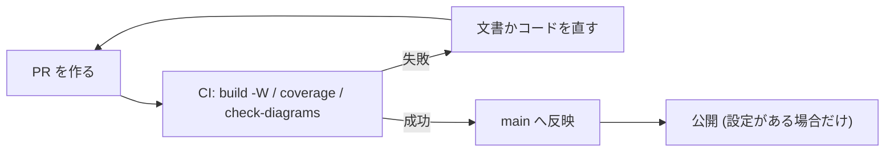

# 運用手順

文書を古くしないための手順と、更新のルール。この文書は Markdown で書き、MyST 経由で Sphinx に取り込んでいる
(既存の Markdown 文書を捨てない、という方針の実例)。

## 更新のルール

1. コードの公開 API を変えたら、**同じ PR** で docstring と文書を更新する。
2. docstring は Google 形式で、日本語で書く。公開 API (`_` で始まらない名前) には必ず書く。
3. 図は diagrams.net (`.drawio` と、書き出した `.drawio.svg`) か Mermaid で描く。`.drawio` だけをコミットしない。
   このリポジトリの構成図は `tools/diagrams/build_diagrams.py` から生成する ([拡張のしかた](learn/04-extend.md))。
4. 新しいページは `docs/page-template.rst.tmpl` を元にして、目的 / 見るポイント / 使うときの注意 / よくある誤り / 関連、の順に書く。



## 新しいリポジトリを加える

```bash
$ docspipeline init <リポジトリ> --project "<題名>" --author "<名前>" --package ../src
$ pip install "docspipeline[docs]" && docspipeline build <リポジトリ>/docs
```

C++ を含むなら `--cpp ../include`、Houdini の `hou` を使うなら `--hou` を付ける。
`init` は `docs/` の雛形と `.github/workflows/docs.yml` を作る。既存のファイルは上書きしない。

## CI

| 条件 | 内容 |
|---|---|
| PR ごと | `docspipeline build --require-mermaid` (警告をエラー扱い)、`check-diagrams`、`coverage` |
| 週 1 回・手動 | `docspipeline linkcheck` (外部リンクの切れ) |
| main への反映 | リポジトリ変数 `CONFLUENCE_PUBLISH` が `true` のときだけ、Confluence へ公開 |

## Confluence への公開を始める

1. 専用のスペースと、専用の親ページを用意する。**手で書くページと同じ親にしない。**
2. ローカルで `confluence-check` と `publish --mode dryrun` を試す (環境変数は [Confluence への公開](confluence.rst) を参照)。
3. GitHub のリポジトリに、変数 (`CONFLUENCE_SERVER_URL` ・ `CONFLUENCE_SPACE_KEY` ・ `CONFLUENCE_PARENT_PAGE` ・ `CONFLUENCE_SERVER_USER`)
   と、シークレット (`CONFLUENCE_API_TOKEN`) を登録する。
4. 変数 `CONFLUENCE_PUBLISH` を `true` にする。止めたいときは、これを外す。

## 公開前の確認 (目視 + 検索)

公開する文書に、秘密情報・個人情報が含まれていないことを確認する。

```bash
$ grep -rniE "token|secret|password|api[_-]?key|@[a-z0-9.-]+\.[a-z]{2,}" docs --include="*.rst" --include="*.md" --include="*.py"
```

ヒットしたものを目で見て、実際の値でないこと (環境変数の名前や、例のアドレス) を確認する。

## 困ったとき

| 症状 | 原因と対処 |
|---|---|
| `doxygen が見つかりません` | `doxygen` をインストールする。手元で飛ばすなら `DOCSPIPELINE_SKIP_DOXYGEN=1` と `build --no-strict` (C++ の指示子は警告になる) |
| Mermaid の図がコードのまま出る | `mmdc` が見つからない。`npm install @mermaid-js/mermaid-cli` するか、`DOCSPIPELINE_MMDC` で指定する |
| CI で `mmdc` が起動しない | Chromium のサンドボックスが原因のことが多い。`DOCSPIPELINE_PUPPETEER_CONFIG` に `{"args":["--no-sandbox"]}` の設定ファイルを渡す |
| どこから直せばよいか分からない | まず `docspipeline doctor`。そのあと [トラブルシュート](learn/07-troubleshooting.md) |
| `py:class reference target not found` | 参照先が文書に無い。型変数などは `nitpick_ignore_regex` に足す ([使い方](usage.rst)) |
| ビルドが外部サイトで失敗する | 外部につなげない環境では `DOCSPIPELINE_OFFLINE=1` |
