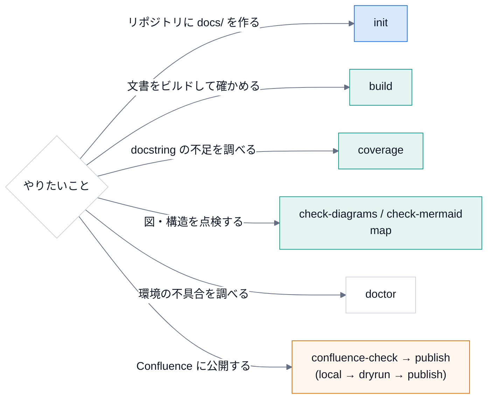

# 使い方

## どのコマンドを使うか



## コマンド一覧

| コマンド | 内容 |
|---|---|
| `docspipeline init TARGET --project NAME --author A` | `docs/` の雛形と CI の設定を作る |
| `docspipeline build [DOCS]` | Sphinx でビルドする。既定は警告をエラー扱い。公開はしない |
| `docspipeline linkcheck [DOCS]` | 外部リンクの切れを確認する |
| `docspipeline coverage PATH...` | docstring が無い公開 API を一覧する |
| `docspipeline check-diagrams [DOCS]` | `.drawio` に、書き出した SVG があるか確認する |
| `docspipeline check-mermaid [PATH...]` | Mermaid ブロックが、標準の `%%{init}%%` の行で始まるか確認する (`--fix` で入れる) |
| `docspipeline mermaid-style` | 標準の `%%{init}%%` の行と、`classDef` の組を表示する (貼り付け用) |
| `docspipeline map PACKAGE` | ソースを構文解析して、モジュールの依存の地図を作る |
| `docspipeline doctor` | 手元で使える機能を確認する。トークンの値は出さない |
| `docspipeline confluence-check [DOCS]` | Confluence への接続・認証・権限を確認する。ページは変更しない |
| `docspipeline publish [DOCS] --mode MODE` | Confluence 形式でビルドする。公開は `--mode publish` のときだけ |

### 各コマンドの詳細

**`init`**

- `TARGET/docs` に `conf.py` と雛形、`.github/workflows/docs.yml` を作る。
- `--package` (Python のソース)・`--cpp` (C++ のソース)・`--hou` で構成を選ぶ。
- 既存のファイルは `--force` を付けない限り上書きしない。
- CI の docstring の関門は、`--min-coverage` (既定 80) 未満で **失敗する**。
- `--package` / `--cpp` に **実在しない場所** を指定すると、何も書かずに終了コード 2 で止まる (`docs/` からの相対パス)。

**`build`**

- 既定は警告をエラー扱い (`-W --keep-going`)。`--no-strict` で外せる。
- `-b confluence` でも **公開はしない** (常に `local`)。公開できるのは `publish` だけ。
- `--require-mermaid` では、保存済みの環境 (増分ビルドのキャッシュ) を使わず、全部を読み直す (`-E`)。
  前のビルドが「コードのまま」で済ませたページを、変更なしとして飛ばされると、方針が素通りするため。

**`coverage`**

- `--fail-under` で基準を決められる。
- 存在しないパス・構文エラーのファイルは、終了コード 2 のエラーにする (「100%」と黙って報告しない)。
- `__all__` は `= [...]`・`: list[str] = [...]`・`+= [...]` を読む。
- `_` で始まる名前のモジュール (`_compat.py`・`_impl/`) は、公開 API ではないので数えない。

**`check-diagrams`**

- `DOCS` が無ければ終了コード 2。`_build`・`_generated`・`_doxygen`・`node_modules`・隠しディレクトリは探さない。

**`check-mermaid`**

- 既定の検査対象は `docs` と `README.md`。全ての Mermaid ブロックの 1 行目が、標準の `%%{init}%%` の行かを確かめる。
- GitHub (Markdown のまま) と、Sphinx (`mmdc` で SVG にした HTML) で、図の色とフォントを揃えるため。

**`map`**

- ローカルで読むだけで、外部へは送信しない。`--fail-on-cycle` で、循環があれば失敗させる。
  使い方は [機械の地図](learn/09-structure-map.md)。

**`publish`**

- [Confluence への公開](confluence.md) を参照。`dryrun` / `publish` では、Mermaid が画像にならなければ **失敗させる**
  (`DOCSPIPELINE_MERMAID_MISSING=error` を自動で付け、全部を読み直す)。黙ってコードのままにすると、
  Confluence のページが、図の無いページに置き換わるため。

## 環境変数

| 名前 | 内容 |
|---|---|
| `DOCSPIPELINE_OFFLINE` | `1` で intersphinx と nitpicky を無効にする (外部サイトにつなげない環境用) |
| `DOCSPIPELINE_MERMAID_MISSING` | `literal` / `warn` / `error` ([設計](design.md) を参照) |
| `DOCSPIPELINE_MMDC` | `mmdc` のパス。省略すると `PATH` と `node_modules/.bin` から探す |
| `DOCSPIPELINE_PUPPETEER_CONFIG` | `mmdc` に渡す Puppeteer の設定ファイル。CI などでサンドボックスを切るときに使う |
| `DOCSPIPELINE_SKIP_DOXYGEN` | `1` で Doxygen の実行を飛ばす (C++ の指示子は警告になるので、`--no-strict` と併用する) |

Confluence の環境変数は、[Confluence への公開](confluence.md) にある。

## Mermaid の図を書く

Markdown のコードフェンスに `mermaid` と書く。**各ブロックの 1 行目に、標準の `%%{init}%%` の行を置く**
(GitHub がこの行から色とフォントを読む)。手で書かずに、`docspipeline check-mermaid --fix` で入れられる。

```text
flowchart LR
    A["入力"]:::input --> B["処理"]:::proc ==> C["出力"]:::out
    classDef input fill:#dae8fc,stroke:#1a73e8,color:#101828
```

- 色の約束: **青 = 入力、緑 = 処理、オレンジ = 出力・公開、赤 = 止まる・失敗、白 = 補助**。`docspipeline mermaid-style` が `classDef` の組を表示する。
- 強調する経路は `==>` (太い矢印) と `linkStyle <番号> stroke:#e8710a,stroke-width:4px`。番号は、矢印を書いた順 (0 から)。
- 順序のある流れは `sequenceDiagram` に `autonumber` を付けると、番号つきの丸になる。

## プロンプトのコピー

手順の説明に、そのまま Claude Code に渡せるプロンプトを載せられる。HTML では「プロンプトをコピー」ボタンが付く。

```text
.. prompt:: 新しいリポジトリに docs/ を作る

   このリポジトリに DocsPipeline で docs/ を作ってください。
   docspipeline init と docspipeline build を実行し、警告が出たら原因を直してください。
```

Markdown (MyST) では、コードフェンスの言語名の代わりに `{prompt}` と題名を書く。

````text
```{prompt} 新しいリポジトリに docs/ を作る
このリポジトリに ...
```
````

- 題名は省略できる (既定: 「Claude Code に渡すプロンプト」)。
- Confluence など HTML 以外では、題名と普通のコードブロックになる。
- **秘密情報を書かない**。`TOKEN=値` のような形があれば、値を伏せた警告を出す。環境変数は、名前だけを書く。
- 書き方の指針: 何をしてほしいか → 手順 → **してはいけないこと** (コミットしない、値を書き写さない、など) の順に書く。

## 設定の追加

{py:func}`docspipeline.config.build_config` が返した値は、`conf.py` の中で上書き・追記できる。

```python
config = build_config(confdir=__file__, project="X", author="me")

# 型変数など、解決できない参照を警告から外す
config["nitpick_ignore_regex"] += [(r"py:class", r"mypkg\.T")]
globals().update(config)
```

## 使うときの注意

- `TypeVar` を使った型注釈は、nitpicky で未解決の参照になる。上のように外すか、型注釈を単純にする。
- autodoc はコードを `import` する。副作用のある `import` は、文書のビルドでも実行される。
  `docspipeline coverage` は `import` せずに構文だけを読む。
